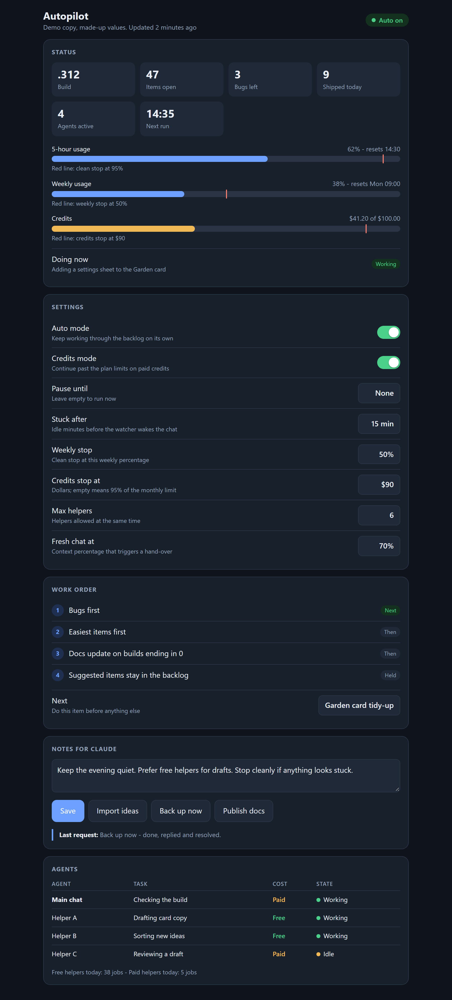
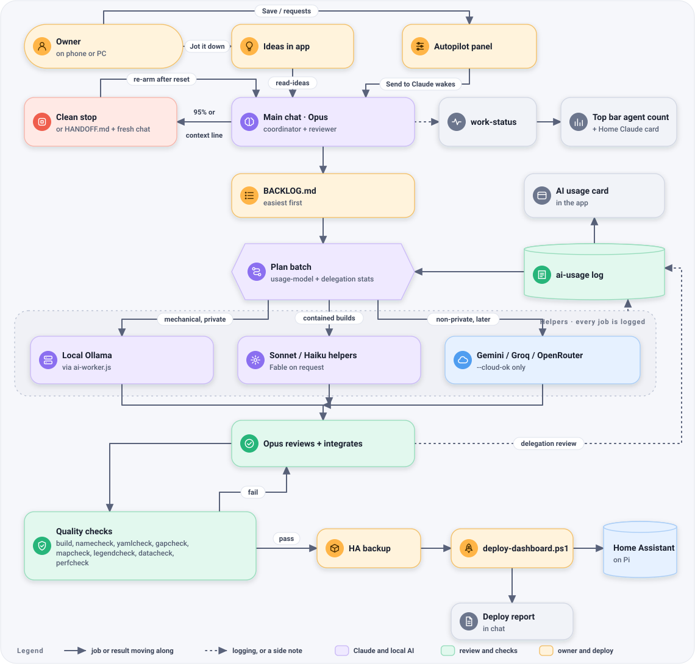

# How the AI builds it


Describes how the AI side of the project builds and maintains the dashboard.

## 1. The idea in one paragraph

One expensive, careful model (the **main chat**, Opus) plans, integrates and checks. Cheaper or free helpers do the well-defined work. Every job is logged, every batch is checked by automated quality tools, and a control panel lets the owner steer from a phone. The goal is the most finished work per unit of usage or credit, without ever risking the family's data.

## 2. The cast

### Main chat (Opus): coordinator and reviewer
- Owns the backlog, the build, the deploy and all commits.
- Hands out work, **reviews helper output rather than writing it**, integrates, runs checks, deploys and posts the deploy report.
- Runs auto mode (sections 7 and 8). Remote Control is always on so the owner can follow from a phone.

### Helper agents (subagents)
- **Sonnet / Haiku at low effort** for contained builds, lookups, filing and mechanical edits; effort goes up only after a low attempt fails.
- **Fable** gets one short helper per build for the highest-judgement task (standing approval), until any usage meter reaches 50%; more than that only after asking the owner.
- **Opus** is used for reviews, audits and docs writing.
- Many agents at once (see "How models, helper counts and effort are chosen" below for the numbers), as long as they are coordinated. Each owns its own files (its own new `src/dashboard/47x-*.js` piece plus named pieces it may edit). Helpers never commit, deploy, edit `BACKLOG.md` or bump the build number; the main chat does.
- Any helper idle more than 5 minutes is stopped and restarted (or its work picked up); leftover headless browser processes are cleared.

### Side sessions
Separate Claude Code sessions for tasks of their own (documents, research, an app path, a profile). They share the folder, so each touches only its own files, commits nothing unless told to, and reports back to the session that started it. Notes too big for a message go in a shared notes folder outside the repo.

### Local Ollama on the PC (free)
A gaming-class PC (RTX 2080, 8 GB VRAM, 32 GB RAM) runs Ollama. Current models:

| Model | Used for |
|---|---|
| qwen3.5:9b | general drafting, filing ideas, summaries |
| qwen3.5:4b | fast, cheap classification and small edits |
| qwen2.5-coder:7b | mechanical code edits, YAML |
| qwen3-vl:8b | images: OCR, reading screenshots and photos |

`tools/ai-worker.js` is the single doorway:
`node tools/ai-worker.js --model qwen3.5:9b --prompt "..." [--image f.jpg] [--json] [--task "label"]`.
It sends one job, prints the answer and logs tokens, time and cost.

### Free cloud helpers
Groq, Gemini and OpenRouter free tiers are providers in the same worker, each used up to 95% of its free allowance. Rules:
- **Personal data goes only to Ollama.** Cloud providers need `--cloud-ok` on every call, so nothing private leaves the PC by accident.
- API keys live in environment variables only, never on a command line or in chat.
- Cloud output is untrusted until Opus checks it.

## 3. Choosing the cheapest helper that works

Order of preference for every job: Ollama (free), then Haiku/Sonnet at low effort, then Sonnet at medium, then Opus. Opus checks and integrates.

This is tuned by data, not guesswork. After checking any helper's work the coordinator logs a **delegation review**:
`node tools/ai-usage.js review --helper <model> --effort <level> --kind filing|code|yaml|docs|research|ocr --verdict ok|fixed|redo`.
Before each batch, `node tools/ai-usage.js delegation` shows the first-time pass rate per kind of job per helper and effort. A kind that keeps needing fixes moves up a level; one that keeps passing gets tried one level lower.

### Throttle the model (the short version)

The app can run many helpers at once, so the model for each job is throttled: the cheapest one that has been doing that kind of work well is used, and the expensive models are kept for judgement.

- **Chosen by usage, complexity and price.** Each kind of job has a place on a ladder from local models to free cloud helpers to Haiku, Sonnet, Opus and Fable, each at low, medium or high effort. Plan usage also lowers the number of helpers as it climbs.
- **A PID controller adjusts it.** After each checked result it steps the kind up or down a rung, aiming for a steady quality, so easy work gets cheaper over time and work that slips gets a stronger model at once.
- **Everything is checked by something stronger.** Workers by their team lead, leads by the check crew, then the main chat.
- **The org chart** is one main chat, team leads, their workers, a check crew and a docs team, shown live on the maintainer pages.
- **A CPU governor** keeps the build PC from being overloaded by pacing parallel checks.

The numbered method below has the details. The same summary is in the app under About, Behind the scenes.

### How models, helper counts and effort are chosen

1. Each build starts with a batch of backlog items (about 30), tagged with the version they are planned for, easiest first, grouped into teams by the files they touch so no two teams edit the same file (claims live in `tools/team-claims.json`).
2. Before a team starts, the controller `node tools/delegate-pid.js pick --kind <kind>` names its model **and** effort for that kind of work (layout, check sweep, YAML, docs, research, code fix, code review, data migration, visual check), from a ladder: local Ollama, free cloud helpers, Haiku, Sonnet, Opus, Fable, each at low, medium or high effort.
3. The controller has hard limits: code never goes to local or free cloud models, personal data never leaves the PC, and data migrations never drop below Sonnet at high effort; new kinds start at Sonnet medium.
4. After every report the coordinator checks the work (diffs, checks, screenshots) and logs the result (`delegate-pid.js log`): ok, fixed with a number of fixes, or redo, plus a 0-1 quality score.
5. The controller works like a PID loop on a target quality of 0.85: the proportional part reacts to the latest results, the integral part to the long-run pass rate (clamped so old history cannot take over), and the derivative part to the trend; a kind that slips moves up one rung at once, and one that keeps passing tries a cheaper rung after three clean passes in a row.
6. Team count: while auto mode is on at least 15 subagents are always running (whatever the usage meters say; the usage governor only trims above that, and models drop to cheaper helpers near the limits). One session tops out at 20 subagents at once, so the target of about 50 comes from parallel build sessions plus the free helpers. A cap that falls as plan usage climbs sets the upper limit, and at 95% of the 5-hour window every team reaches a stopping point so nothing spills into paid usage.
7. A CPU governor keeps the build PC near 75% on a 5-minute average, lowering the number of parallel browser checks, the local-model pool and the suggested agent count above 85% and raising them below 65%, at most one step every two minutes, so short spikes do not matter.
8. Local models run outside that cap in a pool of 5 that grows to 10 while answers stay quick, one model at a time so nothing swaps in the graphics card, and only for yes/no and wording jobs, because local rewrites and code reviews proved unreliable.
9. Free cloud helpers get a batch every build (proofreading, alt text, release-note drafts), kept under 95% of each free allowance, and a stronger model applies only the good results.
10. Builds overlap: while one build's checks run, the next build's teams start; every 5 minutes the coordinator checks for stuck runs (each check stops itself at 5 minutes), CPU, usage and progress, and writes lessons to `tools/team-notes.md` and back into the controller so the next picks start smarter.

## 4. Usage tracking across all agents

`tools/ai-usage.js` keeps one append-only log (`tools/ai-usage-log.jsonl`, committed so it survives) for Claude (main chat and helpers), Ollama and the cloud helpers. Each line records helper, model, tokens in/out, time, cost and a task label.

- Ollama cost is always zero. Cloud cost uses a price table. Claude cost comes from the credit meter (`credits --spent X --left Y` records the meter; cost is the rise since the last reading).
- `summary` gives today / this week / all time per helper and model.
- `publish` writes **totals only** (no prompts, answers or task text) to a small JSON file that the app's **AI usage** card in Design Studio shows.

## 5. The usage model

`tools/usage-model.js` learns what a batch costs in 5-hour window percent: `window % = c + o*(Opus helpers) + s*(Sonnet helpers)`, fitted by least squares, newer batches weighted more.

- Before a batch: `plan --now <5h %> --stop 95` says how many helpers fit.
- After the batch deploys: `record --start % --end % --opus N --sonnet N --items N --note "build .NNN"`.
- Purpose: fill the window up to the stop line instead of stopping early or overshooting.

## 6. The autopilot control panel



A private artifact page, the owner's remote control for auto mode.

- **Settings** (read by Claude at every check-in, before every build and deploy): auto on/off, pause until, weekly stop, credits and the credit stop line, work order, "next", notes.
- **Status** (written by Claude): build, 5-hour and weekly usage, credits spent, open items and bugs, what it is doing, next run, shipped today, and the count of **agents active**. `tools/push-autopilot.ps1` also pushes it to the Home "Claude" card.
- **Requests**: buttons for import ideas, back up now, publish docs; Claude does them and clears them.
- **Send to Claude**: Save and the request buttons post to one ongoing comment thread on the panel. The chat watches that thread, so a Save **wakes the chat**, which re-reads settings, applies them, replies with what changed and resolves the thread.
- Panel settings always win over built-in defaults.

## 7. Limits, credits and handing over

- **Stop lines:** a clean stop at 95% of the 5-hour window or 50% of the weekly limit (always on). A clean stop means everything committed, deployed, pushed, plus a short summary.
- **Credits mode:** when on, work continues past those lines on paid credits, with checkpoints at 50% and 80% and a stop at the panel's credit stop line (or 95% of the monthly limit).
- **Reset-time re-arming:** the 5-hour reset time drifts, so every check-in compares the live reset time with the scheduled wake-up and re-arms it for 5 minutes after the new reset (and after the weekly reset when weekly is the limit). Auto mode runs in the main chat through `/loop` wake-ups so it stays visible on the phone.
- **Fresh chat at the context line:** at a configurable context percentage (default 50), the chat finishes its step cleanly, writes `HANDOFF.md` (live build, in progress, next items, open questions, usage, panel link), starts one fresh session with a brief to read it and continue, tells the owner which chat to follow, and stops. The fresh chat becomes the main chat.

## 8. From idea to deployed build

1. **Jot it down.** The owner types ideas in the app (Design Studio). After every publish, and at session start, `tools/read-ideas.ps1` lists new ones.
2. **Filing.** Every open idea is filed once into the matching topic of `BACKLOG.md`: reworded, expanded into a buildable item, tied to an automatic Home card where sensible, tagged with its idea id. A table summary goes to the owner.
3. **Easiest first.** After every import or finding, the open items are re-sorted by effort.
4. **Batch build.** 5-30 items per build, split among helpers with separate files, integrated by the main chat.
5. **Quality checks** (all must pass before deploy):
   - `build-dashboard.js --check`: the source pieces and the generated page match (and the joined script parses).
   - `overlapcheck`, `rightnowcheck`, `genericcheck`, `jumpcheck`, `housecheck`: no overlapping controls, one Right now area per page, nothing personal hardcoded, no card jumps, holiday effects behind the house.
   - `namecheck`: no duplicate top-level functions, state slots or action keys across pieces.
   - `yamlcheck`: YAML safe before it goes to Home Assistant.
   - `gapcheck`: every card exactly fills its grid columns, with identical gaps, at desktop and phone widths; also checks text contrast in dark and light.
   - `mapcheck`: maps at many zooms (including fractional), tiles and marker drift.
   - `legendcheck`: every colour or line style drawn has a legend entry.
   - `datacheck`: every saved value is in Home Assistant, round-trips a rebuild, and no save shrinks a list unconfirmed.
   - `perfcheck`: every 5th deploy; anything more than 30% worse than baseline blocks.
6. **Deploy.** `tools/deploy-dashboard.ps1` backs up first, builds, refuses if the live file differs from the last commit, copies to Home Assistant and publishes the backlog and wishlist with read-back checks.
7. **Deploy report** posted in the chat after every deploy: total items left (bugs and to-dos counted separately), change log, what is next, lines of code, market value and Claude cost figures.
8. **Suggestions.** Each batch adds one or two "Suggested by Claude" items, which are never built until the owner accepts them.

## 9. Live work status

Every chat and helper posts what it is doing with `tools/work-status.js` (started / checking / waiting / blocked / done), re-posting every few minutes. The app shows an item as idle after 3 minutes without an update. That feeds the **top bar agent count and animation**, the Backlog card's live strip and the Home **"Claude is working"** card. The Ollama worker posts its own jobs.

## 10. Safety nets

- **Backups:** `tools/ha-backup.ps1` before every deploy or edit of the dashboard or configuration, at least hourly during work, and a full set after every 50 shipped items. Retention: the 5 newest plus the newest of each week and month. User data files are backed up on the Pi and never leave it.
- **Docs publishing:** `docs/` is the only public material. It is refreshed on every version that ends in 0 or 5 (1.10, 1.15, 1.20, ...), and otherwise published to the public site only when the owner asks. Never any personal details in it.
- **Rules follow features:** adding a helper, page or integration means updating the usage log, status tracking, deploy report, checks, docs, setup checklist, control panel and `HANDOFF.md` in the same pass.

## 11. Flow diagram



*The build flow from an idea to a deploy.*

<details markdown="1"><summary>Text version</summary>

```text
flowchart TD
  Owner([Owner on phone or PC]) -->|Jot it down| Ideas[Ideas in app]
  Owner -->|Save / requests| Panel[Autopilot panel]
  Panel -->|Send to Claude wakes| Main
  Ideas -->|read-ideas| Main[Main chat - Opus<br/>coordinator + reviewer]
  Main --> Backlog[BACKLOG.md<br/>easiest first]
  Backlog --> Plan{Plan batch<br/>usage-model + delegation stats}
  Plan -->|mechanical, private| Ollama[Local Ollama<br/>via ai-worker.js]
  Plan -->|contained builds| Subs[Sonnet / Haiku helpers<br/>Fable on request]
  Plan -->|non-private, later| Cloud[Gemini / Groq / OpenRouter<br/>--cloud-ok only]
  Ollama --> Review
  Subs --> Review
  Cloud --> Review
  Review[Opus reviews + integrates] --> Checks[Quality checks<br/>build, namecheck, yamlcheck, gapcheck,<br/>mapcheck, legendcheck, datacheck, perfcheck]
  Checks -->|fail| Review
  Checks -->|pass| Backup[HA backup]
  Backup --> Deploy[deploy-dashboard.ps1]
  Deploy --> HA[(Home Assistant on Pi)]
  Deploy --> Report[Deploy report in chat]
  Ollama -.-> Log[(ai-usage log)]
  Subs -.-> Log
  Cloud -.-> Log
  Review -.->|delegation review| Log
  Log --> Plan
  Log --> Card[AI usage card in app]
  Main -.-> Status[work-status] --> Bar[Top bar agent count +<br/>Home Claude is working card]
  Main -->|95% or context line| Stop[Clean stop or HANDOFF.md + fresh chat]
  Stop -->|re-arm after reset| Main
```

</details>

## 12. Batches of helpers (current practice)

- A batch is many Sonnet helpers (the numbers are in section 3), each owning its own files so they never collide; the main chat writes each brief, then checks and integrates.
- The main chat runs gap check, name-clash check, performance check, legend check and jump check on the combined result and fixes failures before deploying.
- **Build progress lines:** short plain lines in chat as each stage finishes.
- **Up-front approvals at hand-over:** when a chat is about to hand over to a fresh one, every approval the next stretch needs is asked for first, so work is not blocked.
- **Context line:** a stop line on how full the chat's context is (85% in a long session), alongside the usage-window stop; reaching it writes the hand-off note and starts a fresh chat.
- **Credits upkeep:** the credits rules in the session notes are re-read and kept current whenever usage or credit settings change.
- **Cross-posting:** helpers and chats post their work to the shared live work status, and a result that matters to another area is posted there too.
- **Live visibility:** the Design Studio shows the Agents tally and Live agents terminals; the docs carry the build-number banner.
