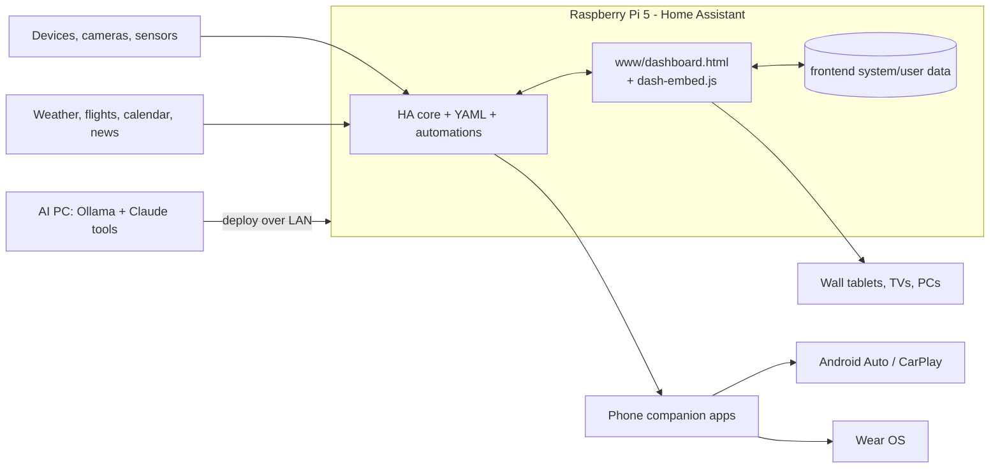

# App architecture

Describes the finished shape of the dashboard and its surroundings.

## 1. Overview

A single-file HTML5 dashboard ("Nashboard") served by Home Assistant (HA) running on a Raspberry Pi 5. Home Assistant talks to devices and services, the dashboard presents everything, phones and cars reach it through the HA companion apps, and an optional AI PC helps build it.

## 2. Source and build

- The source lives in `src/dashboard/` as small pieces joined in file-name order: head, styles (base, layout, cards, per-page), body, then script by feature (`040` start, `060` pages, `080` home, `090` masonry packing, one piece per page such as weather, map, rooms, finance, pets), then feature pieces `471` to `478`, the closing `479-app-end.js`, and the tail.
- `tools/build-dashboard.js` joins them into `ha/www/dashboard.html`. The built file is never edited by hand; `--check` proves pieces and output match.
- Feature pieces register buttons with `Object.assign(ACT, {...})` and keep their own name prefix; `tools/namecheck.js` fails any clash.
- `dash-embed.js` is a Lovelace card that iframes the dashboard and hands it the HA token, so the page is signed in without its own login.
- `ha/` mirrors only the hand-written parts of the Pi's config. Secrets, the database and most of `.storage` are never copied.

## 3. Pages and cards

Pages include Home, Rooms (one page per HA area, generated automatically with per-room settings), Weather, Planes, Space, Map, Packages, Finance, Commute, Sports, Calendar, Pets, Kitchen/Pantry/Recipes, Family Board, Maintenance, Guest, System, Design Studio, Display/TV and About (always last). Each page has a subtitle, a Full window button, and a NEW tag for its first 24 hours.

### Card model
- Everything is a card built with `card({...})` or a width in `CARD_SIZE`: `s` standard (one column), `w` wide (two), `f` full row.
- Card grids use the shared tokens `--col-min` (320px), `--col-wide` (420px for big cards) and `--gap`. Page width is capped near five standard cards and centred (`--page-max`); Full window ignores the cap.
- **Packing grid:** every page's card container is in `MASON_SEL` so cards pack into columns without gaps. All single cards on a page are exactly one column wide, even outside the grid (`--cw`). Container cards (Rooms, Cameras) span the same columns as their neighbours and square up their tiles.
- Card headers collapse on tap; actions live in the menu; collapsed state is remembered per person. Hidden cards are listed on the System page with Show again.
- Text never overruns: `data-fit` and `data-fitbox` shrink text to fit unless the card has Show more.

### Cards live on their page, Home shows copies
Every card has a permanent home on the page it relates to (rain coming on Weather, dog timeout on Pets). **Home owns no cards.** When a card's state matters, Home shows a copy, and the copy goes away again. Rooms get related cards too (a low battery appears in the device's room). A tidbit chip rotates through interesting facts about every feature.

## 4. Data philosophy: data is sacred

- Everything a person enters (lists, places, settings, notes) lives in Home Assistant: frontend system data (shared) or user data (per person), or HA helpers and to-do lists. Never only in the page or `localStorage`.
- All saves go through the central data layer: latest-copy merge, versions, history with undo, nightly export.
- `send()` refuses to save a key that did not load successfully on that screen, so a failed load can never overwrite good data.
- **Versioned migrations:** when saved data changes shape, a migration carries every old field, keeps unknown fields and leaves the old copy under `<key>_v<N>` until the new one has saved.
- **keepData:** a refresh that fails, comes back empty or half written never replaces data already shown.
- Deploys refuse to publish a list that would lose more than 2 items, and read published files back.
- Backups happen before every deploy, hourly during work and by count; retention is the 5 newest plus one per week and month. `datacheck` blocks a build if anything person-entered is not safely stored.
- Per-device only: theme, display size, location pin. Per-person preferences follow the user (`PREF_KEYS`).

## 5. Design rules

- **Light and dark:** colour tokens only; meaningful text uses the darker text tokens; text on accent backgrounds uses dark ink. The check fails contrast below 3:1.
- **Fonts:** one family everywhere (the body font), a rounded logo, monospace only for codes and the flight board; sizes from `--fs1` to `--fs6`.
- **Full window:** every page, multi-view window and card can zoom to fit with no scrolling.
- **Legends:** anything meaning-bearing by colour, line style or icon has a legend.
- **Maps at every zoom,** including fractional zoom; location comes from `myLL()` (device, then commute plan, then saved zip, then home).
- **Phones:** Android and iPhone both. iPhone limits (no speech recognition in the HA app, no Fullscreen API, no vibration) have fallbacks. Overflowing button rows scroll with a fade rather than cutting off. The title bar becomes two lines under 600px.
- **Voice mic** on every quick-add list; **animations** (pets, holiday touches) are seldom outside pet areas and always respect Calm/Off and reduced motion.
- **Car:** follow `CAR-DESIGN.md`. Car screens show only fixed templates from the companion app, so features are HA entities, scripts and notifications; one-glance states, six items or fewer, nothing physical on one tap (confirm with an actionable notification).

## 6. The Home Assistant side

- Hand-written `configuration.yaml`, automations and scripts, validated by `yamlcheck` before copying.
- After copying, a reload trigger (a request sensor plus an automation) makes HA reload all YAML in under a minute with no restart. Only new integrations need a restart.
- Integrations feed the pages: UPnP/SNMP network data, router device tracking, cameras with a self-heal automation, Waze, Music Assistant, Mealie, calendar, news, flights, space, fuel prices, package tracking, sports, finance from a published sheet, pet devices.
- Third-party components come through HACS and are reinstallable.
- Notifications are sent from HA automations to every phone's `notify.mobile_app_*` service, with Android settings (channel, importance, `car_ui`) and iPhone settings (sound, interruption level).
- Published helper files (`www/nashboard_*.json`) carry backlog, usage, work status and the like; they hold no personal data.

## 7. Phones, watch and car

The HA companion apps provide:
- sensors (battery, activity, Wi-Fi), notifications, and device location, which feeds the maps and commute;
- widgets, Quick Settings tiles, NFC tags, and Wear OS tiles and complications;
- Android Auto and CarPlay lists of chosen entities plus driving notifications.

Every feature that can use these adds its setup steps to the device setup checklist (in the app and docs).

## 8. Where things physically go

### The Pi (HA server)
- **Central location,** near the network core (router or switch), on **wired gigabit Ethernet** rather than Wi-Fi. Wi-Fi works but adds latency and drop-outs to everything.
- **UPS:** a small battery backup, so outages do not corrupt storage and the server stays up through short power cuts (put the router and switch on it too).
- **Cooling and heat:** open shelf or ventilated case away from sunlight, vents, appliances and other heat sources. Use the active cooler.
- Reachable for maintenance, not buried behind other gear.

### Requirements
| Level | Spec |
|---|---|
| Minimum | Pi 5 4 GB, quality SD card, wired Ethernet, official power supply |
| **Recommended** | **Pi 5 8 GB with an NVMe SSD** (not an SD card: faster, far more reliable under constant database writes), active cooling, wired gigabit, UPS |
| Move up | Mini PC / NUC (for example a recent Intel N-series or Core i3 with 16 GB RAM and NVMe) |

Move to a mini PC when you see sustained high CPU, slow history or database queries, restarts taking many minutes, heavy camera or video work, local AI, or many more integrations. The dashboard itself is a static file and light; the load comes from HA and its database. Keep the database trimmed (shorter recorder retention) and back up off the device.

### The AI PC
A separate gaming-class PC (RTX 2080, 8 GB VRAM) runs Ollama and the Claude tools. It is **not** part of the always-on home server: it can sleep. It deploys over the LAN, and HA can optionally use its Ollama through HA's Ollama integration for voice or text features. Personal data may go only to this local machine, never to cloud helpers. If it is off, the dashboard keeps working unchanged.
