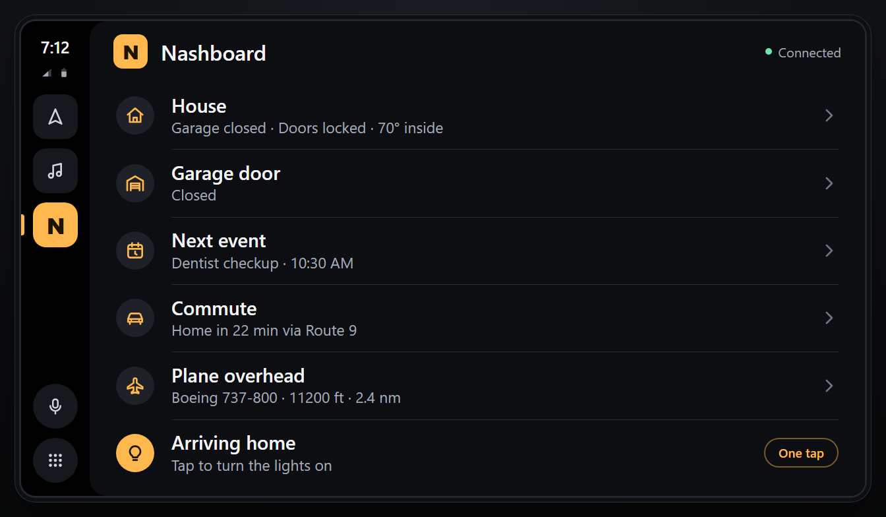
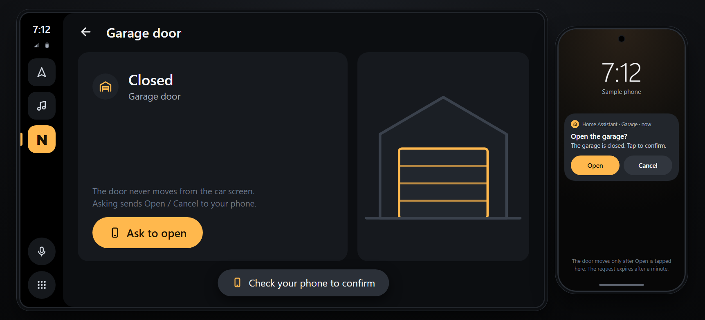
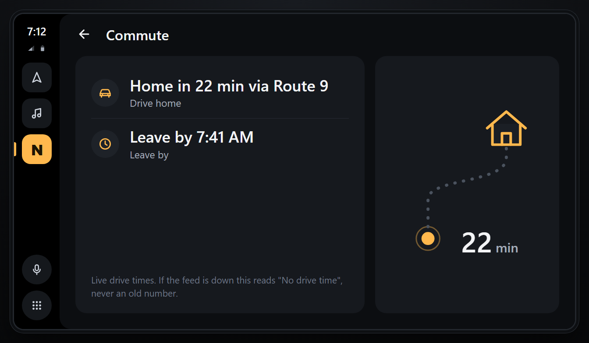
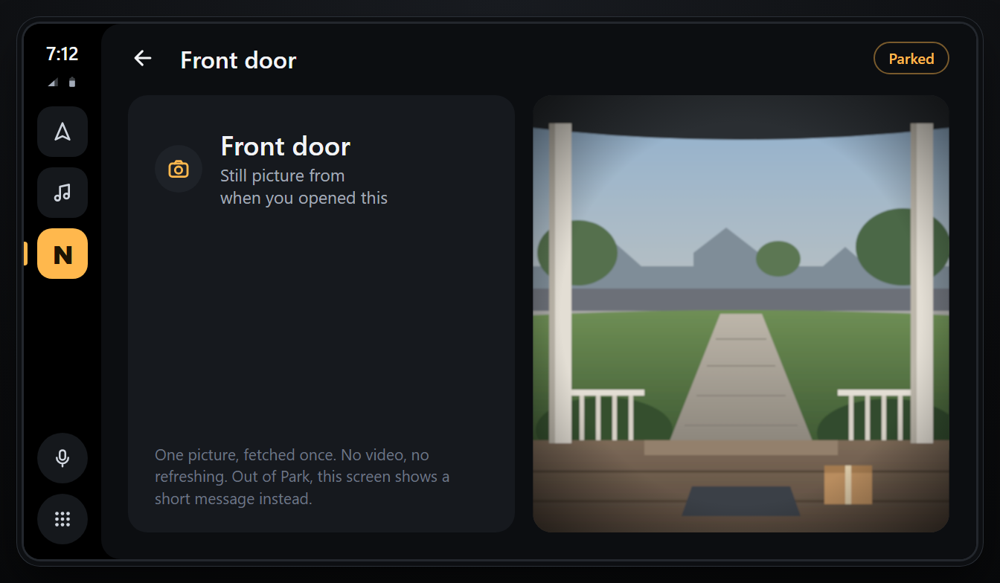
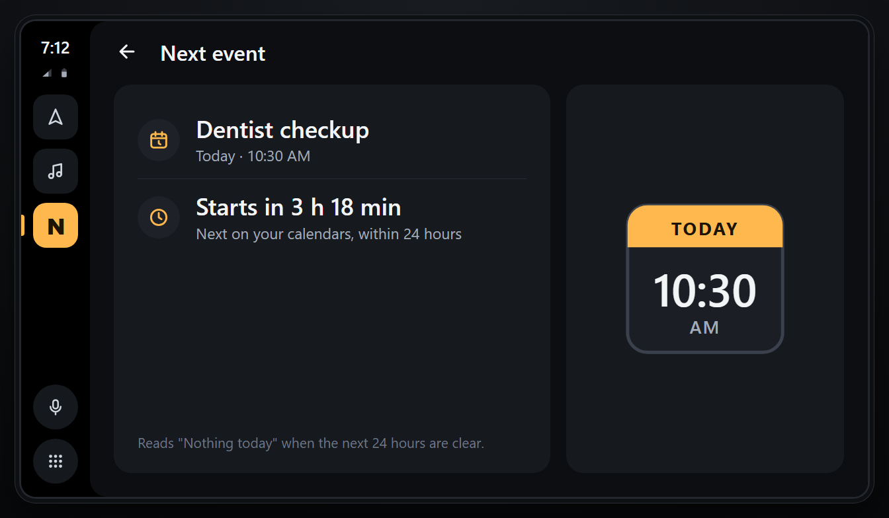

[← Nashboard](index.md)

# Future: car app (Labs prototype)

**This is a prototype. The car app is not built or installed anywhere yet.** The pictures below are design mockups
with made-up sample values. They show what a Nashboard app for Android Auto could look like, drawn inside the limits
Android Auto really sets for apps (fixed lists and panes, big buttons, no maps of our own, no video).

## What works today

Today the car uses the Home Assistant app's own Android Auto screen. You pick favourites in the Home Assistant app and
they show up in the car as a plain list of entities, each with one short line of state. Driving notifications also
reach the car screen. Nashboard already feeds that list with car-ready items: a one-line house status, the drive home,
a leave-by time, the nearest plane overhead, the next calendar event, an "Arriving home" lights button and a garage
request that always asks for confirmation.

## What the car app would add

The same items, but as one purpose-built app instead of a list of favourites:

- **One fixed home list of six rows**, always in the same order (status first, actions last), with its own icon and
  title bar. Favourites are just whatever entities were picked, in a generic list.
- **A detail screen per item.** Commute shows the drive home and the leave-by time together. Next event shows the
  event, its time and how long until it starts.
- **A clear garage flow.** The Garage door screen shows the door state and one button, "Ask to open". The car never
  moves the door. It sends Open / Cancel to the phone, and the door moves only after Open is tapped there.
- **A parked-only front door picture.** While the car reports it is parked, the Plane overhead row is replaced by
  Front door, which shows one still picture taken when the screen opens. No video and no refreshing. Out of Park, the
  screen shows a short message instead.
- **Honest connection state.** If the link to the house drops, the title says so and every row reads "No connection"
  instead of showing old values.
- **Setup on the phone, once.** The server address and the items are picked in the phone app, not in the car.

What it would not do: show the Nashboard dashboard itself, show maps, play video, or unlock or open anything on a
single tap.

## Mockups

| Screen | What it shows |
| --- | --- |
|  | **Main list.** House, Garage door, Next event, Commute, Plane overhead and Arriving home, each with one short line. Arriving home is the only one-tap action (lights only). |
|  | **Garage door.** "Ask to open" sends an Open / Cancel notification to the phone. The car screen only says "Check your phone to confirm". |
|  | **Commute.** Drive home time and route, plus the leave-by time. No map. |
|  | **Front door (parked only).** One still picture from the front door camera. The picture here is a drawing standing in for a camera image. |
|  | **Next event.** The next calendar event in the coming 24 hours. |

## Status

- Design mockups: done (this page).
- App code: an early, untested draft exists for Android Auto. It has never been compiled or run in a car.
- CarPlay: not started beyond a scaffold. It would also need Apple's CarPlay approval.
- Until this ships, use the Home Assistant app's Android Auto favourites as described in the device setup checklist.

See also the [Device setup checklist](device-setup.md) for what the car can do today.
