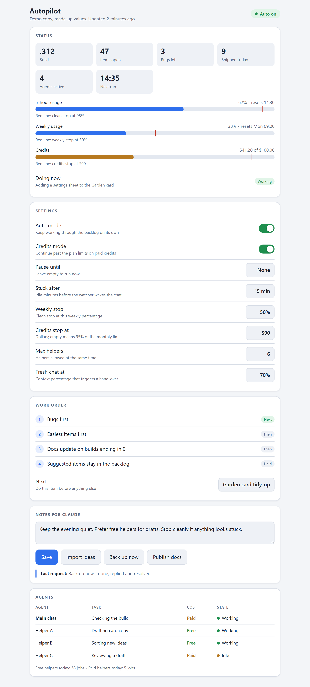
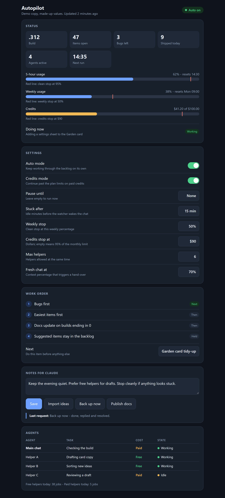

# Developer tools

A tour of the tools and the workflow behind the dashboard: how the code is built and deployed, the automatic quality checks, how ideas become shipped features, how the autopilot is steered and watched, and how the project keeps its AI usage efficient. For the AI cast itself see [How the AI builds it](ai-build-system.md).

## Workflow at a glance

1. **Jot it down.** Ideas are typed into the app's Design Studio. At session start and after every publish, `read-ideas.ps1` lists the new ones.
2. **File.** Every open idea is filed once into the matching topic of the backlog, reworded into a buildable item and tagged with its idea id.
3. **Sort.** Open items are re-sorted by effort so the easiest come first.
4. **Plan the batch.** `usage-model.js plan` says how many helpers fit in the current usage window; the cheapest helper that can do each job is chosen first.
5. **Build in pieces.** Helpers each own their own source pieces; nobody edits the same file at the same time.
6. **Integrate.** The coordinating chat reviews helper output, logs a delegation review and joins the pieces with `build-dashboard.js`.
7. **Check.** The quality checks run; every failure is fixed before anything ships.
8. **Back up.** A dated backup of the live files is taken.
9. **Deploy.** `deploy-dashboard.ps1` copies the build to Home Assistant and publishes the lists with read-back checks.
10. **Report.** A deploy report is posted in the chat: items left, change log, what is next, size, value and usage figures.
11. **Record.** The batch's usage is recorded so the next plan is more accurate; the AI usage log and card update.
12. **Repeat** until the stop line is reached, then stop cleanly and re-arm for the next window.

## 1. The build pipeline

Home Assistant serves the dashboard as one page, but that page is generated and nobody edits it. The code is about 300 source pieces.

- **Source pieces** live in `src/dashboard/` (about 300 JavaScript, CSS and HTML files): head, styles, body, then the script split by feature, then a tail. They are joined in file-name order. New feature code goes in its own numbered piece and registers its buttons with `Object.assign(ACT, {...})`.
- **`build-dashboard.js`** joins the pieces into the generated `ha/www/dashboard.html` and fails the build if the joined script does not parse. It also stamps in the line and piece counts. `--check` fails if the built file does not match the pieces (a sign someone edited the output directly).
- **`src-patch.js`** is a small helper for patch scripts: replace exact text wherever it lives across the pieces (it refuses ambiguous matches), bump the build number, save and rebuild.
- **`pull-from-ha.ps1`** copies the hand-written files from Home Assistant into the repo so the local copy is never assumed current.
- **`ha-backup.ps1`** makes dated backups on the Home Assistant host before any deploy or edit of the dashboard or configuration, and at least hourly during work. Retention keeps the 5 newest plus the newest of each week and each month, per kind of file.
- **Seed files** (`nashboard_seed_*.json` in `ha/www`) hold household starting values (such as default teams, trips and rooms) outside the code. The app reads each one once into saved settings.
- **`deploy-dashboard.ps1`** backs up, builds, refuses if the live file changed since the last commit (so direct edits are never overwritten), copies to Home Assistant, and publishes the backlog and wishlist. Published lists are read back to confirm every row arrived, and a publish that would drop more than a couple of items is refused. The top bar shows "building" while a deploy runs.
- **`yamlcheck.js`** and **`ha-reload.ps1`** handle YAML: the check runs before configuration is copied, and the reload asks Home Assistant to reload all YAML within about a minute, with no restart.
- **`docs-stats.js`** and **`publish-docs.ps1`** regenerate the docs stats and publish `docs/` to the public site, which happens only on request.

## 2. The quality checks

Every check is automatic and a failure blocks the deploy.

- **gapcheck** renders every page in dark and light and fails any card that does not exactly fill its grid columns, so all single cards share one width and every gap is identical. It also fails a lone card stretched across the page and any vertical gap between stacked cards that differs from the column gap. It also fails text with too little contrast. It runs at desktop width and at phone widths, in groups of pages.
- **overlapcheck** shows every card's 3-dot button and fails if any button, link or field sits on top of another one.
- **rightnowcheck** fails any page that has more than one Right now area.
- **genericcheck** fails when a personal name, place or device is hardcoded in the code instead of a setting.
- **housecheck** checks the Home banner for every holiday look: nothing that falls or flies may pass in front of the house.
- **namecheck** fails when two pieces declare the same top-level function, shared state slot or button key, because the later piece would silently win.
- **mapcheck** renders every map at a spread of zooms (including fractional and Full window), and fails on missing tiles, markers that drift from their coordinates, or blank map past the last tile zoom.
- **legendcheck** fails any chart, map or diagram that carries meaning through colour, line style or icon without a legend covering each style; deliberate decoration goes in an allowlist.
- **perfcheck** measures render time, long tasks, memory, page size and idle CPU per page against a saved baseline. It runs every fifth deploy, and a metric more than 30 percent worse blocks.
- **datacheck** protects saved data. It lists every place the app saves or reads data and fails on anything a person entered that lives only in the browser, any save that skips the load-first guard, and any key that is saved but never loaded. Round-trip and shrink checks are part of its design.
- **yamlcheck** catches YAML mistakes before they reach Home Assistant, such as an apostrophe inside a single-quoted string, tabs and odd indentation.
- **tapcheck** (planned) will audit that every tap target is at least 48 px.
- **stuck-check** finds leftover headless browser processes from test runs, live work items not updated for five minutes, and background jobs running far too long. `--fix` cleans up the browser leftovers. It runs at every check-in, before harness runs and before deploys.

Data is treated as sacred: everything a person enters lives in Home Assistant, never only in the page, and any change to a saved shape ships with a versioned migration that keeps every old field.

## 3. From idea to deploy report

- **Jot it down** is the in-app inbox. Ideas show under an Inbox section until filed, then tick off automatically once the backlog is published.
- **The backlog** is one consolidated list grouped by topic, not by date. Each item keeps its note number, and shipped items move to Done with a dated line in the shipped log.
- **Suggested by Claude** items are proposed with every batch but never built until accepted in the app.
- **Batch builds** ship about 5 to 30 items at once. One syntax check, one check pass and one deploy cover the whole batch.
- **Live work status** (`work-status.js`) lets every chat and helper post what it is doing. The Design Studio backlog card, the top bar agent count and the Home "Claude is working" card all read it, and an item is shown as idle after three minutes without an update.
- **Deploy report.** After every deploy the chat gets plain lines: total backlog items left (bugs and to-dos counted separately), the change log, what is next, lines of code, estimated market value and the usage figures.

## 4. The autopilot control panel and usage monitoring

Auto mode keeps working through the backlog on its own, steered from a phone.

- **The control panel** is a private page. Its settings (auto on or off, pause until, weekly stop, credits and the credit stop line, work order, "next", notes) are re-read at every check-in and before every build and deploy, and always win over built-in defaults. Its buttons (import ideas, back up now, publish docs) post to one comment thread that wakes the working chat, which applies the change, replies and resolves it.
- **Status** is written back by the chat: build, 5-hour and weekly usage, credits spent, open items and bugs, what it is doing, next run and agents active. `push-autopilot.ps1` also feeds the Home Claude card.
- **Usage monitoring.** `claude-usage.js` summarises Claude Code usage on the PC every few minutes (5-hour block clock, token totals, equivalent API cost) for the Claude card; `push-usage.ps1` records plan percentages and reset times and can flag a free usage reset waiting in the account.
- **Stop lines.** A clean stop at 95 percent of the 5-hour window or 50 percent of the weekly limit is always on. A clean stop means everything committed, deployed and pushed, with a short summary.
- **Credits mode.** When on, work continues past those lines on paid credits, with checkpoints at 50 and 80 percent and a stop at the panel's credit stop line.
- **Reset drift.** The 5-hour reset time moves, so every check-in compares it with the scheduled wake-up and re-arms the wake-up to five minutes after the new reset. Auto mode runs in the main chat through timed wake-ups so it stays visible on the phone.
- **Fresh chat at the context line.** At a configurable context percentage the chat finishes its step cleanly, writes a hand-off note, starts one fresh session to continue, and stops.

### How the main chat obeys the panel

- **The panel** is a private control page that steers the automatic build mode. It sets: auto mode on or off, how many idle minutes count as stuck, the stop lines for usage and credits, and the approvals for the night (such as how many helpers may run). It never links from these docs.
- **Reading it.** The main chat reads the panel at session start, at every check-in between items, before every build and deploy, and whenever it wakes. What the panel says wins over built-in defaults, and the chat says what changed.
- **Mirror for the watcher.** Each time it reads the panel, the chat copies the on/off switch and the idle minutes into a small local file (`tools/automode.json`), together with the id of the current main chat. The watcher tools below read that file, so they never need the panel.
- **Obeying the lines.** At a stop line (usage or credits) the chat finishes its step, commits, deploys and pushes, then stops cleanly. It will not use a helper the panel does not allow.
- **Approvals.** A new main chat asks for everything that could stall an unattended run in one prompt at hand-over, and records the answers in the hand-over note so the next chat inherits them.

### The stuck watcher

One watcher (`stuck-watch.js`) keeps auto mode from stalling quietly.

- **One at a time.** A lock file holds the watcher's process id and a heartbeat. A second copy exits at once; a dead or stale lock is taken over, so a crashed watcher never blocks the next one.
- **Self-restarting.** Claude Code hooks start it at session start and again after every turn ends, so nobody has to remember to restart it. It stops by itself when auto mode is off or after six hours.
- **What it does.** Every five minutes it runs `stuck-check.js` with a three-minute time limit, so a hung check cannot hang the watcher. The check cleans up leftover headless browsers and lists work items that have not updated.
- **When it wakes the chat.** It wakes the main chat when nothing has changed for the idle minutes (no commit, no source or backlog change, no work item, no test run), when a test run hangs, or when the check itself hangs. The chat then starts the next batch or fixes the hung run.

### Live work status in the app

Every chat and helper posts what it is working on. The Claude Code hooks do this automatically: the main chat shows as working or waiting, and each helper gets its own line that closes when it ends. Three places in the app read it:

- **Top bar Claude icon**: shows that work is going on and how many agents are active.
- **Agents card** (Design Studio): the main chat pinned as Working or Idle, a Helpers count, and free and paid tallies with a bar per job.
- **Live agents tiles**: a terminal-style tile per agent showing its current task, grouped.

Items that stop updating are shown as idle, and finished items clear themselves.

## 5. The efficiency engine

The aim is the most finished work per unit of usage, without risking data.

- **Usage model** (`usage-model.js`). Learns what a batch costs in window percent by least squares over recorded batches (a base cost for the coordinator plus a cost per Opus and per Sonnet helper, newer batches weighted more). `plan --now <percent>` says how many helpers fit before the stop line; `record` stores the result after the deploy. The window is filled toward the stop line instead of stopping early or overshooting.
- **Cheapest helper first.** Order of preference for each job: local Ollama (free), then a small model at low effort, then a mid model at medium, then the top model. The top model reviews and integrates rather than writing everything. Reviews, audits and docs writing use the top model; contained builds use the mid model.
- **Delegation reviews.** After checking a helper's work, the verdict (ok, fixed, redo) is logged by kind of job, helper and effort. `ai-usage.js delegation` shows first-time pass rates, so kinds that keep failing move up a level and kinds that keep passing are tried one level lower.
- **AI worker** (`ai-worker.js`). One doorway for helper jobs. Without a flag a job stays on the local model, the only place personal data may go. With an explicit cloud-allowed flag (and no personal data) it routes through free cloud tiers within their limits, then falls back to local. Keys live in environment variables only.
- **AI usage log and card** (`ai-usage.js`). One append-only log covers every agent: Claude chats and helpers, local models and cloud helpers, with tokens, time, cost and a task label. `summary` gives today, this week and all time; `publish` writes totals only (no prompts, answers or task text) to the Design Studio AI usage card.
- **Market watchdog** (`ai-market-watch.js`). Checks free model lists from the cloud providers and the newest local models that fit the PC's graphics card, without using any AI. It remembers what it has seen, publishes only model names, and feeds a "New free AI options" card that appears while something new is waiting.
- **Batching and targeted work.** Batch deploys, greps instead of whole-file reads, cropped screenshots only for layout changes, and batches of 6 to 13 coordinated helpers at once, each owning its own files.

## Safety nets

- Backups before every deploy, hourly during work, and a full set after every 50 shipped items.
- Idle helpers and stuck test runs are stopped and restarted.
- Only `docs/` is public, with no personal details. The docs site is refreshed on every version that ends in 0 (1.10, 1.20, ...).
- Whenever a helper, page or integration is added, the usage log, work status, deploy report, checks, docs and hand-off note are updated in the same pass.

## Recent additions

- **Jump check** (`jumpcheck.js`). On the Design Studio page it collapses and re-expands three cards one at a time. After each toggle the toggled card's top must stay within 4 px of where it was on screen, and every other card must keep its column and still be there. It prints OK or each problem, and runs with the other checks before a deploy.
- **Performance check catches mutation loops.** An idle-CPU and long-task baseline now flags a script that keeps changing the page in a loop (one such loop in the scrolling chips was found and fixed this way).
- **Check list for a batch:** gap check, overlap check, Right now check, name-clash check, generic check, performance check, legend check and jump check, run by the main chat after the helpers finish and before integrating.
- **Docs version banner.** The public docs show the version they describe (for example 1.1), so a reader can see how current they are.
- **Design Studio agent views.** The Agents tally counts free and paid agents on one line; Live agents shows a terminal-style view of what each agent is working on, fed by the work-status tool.
- **Build progress lines.** The main chat posts a short plain line as each stage of a batch finishes, and asks for every approval it will need up front at hand-over rather than mid-run.
