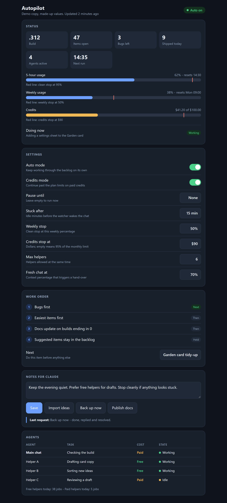

[← Nashboard](index.md)

# Developer workflow

Nashboard is built and maintained in an ongoing conversation with Claude, Anthropic's AI coding assistant. Most of that
workflow is visible right inside the dashboard: you jot an idea on a page, watch it land in the plan, see when it is
being worked on, and hear the wall screens chime when the new build arrives.

This page describes that loop the way it feels to use. For the technical side (the source pieces, the build script, the
coordinator and helper agents), see [How it's built](how-its-built.md).

**On this page**

1. [The loop at a glance](#the-loop-at-a-glance)
2. [Jot it down](#jot-it-down)
3. [How ideas get filed](#how-ideas-get-filed)
4. [The live backlog and work status](#the-live-backlog-and-work-status)
5. [Suggested by Claude](#suggested-by-claude)
6. [Building in batches, easiest first](#building-in-batches-easiest-first)
7. [Quality checks before every deploy](#quality-checks-before-every-deploy)
8. [When a new build arrives](#when-a-new-build-arrives)
9. [Backups](#backups)
10. [The autopilot control panel](#the-autopilot-control-panel)

## The loop at a glance

1. **Jot** an idea in the dashboard, in plain words.
2. **Claude files it** into the backlog under the right topic, rewritten as something buildable.
3. **It gets built** in a batch with other items, easiest first.
4. **The checks run**, and the batch is deployed only if every one passes.
5. **Screens update themselves**, chime once, and mark the pages that changed.
6. **The idea is ticked off** in the app automatically.

Nobody has to open a code editor, a ticket tracker or a terminal to take part. Anyone in the house who can use the
dashboard can add to the plan.

## Jot it down

The **Design Studio** page (opened from System or the More menu) has a card called **Jot it down**. It is a simple
inbox for ideas:

- **Type or say it.** The text box has a mic, and there is no length limit. Write it the way you would say it out loud.
- **No categories.** You don't pick a topic, priority or size. That is Claude's job.
- **Add a picture.** Attach a photo or screenshot when it is easier to show than to describe ("this card looks squashed
  on my phone").
- **Swipe left to remove** an idea you changed your mind about.
- **Import now** asks Claude to pick up everything waiting at its next check-in, instead of waiting for the next build.

Until an idea is filed, it shows under **Inbox** at the top of the Backlog card, so you can see it was received.

## How ideas get filed

Claude reads the open ideas at the start of every working session and again after every deploy, and files **all** of
them, never just a few. For each idea it:

- **Picks the topic** (a bug, the Home page, a specific page, the whole app, a new feature, an integration or piece of
  hardware, a to-do for the owner, or an open question).
- **Rewrites it clearly** and expands it into an item that can actually be built, with enough detail to act on.
- **Suggests how it ties in** with what already exists, and in particular whether it deserves an automatic Home card that
  shows itself when the information matters and hides again afterwards.
- **Keeps the idea's tag** (a short code) on the backlog item, so the app can match the two later.

After each import Claude gives a short table: each new idea, where it was filed, and roughly how much effort it is. Then
it re-sorts what comes next so the easiest open items are always first.

Once the item ships and the updated backlog is published, the app spots the tag and marks the original idea done.

## The live backlog and work status

The backlog is one list, grouped by topic (never by date), and it is the single source of truth for what is planned. The
**Backlog** card in the Design Studio shows it live:

- **Searchable**, with sections collapsed until you search.
- **Checked out now**: a strip at the top showing which items are being worked on right this minute, each with its state:
  **started**, **checking** (the quality checks are running), **blocked**, or **done**.
- **Finished items** drop below the strip as they complete, so you can watch a batch progress.
- **Show done** opens the Done list. Every shipped item also gets a line in a dated shipped log, which feeds the
  [Change log](changelog.md) and a **Shipped per day** chart.

The status shows item titles only. A small Claude card on Home also shows the current build, what is being worked on,
how many items and bugs are open, and how much of the plan's usage has been spent.

## Suggested by Claude

Claude doesn't only build what it is asked for. As it works it proposes new features, integrations, automations and
automatic Home cards that build on what is already there, checked against the backlog so they never repeat an existing
item. A couple of new suggestions arrive with every batch.

Suggestions appear in **Jot it down**, marked as Claude's and dated, with two buttons:

- **Accept** turns it into a normal idea, which is filed into the backlog like any other.
- **Ignore** moves it to a collapsed **Ignored suggestions** list, where **Bring back** restores it.

**Nothing Claude suggests is built until a person accepts it.**

## Building in batches, easiest first

Work runs in batches: typically 5 to 10 backlog items per build, and more when they are small and safe. One syntax
check, one quality pass and one deploy cover the whole batch. Within the open backlog, the easiest items always go
first, so the list keeps shrinking and quick wins don't sit behind big projects.

When the backlog grows faster than it shrinks, a **finish mode** can be switched on: every jotted idea is still filed so
nothing is lost, Claude's suggestions wait in the Accept / Ignore list, and the effort goes into finishing what is
already planned.

## Quality checks before every deploy

A build is only deployed when every relevant automatic check passes. Each check loads the real app in a headless
browser (or reads the source) and fails the moment a design rule is broken:

| Check | What it catches |
|---|---|
| **Layout gap check** | A card that doesn't exactly fill its grid columns, two single cards with slightly different widths, or uneven gaps. Runs at desktop, tablet and phone widths. |
| **Light and dark contrast** | Any text under 3:1 contrast, checked on every page in both light and dark mode. |
| **Maps at every zoom** | Missing map tiles, blank areas, or markers that drift from their true position, at whole and in-between zoom levels and in Full window. |
| **Legends** | A chart, map or diagram that uses a colour, line style or icon for meaning without a legend entry for it. |
| **Data retention** | Anything a person entered that would be kept only in one browser instead of on the home server, or a save that could wipe or shrink a list. |
| **Name clashes** | Two parts of the code quietly defining the same thing, where one would silently override the other. |
| **Performance** | Pages that got noticeably slower or heavier than the saved baseline (every fifth deploy). |

A failure blocks the deploy until it is fixed. The checks exist because each one caught a real problem once; see
[Rules that grow](how-its-built.md#rules-that-grow).

## When a new build arrives

You don't have to refresh anything:

- **Screens reload themselves** when a new version is deployed, but wait while someone is typing.
- **An update chime and toast.** The first time a screen loads a new build it plays a short, soft chime and shows an
  "updated" message. It happens once per build per screen, never during quiet hours or in Calm/Off mode, and there is a
  switch to turn it off in Settings.
- **NEW tags.** A brand-new page shows a **NEW** tag in the menu, the More list and the menu picker for its first day.
- **Updated dots.** When a build changes an existing page, a small **Updated** dot appears on that page's icon in the
  menu, More list and menu picker for 7 days, and clears as soon as you open the page.
- **The build number** is always shown in the title bar, and the About page and Change log say what is new.

## Backups

Backups happen on their own, without anyone asking:

- **Before every deploy**, a dated copy of the app and the Home Assistant configuration is made on the home server.
- **At least once an hour** while work is going on, even if nothing was deployed.
- **After every 50 shipped items**, a full set, in case another trigger hasn't come first.
- **Saved app data** (everyone's settings and lists) is backed up with every deploy and exported nightly, and never
  leaves the home server.

Old backups are pruned automatically: the newest few are kept, plus the newest of each week and of each month.

## The autopilot control panel

Claude can work in long, unattended stretches: finish a request, then carry straight on through the backlog, importing
new ideas after every deploy. The owner steers that from a small private **control panel** (an admin-only **Autopilot**
button in the Design Studio links to it). It offers:

- **Auto on / off**: whether Claude keeps going through the backlog on its own.
- **Pause until**: stop for a while and resume automatically.
- **Limits**: how much of the plan's usage a run may spend before it stops at a clean point.
- **Order and "do next"**: steer which items come first.
- **Requests**: one-tap jobs such as "import ideas now", "make a backup" or "publish the docs".
- **Status**: the current build, what is in progress, what shipped today, and when the next run starts.

Claude re-reads the panel between every item and before every build, so a change takes effect within minutes. When a run
reaches its limit it stops at a clean point (everything built, checked, deployed and saved) and schedules itself to pick
up again after the usage window resets.

See also: [How it's built](how-its-built.md) for the design rules, the build pipeline and how the work is split
between a coordinator and helper agents, and the [Design kit](design-kit.md) to use the same design rules in your own
dashboard.
