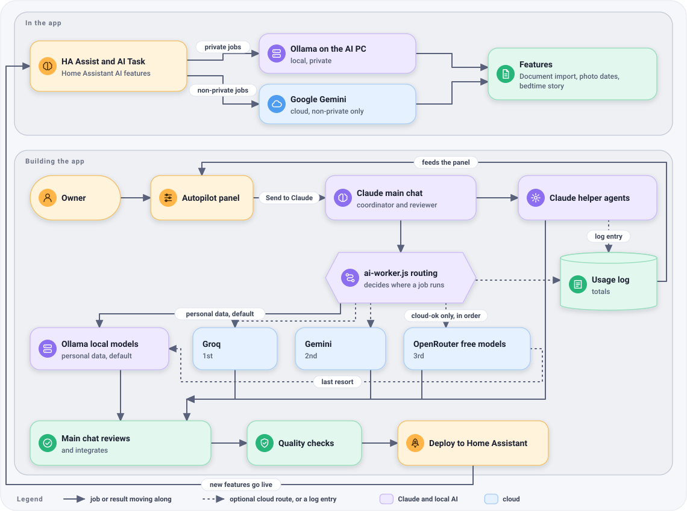
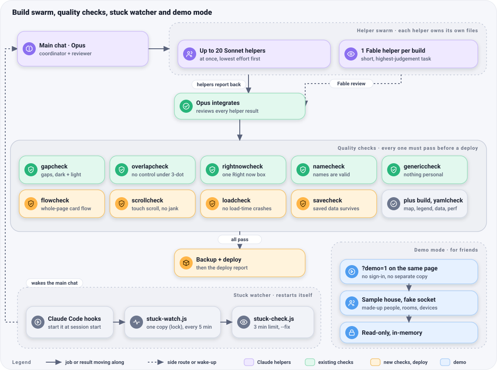
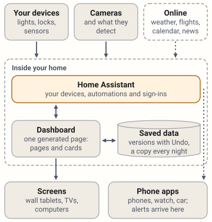
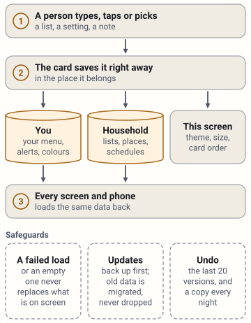
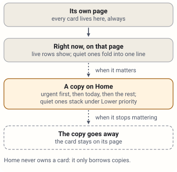
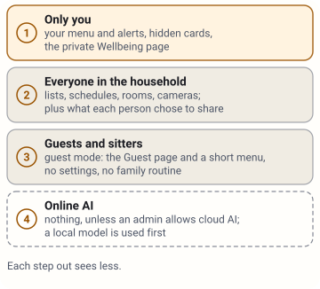
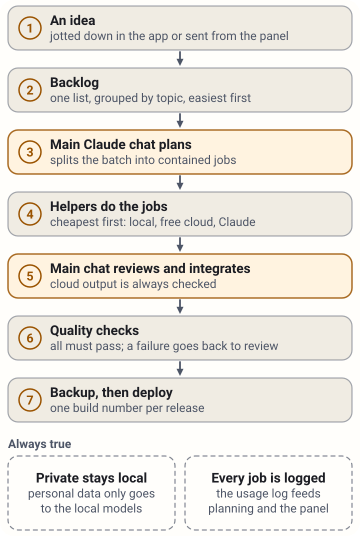

# Diagrams

Three diagrams: how the app works, how AI is used both inside the app and to build it, and how a build is checked, kept moving and shown to friends. Further down: [the pictures on the About page](#about-page-diagrams), the simple ones the app shows everyone.

## 1. How the app works

Home Assistant (HA) runs on a small server at home (a Raspberry Pi class computer is enough). It talks to devices, cameras and online services. The dashboard is one generated page (built from about 340 source pieces) served by HA, and everything a person enters is saved back into HA, never only in the page. Phones, the watch and the car reach HA through the companion apps, which also deliver notifications.


*How the app works: sources feed Home Assistant, which shares data with the dashboard and the companion apps.*

<details markdown="1"><summary>Text version</summary>

```text
flowchart LR
  Devices[Devices and sensors] --> HA
  Online[Weather, flights, calendar, news] --> HA
  Frigate[Frigate cameras] --> HA
  subgraph Pi[Home server - Home Assistant]
    HA[HA core, YAML, automations]
    subgraph Dash[Generated dashboard page]
      Pages[Pages] --> Cards[Cards live on their page]
      Cards -.->|only while it matters| HomeCopies[Home copies]
    end
    Store[(Saved data:<br/>system and user data)]
  end
  HA <--> Dash
  Dash <==>|every save and load| Store
  Dash --> Screens[Wall tablets, TVs, PCs]
  HA --> Companion[HA companion apps]
  Companion --> Phones[Phones]
  Companion --> Watch[Watch]
  Companion --> Car[Android Auto / CarPlay]
  HA ==>|automations| Notify[Notifications]
  Notify --> Companion
```

</details>

Legend:
- Solid thin arrow: data or control flowing in the direction shown.
- Double-line arrow: saved data (reads and writes of what people entered) and notification delivery.
- Dotted arrow: a copy that appears temporarily and goes away again.
- Boxed group: runs on the home server.
- Cylinder: stored data.

## 2. The AI architecture

Two separate uses of AI. Inside the app, HA Assist and AI Task call a local model on the AI PC (Ollama) or Google Gemini for features such as document import, photo dates and a bedtime story. On the build side, a main Claude chat coordinates and reviews, up to 20 Sonnet helpers (plus one Fable helper per build) do the contained work, and one worker script routes jobs to the cheapest suitable model. Personal data only ever goes to the local Ollama models.



*The two uses of AI: features inside the app, and the way the app gets built.*

<details markdown="1"><summary>Text version</summary>


```text
flowchart TD
  subgraph InApp[In the app]
    Assist[HA Assist and AI Task] -->|private jobs| OllamaA[Ollama on the AI PC]
    Assist -->|non-private jobs| GeminiA[Google Gemini]
    OllamaA --> Features[Document import, photo dates,<br/>bedtime story]
    GeminiA --> Features
  end

  subgraph Build[Building the app]
    Owner([Owner]) --> Panel[Autopilot panel]
    Panel -->|Send to Claude| Main[Claude main chat<br/>coordinator and reviewer]
    Main --> Agents[Up to 20 Sonnet helpers<br/>+ 1 Fable per build]
    Main --> Worker{{tools/ai-worker.js routing}}
    Worker -->|personal data, default| OllamaB[Ollama local models]
    Worker -.->|cloud-ok only, in order| Groq[Groq]
    Worker -.-> GeminiB[Gemini]
    Worker -.-> OpenR[OpenRouter free models]
    Worker -.->|last resort| OllamaB
    Agents --> Review[Main chat reviews and integrates]
    OllamaB --> Review
    Groq --> Review
    GeminiB --> Review
    OpenR --> Review
    Review --> Checks[Quality checks:<br/>gap, overlap, rightnow, name, generic,<br/>flow, scroll, load, save] --> Deploy[Deploy to Home Assistant]
    Agents -.-> Log[(Usage log)]
    Worker -.-> Log
    Log --> Panel
  end

  Deploy --> Assist
```


</details>

Legend:
- Solid arrow: a job or result moving along.
- Dotted arrow: optional cloud route (only when a job is marked safe for the cloud, tried in the order shown within free limits) or a log entry being written.
- Diamond-style hexagon: the routing step that decides where a job runs.
- Cylinder: the usage log, which records totals and feeds the autopilot panel and the in-app usage card.
- Rule shown in the labels: personal data goes only to Ollama on the local PC; cloud output is always checked by the main chat before use.

## 3. Build swarm, quality checks, stuck watcher and demo mode

How a build runs. The main Opus chat hands contained work to up to 20 Sonnet helpers at once, plus one Fable helper per build for the highest-judgement short task (usually the pre-deploy review). Each helper owns its own files, and none of them runs the screenshot checks or deploys. Opus integrates the results, then the quality checks run once, centrally, and every one must pass before the backup and deploy:

- gapcheck, overlapcheck, rightnowcheck, namecheck and genericcheck (spacing, controls under the 3-dot button, one Right now container per page, names, nothing personal hard-coded).
- flowcheck (whole-page card flow), scrollcheck (smooth touch scrolling), loadcheck (no load-time crashes in the built page) and savecheck (saved data survives).
- The build itself, plus yamlcheck, mapcheck, legendcheck, datacheck and perfcheck where they apply.

A stuck watcher keeps unattended building from stalling: Claude Code hooks start one copy of `stuck-watch.js` at session start and after each stop. It runs `stuck-check.js` every five minutes with a three-minute limit, and it wakes the main chat when the chat is idle or a test run hangs. Demo mode opens the same page with `?demo=1` on made-up sample data: no sign-in, a fake connection, nothing saved to the real house, read-only, and a DEMO strip on every page.



*A build from helpers to deploy, with its safety nets and the demo mode.*

<details markdown="1"><summary>Text version</summary>

```text
flowchart TD
  Main[Main chat, Opus] --> Sonnet[Up to 20 Sonnet helpers]
  Main --> Fable[1 Fable helper per build]
  Sonnet --> Integrate[Opus integrates]
  Fable -.->|review| Integrate
  Integrate --> Checks
  subgraph Checks[Quality checks, all must pass]
    Old[gapcheck, overlapcheck, rightnowcheck,<br/>namecheck, genericcheck]
    New[flowcheck, scrollcheck, loadcheck, savecheck]
    Rest[build, yamlcheck, mapcheck, legendcheck,<br/>datacheck, perfcheck]
  end
  Checks -->|all pass| Deploy[Backup and deploy]
  Hooks[Claude Code hooks] --> Watch[stuck-watch.js, every 5 min]
  Watch --> Check[stuck-check.js, 3 min limit]
  Watch -.->|idle or hung: wake| Main
  Demo[?demo=1] --> Sample[Sample house, fake socket] --> RO[Read-only, in-memory]
```

</details>

Legend:
- Solid arrow: a job or result moving along.
- Dotted arrow: a side route (the Fable review) or the watcher waking the main chat.
- Purple boxes: Claude helpers. Green: the existing checks. Orange: the new checks and the deploy. Grey: the watcher. Blue: demo mode.

## About page diagrams

These are the quick pictures on the app's **About** page, drawn for everyone in the household rather than for builders. They use one picture language: a plain box is a thing or a step, a tinted box is the centre of that picture, a cylinder is saved data, a dashed outline is a boundary, a safeguard or something that goes away, a solid arrow is a flow, a dotted arrow happens on its own (or goes online), and a numbered badge gives the order.

### How the app works

Your devices and cameras feed Home Assistant inside your home. Online services (weather, flights, calendars, news) come in over the internet. Home Assistant serves the dashboard and keeps its saved data; screens and the phone apps show it.



### How your data is kept

Whatever a person types, taps or picks is saved right away where it belongs: to you, to the household, or to this screen only. Every screen and phone then loads the same data. Safeguards: a failed or empty load never replaces what is on screen, updates back up first and migrate old data, and the last 20 versions can be undone, with a copy every night.



### Where cards show up

Every card has a home page (and can also show on other pages where it is useful). That page's Right now card shows the live rows and folds the quiet ones into one line. While something matters, a copy shows on Home (urgent first, then today, then the rest); when it stops mattering the copy goes away. Home never owns a card, it only borrows copies.



### Who can see what

Each step out sees less: your own choices and the private Wellbeing page are only yours; lists, schedules, rooms and cameras are shared with the household; guests and sitters get the Guest page and a short menu; and online AI gets nothing unless an admin allows cloud AI.



### Behind the scenes: how the AI builds it

Shown on About to admins only: an idea goes to the backlog, the main Claude chat plans a batch, helpers do the work starting with the cheapest, and every change passes the automatic checks before it is deployed. The full version is diagram 3 above.


