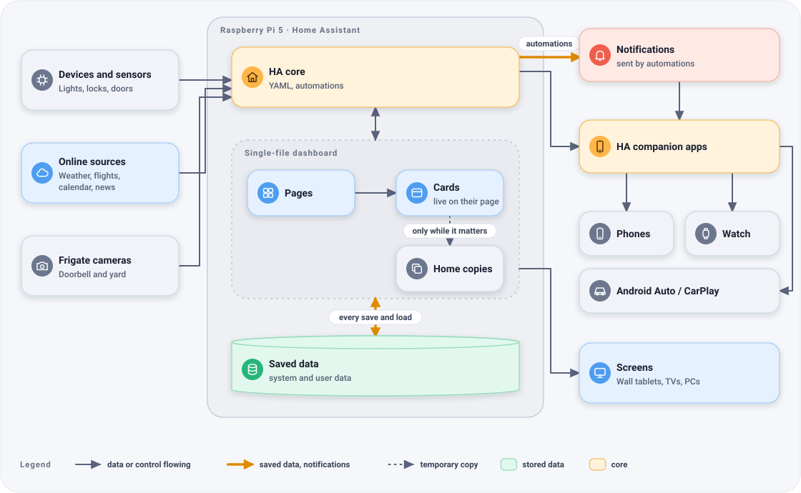

# Diagrams

Two flow diagrams: how the app works, and how AI is used both inside the app and to build it.

## 1. How the app works

Home Assistant (HA) runs on a Raspberry Pi 5. It talks to devices, cameras and online services. The dashboard is one HTML file served by HA, and everything a person enters is saved back into HA, never only in the page. Phones, the watch and the car reach HA through the companion apps, which also deliver notifications.



*How the app works: sources feed Home Assistant, which shares data with the dashboard and the companion apps.*

<details markdown="1"><summary>Text version</summary>

```text
flowchart LR
  Devices[Devices and sensors] --> HA
  Online[Weather, flights, calendar, news] --> HA
  Frigate[Frigate cameras] --> HA
  subgraph Pi[Raspberry Pi 5 - Home Assistant]
    HA[HA core, YAML, automations]
    subgraph Dash[Single-file dashboard]
      Pages[Pages] --> Cards[Cards live on their page]
      Cards -.->|only while it matters| HomeCopies[Home copies]
    end
    Store[(Saved data:<br/>system and user data)]
  end
  HA <--> Dash
  Dash <==>|every save and load| Store
  Dash --> Screens[Wall tablets, TVs, PCs]
  HA --> Companion[HA companion apps]
  Companion --> Phones[Phones]
  Companion --> Watch[Watch]
  Companion --> Car[Android Auto / CarPlay]
  HA ==>|automations| Notify[Notifications]
  Notify --> Companion
```

</details>

Legend:
- Solid thin arrow: data or control flowing in the direction shown.
- Double-line arrow: saved data (reads and writes of what people entered) and notification delivery.
- Dotted arrow: a copy that appears temporarily and goes away again.
- Boxed group: runs on the Raspberry Pi 5.
- Cylinder: stored data.

## 2. The AI architecture

Two separate uses of AI. Inside the app, HA Assist and AI Task call a local model on the AI PC (Ollama) or Google Gemini for features such as document import, photo dates and a bedtime story. On the build side, a main Claude chat coordinates and reviews, helpers do the contained work, and a single worker script routes jobs to the cheapest suitable model. Personal data only ever goes to the local Ollama models.


*The two uses of AI: features inside the app, and the way the app gets built.*

<details markdown="1"><summary>Text version</summary>

```text
flowchart TD
  subgraph InApp[In the app]
    Assist[HA Assist and AI Task] -->|private jobs| OllamaA[Ollama on the AI PC]
    Assist -->|non-private jobs| GeminiA[Google Gemini]
    OllamaA --> Features[Document import, photo dates,<br/>bedtime story]
    GeminiA --> Features
  end

  subgraph Build[Building the app]
    Owner([Owner]) --> Panel[Autopilot panel]
    Panel -->|Send to Claude| Main[Claude main chat<br/>coordinator and reviewer]
    Main --> Agents[Claude helper agents]
    Main --> Worker{{tools/ai-worker.js routing}}
    Worker -->|personal data, default| OllamaB[Ollama local models]
    Worker -.->|cloud-ok only, in order| Groq[Groq]
    Worker -.-> GeminiB[Gemini]
    Worker -.-> OpenR[OpenRouter free models]
    Worker -.->|last resort| OllamaB
    Agents --> Review[Main chat reviews and integrates]
    OllamaB --> Review
    Groq --> Review
    GeminiB --> Review
    OpenR --> Review
    Review --> Checks[Quality checks] --> Deploy[Deploy to Home Assistant]
    Agents -.-> Log[(Usage log)]
    Worker -.-> Log
    Log --> Panel
  end

  Deploy --> Assist
```

</details>

Legend:
- Solid arrow: a job or result moving along.
- Dotted arrow: optional cloud route (only when a job is marked safe for the cloud, tried in the order shown within free limits) or a log entry being written.
- Diamond-style hexagon: the routing step that decides where a job runs.
- Cylinder: the usage log, which records totals and feeds the autopilot panel and the in-app usage card.
- Rule shown in the labels: personal data goes only to Ollama on the local PC; cloud output is always checked by the main chat before use.
