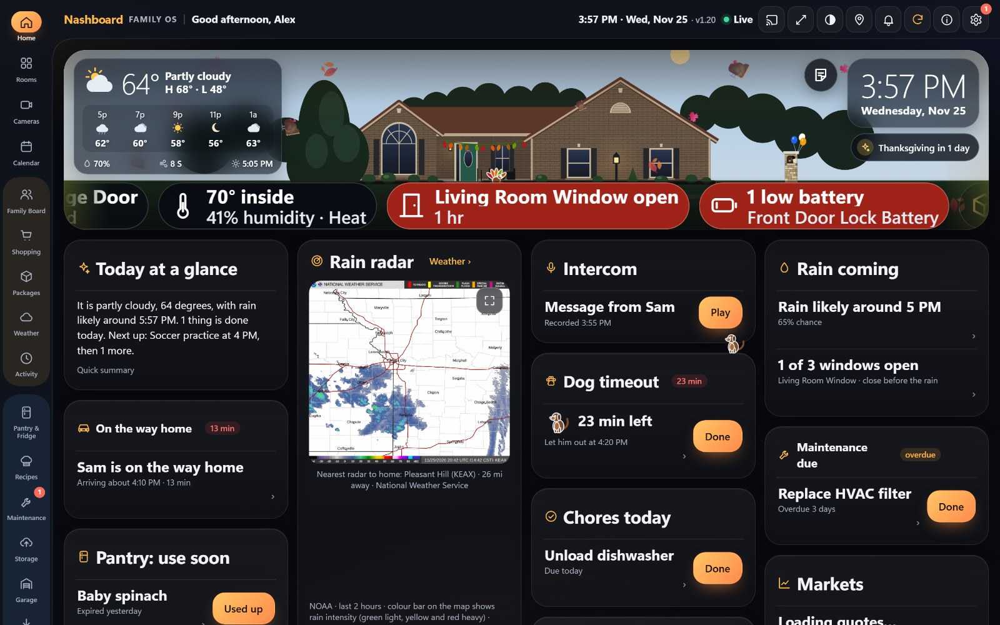
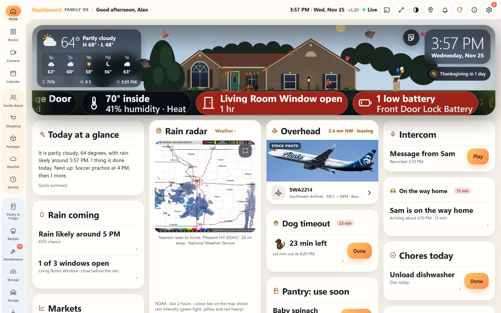

[← Nashboard](index.md)

# Home page

Home is the page most screens sit on. It has a banner at the top and a grid of cards below. Most cards are
**conditional**: they appear when they're useful and disappear when they aren't.

## The banner

- **House illustration** drawn in the browser, with day and night skies, stars and the moon. Windows light up
  when that room's lights are on; the porch light and lamp post follow the front-yard lights.
- **Driveway and mailbox**: the mailbox stands on the outside edge of the driveway by default (you can move it, restyle it or recolour it in Your house) and swings its door open with envelopes when mail is
  expected today, from USPS Informed Delivery emails. It stays put.
- **Compact weather overlay** on wide banners: temperature, conditions, the next hours and quick facts. Narrow
  screens get a regular weather card instead.
- **Status chips** in a scrolling strip of two-line chips (label on top, detail below) **below the house** (not over it), sitting between the horizon and the banner's bottom edge: lights on, garage, indoor temperature and
  humidity, mail and packages, low batteries, open doors and windows, updates available, pet problems. Tap a chip to
  act on it or open its details. Chips and switches have large invisible touch areas.
- **Tap the banner** for a bubble that explains what drives it: the sky (holiday, weather effect, sunrise and sunset) and
  the house (lights on, packages delivered today, holiday decorations), with links.
- **Tidbit chip**: one fun fact per page load, rotating through topics (lines of code in the dashboard, planes
  overhead, Space Station passes, packages this year, devices reporting, daylight and more).

The top bar shows the greeting, the time and date, the version (with the open-backlog count for admins) and the
connection status. Its buttons sit tight, and text that does not fit scrolls instead of being cut off.

## Cards

| Card | When it shows |
|---|---|
| **Weather** | Always, unless the banner overlay is showing it; phones also get a card for the phone's own location |
| **Calendar / Up next** | Upcoming events, sized to fit names |
| **Rooms** | The six most-used rooms first (Show more for the rest) with quick controls; tap a room name for its room dashboard |
| **Cameras** | Camera snapshots |
| **Overhead** | A plane within 5 nm: photo, airline, route, altitude, speed and live distance. Stays at least 3 minutes and follows the plane as it leaves |
| **Space Station** | From 10 minutes before the ISS rises until it sets: a live sky dial with the pass track and where to look |
| **Black-owned businesses** | A suggestion card that works with or without a directory. Reads (on this screen only) home jobs due within two weeks, the shopping list and upcoming events, and turns them into at most three generic search words such as "gutter cleaning" or "bakery". Only those words and the general area typed in its settings are sent, never names, addresses or list items. A directory on your own network is always allowed; any other is used only while cloud use is allowed in AI privacy. The home's local AI can also pick the needs, including seasonal ones such as gutters before winter. With no directory it shows them as "Your home may need: ..." with a Search button that opens a web search for Black-owned businesses of that kind in a new tab when tapped; the dashboard sends nothing itself and never makes up business names. The card's title is Black-owned businesses by default; **Kinds of business to support** in Business settings lets you pick Black-owned, Women-owned, Veteran-owned, LGBTQ+-owned, Latino-owned, Asian-owned, Indigenous-owned, Family-owned or Local and independent (with more than one, or a different one, the title becomes Businesses to support). Menu: Business settings (admins paste a directory web address with {q} where the words go), Mute for 30 days, Hide this card. |
| **Games** | Your teams' games from a day before to a few hours after; live games show a pulsing dot and scores flash when they change |
| **Up next tasks** | Google Tasks due today are added to the Up next card |
| **Gas prices** | Cheapest nearby premium and diesel; collapsible |
| **Right now** | The cards that matter this minute, in priority order. The Claude card (admins who maintain the app) appears only while Claude is working and says what |
| **Ask AI** | Everyone can type a question or request. It is answered in the card by the first AI available, in this order: an AI in your home (Home Assistant), Ollama, a cloud AI (only when an admin allowed cloud AI), then Claude (also only with cloud AI allowed). A drop-down lists only the AI available now and remembers your pick; with none picked it chooses for you. Claude on claude.ai (a new browser tab) is listed only when an admin allowed cloud AI; with no AI available the card says so calmly |
| **Claude admin** | Admins only: Claude's status and controls, split from Ask AI |
| **Eat this first** | Leftovers from the Pantry & Fridge leftovers tracker, oldest first |
| **Gig night** | A gig coming up: start time, the be-there-by (setup) time and the plan |
| **Claude usage** | AI plan usage for the house's Claude account; collapsible |
| **Air quality** | Whenever outdoor air quality is Moderate or worse (AQI 51+): the same card as the Air page, with the next 12 hours and today's pollen when available. Stays at least 3 minutes |
| **Breaking news** | Recent big headlines, local first |

Commute trips live on the Commute page; Home shows Leave soon and On the way home only when they matter. Every card has a ⋯ menu in its header (Full window, Move, Collapse, Hide for today, Hide just for me, How it works), and tapping a card's top bar collapses or expands it.

- **Collapsed cards show a one-line summary** in the header (weather, air, UV, commute, cameras, calendar, packages, trash night, the Litter-Robot and more).
- **Cards stay locked in place**: collapsing or expanding one never makes the others jump columns.
- **Move** in the card menu lets you drag a card to a new spot. The order is shared, so every screen shows the same layout.
- **How it works** in the card menu opens a short plain explanation of that card.
- **Page intro line**: a friendly one-line description under the page title; hide it with its Hide button or in Settings.
- **Rain radar** (and every radar) has a Full window button.

## Today at a glance and the order of cards

- **Today at a glance** is always the first card under the banner: two or three sentences about what already happened
  today, what is going on now and what is coming. With an AI set up in Home Assistant it is written by a local model
  (a cloud model only after an admin allows it); without one it is a plain summary built from the same facts.
- **Every automatic card has a priority**, so the order means something:
  1. **Urgent**: a fire alarm, a water leak, a power cut, someone at the door, severe weather, time to leave.
  2. **Needs doing today**: chores, maintenance that is due, medicine running low, trash night, a package outside.
  3. **Worth knowing**: low batteries, dinner tonight, a birthday coming up.
  4. **Lower priority**: quiet single-row cards are stacked together in one small card titled Lower priority, so they
     take one slot instead of six. Nothing is hidden.
- **Chips on a title** appear only when they add something the title does not say: the minutes left on a timed card
  ("23 min") or "overdue".
- **Full-screen card notices are off by default.** Turn them on in Settings and an urgent card that appears or clears
  by itself shows a big notice on wall screens and TVs. A phone, tablet or computer only joins in if you switch on "On
  this screen too" on that device. See [Settings](settings.md).

## Pop-up cards

The banner also has the **tidbit chip** (tap it for the next fun fact, including the app's estimated market value), the
**pet characters** (they react when someone is at the door) and **holiday decorations**. See [Every feature](features.md)
for the complete list.

Pop-up cards appear at the top when something needs attention. Each stays **at least 3 minutes** so the screen
doesn't flicker; if the situation clears sooner the card says so ("Closed now", "Lights are off now") and then
leaves. Several have a one-tap action button.

<!-- homecards:start -->
The app has 108 automatic Home cards. This table is written from the app's own list and its How it works texts, so it always matches the app.

| Home card | Shows when | What you can do |
|---|---|---|
| Garage open | On Home when a garage door has been open more than 10 minutes; goes away when closed. | Tap Close and confirm to close the door. |
| Litter-Robot | Appears when the waste drawer is 80 percent full or more, the litter is 30 percent or lower, or the robot reports a fault; goes away once fixed. | Read only. |
| Dog timeout | While the timeout timer is running; gone when time is up. | Tap Done to cancel the timer early. |
| Dog feeder | On Home during the 10 minutes before the feeder is due; goes away after feeding. | Read only. |
| Markets | Weekdays within an hour of the 9:30 AM or 4:00 PM Eastern open and close, or for 2 hours after the watchlist average moves 2 percent or any one symbol moves 5 percent. | Tap it to open the Finance page. |
| UV high | Between 10 AM and 4 PM while the UV index is 6 or more. | Read-only. |
| Rocket launch | On Home from 30 minutes before a launch's scheduled time until 10 minutes after it. | Tap it to open the Space page. |
| Chores today | Appears while chores are due or overdue; gone when all are done. | Tap Done on a chore to mark it done. |
| Severe weather | While an extreme or severe alert, or any warning, is active for the location; clears when it ends. | Tap it to open the Weather page. |
| Leave soon | On Home when a timed event with a location starts within the next hour (shows up to two). | Tap Navigate to open directions to the event location. |
| Nursery asleep | Only between 6 PM and 8 AM, while the sound machine is playing; clears when it stops. | Read only. |
| New on Wi-Fi | When a new device appears, until you deal with it. | Tap it to open the Network page and name it or mark it Unknown. |
| House health | On Home for admins only, when one of those is wrong; disappears once fixed. | Tap its link to open System or Network for details. |
| Internet outage | Appears when the router reports no connection, or when one of those status pages reports anything other than normal; clears when it recovers. | Read only; choose which services to watch on the Network page. |
| Fever | On Home for 12 hours after a temperature of 100.4 F or higher is logged. | Tap Log temp to open the Family Board and add a new reading. |
| Medicine | On Home while a medicine was given and its next safe dose time is still ahead (within 24 hours). | Read only. |
| Pantry: use soon | Appears when items are near their use-by date; clears when used or removed. | Tap Used up to remove an item; the Pantry page has the full list. |
| Birthday coming up | In the 14 days before a birthday; gone after the day. | Tap Add gift to list when no gift is on the list yet. |
| Holiday tradition | On Home as that holiday gets close; goes away after. | Read only. |
| Good morning | From 6 AM to 9 AM, when there is more than one item to show. | Read only. |
| Goodnight check | From 9 PM to 1 AM, while a light, lock or the garage is still on or open. | Tap a button to lock or turn something off; Everything runs all of them. |
| The week ahead | On Home on Sunday evening only, from 5 to 9 PM. | Read only. |
| Medicine running low | Appears when a medicine has 14 days or fewer left, is near expiry, or its quantity is marked low or empty. | Tap Add to list to put it on the shopping list, or open the Pantry page. |
| For sale | When something has been listed a month or longer. | Read-only. |
| Low batteries | On Home when a battery is low; goes away when replaced. | Read only. |
| Movie night | Fridays from 5 PM to 9 PM, when at least one movie is saved in Family favorites. | Open the Family favorites list with the see all link. |
| New car recall | When a new recall is found; shown on the Commute page. | Follow the link to check the car at NHTSA, then tap Seen. |
| Intercom | On Home for 10 minutes after a new message is recorded. | Tap Play to hear it. |
| On the way home | While a commute trip ending at home is active, the person is not home, and their location changed in the last 90 minutes; goes away when they arrive. | Read only. |
| Rain coming | When rain or snow is at least 60 percent likely (or forecast) in the next 3 hours and it is not already raining. | Close an open garage door from the card (tap twice to confirm). |
| Freeze tonight | On Home after noon when the forecast low in the next 20 hours is 32 F or colder. | Read only. |
| Dinner tonight | Appears from 11 AM on a day with dinner planned; empty otherwise. | Read only. |
| Autoship soon | When an order ships within the next 2 days; gone after that day. | Read-only. |
| Maintenance due | On Home when a job is due; goes away when done. | Tap Done to mark it finished. |
| Trash night | From 3 PM the day before pickup until 9 AM on the pickup day. | Tap Done once the bins are out; it shows who did it ('Done by' and a first name) until the pickup passes, then hides. |
| Lights still on | From 11 PM to 5 AM when two or more lights are on. | Tap All off to turn them off. |
| Cat’s medicine | No longer shown on its own: the cat's medicine row now appears inside the Pet care due card. | Tap Log now to record that the dose was given. |
| Overdue tasks | Only when a task is past its due date. | Read-only; finish tasks on the Calendar page. |
| Running low | On Home when an item's count reaches its low level. | Read only; update the count on the Storage page. |
| Warranty ending | On Home when a stored item has a warranty ending in the next 30 days. | Tap the Manual link if one is saved. |
| Car due soon | When a date is within 30 days or overdue, or an oil change is within 500 miles. | Read-only. |
| Hobbies | On Home when something for a picked hobby is due today, tomorrow or within a week. | Read only; open the Hobbies page for details. |
| Something to do today | Saturday and Sunday mornings, 8 to 10 AM. | Read-only; the Family Board card has We did it. |
| Doorbell | Appears on a ring or person detection and stays 10 minutes after the last one (longer while a person is still detected), on Home, Cameras, the Activity page and room pages (never a second copy). | Tap Got it to hide it on this screen until the next ring. |
| Package left outside | Appears for a package delivered within 24 hours when nobody is home today or after dusk, until you tap Got it. | Tap Got it to hide that package. |
| New free AI options | On Home for admins while finds from the last 7 days remain. | Tap Add to Jot it down to file it as an idea, or Dismiss. |
| Air restrictions near home | When a nearby airport is affected or a restriction covers or is near home. | Read-only. |
| Pet care due | On Home while a pet task is due; stays until Done and says overdue after an hour. | Tap Done to log the dose or confirm the feeding. |
| Bedtime | From the usual bedtime hour for 3 hours, while a routine runs, and while sitter mode is on. | Tap Start to begin the routine or Next to move to the following step. |
| Black-owned businesses | A job, event or shopping item matches a business type, or a seasonal need applies, and the card is not muted. | Open Business settings (3-dot menu) to pick the kinds, set a directory address and area, and choose how many to show. |
| Roll up the car windows | Appears when a car window is open and it is raining or the rain chance is 50 percent or more. | Read it and close the windows; the card clears once they are closed or the rain risk passes. |
| Pick up dinner? | On Home 4 to 8 PM when someone is heading home from a trip. | Tap a phone number to call, or Copy the order. |
| Dishwasher | Home shows it while running or clean. A kitchen room page also shows it when dirty. | Start or cancel a timer, and tap Emptied when the dishes are put away. |
| Pickup soon | In the 15 minutes before pickup, on days the schedule applies. | Read-only. |
| Pack a lunch | On Home from 6 to 9:30 AM on days marked as pack a lunch. | Read only; change the days in the Kid monitor card. |
| Earbuds battery | On Home when any earbud battery is at or below the limit you set. | Read only; put them on the charger. |
| Internet provider outage | On Home when the sensor has said down for more than 2 minutes; clears when back up. | Open the provider outage page link if one is saved in the Internet card settings. |
| Bills due | When a bill is due within the lead time (default 3 days) or is overdue. | Tap Mark paid; a repeating bill moves to its next date. |
| Energy | Appears after noon when today so far is at least 1.5 times the recent daily average. | Read only. |
| Power outage | Appears only while that grid sensor reports an outage and goes away when power is back. | Tap Open to go to the Energy page. |
| Plug in the car | Appears from 6 PM when the battery is below your chosen level and the car is not plugged in. | Read only. |
| Added from email | When something was added in the last 24 hours or an email is waiting. | Follow the link to the Family Board to undo an item or approve a waiting email. |
| Featured | Until the post's show-until date. | Tap the link to open the post. |
| Gaming | On Home while someone is playing. | Read only. |
| Achievement | Appears for 3 hours after an unlock. | Read only. |
| Garage door left open | Appears when a door picked in settings, or a limit shorter than 10 minutes, has been open too long; the plain Garage open card covers the default 10 minutes. | Tap Close and confirm to close the door. |
| Gas price drop | Appears when gas alerts are on and a station within 8 miles is at or below your target price, or the regular-gas area average fell 10 percent in a day. | Tap Go to open driving directions in Google Maps. |
| Gig night | Appears from the morning of a gig day until breakdown ends. | Read only. |
| Nursery temperature | On Home in the evening and night, or while the nursery is asleep, when outside the range. | Read only; set sensors and range with Pick sensors on the Family page. |
| For your hobbies | Garden tip 7 AM to 8 PM when no rain is forecast for 3 days; running tip 5 AM to 7 PM when a 2+ hour window is 40 to 82 degrees, dry and calm. | Tap the Hobbies link. |
| Insurance list | Only when something on the list needs review and you have not snoozed it; hidden when the list is empty or all up to date. | Tap Review to open Storage, where you can mark the list reviewed or be reminded in a month. |
| Timers | On Home while any kitchen timer is running or paused. | Tap Cancel to stop a timer; a chime and message play when one finishes. |
| Laundry | On Home while an appliance is running or finished; clears when its door opens or you tap Done. | Tap Done when the clothes are moved. |
| Pool | Appears when a reading is low or high, or the last manual test is older than your reminder days. | Tap Open Pool or Log a test to go to the Pool page. |
| Everyone left | Appears for 45 minutes after the last person leaves, only if something is left on or open. | Turn all lights off, or lock and close the garage with a tap-twice confirm. |
| Eat this first | Appears when a leftover is due within a day or already past its date. | Read only on Home; manage leftovers on the Pantry page. |
| Reading tonight | About 6 to 9 PM, when a book is picked for today. | Tap We read it to log it. |
| Out the door | On Home weekday mornings 6 to 9:30 AM, while someone is home and items remain unticked. | Tap the link to open the Kitchen checklist and tick items off. |
| Quiet hours | On wall screens and TVs only while quiet hours are active. | Read only; change it in Settings. |
| Real-device checks | On Home once a week while any check is unticked; stops when all are ticked. | Open the checks, or remind me next week. |
| Recently used | Appears when a card on another page was used in the last 4 hours. | Tap a row to go back to that card. |
| Calendar clash | On the Calendar page and Family Board when a clash is found; on Home only for a clash today. Gone after Fixed or Not a clash. | Tap Fixed when you sorted it, or Not a clash to stop flagging that pair. |
| Overnight | Built once on the first screen wake after 6 AM; shows on Home and the Activity page (Security chip) until 10 AM. | Tap Got it to hide it for the day. |
| Trip prep | From 3 days before a trip until you leave, and again on the last day of the trip until the day after. | Tap Open the plan to tick things off on the Family Board. |
| Something unusual | Only when today drifts from the usual for that weekday and a weekday has at least 3 learned days; hidden once answered. | Tap Expected to teach it that this is normal on that weekday, or Dismiss to hide it for today. |
| Weekend plans | Friday after 5 PM until Sunday night. | Tap Add to put a plan on the family calendar. |
| Security alerts | When an important alert from the last 24 hours has not been marked seen. | Read-only here; mark alerts seen on the Activity page under the Security chip. |
| Smoker | On Home while the pit is hot, or once the probe reaches its goal until dismissed (dismissing hides it for 6 hours). | Tap Dismiss on the done message. |
| Steam Deck battery | Only when the battery is under 20 percent and not charging. | Read-only. |
| Sticky notes due | Only while a reminder is due or overdue, or a countdown is in its last day. | Tap Done on a reminder. |
| Cast dashboard | Appears while a TV is casting the dashboard, and only if the cast countdown is on. | Open YouTube, YouTube TV or the Watch app on that TV with a tap. |
| TV volume leveler | Only on a room page, for a TV in that room with the leveler on. | Read-only. |
| Running on battery | After 30 seconds on battery, and for two minutes after the power returns. | Tap Safe shutdown (and confirm) when a NAS shutdown button exists. |
| Printer ink low | When a level is at or below the limit set on the Utilities page. | Read-only. |
| Vision alerts | Appears when a vision check is on and its latest answer is an alert you have not yet acknowledged. | Tap the acknowledge button to dismiss the alert. |
| Cats not fed yet | After the feed-by time passes with no feeding seen. | Tap Fed them to clear it. |
| Wellbeing | Affirmation 5 to 11 AM if turned on; wind-down from the lead time before bedtime until an hour after, if on. | Tap the link to open the Wellbeing page. |
| What’s new | Appears on the first open after an update, until you tap Got it or the New marks days pass (default 3). | Tap Got it, or Settings for sound, the big announcement, wall screens and how long the marks stay. |
| Claude is working | For admins with the alert switch on, while any item is active. | Read-only. |
| Workout summary | On Home for 2 hours after a workout or interval timer finishes. | Read only. |
| Shopping run | On the weekly shopping day, or when the list reaches the set size. | Tap Start shopping to open the list grouped by store section. |
| Package on the porch | While the package sensor is on, or a logged outside package is gone from view. | Open the camera from the button. |
| Closings and delays today | Only when a feed lists a matching closing or delay today. | Tap Details to open the source page. |
| Camera sees something | On Home when a watched state equals its alert value for the minutes you set. | Tap Open camera to see the camera. |
| Mail truck | On Home when a vehicle sensor turns on, or near the usual mail time once learned and not yet seen. | Tap Yes, mail truck or Not it, or Open camera. |
| PC running hot or full | On Home while one of those is true; gone when it clears. | Read-only. |
| 3D print | On Home for an hour after a finish, or three hours after a failure; gone after. | Read-only. |
| Router or NAS offline | On Home while it is true; gone when it is back. | Read-only. |
<!-- homecards:end -->

Every one of these also lives on its own page's **Right now** card (see [Every feature](features.md#home-automatic-cards) for which page owns which). Add `?popdemo=1` to the dashboard address to preview every pop-up card with sample text.

## Layout behaviour

**Smart layout** is on by default (Settings, This screen). Home and the pages with a Right now box size each card to fit what it shows, pack every card in one flow, and show section names as small labels with a row of section chips. Your card order is kept, and a card you move into another section stays there; you can switch it off per screen. The grid packs cards to leave the least empty space while the page loads. After that, positions are fixed: a card
that grows (for example when expanded) pushes only the cards below it, and a new card drops into the shortest
column. Nothing jumps sideways. When a card is hidden or dismissed the others restack so no gap is left. Pets never
vanish or flicker when the page redraws. The **interface scale** (Settings → Look and size) re-packs cards, columns and
text smaller or larger, and Full window has its own − / + scale control.
