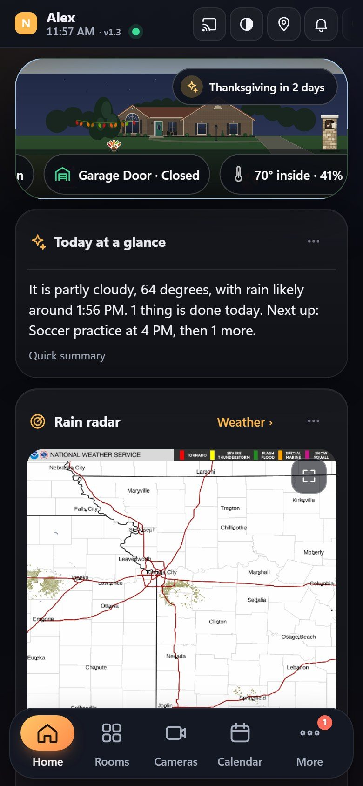

[← Nashboard](index.md)

# Home page

Home is the page most screens sit on. It has a banner at the top and a grid of cards below. Most cards are
**conditional**: they appear when they're useful and disappear when they aren't.

## The banner

- **House illustration** drawn in the browser, with day and night skies, stars and the moon. Windows light up
  when that room's lights are on; the porch light and lamp post follow the front-yard lights.
- **Driveway and mailbox**: the mailbox (a stone pillar) swings its door open with envelopes when mail is
  expected today, from USPS Informed Delivery emails. It stays beside the driveway.
- **Compact weather overlay** on wide banners: temperature, conditions, the next hours and quick facts. Narrow
  screens get a regular weather card instead.
- **Status chips** in a scrolling marquee **below the house** (not over it): lights on, garage, indoor temperature and
  humidity, mail and packages, low batteries, open doors and windows, updates available, pet problems. Tap a chip to
  act on it or open its details. Chips and switches have large invisible touch areas.
- **Tap the banner** for a bubble that explains what drives it: the sky (holiday, weather effect, sunrise and sunset) and
  the house (lights on, packages delivered today, holiday decorations), with links.
- **Tidbit chip**: one fun fact per page load, rotating through topics (lines of code in the dashboard, planes
  overhead, Space Station passes, packages this year, devices reporting, daylight and more).

The top bar shows the greeting, the time and date, how many lines of custom code the dashboard has, and the
connection status.

## Cards

| Card | When it shows |
|---|---|
| **Weather** | Always, unless the banner overlay is showing it; phones also get a card for the phone's own location |
| **Calendar / Up next** | Upcoming events, sized to fit names |
| **Rooms** | The six most-used rooms first (Show more for the rest) with quick controls; tap a room name for its room dashboard |
| **Cameras** | Camera snapshots |
| **Overhead** | A plane within 5 nm: photo, airline, route, altitude, speed and live distance. Stays at least 3 minutes and follows the plane as it leaves |
| **Space Station** | From 10 minutes before the ISS rises until it sets: a live sky dial with the pass track and where to look |
| **Games** | Your teams' games from a day before to a few hours after; live games show a pulsing dot and scores flash when they change |
| **Up next tasks** | Google Tasks due today are added to the Up next card |
| **Gas prices** | Cheapest nearby premium and diesel; collapsible |
| **Right now** | The cards that matter this minute, in priority order. The Claude card (admins who maintain the app) appears only while Claude is working and says what |
| **Ask Claude** | Everyone can type a question or request for Claude; it opens Claude in a new browser tab |
| **Claude admin** | Admins only: Claude's status and controls, split from Ask Claude |
| **Eat this first** | Leftovers from the Pantry & Fridge leftovers tracker, oldest first |
| **Gig night** | A gig coming up: start time, the be-there-by (setup) time and the plan |
| **Claude usage** | AI plan usage for the house's Claude account; collapsible |
| **Air quality** | Whenever outdoor air quality is Moderate or worse (AQI 51+): the same card as the Air page, with the next 12 hours and today's pollen when available. Stays at least 3 minutes |
| **Breaking news** | Recent big headlines, local first |

Commute trips live on the Commute page; Home shows Leave soon and On the way home only when they matter. Every card has a ⋯ menu in its header (Full window, Move, Collapse, Hide for today, Hide this card, How this works), and tapping a card's top bar collapses or expands it.

- **Collapsed cards show a one-line summary** in the header (weather, air, UV, commute, cameras, calendar, packages, trash night, the Litter-Robot and more).
- **Cards stay locked in place**: collapsing or expanding one never makes the others jump columns.
- **Move** in the card menu lets you drag a card to a new spot. The order is shared, so every screen shows the same layout.
- **How this works** in the card menu opens a short plain explanation of that card.
- **Page intro line**: a friendly one-line description under the page title; hide it with its Hide button or in Settings.
- **Rain radar** (and every radar) has a Full window button.

## Today at a glance and the order of cards

- **Today at a glance** is always the first card under the banner: two or three sentences about what already happened
  today, what is going on now and what is coming. With an AI set up in Home Assistant it is written by a local model
  (a cloud model only after an admin allows it); without one it is a plain summary built from the same facts.
- **Every automatic card has a priority**, so the order means something:
  1. **Urgent**: a fire alarm, a water leak, a power cut, someone at the door, severe weather, time to leave.
  2. **Needs doing today**: chores, maintenance that is due, medicine running low, trash night, a package outside.
  3. **Worth knowing**: low batteries, dinner tonight, a birthday coming up.
  4. **Lower priority**: quiet single-row cards are stacked together in one small card titled Lower priority, so they
     take one slot instead of six. Nothing is hidden.
- **Chips on a title** appear only when they add something the title does not say: the minutes left on a timed card
  ("23 min") or "overdue".
- **Full-screen card notices are off by default.** Turn them on in Settings and an urgent card that appears or clears
  by itself shows a big notice on wall screens and TVs. A phone, tablet or computer only joins in if you switch on "On
  this screen too" on that device. See [Settings](settings.md).

## Pop-up cards

The banner also has the **tidbit chip** (tap it for the next fun fact, including the app's estimated market value), the
**pet characters** (they react when someone is at the door) and **holiday decorations**. See [Every feature](features.md)
for the complete list.

Pop-up cards appear at the top when something needs attention. Each stays **at least 3 minutes** so the screen
doesn't flicker; if the situation clears sooner the card says so ("Closed now", "Lights are off now") and then
leaves. Several have a one-tap action button.

| Pop-up | Shows when | Action |
|---|---|---|
| Garage open | A garage door has been open more than 10 minutes | Close (tap twice to confirm) |
| Litter-Robot | Waste drawer nearly full, litter low, or a fault | |
| Rain coming | Rain or snow likely in the next few hours | |
| Freeze tonight | The overnight low will be at or below freezing | |
| Dinner tonight | Tonight's dinner from the meal plan, with when to start cooking | |
| Autoship soon | A recurring order ships within two days | |
| Maintenance due | A house job is due or overdue | Done |
| Trash night | The evening before (and morning of) trash or recycling pickup | |
| Lights still on | Late at night with two or more lights on | All off |
| Dog timeout | The dog timeout timer is running (counts down) | Done |
| Dog feeder | The feeder runs in the next 10 minutes | |
| Chores today | Family Board chores due today or overdue | Done |
| Markets | Weekdays around the market open and close, or after a big move | |
| Rocket launch | From 30 minutes before liftoff to 10 minutes after | |
| UV high | Around midday when the UV index is 6 or more | |
| Severe weather | A National Weather Service warning is active where you are | |
| Leave soon | A calendar event with a location starts within the hour, or a commute trip says it's time to go | Navigate |
| Nursery asleep | The nursery sound machine is playing at night (chimes go quiet) | |
| New on Wi-Fi | A device this screen hasn't seen before joins the network | Known |
| House health | No recent backup, or a storage volume needs attention (admins) | |
| Pollen | Pollen is medium-high or higher (and the air quality card isn't showing) | |
| Internet outage | A service the house depends on (remote access, Cloudflare, GitHub, Discord) reports a problem | |
| Medicine | A medicine was given and the next dose isn't OK yet ("next dose OK at …") | |
| Fever | A temperature of 100.4°F or higher was logged in the last 12 hours, with when Tylenol or ibuprofen is next OK | |
| Pantry: use soon | Pantry food expires in the next 3 days or just expired | Used up |
| Birthday coming up | A birthday on the calendar is within two weeks | Add gift to list |
| Intercom | Someone recorded a message for every screen in the last 10 minutes | Play |
| On the way home | Someone's commute home has started (arrival time, slower than usual) | |
| Claude | Claude Code usage near the limit, or a free usage reset waiting | |
| What's new | After an update, listing every change since this screen last looked | Got it |
| Good morning | 6 to 9 AM: weather, the first event, when to leave and the drive time, trash pickup, once-a-day medicines not given yet, the next birthday | |
| Goodnight check | 9 PM to 1 AM when lights are on, a door is unlocked, the garage is open or a TV is on | All off, Lock, Close (confirmed), Turn off |
| Doorbell | Someone rings or a person is at the front door (a live snapshot) | Ignore |
| Pet's medicine | A pet's medicine is due | Log now |
| Overdue tasks | A Google Task is overdue | |
| Pick up dinner? | Someone heads home between 4 and 8 PM | Call a carry-out place, Copy the order |
| Eat this first | Leftovers are waiting in the fridge (oldest first) | |
| Gas price drop | The cheapest nearby station for your fuel is at or below your price | |
| Car due soon | A car's registration, inspection or oil change is due within 30 days | |
| New car recall | The weekly recall check finds a new one | |
| Low batteries | Any device's battery is low (with its room) | |
| Medicine expiring | A medicine in the Pantry's Medicine place expires within a month | |
| Running low | A stored item is at or below its low count | Add to shopping list |
| Warranty ending | An appliance warranty ends within 30 days | |
| Holiday tradition | The week of a holiday you've saved a tradition for | Directions |
| The week ahead | Sunday 5 to 9 PM: events, trash days, birthdays, maintenance, weather trend | |
| Something to do today | Weekend mornings 8 to 10 AM: a kids' idea that fits the weather | |
| Movie night | Friday 5 to 9 PM: a pick from Family favorites | |
| For sale | Something has been listed for sale for a month | Sold |
| Hobbies | One of your hobbies has something coming up | |
| Gig | A gig is coming: shows "Gig" with the be-there-by (setup) time | |
| Medicine running low | A medicine expires within two weeks, or its quantity is 1 or low | Add to list |
| Leaving the house | Everyone has left (for 45 minutes after) and lights are on, a lock is unlocked, the garage is open or a door or window is open | All off (locks and garage take two taps) |
| Kitchen timer | A kitchen timer is running (counts down) | |
| Out the door | Weekday mornings 6:00 to 9:30, until everything is ticked or everyone has left | Tick items |
| Package left outside | A delivery sits out with nobody home, or after dark | |

Every one of these also lives on its own page's **Right now** card (see [Every feature](features.md#home-automatic-cards) for which page owns which). Add `?popdemo=1` to the dashboard address to preview every pop-up card with sample text.

## Layout behaviour

The grid packs cards to leave the least empty space while the page loads. After that, positions are fixed: a card
that grows (for example when expanded) pushes only the cards below it, and a new card drops into the shortest
column. Nothing jumps sideways. When a card is hidden or dismissed the others restack so no gap is left. Pets never
vanish or flicker when the page redraws. The **interface scale** (Settings → Look and size) re-packs cards, columns and
text smaller or larger, and Full window has its own − / + scale control.
