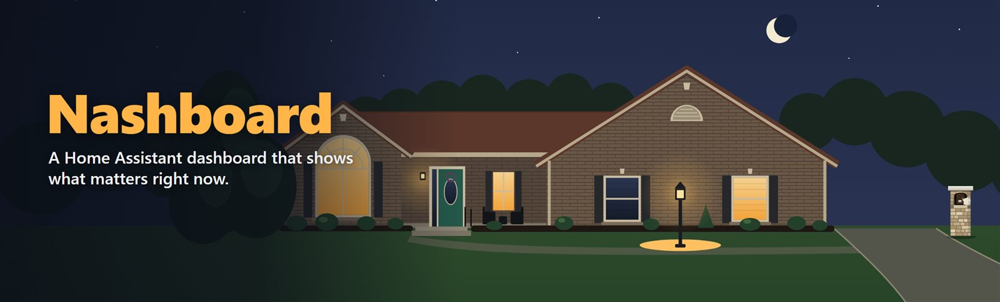
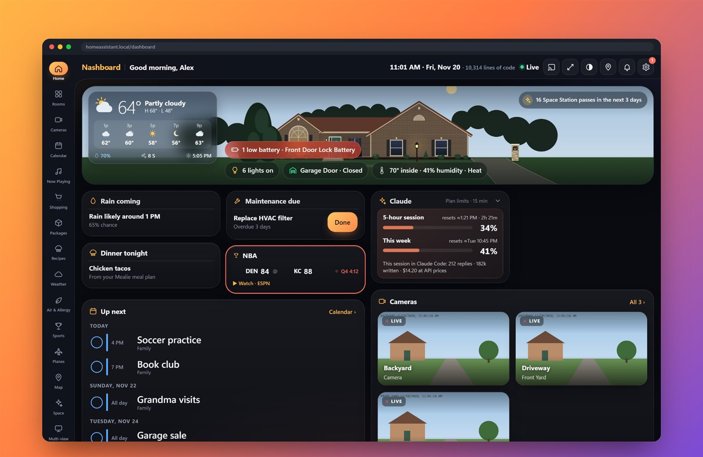

# Nashboard

Nashboard is a custom dashboard for [Home Assistant](https://www.home-assistant.io/). It is one HTML file that runs
inside Home Assistant (through a small Lovelace card), so it works anywhere Home Assistant does: wall tablets,
phones, laptops, and TVs through casting.

It is built around one idea: **the screen should show what matters right now, and get out of the way otherwise.**
Cards appear on their own when something needs attention (a plane overhead, the garage left open, rain coming,
trash night) and leave on their own when it no longer does.

*Screenshots use a made-up demo house; no real data.*

## Contents

- [Home page](home.md): the banner, every Home card, and the pop-up cards
- [All pages](pages.md): what each page shows and does
- [Settings and personalisation](settings.md): menu pages, per-user settings, display size, alerts
- [Data sources](integrations.md): which Home Assistant integrations and free services feed each page
- [How it works and installing](setup.md): the files, the card, deploying, backups

## Highlights

- **Illustrated home banner** with live lights, a mailbox that opens when mail is due, a compact weather overlay,
  status chips and a rotating "tidbit".
- **Smart Home cards**: overhead aircraft, the Space Station when it's up, live games, commute times, packages,
  breaking news, gas prices, and more, each shown only when useful.
- **Pop-up cards** (garage open, rain coming, freeze tonight, lights still on, maintenance due, trash night and others) that stay at least three minutes and say when the situation clears.
- **Stable layout**: once a page settles, cards never jump sideways; new cards drop into the emptiest spot.
- **25 pages**, from Rooms, Cameras and Calendar to Planes, Space, Air & Allergy, Network & Storage, a Family Board,
  a Guest page and per-room dashboards such as a calm Nursery screen.
- **Per-user settings** that follow each Home Assistant user to every device.
- **Casting** to TVs and a full-screen **Display** mode.
- **Phone compass**: the sky dials and the plane map turn as you turn the phone.

## Pages at a glance

| Page | In one line |
|---|---|
| [Home](home.md) | Banner, status, and the cards that matter right now |
| [Rooms](pages.md#rooms) | Every room's lights and devices, with room dashboards |
| [Cameras](pages.md#cameras) | Camera wall with layouts and live view |
| [Calendar](pages.md#calendar) | Day, week and month views; add and edit events |
| [Now Playing](pages.md#now-playing) | Music around the house, speaker groups, browsing |
| [Shopping](pages.md#shopping) | The shared shopping list |
| [Packages](pages.md#packages) | Shipments from any carrier, email import, autoship |
| [Recipes](pages.md#recipes) | Recipe book and meal plan from Mealie |
| [Weather](pages.md#weather) | Forecast, radar, sun and moon |
| [Air & Allergy](pages.md#air--allergy) | Air quality, UV, pollen, "open the windows?" |
| [Sports](pages.md#sports) | Your teams' games and live scores |
| [Commute](pages.md#commute) | Live drive times for each trip |
| [Planes](pages.md#planes) | Live aircraft map, airport boards, highest plane worldwide |
| [Map](pages.md#map) | People and devices on a map |
| [Space](pages.md#space) | Space Station passes, launches, satellites, sky dial |
| [Multi-view](pages.md#multi-view) | Several pages on one big screen |
| [Display](pages.md#display) | Full-screen TV mode |
| [Finance](pages.md#finance) | Watchlist and charts |
| [Room dashboards](pages.md#room-dashboards) | A page per room; the Nursery has its own design |
| [Network & Storage](pages.md#network--storage) | Internet, router, NAS, devices online |
| [Family Board](pages.md#family-board) | Kitchen screen: who's home, today, trash, lists |
| [Guest](pages.md#guest) | Wi-Fi QR code and house info for guests |
| [Maintenance](pages.md#maintenance) | Recurring house jobs with countdowns |
| [Pets](pages.md#pets) | Pet devices such as a self-cleaning litter box |
| [System](pages.md#system) | Health, updates, backups, settings |
| [Labs](pages.md#labs) | Experiments such as a 3D printer monitor |
