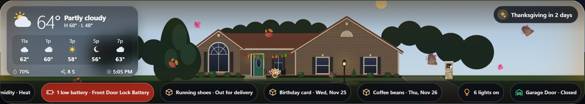

Nashboard 1.35 · for Home Assistant

<h1>The screen shows <em>what matters right now</em>, and gets out of the way otherwise.</h1>

A dashboard for wall tablets, phones and TVs. Cards appear on their own when something needs attention (a plane overhead, the garage left open, rain coming, trash night) and leave on their own when it no longer does.

More than 40 pagesRuns inside Home AssistantYour data stays at homeLocal AI only, unless you allow morePhones, tablets, TVs

<a class="nb-btn pri" href="tour.html">Take the tour</a><a class="nb-btn" href="getting-started.html">Get started</a><a class="nb-btn" href="faq.html">Questions</a><a class="nb-btn cof" href="https://buymeacoffee.com/jdrummernash1" target="_blank" rel="noopener"><svg class="nb-ic" aria-hidden="true"><use href="#i-coffee"/></svg>Buy me a coffee</a><a class="nb-btn" href="{{ site.demo_url }}setup.html#try-the-demo-first">Try the demo</a>

<a class="nb-door" href="living-with-nashboard.html"><b><svg class="nb-ic" aria-hidden="true"><use href="#i-home"/></svg>Use it</b><small>For everyone in the family: what the cards mean, the everyday habits, every page with a picture.</small>Living with Nashboard ›</a>
<a class="nb-door" href="setup.html"><b><svg class="nb-ic" aria-hidden="true"><use href="#i-setup"/></svg>Set it up</b><small>For the person with the Home Assistant sign-in: install in six steps, then the Getting started list.</small>Set it up ›</a>
<a class="nb-door" href="how-its-built.html"><b><svg class="nb-ic" aria-hidden="true"><use href="#i-build"/></svg>Behind the scenes</b><small>For the curious: the design rules, the automatic quality checks, and how it was built with AI helpers.</small>How it's built ›</a>

<!-- stats:start -->

<b>Nashboard</b>The screen shows what matters right now, and gets out of the way otherwise.

<b>59,772</b>Lines of custom code

<b>$374k–$747k</b>Market value · about 4,981 developer hours

<b>45</b>Pages

<b>1.35</b>Version

<b>66</b>Open backlog items

<b>32</b>Open bugs

<b>402</b>Changes shipped, last 7 days

<b>434 · 215 · 88</b>Design ideas: Human · Claude · other projects

<b>32</b>Most tasks running at once · record, Nov 26

Updated Nov 26 2026 · <a href="changelog.html">Change log</a>

<!-- stats:end -->

<!-- whatsnew:start -->

<h2>What's new · Nashboard 1.35</h2>

Everything since Nashboard 1.0 came out · updated Nov 26 2026 · <a href="changelog.html">full change log</a>

<ul><li>1.33 One Import button on Packages' "Found in your email" (Human)</li><li>1.33 Watch and phone battery picks only a real 0-100 % sensor (Human)</li><li>1.33 Agents card is a table with Active now and Done today bars (Human)</li><li>1.33 Hardware cards compact under the new rule (Human)</li><li>1.33 The Jot it down list clears filed ideas by itself, only from an admin screen, never deleting (Human)</li><li>1.33 Medicine logs kept 14 days (Human).</li><li>1.32 Top bar Undo button now the same size as every other bar button, new rule: all toolbar buttons the same size (Human)</li><li>1.32 Typing in Jot it down (or any text box) can no longer trigger the "this would remove saved entries" warning, and nothing is written while you type (Human)</li><li>1.32 Five Anthropic Claude Code skills added to the project's own skills with credits (webapp-testing, frontend-design, accessibility-review, design-critique, ux-copy; Human)</li><li>1.32 Household and private bills linked by name so a bill shows once on Home and Mark paid ticks both (Claude (found in review)).</li><li>1.31 20 GitHub-crawl ideas (all Suggested by Claude, each credited): Right now snooze and daily quiet windows (button only), speaker timers and alarms on Home, a note for the wall screen, wall screen remote controls</li><li>1.31 Next visible ISS pass with a where-to-look chart, plane watch list with quiet hours and photo, weather now marker, indoor comfort and mould-risk score</li><li>1.31 Cook mode step timers and swipes, pantry running-low with optional auto-add and Undo, appliance time left and finish time, compost and custom pickup days</li><li>1.31 Calendar day badges and saved views, bills checklist with who pays, room presence (opt-in), guest Wi-Fi voucher</li><li>1.31 Plant care limits and badges, pet meals today, Parcel app sensors in Packages, automation ideas on System. The private Finance bills Home row is renamed "My bills due" (Claude (found in review)).</li><li>1.30 Docs-publish and deep-polish build. Two-way Google sync phases 0-1: per-person and household calendar and list settings, shared Family calendar pickup, audit and round-trip tools (Human)</li><li>1.30 "Make the list for you" on Chores and Shopping (Human)</li><li>1.30 Full 4-part code review: 23 bugs fixed (wall-screen privacy leaks in AI summaries, the busy-clash suggestion, the camera timeline, kid schedule and car value; family inbox lost mail; double taps; screen-time limit; plurals and "ago" wording) plus 10 review follow-ups (Everyone home counts only people who share, no hardcoded PC name, list cards say when a list could not load, family inbox grown-ups only, medicine dose not logged twice, first-come chore credit, garage warning once, reward approve gated, weekend plan keeps private titles out) (Claude (found in review))</li><li>1.30 Card packer about twice as fast on phones, hardening sweep (Claude)</li><li>1.30 Docs pass: one New in 1.27 to 1.30 section, What's new fixed, page entries for 1.28-1.29 features (Claude).</li><li>1.29 Camera wall with one big picture and a 24-hour person and vehicle timeline with visitor pictures (credit deekay2153/ultimate-hikvision-nvr-card)</li><li>1.29 PTZ joystick with tap-to-aim and a vacuum map with tap-a-room cleaning</li><li>1.29 Old-device lite mode (credit myB0B/HA-SlimDash)</li><li>1.29 This year versus last year for weather and power, CSV export of any sensor history (credit bertel2020/HA-Apps)</li><li>1.29 Left before next paycheck, budgets and debt payoff on Finance (credit moeckjeremy/ledger-home-finance)</li><li>1.29 Run it now or wait energy line and a month view on the Up next card (credits murre87/energywizard, alexpfau/calendar-card-pro)</li><li>1.29 Cards redraw in place on every page (all Suggested by Claude)</li><li>1.29 Touch check fixes (Claude (found in review)).</li><li>1.28 Bookshelf: one family library on the Kids page with covers, per-person shelves and e-book provider links (Human)</li><li>1.28 Home swipe left turns a card off for good, with Undo (Human)</li><li>1.28 Kids reward store with grown-up approval, streaks and badges, chore rotation and first-come pool, screen-time card (Suggested by Claude, credits: ccpk1/ChoreOps, JVarhol/HA-Family-Hub, juju35)</li><li>1.28 Rain in the next 60 minutes, weather on calendar days, event directions in Maps or Waze, sleep timer, listening recap, guest jukebox, per-person calendar columns, private calendars as busy blocks, radar layers, power flow, per-appliance cost, battery fleet, QR/NFC maintenance labels, warranty ending, recall check, camera event filters, mail picture strip, floor plan, fridge door drift, plant thirst, car service from mileage, fever night summary, sleep-friendly night mode (Suggested by Claude, GitHub crawl; credits on the Credits page). Google sync phases 0-1 still being built.</li><li>1.27 Import a document: Undo, import history, "Tell the AI about this document" notes, sensible default calendars and lists, calendars and lists made automatically (Human)</li><li>1.27 Camera inside the dashboard for Take a photo (Human)</li><li>1.27 System page on phones redraws in place, new sysphonecheck (Human)</li><li>1.27 Smooth card motion and live slide-away while dragging, Home swipe right to hide for today (Human; swipe left still being fixed for 1.28)</li><li>1.27 Ideas card for bought hardware (Human)</li><li>1.27 Gigs spending section removed, opaque How it works, top bar see-through fix, medicine "1 days ago", daily agenda cleanup, pet care rises when overdue, Move to top, bigger sports balls (Human)</li><li>1.27 Ollama helpers yield while the family uses the AI (Human)</li><li>1.27 Spoken alerts with no screen open, shared speak path, local AI alert wording, surprise reveal sharing, learned shopping pairs, camera picture queue (Suggested by Claude)</li><li>1.27 Backlog cleanup and merge driver (Claude (found in review)).</li><li>1.26 Live activity strip in the Home banner, Tonight's plan, Heads-up on the week [Claude]</li><li>1.26 Energy outlook, why the power bill was up, Ask AI knows the house [Claude]</li><li>1.26 Shopping nudge, no dinner planned use these first, spoken urgent alerts [Claude]</li><li>1.26 Why is that alert on, sitter brief, surprise planner [Claude]</li><li>1.26 Camera alert zones, which package is that, while you were out, who is at the door in words [Claude]</li><li>1.26 Adaptive lighting, tomorrow's trips vs the charge, why the drive is slow, news that touches the house [Claude]</li><li>1.26 Phone alert digest, quiet-day recap, gift shop finder, home jobs from a sticky note, stock car photo [Claude]</li><li>1.26 When-this-do-that builder with reviewable automation drafts [Claude].</li><li>1.25 Needs attention card and Household modes [Claude]</li><li>1.25 Everyone home / last one out and Announce [Claude]</li><li>1.25 Storm prep list and Water running at night [Claude]</li><li>1.25 Private cards: my to-dos, private reminders, wish list, gift dates and sizes, gift deadlines [Claude]</li><li>1.25 Scene suggestions, light tint, raised cards feed Right now, sticky notes become chores, trash Done on the Family Board, Space data age on the TV [Claude]</li><li>1.25 Slow internet explained, litter box pattern, deadlines from email, repeat dinner with a swap, Ollama warm-up [Claude]</li><li>1.25 Door, lock and sensor history, locks by person with guest code, Sunday chores balance [Claude]</li><li>1.25 Tombstone cleanup, wall user calm page, sticky paper follows the Look [Claude]</li><li>1.25 Wall screen can save scene counts and the trash streak (needs the HA wall-save update) [Claude (found in review)]</li><li>1.25 Docs: changelog cleaned (no duplicates, no internal paths), page links fixed [Claude (found in review)].</li><li>1.24 Document import reads photos reliably (shrink, rotate, marker check) with Location + Room fields and a per-kid Daily agenda card [Human]</li><li>1.24 100% CPU alarm card for every computer [Human]</li><li>1.24 Card drag/resize saved per person, Wider/Narrower [Human]</li><li>1.24 Calm-layout fixes on Family, System, Hardware, Utilities, Design Studio [Claude (found in review)]</li><li>1.24 Performance: observer merge, timer fix, off-screen animation pause [Human]</li><li>1.24 Claude suggestions card and per-build suggestion pass [Human]</li><li>1.24 Workout and Documents read each person's own copy [Claude (found in review)]</li><li>1.24 Nine settings never fall back to defaults [Claude (found in review)]</li><li>1.24 Home Right now side-by-side heights [Human]</li><li>1.24 Companion app phone cards on Hardware [Human]</li><li>1.24 Now playing speakers, queue, favorites and radio [Human]</li><li>1.24 Wall picture-frame privacy mode [Human]</li><li>1.24 Banner layers, Now playing Stop sends stop, kid medicine to shopping list [Human]</li><li>1.24 Planned versions on the Backlog page, docs say where AI decides [Human]</li><li>1.24 Camera sound and phone camera alerts ready for HA [Human]</li><li>1.24 GitHub credits on About and a docs Credits page [Human]</li><li>1.24 Peak tasks stat on About and docs [Human]</li><li>1.24 Gesture and print checks [Human]</li><li>1.24 Changelog marks Human or Claude [Human]</li><li>1.24 Docs Listen mode and forks page [Human]</li><li>1.24 Let the app place this card [Claude].</li><li>1.23 Card drag and Wider/Narrower resize saved per person</li><li>1.23 Title-bar loading wheels</li><li>1.23 Combined cards round 3 (Health, Home upkeep, Daily routine) [Human]</li><li>1.23 One phone alert per security event [Source unknown]</li><li>1.23 Location share only by its owner [Human]</li><li>1.23 Package dedupe [Source unknown], delivery-check fixes and USPS email fallback</li><li>1.23 Shorter welcome tour and lighter defaults [Human]</li><li>1.23 Banner chips [Claude (found in review)], sticky countdown, Take a photo opens the camera, Cast fix and castcheck</li><li>1.23 Right now side-by-side heights on pages [Human]</li><li>1.23 Text-only AI to a local text model [Source unknown]</li><li>1.23 Screens always reach the latest build</li><li>1.23 Document import review flow (Location + Room, lunch menu calendar, marker confirm, pack-a-lunch reminders; reading the menu and agenda photos continues in 1.24)</li><li>1.23 Wall screens drop the finance cache</li><li>1.23 About and Backlog on Smart layout [Human]</li><li>1.23 A gone card closes its gap once [Source unknown]</li><li>1.23 Docs tables, contents list, prev/next links and Home Assistant OS intro [Human].</li><li>1.23 Card drag and Wider/Narrower resize saved per person</li><li>1.23 Title-bar loading wheels</li><li>1.23 Combined cards round 3 (Health, Home upkeep, Daily routine)</li><li>1.23 One phone alert per security event</li><li>1.23 Location share only by its owner</li><li>1.23 Package dedupe, delivery-check fixes and USPS email fallback</li><li>1.23 Shorter welcome tour and lighter defaults</li><li>1.23 Banner chips, sticky countdown, Take a photo opens the camera, Cast fix and castcheck</li><li>1.23 Right now side-by-side heights on pages</li><li>1.23 Text-only AI to a local text model</li><li>1.23 Screens always reach the latest build</li><li>1.23 Document import review flow (Location + Room, lunch menu calendar, marker confirm, pack-a-lunch reminders; reading the menu and agenda photos continues in 1.24)</li><li>1.23 Wall screens drop the finance cache</li><li>1.23 About and Backlog on Smart layout</li><li>1.23 A gone card closes its gap once</li><li>1.23 Docs tables, contents list, prev/next links and Home Assistant OS intro.</li><li>1.22 The combined-card groups that missed 1.21 (Weather, Deliveries, Family today, Pets, Car) [Human], review fixes (printer controls need two taps and are hidden on wall screens, Send to printer only to notify/script actions, the loading wheel only on real placeholders, clearing the last package saves properly, card order version) [Claude (found in review)], the Scale button works on every page, the weather card starts collapsed off the banner [Human], car fixes (stable ids, adding waits for load) [Claude (found in review)], phone banner strip above the house art for the notes button and holiday chip, shopping list sorted by store department, hobbies project file monitor, sticky notes no longer duplicate, data package history, Black-owned and other businesses card with a kinds picker [Human], Arriving today packages card [Claude].</li><li>1.22 The combined-card groups that missed 1.21 (Weather, Deliveries, Family today, Pets, Car), review fixes (printer controls need two taps and are hidden on wall screens, Send to printer only to notify/script actions, the loading wheel only on real placeholders, clearing the last package saves properly, card order version), the Scale button works on every page, the weather card starts collapsed off the banner, car fixes (stable ids, adding waits for load), phone banner strip above the house art for the notes button and holiday chip, shopping list sorted by store department, hobbies project file monitor, sticky notes no longer duplicate, data package history, Black-owned and other businesses card with a kinds picker, Arriving today packages card.</li><li>1.21 Printers (Add a printer for any printer type, printer controls, Print reports card, low toner to the shopping list) [Human], deleted items stay deleted across screens (about 25 lists, cleaned up after 90 days; packages and autoship now versioned) [Claude (found in review)], loading wheels everywhere with Retry after a timeout, drag cards with the mouse and set a card width, combined cards on Home (House status, Plans and food; the Weather, Deliveries, Family today, Pets and Car groups were left out of 1.21 by mistake and ship in 1.22) [Human], one layout for every Hardware card [Source unknown], Phones and laptops battery card, leftovers trash button with history, cards and pages ordered by use with a Raised for you mark [Human], wall screen calm self-check, scroll health line on System [Claude], print buttons on more pages [Human], one camera alerts card [Source unknown].</li><li>1.21 Printers (Add a printer for any printer type, printer controls, Print reports card, low toner to the shopping list) [Human], deleted items stay deleted across screens (about 25 lists, cleaned up after 90 days; packages and autoship now versioned) [Claude (found in review)], loading wheels everywhere with Retry after a timeout, drag cards with the mouse and set a card width [Human], combined cards on Home (House status, Plans and food, Weather, Deliveries, Family today, Pets, Car) [Claude], one layout for every Hardware card [Source unknown], Phones and laptops battery card, leftovers trash button with history, cards and pages ordered by use with a Raised for you mark [Human], wall screen calm self-check, scroll health line on System [Claude], print buttons on more pages [Human], one camera alerts card [Source unknown].</li><li>1.21 Printers (Add a printer for any printer type, printer controls, Print reports card, low toner to the shopping list), deleted items stay deleted across screens (about 25 lists, cleaned up after 90 days; packages and autoship now versioned), loading wheels everywhere with Retry after a timeout, drag cards with the mouse and set a card width, combined cards on Home (House status, Plans and food; the Weather, Deliveries, Family today, Pets and Car groups were left out of 1.21 by mistake and ship in 1.22), one layout for every Hardware card, Phones and laptops battery card, leftovers trash button with history, cards and pages ordered by use with a Raised for you mark, wall screen calm self-check, scroll health line on System, print buttons on more pages, one camera alerts card.</li><li>1.21 Printers (Add a printer for any printer type, printer controls, Print reports card, low toner to the shopping list), deleted items stay deleted across screens (about 25 lists, cleaned up after 90 days; packages and autoship now versioned), loading wheels everywhere with Retry after a timeout, drag cards with the mouse and set a card width, combined cards on Home (House status, Plans and food, Weather, Deliveries, Family today, Pets, Car), one layout for every Hardware card, Phones and laptops battery card, leftovers trash button with history, cards and pages ordered by use with a Raised for you mark, wall screen calm self-check, scroll health line on System, print buttons on more pages, one camera alerts card.</li><li>1.20 Calm layout (banner full width from the first frame, cards placed before they show, no cards moving on their own; re-layout at most every 5 minutes and never on screen), sticky notes as a banner button, banner never stretches tall [Human], smoother phone scrolling [Claude (found in review)], tighter cards, top-bar badge under tablet width, game-day balloons [Human]</li><li>1.20 A full code review (about 60 fixes: data that could be lost, crashes on bad saved data, unsafe links, privacy on wall and kid screens), dead-button sweep (no dead controls found) [Claude (found in review)], Move mode Cancel button, empty-Add hints [Source unknown], Display wake lock fix [Claude (found in review)]</li><li>1.20 Docs and pictures updated [Human].</li><li>1.20 Calm layout (banner full width from the first frame, cards placed before they show, no cards moving on their own; re-layout at most every 5 minutes and never on screen), sticky notes as a banner button, banner never stretches tall, smoother phone scrolling, tighter cards, top-bar badge under tablet width, game-day balloons</li><li>1.20 A full code review (about 60 fixes: data that could be lost, crashes on bad saved data, unsafe links, privacy on wall and kid screens), dead-button sweep (no dead controls found), Move mode Cancel button, empty-Add hints, Display wake lock fix</li><li>1.20 Docs and pictures updated.</li><li>1.19 Cards no longer stack on top of each other on a phone, the page stays put while cards change size [Claude (found in review)], Smart layout on by default (per-screen off switch), wall screen user (private and grown-ups cards hidden on a marked login), Right now Done hides a row on every screen with Undo and syncs to the car, sticky notes as a yellow paper Home card, businesses card picks home needs with AI and offers a one-tap search, kinds of business to support, Ask AI lists claude.ai only when cloud AI is allowed [Human], GoatCounter ready for a site code [Source unknown], contrast fixes [Claude (found in review)], 2.0 prep (home network address out of the tools, finance link only in settings, licence draft) [Claude].</li><li>1.19 Cards no longer stack on top of each other on a phone, the page stays put while cards change size, Smart layout on by default (per-screen off switch), wall screen user (private and grown-ups cards hidden on a marked login), Right now Done hides a row on every screen with Undo and syncs to the car, sticky notes as a yellow paper Home card, businesses card picks home needs with AI and offers a one-tap search, kinds of business to support, Ask AI lists claude.ai only when cloud AI is allowed, GoatCounter ready for a site code, contrast fixes, 2.0 prep (home network address out of the tools, finance link only in settings, licence draft).</li><li>1.18 Readable colours on the card 3-dot icon and the menu SOON badge [Human], Finance tags [Source unknown], the Print monitor icon and the Wellbeing breathing text [Human]</li><li>1.18 Commute history card no longer stretches</li><li>1.18 Checks cover every page and width [Source unknown].</li><li>1.18 Readable colours on the card 3-dot icon and the menu SOON badge, Finance tags, the Print monitor icon and the Wellbeing breathing text</li><li>1.18 Commute history card no longer stretches</li><li>1.18 Checks cover every page and width.</li><li>1.17 Smart layout trial on every page with a Right now box (one canvas, section chips, moves into another section stick, use order weighs placement) [Human], smoother phone scrolling (background work waits out a whole swipe series) [Claude (found in review)], signing back in on a tablet brings back your own settings and switches the look at once, house trees stay on the banner and the photo reader asks one or two trees [Source unknown], house decor sway off on phones [Human].</li><li>1.17 Smart layout trial on every page with a Right now box (one canvas, section chips, moves into another section stick, use order weighs placement), smoother phone scrolling (background work waits out a whole swipe series), signing back in on a tablet brings back your own settings and switches the look at once, house trees stay on the banner and the photo reader asks one or two trees, house decor sway off on phones.</li><li>1.16 Ask AI card (local AI first, model drop-down, answers in the card), My gift ideas card (private to your own account), light buttons show the live colour, Space page loads again (fallback sources, keeps last data, retries), one Closest card on Planes, plain HASS.Agent steps on Hardware, add a card on Home and the Family Board plus 6 more addable cards, pages rise by use too, house picture links and live touches, businesses card local AI words [Human], sign-in switch keeps each person's settings apart [Source unknown], Design Studio AI usage refreshes itself and lists every model, idle agents hide after 5 minutes, org chart shows the standard teams [Human], docs visit row [Source unknown], kitchen display switch instant [Human], wording fixes [Claude (found in review)], check tools fixed [Claude].</li><li>1.16 Ask AI card (local AI first, model drop-down, answers in the card), My gift ideas card (private to your own account), light buttons show the live colour, Space page loads again (fallback sources, keeps last data, retries), one Closest card on Planes, plain HASS.Agent steps on Hardware, add a card on Home and the Family Board plus 6 more addable cards, pages rise by use too, house picture links and live touches, businesses card local AI words, sign-in switch keeps each person's settings apart, Design Studio AI usage refreshes itself and lists every model, idle agents hide after 5 minutes, org chart shows the standard teams, docs visit row, kitchen display switch instant, wording fixes, check tools fixed.</li><li>1.15 Smart layout trial on Family and System (one canvas), cards rise by use with a Raised for you mark [Human], add or remove a card on any page (Home and Family Board too) [Claude], Black-owned businesses card (local AI words), sticky notes edit in place and phone reminders [Human], trash Done by [Claude (found in review)], house picture links and live touches (mailbox glow, garage open, solar shimmer), Family scroll freeze fixed at the packer [Human], contrast fixes (Display chip strip, card menus on phones, weather, nursery) [Claude (found in review)], kitchen display switch instant [Human], room words fixed [Claude], docs for 1.12-1.15 with all pictures retaken, Claude Max month in the costs [Claude (found in review)].</li><li>1.15 Smart layout trial on Family and System (one canvas), cards rise by use with a Raised for you mark, add or remove a card on any page (Home and Family Board too), Black-owned businesses card (local AI words), sticky notes edit in place and phone reminders, trash Done by, house picture links and live touches (mailbox glow, garage open, solar shimmer), Family scroll freeze fixed at the packer, contrast fixes (Display chip strip, card menus on phones, weather, nursery), kitchen display switch instant, room words fixed, docs for 1.12-1.15 with all pictures retaken, Claude Max month in the costs.</li><li>1.14 Hardware page matches HASS.Agent sensors with a setup guide for PCs with none, Pi card text wraps, live games window, TV plane map beside the radar, sticky notes on Home [Human], related settings in card menus [Claude], camera-first picture picker [Source unknown], baby monitor card, Import a document only on Calendar and Family, admin Visits card, Throttle the Model card, bedroom TV cast fixes, icons readable on and off [Human], empty-state icons readable [Claude (found in review)].</li><li>1.13 Card options open under their own 3-dot everywhere (optioncheck) [Human], What's new fits any screen [Source unknown], cast strip uses the Home chips, cat medicine copies update together [Human], trash Done button [Source unknown], wishlist links survive the name filter [Human], Packages text in full, "N Open in B/L" [Source unknown], agent activity keeps refreshing on throttled devices [Human], Family patches only changed sections, TV view at phone width [Claude (found in review)], card headers 48 px [Source unknown], contrast and tap fixes on every page [Claude (found in review)], System/Packages/Hobbies cards movable [Source unknown].</li><li>1.12 Hardware page shows one card per PC running HASS.Agent (found automatically, Add another PC how-to) [Human], Home idle CPU cut by two thirds, smoother phone scrolling [Claude (found in review)], banner clock matches the top bar, phone top bar keeps the clock in view, chip strip fades at its edges [Human], demo sports card, Kids and hobby chips show their state, Kids card loads on Settings [Source unknown], fewer repeat AI summary calls [Claude (found in review)], Buy me a coffee on the About page [Source unknown], all docs pictures retaken without maintainer chips, device check tuned [Claude (found in review)].</li><li>1.11 Camera sound over WebRTC first, camera-model training wizard (past footage, snapshot collector) [Human], per-kind phone alerts per camera [Claude], map garage label [Source unknown], more house picture options and the photo reader filling them, demo built from the screenshot data [Human], scroll-safe page timers [Claude (found in review)], map markers spread apart [Human], faster device lookups [Source unknown], Family card on the column grid [Human], savecheck and loadcheck warnings nearly cleared, How it works audit (18 fixes) [Claude (found in review)], HA camera alerts automation (off until switched on) and vision switches [Human].</li><li>1.10 Camera control bar with tap-for-sound and Talk [Human], every vision alert on one screen with camera detections grouped on Home [Claude], Camera models (setup, lighting checklist, hold time, Frigate steps), cards in wrappers move again [Human], Security page folded into Activity [Source unknown], one Agents card plus an org chart, a Kids list in Settings, hobby owners and spending [Human], wording check clean on every page [Claude (found in review)], docs keep one version everywhere. Tools: overlapcheck skips closed sections, scrollcheck closes its browsers [Human].</li><li>1.9 Bigger banner clock with the info chip stacked under it [Human], top bar text tightens before it scrolls [Source unknown], About page facts generated at build time (109 Home cards, 306 cards, checks, models) [Claude], Design Studio status from one live model [Human], docs written from the app [Source unknown], first-screen check (Commute chart no longer mostly empty) [Claude], a 44 px move handle and a new card-move check [Human], check runs stop at 5 minutes [Source unknown].</li></ul>

<!-- whatsnew:end -->

<video autoplay muted loop playsinline preload="auto" poster="images/snip-home.jpg" aria-label="The Nashboard Home page running on a laptop: the animated banner, the scrolling chips and the cards"><source src="images/snip-home.webm" type="video/webm"></video>

Nashboard is a custom dashboard for [Home Assistant](https://www.home-assistant.io/). It runs inside Home Assistant
(through a small dashboard card), so it works anywhere Home Assistant does: wall tablets, phones, laptops, and TVs
through casting. Nothing to host, no account of its own.

## What is Home Assistant OS, and what does this cost?

**Home Assistant OS** is the free, open-source operating system that runs Home Assistant on a small computer (a
Raspberry Pi, a mini PC, or a virtual machine). Install it once and it manages itself: it connects your lights, locks,
cameras, sensors and services in one place, keeps working without the internet for local devices, and updates in a few
taps. Nashboard is a dashboard that runs inside it.

**It is all free, with no monthly payment.** Home Assistant OS, Home Assistant, Nashboard and the free data services it
reads (weather, planes, space, and so on) cost nothing to run. The only things you might ever pay for are optional: an AI
subscription, if you choose to let the AI helpers use a paid service, and the hardware you run it on. Nashboard works
with local AI only unless you allow more.

☕ If Nashboard is useful to you, you can [buy me a coffee](https://buymeacoffee.com/jdrummernash1).

## Use it

- [Why Nashboard](why-nashboard.md): what problem it solves, for someone new to smart homes
- [Guided tour](tour.md): a step-by-step visual walkthrough, one screenshot per page
- [Living with Nashboard](living-with-nashboard.md): the everyday habits that get the most out of it
- [Home page](home.md): the banner, every Home card, and how the order is decided
- [All pages](pages.md): every page, with a screenshot of each
- [Every feature](features.md): the complete list, including every automatic Home card
- [Themes](themes.md): every look, light and dark, and the accent colours
- [Nashboard 1.0](release-1.0.md): what is in the first release
- [FAQ](faq.md): the questions people ask first

## Set it up

- [Set it up](setup.md): what you need, installing in six steps, and what each page needs
- [Getting started](getting-started.md): your first hour, in the order that works
- [Settings and personalisation](settings.md): the Settings page, per-person settings, interface scale, alerts
- [Device setup checklist](device-setup.md): what each TV, wall tablet, phone, car and watch needs
- [Data sources](integrations.md): every Home Assistant integration and free service the app uses
- [Automations](automations.md): the phone alerts and reminders the house can run on its own, and how to turn each off
- [Notifications](notifications.md): every notification the system can send, generated from the real automations

## Behind the scenes

- [How it all connects](how-it-connects.md): from devices and data sources through Home Assistant to the cards
- [How it's built](how-its-built.md): the design models and rules, the quality checks, the build and deploy pipeline
- [How the AI builds it](ai-build-system.md): the main chat and its helpers, usage tracking, the autopilot panel
- [Diagrams](diagrams.md) and [App architecture](app-architecture.md): how the app is structured and how data is protected
- [Developer workflow](developer-workflow.md) and [Developer tools](developer-tools.md): from a jotted idea to a deployed build
- [Design engine](design-engine.md) and [Design kit](design-kit.md): every design rule in plain language, and as one shareable file
- [Forks and models](forks-and-models.md): the separately maintained design guides, quality checks and autopilot panel
- [Future: car app](car-app.md): a Labs prototype for Android Auto, as design mockups
- [Change log](changelog.md): everything shipped, newest first
- [Credits](credits.md): the GitHub projects Nashboard stands on, and their authors

**How it is built, in short.** The code is written as more than 450 small source pieces (JavaScript and CSS, one piece per
feature or page), not as one big file. A build script joins the pieces in order, checks that the result parses, and
writes one generated page that Home Assistant serves. Nobody edits that generated page by hand. Before every deploy a set
of automatic checks loads the real app in a headless browser and fails on any broken design rule (card gaps and widths,
overlapping controls, one Right now area per page, name clashes, saved data, maps, legends, speed, a priority for every
Home card, and nothing personal hardcoded). Values that belong to one household live in saved settings, never in the code.

*Screenshots use a made-up demo house; no real data.*

## Highlights

- **Illustrated home banner** with live lights, a mailbox that opens when mail is due, a compact weather overlay,
  status chips and a rotating "tidbit".
- **Smart Home cards**: overhead aircraft, the Space Station when it's up, live games, commute times, packages,
  breaking news, gas prices, and more, each shown only when useful.
- **Pop-up cards** (garage open, rain coming, freeze tonight, lights still on, maintenance due, trash night and others) that stay at least three minutes and say when the situation clears.
- **Stable layout**: once a page settles, cards never jump sideways; new cards drop into the emptiest spot.
- **More than 40 pages**, from Rooms, Cameras and Calendar to Planes, Space, Air & Allergy, Network & Storage, a Family
  Board, Security, a Guest page, Storage, Hobbies, Workout, an Activity timeline and per-room dashboards such as a calm
  Nursery screen, plus a Kitchen tablet mode for a wall screen.
- **Background automations** that reach every phone with the screen off: medicine OK again, the dog timeout, birthdays,
  the week ahead, the goodnight check, gas price drops, a package left outside, planes and the Space Station. See
  [Automations](automations.md).
- **Medicine & fever tracking** per child, **pet medicine by NFC tag**, cars by VIN with recall checks, and a house
  inventory with printable QR labels.
- **Per-user settings** that follow each Home Assistant user to every device.
- **Casting** to TVs and a full-screen **Display** mode.
- **Phone compass**: the sky dials and the plane map turn as you turn the phone.

## Pages at a glance

<!-- pagelist:start -->
### Main tabs (bottom bar on phones)

| Page | What it is |
|---|---|
| [Home](pages.md#home) | Overview of the house |
| [Rooms](pages.md#rooms) | Lights and devices by room |
| [Cameras](pages.md#cameras) | Live camera views |
| [Calendar](pages.md#calendar) | Agenda and events |

### Everyday

| Page | What it is |
|---|---|
| [Family Board](pages.md#family-board) | Who’s home, chores, medicine and birthdays |
| [Shopping](pages.md#shopping) | Shopping list |
| [Packages](pages.md#packages) | Tracking and autoships |
| [Weather](pages.md#weather) | Forecast, radar and alerts |
| [Activity](pages.md#activity) | What happened around the house today |

### House

| Page | What it is |
|---|---|
| [Pantry & Fridge](pages.md#pantry--fridge) | Pantry, fridge and freezer: what expires soon |
| [Recipes](pages.md#recipes) | Meal plan and recipes |
| [Maintenance](pages.md#maintenance) | Home maintenance schedule |
| [Storage](pages.md#storage) | Where things are kept around the house |
| [Garage](pages.md#garage) | Cars, the garage door, charging and your toolboxes |
| [Automations](pages.md#automations) | What the house does on its own |
| [Utilities](pages.md#utilities) | Water leaks, UPS battery and printer ink |
| [Pool](pages.md#pool) | Water chemistry, what to add, and a test log |

### Family

| Page | What it is |
|---|---|
| [Kids](pages.md#kids) | Chores, stars, shows and fun, with big buttons |
| [Pets](pages.md#pets) | Pet characters, timeout, feeder and devices |
| [Guest](pages.md#guest) | Wi-Fi, contacts and how-tos for guests |
| [Sitter monitor](pages.md#sitter-monitor) | Cameras, room, medicine and who to call |
| [Wellbeing](pages.md#wellbeing) | Mood check-ins, breathing, wind-down and gratitude, just for you |
| [Workout](pages.md#workout) | Routines, interval timer, health stats and a log |
| [Hobbies](pages.md#hobbies) | Your hobbies, set lists, book club and more |

### Out & about

| Page | What it is |
|---|---|
| [Commute](pages.md#commute) | Trips, drive times and leave-soon |
| [Map](pages.md#map) | People and devices on a map |
| [Air & Allergy](pages.md#air--allergy) | Air quality and pollen |
| [Planes](pages.md#planes) | Aircraft overhead |
| [Space](pages.md#space) | Space Station, launches and satellites |

### Fun & info

| Page | What it is |
|---|---|
| [Now Playing](pages.md#now-playing) | What’s playing, browse and play |
| [Sports](pages.md#sports) | Scores, schedules and replays |
| [Finance](pages.md#finance) | Markets and watchlist |
| [Multi-view](pages.md#multi-view) | Several pages at once |

### Labs

| Page | What it is |
|---|---|
| [Labs](pages.md#labs) | Experiments such as Energy and bills |
| [Browser](pages.md#labs) | Quick web look-ups |
| [3D Printer](pages.md#labs) | 3D printer status |
| [Energy](pages.md#labs-energy-and-bills) | Power, usage and bills |

### System

| Page | What it is |
|---|---|
| [Network](pages.md#network--storage) | Wi-Fi devices, speed and internet services |
| [Settings](pages.md#settings) | You, this screen, the household, alerts, and the house and app |
| [System](pages.md#system) | Updates, batteries, backups and the app’s data |
| [Hardware](pages.md#hardware) | Computers, phones, printers, router and NAS |
| [About](pages.md#about) | Version, what’s new, features and credits |

### Other pages

| Page | What it is |
|---|---|
| [Security](pages.md#security) | Alerts, doors, garage, locks, alarms and cameras, kept until seen |

### Screens and views

| Page | What it is |
|---|---|
| [Display](pages.md#display) | Full-screen TV mode, a different setup per TV |
| [Kitchen tablet](pages.md#kitchen-tablet) | Home on a kitchen wall screen, back to Home when idle, dim at night |
| [Room dashboards](pages.md#room-dashboards) | A page per room; the Nursery has its own design |

<!-- pagelist:end -->
