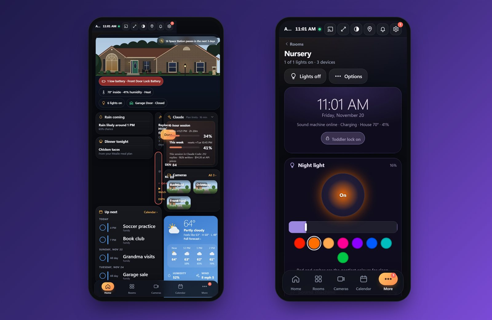

Nashboard 1.0 · for Home Assistant

<h1>The screen shows <em>what matters right now</em>, and gets out of the way otherwise.</h1>

A dashboard for wall tablets, phones and TVs. Cards appear on their own when something needs attention (a plane overhead, the garage left open, rain coming, trash night) and leave on their own when it no longer does.

More than 40 pagesRuns inside Home AssistantYour data stays at homeLocal AI only, unless you allow morePhones, tablets, TVs

<a class="nb-btn pri" href="tour.html">Take the tour</a><a class="nb-btn" href="getting-started.html">Get started</a><a class="nb-btn" href="faq.html">Questions</a>

<a class="nb-door" href="living-with-nashboard.html"><b><svg class="nb-ic" aria-hidden="true"><use href="#i-home"/></svg>Use it</b><small>For everyone in the family: what the cards mean, the everyday habits, every page with a picture.</small>Living with Nashboard ›</a>
<a class="nb-door" href="setup.html"><b><svg class="nb-ic" aria-hidden="true"><use href="#i-setup"/></svg>Set it up</b><small>For the person with the Home Assistant sign-in: install in six steps, then the Getting started list.</small>Set it up ›</a>
<a class="nb-door" href="how-its-built.html"><b><svg class="nb-ic" aria-hidden="true"><use href="#i-build"/></svg>Behind the scenes</b><small>For the curious: the design rules, the automatic quality checks, and how it was built with AI helpers.</small>How it's built ›</a>

<!-- stats:start -->

<b>34,407</b>Lines of custom code

<b>$215k–$430k</b>Market value · about 2,867 developer hours

<b>44</b>Pages

<b>.265</b>Latest build number

<b>11</b>Open backlog items

<b>1</b>Open bugs

<b>355</b>Changes shipped, last 7 days

Updated Nov 24 2026 · <a href="changelog.html">Change log</a>

<!-- stats:end -->

<!-- whatsnew:start -->

<h2>What's new · latest release build .265</h2>

Everything shipped since the last docs update (build .264) · updated Nov 24 2026 · <a href="changelog.html">full change log</a>

<ul><li>.265 Set-up cards fold into one "More to set up" card, the quiet-rows fold is remembered, the menu is grouped into sections, readable weather hour labels, Fire safety cards full width on the Family Board, readable NEW badge.</li></ul>

<!-- whatsnew:end -->

Nashboard is a custom dashboard for [Home Assistant](https://www.home-assistant.io/). It runs inside Home Assistant
(through a small dashboard card), so it works anywhere Home Assistant does: wall tablets, phones, laptops, and TVs
through casting. Nothing to host, no account of its own.

☕ If Nashboard is useful to you, you can [buy me a coffee](https://buymeacoffee.com/jdrummernash1).

## Use it

- [Why Nashboard](why-nashboard.md): what problem it solves, for someone new to smart homes
- [Guided tour](tour.md): a step-by-step visual walkthrough, one screenshot per page
- [Living with Nashboard](living-with-nashboard.md): the everyday habits that get the most out of it
- [Home page](home.md): the banner, every Home card, and how the order is decided
- [All pages](pages.md): every page, with a screenshot of each
- [Every feature](features.md): the complete list, including every automatic Home card
- [Themes](themes.md): every look, light and dark, and the accent colours
- [Nashboard 1.0](release-1.0.md): what is in the first release
- [FAQ](faq.md): the questions people ask first

## Set it up

- [Set it up](setup.md): what you need, installing in six steps, and what each page needs
- [Getting started](getting-started.md): your first hour, in the order that works
- [Settings and personalisation](settings.md): the Settings page, per-person settings, interface scale, alerts
- [Device setup checklist](device-setup.md): what each TV, wall tablet, phone, car and watch needs
- [Data sources](integrations.md): every Home Assistant integration and free service the app uses
- [Automations](automations.md): the phone alerts and reminders the house can run on its own, and how to turn each off

## Behind the scenes

- [How it all connects](how-it-connects.md): from devices and data sources through Home Assistant to the cards
- [How it's built](how-its-built.md): the design models and rules, the quality checks, the build and deploy pipeline
- [How the AI builds it](ai-build-system.md): the main chat and its helpers, usage tracking, the autopilot panel
- [Diagrams](diagrams.md) and [App architecture](app-architecture.md): how the app is structured and how data is protected
- [Developer workflow](developer-workflow.md) and [Developer tools](developer-tools.md): from a jotted idea to a deployed build
- [Design engine](design-engine.md) and [Design kit](design-kit.md): every design rule in plain language, and as one shareable file
- [Future: car app](car-app.md): a Labs prototype for Android Auto, as design mockups
- [Change log](changelog.md): everything shipped, newest first

**How it is built, in short.** The code is written as about 290 small source pieces (JavaScript and CSS, one piece per
feature or page), not as one big file. A build script joins the pieces in order, checks that the result parses, and
writes one generated page that Home Assistant serves. Nobody edits that generated page by hand. Before every deploy a set
of automatic checks loads the real app in a headless browser and fails on any broken design rule (card gaps and widths,
overlapping controls, one Right now area per page, name clashes, saved data, maps, legends, speed, a priority for every
Home card, and nothing personal hardcoded). Values that belong to one household live in saved settings, never in the code.

*Screenshots use a made-up demo house; no real data.*

## Highlights

- **Illustrated home banner** with live lights, a mailbox that opens when mail is due, a compact weather overlay,
  status chips and a rotating "tidbit".
- **Smart Home cards**: overhead aircraft, the Space Station when it's up, live games, commute times, packages,
  breaking news, gas prices, and more, each shown only when useful.
- **Pop-up cards** (garage open, rain coming, freeze tonight, lights still on, maintenance due, trash night and others) that stay at least three minutes and say when the situation clears.
- **Stable layout**: once a page settles, cards never jump sideways; new cards drop into the emptiest spot.
- **More than 40 pages**, from Rooms, Cameras and Calendar to Planes, Space, Air & Allergy, Network & Storage, a Family
  Board, Security, a Guest page, Storage, Hobbies, Workout, an Activity timeline and per-room dashboards such as a calm
  Nursery screen, plus a Kitchen tablet mode for a wall screen.
- **Background automations** that reach every phone with the screen off: medicine OK again, the dog timeout, birthdays,
  the week ahead, the goodnight check, gas price drops, a package left outside, planes and the Space Station. See
  [Automations](automations.md).
- **Medicine & fever tracking** per child, **pet medicine by NFC tag**, cars by VIN with recall checks, and a house
  inventory with printable QR labels.
- **Per-user settings** that follow each Home Assistant user to every device.
- **Casting** to TVs and a full-screen **Display** mode.
- **Phone compass**: the sky dials and the plane map turn as you turn the phone.

## Pages at a glance

| Page | In one line |
|---|---|
| [Home](pages.md#home) | Banner, status, and the cards that matter right now |
| [Rooms](pages.md#rooms) | Every room's lights and devices, with room dashboards |
| [Cameras](pages.md#cameras) | Camera wall with layouts and live view |
| [Calendar](pages.md#calendar) | Day, week and month views; add and edit events; Google Tasks |
| [Activity](pages.md#activity) | Today's timeline: doorbell, doors, garage, arrivals, packages |
| [Now Playing](pages.md#now-playing) | Music around the house, speaker groups, browsing |
| [Shopping](pages.md#shopping) | The shared shopping list |
| [Packages](pages.md#packages) | Shipments from any carrier, email import, autoship |
| [Recipes](pages.md#recipes) | Recipe book and meal plan from Mealie |
| [Pantry & Fridge](pages.md#pantry--fridge) | What's on hand and what expires soon |
| [Storage](pages.md#storage) | Where things are kept, with QR labels and warranties |
| [Garage](pages.md#garage) | Cars, the garage door, charging and searchable toolboxes |
| [Kids](pages.md#kids) | Big-button page for a kid's tablet: bedtime, star chart, coat check, shows |
| [Weather](pages.md#weather) | Forecast, radar, sun and moon |
| [Air & Allergy](pages.md#air--allergy) | Air quality, UV, pollen, "open the windows?" |
| [Sports](pages.md#sports) | Your teams' games and live scores |
| [Commute](pages.md#commute) | Live drive times for each trip |
| [Planes](pages.md#planes) | Live aircraft map, airport boards, highest plane worldwide |
| [Map](pages.md#map) | People and devices on a map |
| [Space](pages.md#space) | Space Station passes, launches, satellites, sky dial |
| [Multi-view](pages.md#multi-view) | Several pages on one big screen |
| [Display](pages.md#display) | Full-screen TV mode, a different setup per TV |
| [Kitchen tablet](pages.md#kitchen-tablet) | Home on a kitchen wall screen, back to Home when idle, dim at night |
| [Finance](pages.md#finance) | Watchlist and charts |
| [Room dashboards](pages.md#room-dashboards) | A page per room; the Nursery has its own design |
| [Network & Storage](pages.md#network--storage) | Internet, router, NAS, devices online |
| [Family Board](pages.md#family-board) | Kitchen screen: who's home, today, trash, lists, medicine, birthdays, intercom |
| [Guest](pages.md#guest) | Wi-Fi QR code and house info for guests |
| [Maintenance](pages.md#maintenance) | Recurring house jobs with countdowns |
| [Pets](pages.md#pets) | Pet characters, dog timeout and feeder, pet medicine, litter box |
| [Hobbies](pages.md#hobbies) | Each person's hobbies with shared cards |
| [Workout](pages.md#workout) | Interval timer, routines, health stats and a workout log |
| [Security](pages.md#security) | Alarm mode, alert choices and a saved security log |
| [Utilities](pages.md#utilities) | Water leak sensors, a UPS and printer ink |
| [Pool](pages.md#pool) | Water readings, what to add and a test log |
| [Wellbeing](pages.md#wellbeing) | A private page: mood check-ins, breathing, gratitude |
| [Sitter monitor](pages.md#sitter-monitor) | A calm page for whoever is watching a sick child |
| [Automations](pages.md#automations) | What the house does on its own; make your own |
| [System](pages.md#system) | Health, updates, backups, settings, device setup |
| [Settings](pages.md#settings) | Your own look, alerts, menu pages and location use |
| [About](pages.md#about) | Version, what's new, features, credits, the tour |
| [Labs](pages.md#labs) | Experiments such as Energy and bills |
