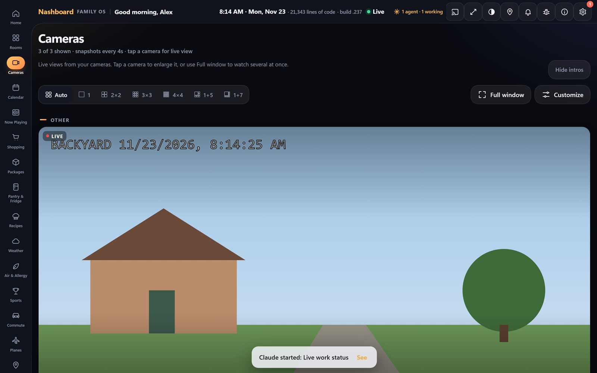
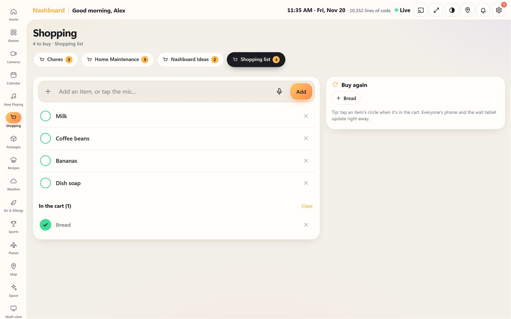
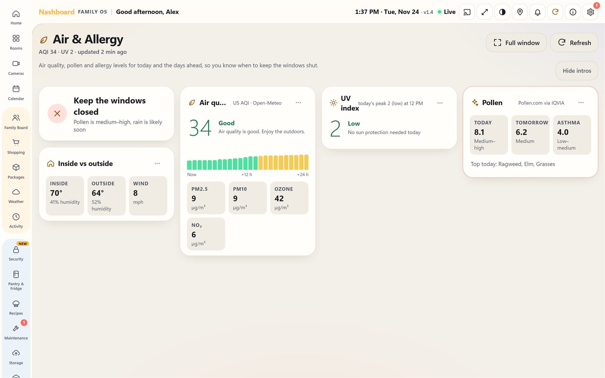
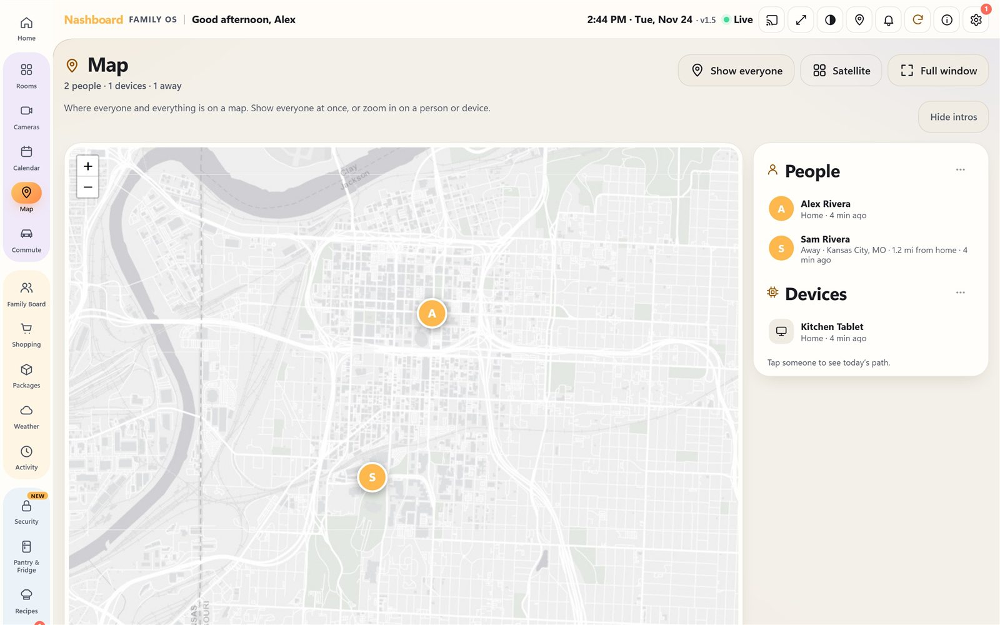
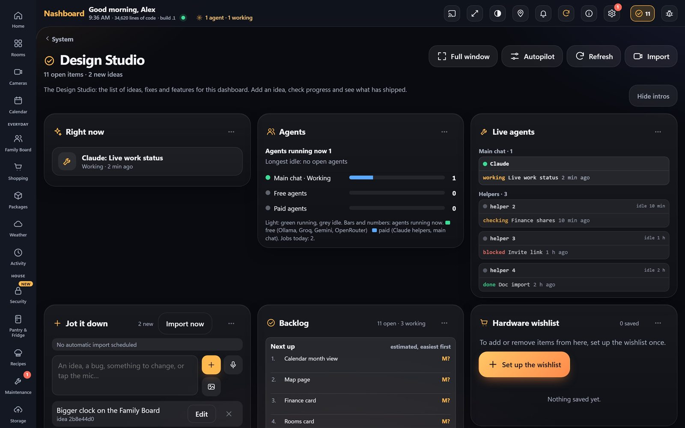
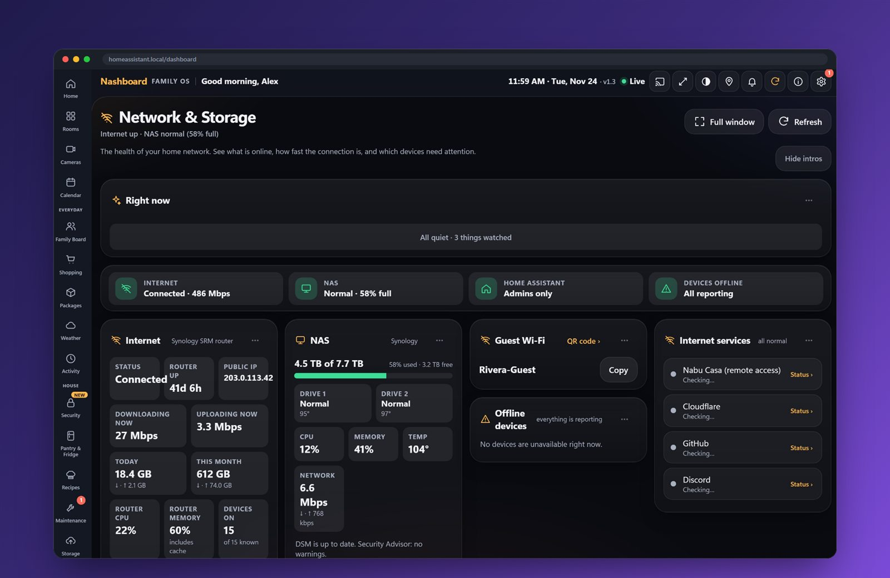
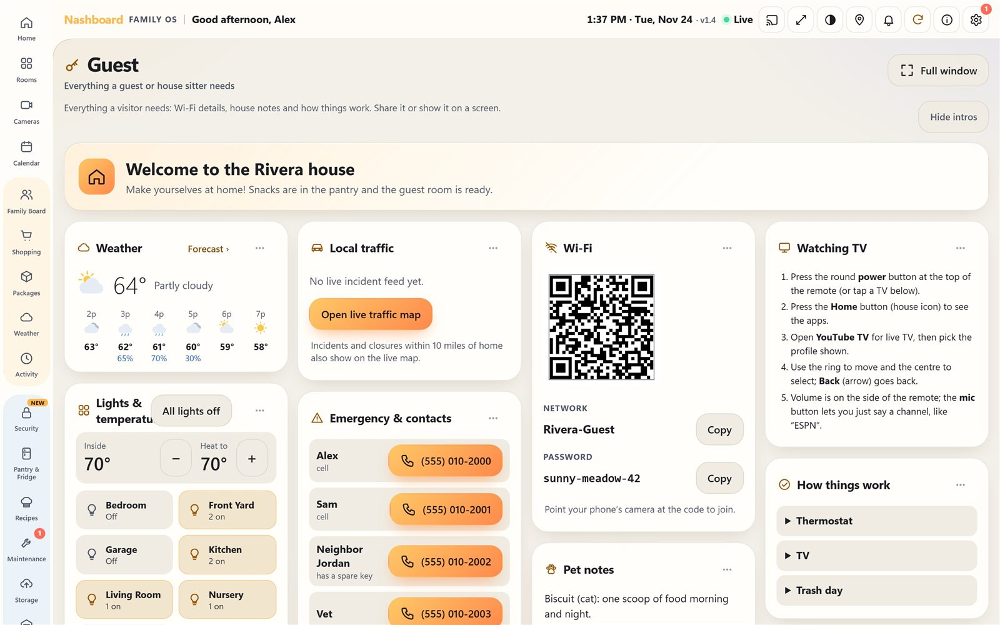
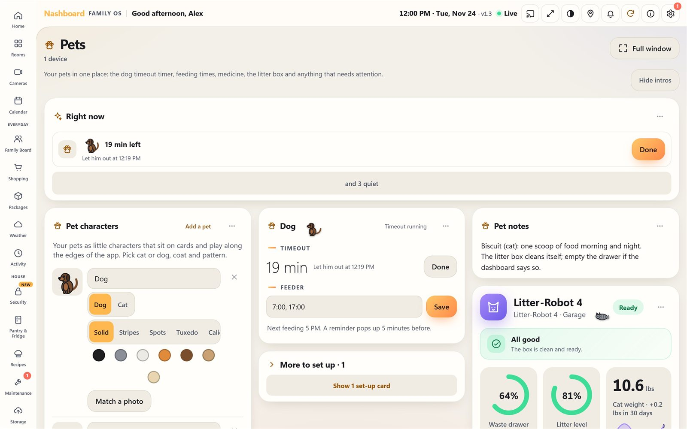

[← Nashboard](index.md)

# All pages

Pages appear in the side menu (or the bottom bar and "More" sheet on phones). The menu, the More sheet and Menu pages are grouped under short headings: **Everyday**, **House**, **Family**, **Out & about**, **Fun & info**, **Labs** and **System**. Home and the tab-bar pages stay first and About stays last. Each Home Assistant user can choose
which pages they see, and in what order; see [Settings](settings.md). Some pages only appear once their data exists:
for example, Cameras needs at least one camera. Pages you set up yourself (Commute, Pets, Pool, Utilities and Energy)
wait under **More to set up** in Menu pages, each with a **Set up** button that opens the page and adds it to your menu.

They're listed here in roughly the same order as the menu, so you can scroll through the whole app or jump to one:

[Home](#home) · [Rooms](#rooms) · [Cameras](#cameras) · [Calendar](#calendar) · [Activity](#activity) · [Now Playing](#now-playing) · [Shopping](#shopping) · [Packages](#packages) · [Recipes](#recipes) · [Pantry & Fridge](#pantry--fridge) · [Storage](#storage) · [Garage](#garage) · [Kids](#kids) · [Weather](#weather) · [Air & Allergy](#air--allergy) · [Sports](#sports) · [Commute](#commute) · [Planes](#planes) · [Map](#map) · [Space](#space) · [Multi-view](#multi-view) · [Display](#display) · [Kitchen tablet](#kitchen-tablet) · [Finance](#finance) · [Room dashboards](#room-dashboards) · [Design Studio](#design-studio) · [Network & Storage](#network--storage) · [Family Board](#family-board) · [Guest](#guest) · [Maintenance](#maintenance) · [Pets](#pets) · [Hobbies](#hobbies) · [Workout](#workout) · [Utilities](#utilities) · [Pool](#pool) · [Wellbeing](#wellbeing) · [Sitter monitor](#sitter-monitor) · [Automations](#automations) · [System](#system) · [About](#about) · [Labs](#labs)

[Security](#security) · [Settings](#settings) · [Utilities](#utilities) · [Pool](#pool) · [Wellbeing](#wellbeing) · [Sitter monitor](#sitter-monitor)

Also: [Things every page has](#things-every-page-has) (the card ⋯ menu, tap-to-collapse, Right now, theme colours,
left- or right-handed phones).

*Screenshots use a made-up demo house; no real data.*

## Things every page has

- **A subtitle** under the page title (also shown in the phone's More menu), and a **Full window** button that fills the
  window, then the whole screen; it zooms the page so all of it fits.
- **A Right now card** on pages that own Home cards. It shows what is live on that page (Rain coming on Weather, the
  dog timer on Pets, Leave soon on Commute). Everything quiet folds into one line, **All quiet · 8 things watched** (or
  **and 6 quiet** under the live rows); tap it to see the whole list; whether that fold is open is remembered for you on every device. A row for something the house does not have (no
  UPS, no pool reading, no car that charges) is left out, and a quiet row says the real state ("Garage door: Closed")
  or what it watches for. Home only shows copies while they matter.
- **Set-up and settings cards come after the page's own cards**, never above them, so a page opens on its content. Cards that are still waiting to be set up fold into one **More to set up · N** card at the very end of the page; tap it to show them.
- **The card ⋯ menu** on every card's header: Full window, Collapse, Hide for today and Hide this card (with a confirm;
  admins can also turn a card off for everyone). Hidden cards come back from Customize menu → Hidden cards or the System
  page's Hidden cards section.
- **Move and How this works** are in the same menu: Move drags a card to a new spot (the order is shared by every
  screen), and How this works opens a short plain explanation of the card.
- **Tap a card's top bar** to collapse or expand it. Buttons and links in the header still work as normal. What you
  collapse is remembered for you (it follows your sign-in to every screen); other people keep their own view. A
  collapsed card shows a **one-line summary** in its header, and cards stay locked in their columns when one collapses or expands (no jumping).
- **A page intro line** under every page title says what the page is for; hide it from the line itself or in Settings.
- **Interface scale** (Settings → Look and size) re-packs cards, columns and text smaller or larger; in Full window a
  small − / + control sets it. Buttons, chips and switches have 44 px touch areas.
- **NEW and UPDATED tags** in the menu: a page added in the last 24 hours shows NEW; a page whose Right now card has
  something new since you last opened it shows an UPDATED dot until you open it.
- **Theme colours**: Interface scale offers seven accent colours (Amber, Coral, Rose, Violet, Blue, Teal, Green), per
  person, readable in light and dark.
- **Left- or right-handed** (Interface scale → Hand, per person): on phones the navigation, room card buttons, page header
  buttons, add and mic buttons, Home card buttons and sheet buttons move to your thumb's side.
- **Voice** on every quick-add list, and no character limits on text boxes.
- **Swipe between pages** on phones: a clear sideways swipe on empty page or a card body goes to the next or previous
  page in menu order, with a page-name hint (maps, charts, chip rows and card swipes keep their own gestures). Turn it
  off in Alerts & notifications.
- **Legends**: any map, chart or dial whose colours, lines or symbols mean something has a legend for each one.
- **A soft chime** the first time a screen loads a new build (once per build, never in quiet hours or on Calm/Off; a
  switch in Settings).

## More on every page

- **Open backlog chip** (admins who maintain the app only): a small number chip in the top bar shows how many items are open in the backlog; tap it to open the Design Studio. The strip scrolls instead of squeezing, and a failed load keeps the number already shown.
- **New marks:** a new card gets a small "New" tag and a soft glow for up to 3 days. It goes away once you have seen it (on screen for 2 seconds) or tapped it, and the seen list follows your account.
- **Labs switch:** Settings has a "Show Labs pages" switch that hides the whole Labs section from the menu for you. Each Labs page also keeps its own switch in Menu pages.
- **Smooth touch scrolling:** while a finger is scrolling, timers and data loads that would redraw part of the page wait, then run once afterwards. Taps and typing are never held.
- **Card change notices:** off unless you turn them on in Settings. When on, an **urgent** card (a leak, someone at the door, time to leave) that appears or clears on its own puts a large notice on **wall screens and TVs**, readable from across the room. Phones, tablets and computers stay quiet unless you switch on "On this screen too" on that device. Changes you cause yourself and the first load stay silent, a burst of changes becomes one notice, it closes by itself, and quiet hours swap it for a small message.
- **Demo mode:** open the dashboard address with `?demo=1` and it runs on made-up sample data: no sign-in, read-only, nothing real is read or written, and a DEMO strip shows on every page. Tapping something that would save explains why it is off; nothing pops up by itself.
- **Refresh button:** a chip in the top bar, on every screen. A tap re-fetches the current page's data and redraws the page, unless you are typing in a text box (your text is never thrown away). A long press, or a tap while a new version is waiting, does a full safe reload, which also waits while you are typing, have unsaved text or have a sheet open. A short spin shows while it works, and a failed or empty load keeps the data already on screen.
- **At a glance summaries:** Weather, Commute, Packages, Family Board, Pantry & Fridge and Security each show one optional sentence in an **At a glance** card beside their Right now card. It is built the same way as Home's Today at a glance: a local model first, a cloud model only after "Allow cloud AI" has been switched on there, otherwise a plain sentence made from the page's own facts. Each page refreshes its sentence at most every 15 minutes (a failed try waits 10), and the text is shared by every screen. The **Page summaries** card on the System page turns all six off and stops the AI calls.

### Background picture

An optional soft picture behind every page, switched on in Settings under Display size, next to Look. It is **off by default**. **Pictures from** is either public-domain art (pick a theme such as Landscapes, Impressionism, Seascapes, Flowers, Japanese prints or Abstract) or whatever the Picture frame is set to show (an album such as Google Photos, or image entities). It changes slowly (every 5 minutes, 15 minutes, 1 hour, 6 hours or daily) and fades between pictures. **Dimming** (Light, Medium or Strong) lays the page's own background colour over the picture so text stays readable in dark and light and in every Look. A picture that won't load is skipped, and the choice follows you to every device.

## Home

The page most screens sit on: an illustrated house banner with live status, and cards that appear when they matter
(a plane overhead, rain coming, a game on, a package arriving) and leave when they don't. Every card and pop-up is
described on the [Home page](home.md) guide and in the [Every feature](features.md#home-automatic-cards) table.

### Home: Today at a glance and card order

- **Today at a glance:** the first card under the banner, with two or three sentences about what already happened today, what is going on now and what is coming. It uses the AI set up in Home Assistant when there is one; otherwise a plain summary built from the same facts (weather, calendar, alerts, packages, commute). A prompt only goes to a local model unless "Allow cloud AI" is switched on. The text is shared by every screen and refreshed at most every 15 minutes.
- **Card order:** every automatic card has a priority. Urgent cards come first (a leak, a power cut, someone at the door, time to leave), then what needs doing today, then richer cards (more rows, buttons or a photo), then a "Lower priority" section where quiet single-row cards are stacked together in one small card. Nothing is hidden. A small chip appears on a title only when it adds something: the minutes left, or "overdue". On Rooms, customised room cards come first.

## Rooms

Every Home Assistant area as a card (including new rooms that have no devices yet): lights, switches, fans, media,
climate and sensors, with chips to filter the list. Tap a room's name to open its [room dashboard](#room-dashboards).
Rooms can have a picture as their background and their own icon. Rooms with a routine (such as a bedtime routine) show
a button for it. **Right now** shows low batteries (with each device's room), lights left on late, the garage and the **Leaving the
house** check: when everyone has left (for 45 minutes after), a card lists lights left on, unlocked locks, an open
garage and open doors or windows, with **All off** (locks and the garage take two taps).

### Rooms: Laundry

On a laundry or utility room page, a **Laundry** card follows any appliance on a power-monitoring plug: power above a threshold means running, low power for a few minutes means done. A Home card appears when a load finishes and goes away when the door opens (optional door sensor) or someone taps Done; a washer left finished for a while gets a "wet clothes forgotten" reminder. Appliances are picked in the card. The dishwasher keeps its own card.

## Cameras

A camera wall like a security console: layouts (auto, 1, 2×2, 3×3, 4×4, 1+5, 1+7), grouping, ordering, hiding,
labels, snapshot refresh rate or live video. Tap a camera for a large live view. Snapshots are fetched with the
dashboard's own sign-in, never stale camera links.

### Cameras: alerts and Frigate

- **Camera alerts:** a card with status and recent detections, plus a settings sheet where each camera gets person detection, extra objects (car, animal, package), zones when the source reports them, quiet hours and who is notified. Detection comes from Frigate; other cameras still get quiet hours and a phone list.
- **Frigate at the door:** a Talk button and Open camera link on the Doorbell card; a "Person at the door" card for 2 minutes after a Frigate person sensor fires; a "The camera sees a package outside" card on Packages and Home.
- **Video states:** pick any sensor that reports a state seen on video (for example a Frigate state classification such as door open or closed). Each shows its value, how long it has been so, and a snapshot, with an optional "alert when it is this for N minutes" Home card.
- **Mail truck:** vehicle sensors and a front camera; each detection asks "Was that the mail truck?". Once enough answers are logged, a Home card says when the truck is usually due.

### Cameras: vision alarms

A camera snapshot is read by the AI set up in Home Assistant, and a **Vision alerts** card appears on Home only when the answer says something needs doing. Nothing is built in: each check is switched on, given a camera and a schedule (daily, weekly or hourly, with a time and, for outdoor checks, daylight hours only) from its settings sheet on the Cameras page. A check does nothing until it is on, has a camera and an AI is available. It uses a **local AI by default**; a cloud model is used for a check only if you turn on "Allow cloud AI" for that check. The snapshot sent for the AI is removed again afterwards, and a failed or empty check never replaces what is shown. Several screens may be open, but a check runs once, not once per screen.

- **Grass is getting long:** a yard camera is asked weekly; a strip of the last few snapshots shows how it has changed, and **Mowed it** clears the card.
- **Scrape the windshield:** on a cold morning (today's low or the current temperature under a limit you choose, inside a morning window), a driveway or car camera is asked whether the windshield is frosted or iced. The card says to leave a few extra minutes early. The temperature source, limit, window and extra minutes are all picked in the sheet; with no temperature source or forecast the check stays quiet and says what to add.
- **It snowed:** a yard camera is asked for fresh snow after a cold night, with a Commute button on the card.
- **Cats fed:** a camera at the feeding spot is asked at set times, and when a motion sensor you pick fires, whether a pet is eating or the bowl has food. The last time they were fed shows on the Pets page, and a card appears if nothing shows them fed by the time you set.

## Calendar

Day, week and a rolling 4-week month (this week plus three, up to five events a day that wrap to two lines, past days
dimmed) across all your calendars, in the colours you pick (shared by everyone). Add and edit events, toggle calendars
on and off, and see the meal plan alongside. The wall calendar has big **Add event** and **Add to list** buttons with a
microphone. Zoom to fit sizes rows correctly in Full window and keeps your scroll position.

- **Tasks** card for Google Tasks: every list with due dates, overdue items in the warning colour, tick to complete and
  an add box per list. Tasks due today also show in Home's Up next card; overdue ones get a Home card.

## Activity

One scrolling timeline of what happened around the house **today and yesterday**, newest first and grouped by hour: the
doorbell and people at the front door, the garage and doors, locks, people arriving and leaving, packages, alarms and
smoke, and intercom messages. **Filter chips** narrow it to one kind. It reads Home Assistant's logbook, refreshes when
you open it and every minute while it's open.

## Now Playing

What every speaker is playing, with artwork, play/pause, seek, volume and per-speaker faders inside speaker groups.
Browse and search Music Assistant to start something new.

### Now Playing: YouTube playlists and launch buttons

A **YouTube playlists** card. Save playlists by name by pasting a YouTube or YouTube Music playlist link (Settings on the card), choose a speaker or TV under **Play on**, and tap a playlist to play it there; Cast players open the YouTube app on that playlist, other players are sent the link. The **YouTube TV** section has one button per TV you pick in the card's Settings, and each opens YouTube TV on that TV. Playlists and the chosen TVs are saved in Home Assistant, so every screen shows the same ones. With nothing saved the card explains what to add.

While a TV is showing the dashboard by casting, the **Cast dashboard** pop-up also gets **YouTube** and **YouTube TV** buttons for that TV. They try the TV's own YouTube source first, then its remote or the cast app, then the link, and say if the app couldn't be opened.

## Shopping

The Home Assistant shopping list (and Mealie's, if connected). Only shopping lists show here; chores, maintenance, the
pantry and ideas stay on their own pages. Add several items at once (or say them), tick items into the cart, clear the
cart, and "Buy again" from recent items. Changes show on every screen instantly.

### Shopping: Kroger-family store

A store card for any Kroger-family banner, picked in the card (the choice is saved for everyone). **Open store** opens the store's site; **Copy list + open store** copies the open items on the current shopping list and opens the store; **Send to the store's to-do list** appears only when Home Assistant has a to-do list named after the banner or Kroger; and a short row of store-search links covers the first open items. Any Home Assistant entity named after the banner or Kroger is listed. This is link-out only (no store account or sync). With no store picked, the card shows what to set up.

## Packages

Add a tracking number from any carrier. Shipments are also found in email (USPS, store order emails) and through
17TRACK; email finds wait for you to **Import** or **Ignore** them. Each package shows its stage and latest event, and
delivered ones leave two days later. A separate section handles recurring **autoship** orders with their next ship
date.

**Package left outside**: when a delivery sits outside with nobody home, or is still out after dark, a card shows here
and on Home, and every phone gets one notification.

### Packages: Frigate

A package left outside is shown with a live snapshot and an Open camera button when Frigate package sensors see one, and a calm note appears when a delivery was logged outside but Frigate no longer sees it. See Cameras for the rest of the Frigate cards.

### Packages: Shop import

A **Shop import** card with a paste box. Paste a Shop app order email, a carrier tracking link or a tracking number, and every tracking number found is added to the Packages list in the same shape as one typed by hand, never twice. Shop has no public connection to read automatically; to import without pasting, forward Shop order emails to the Family inbox, which files the tracking number as a package.

## Recipes

The family recipe book from Mealie: search, photos, ingredients scaled to servings, importing recipes from a link, and
the week's meal plan. **Cook mode** shows one step at a time with the amounts inline ("whisk the **2 cups** flour") and a
row of that step's ingredients with a little picture for each; long steps shrink to fit the screen. Sending a recipe to
the shopping list first asks **"Use what's in the pantry?"** and leaves the ticked items off the list. **Dinner tonight**
(Right now and Home) says when to start cooking.

## Pantry & Fridge

What's on hand and when it expires, in a shared Home Assistant to-do list. Each item is **pantry, fridge or freezer**.
The add form has a **barcode scan button** (camera, a photo, or typed); the name comes from Open Food Facts. The shopping
and Storage add forms have the same button. Add the
expiration date and amount. **Use soon** lists anything expiring within 3 days; **Used up** removes it, and the cart
button also adds it to the shopping list. Home and the Kitchen room show a card for food to use soon.

- **Leftovers tracker**: log leftovers with the date; Home shows an **Eat this first** card, oldest first.
- **Storage places** you add and remove (shared for everyone; a Medicine place is included). Tap a place to set its
  container type (add and remove your own types) and what it sits inside; **Where** shows the nesting. On hand is
  grouped by place.
- **Medicine expiring**: medicines in the Medicine place show a card (Family Board, Pantry, Home copy) when they expire
  within a month, and the Medicine & fever card warns before you log a dose of an expired one.
- **Suggested use-by dates**: items with no date get a suggestion from standard food storage times (USDA FoodKeeper,
  about 200 foods, by pantry, fridge or freezer), marked as suggested, with one-tap **Accept**.

## Storage

"Where's it stored": a house inventory, shared for everyone.

- **Places nest** (Garage › Red toolbox › Drawer 3). **Items** live in a place with a name, count, note and photo;
  appliances also get a serial number, purchase date, warranty end and a manual link.
- **One big search box** finds things by words ("aaa batteries", "where are the christmas lights") and shows the full
  place path.
- **Printable QR labels** for every place: stick one on a bin, scan it with a phone and that place opens on the
  dashboard.
- **Low counts**: set a low number on an item; when it's at or below, **Running low** shows (with Add to shopping list).
- **Warranty ending**: a card when an appliance's warranty ends within 30 days, with its serial, place and manual.

## Garage

Tool storage, built on the Storage page's places and items (so the Storage search finds tools too).

- **Toolboxes and tool chests**, each with its **drawers**, and the **tools** in each drawer.
- **One search box** for tools ("10 mm socket", "torque wrench") that shows the toolbox and drawer.
- A small **photo per drawer**, and printable **QR labels** like the Storage page's.
- A **Tool storage** card on the Garage room page.
- **Car cards** (registration, inspection, oil change, recalls) also show here.
- **Tools from a photo**: take or pick a photo of a toolbox or drawer and the AI set up in Home Assistant lists the drawers and tools; you review the list before anything is saved.

### Garage: new cards

- **Car pictures:** a real photo of the car instead of the drawn art. Order: a picture you saved on the car (link or upload), then an automatic matching photo of the same year, make and model from Wikimedia Commons (free, shown with a caption and a link to its licence page since colours can differ), then the drawn art.
- **Car value:** type in a value and the date you looked it up (from any source); the card shows an estimate of today's value that depreciates at a yearly rate (default 15%, changeable per car). No price is scraped.
- **EV charging:** battery, range, plugged and charging for any car integration. A "Plug in the car" card appears from 6 PM when the battery is below your chosen level and the car is not plugged in. A button looks up the nearest public chargers (Open Charge Map, free), with distance, plug types, power and Navigate.
- **Garage door:** works with any cover. Open and Close are always offered, and the state is labelled "reported" because some openers report stale state. A Home card shows when the door has been open longer than a time you choose.
- **Smart plugs:** pick any switch as a plug; each gets an on/off button, plus power and energy today when a sensor exists. An unavailable plug says where to fix it.
- **Toolbox photo import:** take or pick a photo of a toolbox or drawer; the AI lists drawers and tools for review (rename, untick, change counts). Only Save writes to the Storage inventory, with drawers as places and tools as items.
- **Toolbox picture:** every toolbox card shows a drawn picture of the box, built from the saved inventory. Drawers sit top to bottom in name order, hutch sections (Hutch, Top tray, Lid and similar) are drawn on top as a shelf of compartments, and drawers that differ only by Left or Right sit side by side in one row. Tap a drawer to see its tools under the picture, and a search on the Garage page lights up the drawers that hold a match. It follows dark and light and saves nothing new.
- **NFC tags:** every toolbox and drawer has an **Attach a tag** button. The sheet shows the tag id to write with the Home Assistant companion app and can listen for the next scan to pair the tag in one tap (or paste an id). Scanning a paired tag opens the Garage page at that drawer with its contents highlighted for a few seconds. Listening for scans needs a screen signed in as an admin; other screens use a notification automation sketched in the project's drafts.

## Kids

One big-button page for a kid's tablet, made only from things that already exist. A child sees no settings, no
editing and no set-up text: a card that is not set up yet is simply not there, and adding or importing sits behind the
**Grown-ups** button at the bottom, which asks for the kid-lock PIN and closes again by itself after five minutes.

- **Hello**: the time and a countdown to bedtime.
- **Coat check**: what to wear, from the weather.
- **Star chart**: each Family Board chore done earns a star.
- **Out the door**: the shared morning checklist.
- **Shows & channels** from Family favorites (anything on the "blocked for kids" list never shows).
- **Pets**, a **plane overhead** and the **Space Station** flyover, and big **music** buttons.
- **Tell me a story**: a gentle bedtime story made from the day, read aloud if you like (needs an AI set up in Home
  Assistant).
- **Kid lock**: with Kids as a screen's start page, a 4-digit grown-up PIN keeps the tablet on this page.

### Kids: new cards

- **Bedtime library:** an "Our books" shelf. Add a book by scanning its barcode, photographing the cover or typing a title or ISBN (looked up in Open Library, no key). "Read tonight" picks the least recently read book, one a day; "We read it" logs the day.
- **Favourite colour:** in Room settings, a child can have a favourite colour that themes that child's room page, the medicine chip and the Kids page when only one child has a colour. No colour means no change.

## Weather

Current conditions, hourly and daily forecasts, rain chances, the National Weather Service forecast text, sun
and moon times, and a live radar with warnings outlined (full-screen capable). Phones can show weather for where
the phone is. The **What to watch** card (Right now) always shows severe weather, rain coming, freeze tonight and UV.

## Air & Allergy

- **"Open the windows?"**: a plain-English verdict from air quality, pollen, rain coming, temperature, humidity,
  wind, and whether opening up would cool the house.
- **Air quality**: US AQI with the next 24 hours as coloured bars, plus PM2.5, PM10, ozone and NO₂.
- **UV index**: now, today's peak and the hours sun protection is needed.
- **Pollen**: from Home Assistant's IQVIA integration (Pollen.com), when set up.
- **Inside vs outside**: temperature, humidity and wind side by side.

## Sports

Your teams' schedules and scores from ESPN (via the Team Tracker integration), with live game cards, TV network
links and recaps.

- **Final scores · last 2 days** for every followed team; **tap a final** for the box score (score by period, team
  stats, leaders, player tables).
- **Watch** opens the game's YouTube TV channel when an admin has saved that network's share link; otherwise the live
  guide. At most one Highlights and one Condensed game link per game, official channels first.
- **Teams**: pick a league, then the team; remove any team, or hide one just for you (also on Home). Minor-league
  baseball comes from MLB's own stats feed.

## Commute

Each trip (for example drop-off then work, or school runs) with live drive time per leg from Waze, delay versus
usual, "leave by" times, a route map and recent days' history. Trips, stops and times are set up in the page's
settings, which create the Waze routes in Home Assistant automatically. Each trip belongs to a person and has its own
**Navigate** button.

**Right now** on Commute: Leave soon, On the way home, **Pick up dinner?** (heading home 4 to 8 PM: saved carry-out places
with tap-to-call and Copy the order), **Gas price drop**, **Car due soon** and **New car recall**. Cars added by VIN
(details and recalls from NHTSA, plate, insurance, tire size, registration, inspection and oil change dates) show here
and on the Garage room.

## Planes

A live map of aircraft around home or around the phone (5 to 500 nm), coloured by altitude, with flight paths,
military aircraft ringed, and emergencies (squawk 7700) highlighted worldwide.

- Glass cards on the map's edge (on a phone they become a plain list under the map, so nothing is hidden or cut off): the plane you picked (all details and a small photo, or a labelled stock photo of its
  type), the **closest** plane, **military** planes in range, and the **highest** and **fastest plane in the world**
  right now (tap to fly the map there).
- Arrivals and departures boards for nearby airports (airport tabs scroll on phones).
- Satellite map, full window or full screen, the phone **compass** (the map turns as you turn), map buttons that
  scroll when they don't fit, and an **INFO** button that hides or shows the legend and info cards.
- Optional phone alerts when a plane passes overhead (one per pass).

### Planes: air traffic tiles

Four tiles inside the Planes page grid, all from free sources without a key: **US air traffic status** (ground stops, delay programs, closures), **Restricted airspace** (restricted, prohibited, warning and alert areas near the map centre, with altitudes, times and a small sketch with a legend), **Flight restrictions** (temporary restrictions, optional state filter) and **Listen and world** (live air traffic audio links for chosen airports and links to other countries' air navigation services). Worldwide status feeds and official NOTAM search need a key or account, so those are links only.

### Planes: photo card, airspace layer and Home card

- **Plane photo card:** when an overhead alert fires while the Planes page is open, a glass card sits over the top-left of the map with the plane's picture (the same photo sources as the Home aircraft card) plus flight, type, altitude and route. The map controls stay clear on the right edge. Close it with the x; a dismissed plane stays dismissed, and the card closes by itself when the plane leaves the area.
- **AIR map layer:** an **AIR** button next to PATH and INFO draws the nearby special-use airspace and the currently active temporary flight restrictions under the planes, with its own legend rows. On or off is remembered on each device.
- **Air restrictions near home (Home card):** shown on Home only while it matters: a ground stop, ground delay or closure at a nearby airport, or an active temporary flight restriction that covers home or reaches within the Planes radius. On the Planes page it always shows, with a calm line when there is nothing ("No flight restrictions or ground stops near home").

## Map

People and tracked devices on a map with their recent path for the day, commute places and a You marker.

## Space

The Space Station: where it is, the next visible pass, every pass for three days, and whether each is visible.
Upcoming rocket launches. Bright satellites overhead now, and a **sky dial** that can turn with the phone's
compass.

## Multi-view

Show up to four pages at once on a large screen, each in its own tile.

## Display

A full-screen mode for TVs and wall displays: clock, weather, cameras, and automatic cards (up next, commute,
games, overhead aircraft, Space Station, packages, now playing, breaking news). Google Tasks due today or overdue
show as a **Tasks** card. It can rotate between views or
stay on one. TV cards are denser, so more rows fit on each (up to five games, trips, tasks and events, four packages).
Casting to a TV opens the same Display, and **each TV can have its own setup** (rotating or still, seconds
per screen, which screens, night dimming). Casting creates or refreshes a view for that TV in Home Assistant's TV
dashboard, so the TV still knows which one it is after a reload. Home's cards show as a strip on the radar and camera screens; a pet peeks in
from a corner now and then.

### Display: picture frame

A display can be a **picture frame**: when nobody is in the room it shows a full-screen slideshow, and when someone is there it shows the normal Display screens. Another Display screen can add the slideshow to its rotation. Sources are public-domain art (Art Institute of Chicago open data, by theme or search, with favourites), any Home Assistant image entity, or photo albums from the media library (including Google Photos once that integration is added). Someone is in the room while a chosen presence sensor is on, or the screen was touched recently; with no sensor it works from touch alone. Whether a screen is a picture frame is per device.

### Display: wall display and TV big-type cards

- **Wake on approach:** per screen, in the Cast sheet under This device, pick presence, motion or camera person sensors. When one sees someone, the screen wakes: the page undims, and the screen is switched on and brightened through the Fully Kiosk integration in Home Assistant, or woken with the companion app's screen-on command. After the room has been empty and untouched for a while it dims again; an optional setting limits this to night. A fully dark screen can only be woken from Home Assistant itself, so the same idea is also provided as an automation sketch. Settings are saved in Home Assistant under a random screen label, not a name.
- **Nest Hub kitchen view:** a cast target can show a compact kitchen screen instead of the rotation: clock, timers, the out-the-door list, dishwasher, leftovers and today's events. Choose it in the Cast sheet under Setup for one TV.
- **Wall display setup checklist:** a card on the Kitchen room page with live checks, and a Wall display group in Device setup.
- **TV big-type cards:** on the Display view, chosen Home and Right now cards (Today at a glance, reading tonight, gaming and achievements, laundry, leak, UPS and printer alerts, bills due, the mail truck, the doorbell and person at the door) use a large-type look readable from across the room. Buttons and links are dropped because nothing can be tapped on a TV, long text is trimmed, and only the first few rows show (two for the doorbell and person at the door).

## Kitchen tablet

For a wall display in the kitchen, turned on per device: **Cast → This device → Kitchen tablet** (or add
`?display=kitchen` to the address; `?display=off` turns it off).

- The display shows the normal Home page. After 2 minutes without a touch it goes back to Home and closes anything left
  open, and it keeps the screen awake.
- 9 PM to 6:30 AM it dims after a minute without a touch (a tap wakes it), with no animations or chimes.
- The kitchen at-a-glance cards are on the Kitchen room page: Today, Who's home, Trash & recycling and Chores from the
  Family Board, plus the Living Room controls. Room settings can hide them.
- The Kitchen room page also has **Timers** (three named timers; 5, 10, 15, 30 and 60 minute buttons, a name and minutes
  form, pause, resume and cancel; a countdown card on Home while one runs, and a chime and message on open screens when
  one finishes, quiet at night on the kitchen tablet) and **Out the door**, an editable checklist (Backpack, Snacks, Water
  bottle, Lunch, Meds) shared between screens and reset each morning, with a copy on Home on weekday mornings until
  everything is ticked or everyone has left.

## Finance

A watchlist from a published spreadsheet: prices, day and week moves, charts, and a Bitcoin long-term "power
law" chart that zooms and remembers the zoom. The **Markets** card (Right now and Home) shows around the open and close
and after a big move.

## Room dashboards

Every room has its own dashboard, opened by tapping the room's name on Home or the Rooms page (they are not in the
side menu). A room added in Home Assistant gets its page right away. The general version groups the room's devices into
lights, media, climate, doors, switches and scenes, cameras and sensors. Rooms can have a custom design:

- **Nursery**: a calm, dark screen for night-time. Big clock and status, toddler-lock switch, the night light
  (on/off orb, brightness, eight colours, with a note that red and amber are gentlest for sleep), the sound
  machine (play/stop, volume, favourites, and every built-in sound grouped into sleep, bedtime and wake-up),
  the bedtime routine, the nursery speaker, **presets** (save the sound, volume and light under a name; one tap to
  recall) and a 7-night **sleep log** worked out from the sound machine.

**Room settings** (button in every room page's header), saved per room for everyone:

- **Layout by room type**: kitchen, bedroom, garage, living room, office, outdoors or other (guessed from the room's
  name), which sets the order of the sections.
- **Show or hide sections**: lights, climate, media, cameras, sensors, blinds and doors, and so on.
- **Add a card to this room**: any Home card (dog timeout, trash night, the doorbell…) or a main card (weather, calendar,
  packages, medicine, pantry).
- **Room icon**: a searchable grid of icons in the room's options, shared for everyone.

While something in a room is playing, a **Now playing** card (turntable icon; channel and artwork for video players)
shows on that room's page. A bedroom with a child set in Room settings also gets that child's cards (a child's room).
Every room page also shows the cards that relate to it: the **Doorbell**, its maintenance jobs, low batteries, pet
device problems, tonight's dinner and expiring food (Kitchen), packages (front of the house), cars (Garage), and
**Storage here**: the containers from the Storage page whose place name contains the room's name.

## Design Studio

Opened from System or the More menu (not in the side menu). Its cards are wide (at least a third of the page):

- **Jot it down**: type or say an idea, attach a photo or screenshot, swipe left to remove one; it keeps a draft while
  you type and stays put after you submit. **Import now** asks for new ideas to be filed at the next check-in. Claude's
  **suggestions** appear here marked and dated, with Accept and Ignore. Ignored ones are archived in a collapsed **Ignored suggestions** list with **Bring back**.
- **Backlog**: the whole plan, searchable, every section collapsed until you search, with an open count. **Show done**
  opens the Done list and scrolls to it.
- **Every feature**: the running feature list, searchable.
- **Change log**: a heading per day and an expandable box per build.
- **Shipped per day**: a chart of the last 14 days with a 7-day average.
- **Hardware wishlist**: add a product link, × to remove, **Bought** moves it to Purchased; refreshes every minute.
- **Live agents** and **Agents tally**: the main chat pinned (Working or Idle), a Helpers count, then Free and Paid tallies
  with a bar for every job (status posts count as jobs) and a legend.
- **Autopilot** (admins): opens the private control panel for the assistant that maintains the dashboard.

See [Settings](settings.md#design-studio-backlog-and-ideas).

## Network & Storage

- **Status strip**: internet, NAS, Home Assistant and offline devices, each green, amber or red.
- **Internet**: connection status, router uptime, live download and upload speed, data used today and this month,
  router CPU and memory, and hourly speed tests with a 7-day chart.
- **Internet services**: the status of the remote-access service, Cloudflare, GitHub and Discord.
- **Internet provider**: a connectivity sensor (modem or router, ping or uptime) and optional speed-test sensors (download, upload, ping). If the connection is down for 2 minutes, Home and this page show an outage card with a link to the provider's outage page, which you type in the card's settings. It works from Home Assistant entities, since most providers have no public status feed.
- **NAS** (Synology DSM): volume space and status (with an explanation when it needs attention), each drive's
  health and temperature, CPU, memory, temperature, traffic, update and security status.
- **Home Assistant**: CPU, memory, disk and uptime.
- **Devices on the network**: everything connected to the router, busiest first, with Wi-Fi band, signal strength
  (weak signals in red) and live traffic.
- **New on Wi-Fi**: Known dismisses it; **Unknown** logs it to a shared **Follow up later** list here (Done clears it).
- **Offline devices**: anything unavailable, grouped by integration. The guest Wi-Fi details show here too.

## Family Board

Made for a kitchen screen with bigger text: the time and weather, **who's home**, today's events and tonight's
dinner, **trash and recycling** days (with "take the bins out tonight"), the live **shopping list**, a shared
**chores** list anyone can tick off, **birthdays** coming up (from calendars, plus people added by hand), the
**intercom** (record a message that plays on every screen and notifies phones), **holiday traditions**, **carry-out
orders**, **kids' activity ideas**, **family favorites**, **for sale**, the Sunday **week ahead**, the **doorbell**, and
the **Medicine & fever** card: one-tap buttons for each medicine with its own rules (once a day, every few hours,
alternating Tylenol and ibuprofen), a profile per child, a temperature log, symptom buttons, a 7-day history with a
fever chart and a copy-for-the-doctor summary, FDA drug-label facts with citations, and a heads-up when two medicines are
the same kind.

**Right now** on the Family Board covers Good morning, Goodnight check, chores, trash night, lights left on, the nursery,
fever and medicine, medicine expiring, birthdays, holiday traditions, the week ahead, kids' ideas, movie night, for sale
and the intercom.

### Family Board: new cards

- **Where is everyone:** one tile per person. Each person decides whether their place shows (off until they switch it on). Only Home, Work or Away, battery and last update show, never coordinates. **Ring my phone** uses a Find My Device sound button when there is one, otherwise the companion app notification command.
- **Family inbox:** a dedicated email address read through Home Assistant's IMAP integration. The AI works out what each message is and files it as a calendar event, package, note or shopping item. Mail is untrusted: only allowed senders are filed by themselves, everything else waits for a tap, and every filed item has Undo. Without IMAP or AI the card says what to add.
- **Closings:** places to watch (daycare, school), feeds, sensors and a manual "Closed today" toggle; a Home card shows while something is closed or delayed.
- **How we're doing:** an opt-in card fed by the private Wellbeing page (see [Wellbeing](#wellbeing)). It shows a mood dot per person who chose to share and rotates the shared gratitude notes as one quiet line. It stays empty until someone opts in.
- **Page title:** the Family Board now shows its **Family Board** heading like every other page; before, the page started straight into its cards with no title. The same build also stops the chore and trash schedule from being saved before it has finished loading, which could have overwritten it.

## Guest

Everything a guest or house sitter needs on the screens already around the house: a welcome note, **Wi-Fi with a
QR code** (drawn on the device; the password is never sent anywhere) and copy buttons, room light switches and an
"all lights off" button, the thermostat, tap-to-call contacts, how-tos and pet notes. Admins edit it; everyone sees
the same information. Also: **weather now and the next 6 hours**, the live radar, and a **Watching TV** card with the
TV remote steps and YouTube TV buttons for each TV (no passwords on the page).

### Guest: guest mode

An admin can turn on **guest mode** from a phone: every house screen switches to a simple guest view (the Guest page first, a short menu, no System, settings or editing). A grown-up PIN lifts it on one screen for 5 minutes of use, and an optional end date turns it off by itself. The screen you switch it from, and any screen set to opt out, keeps working normally. A small card on this page also turns on the Sitter monitor and opens it.

## Maintenance

Recurring house jobs (filters, smoke detector tests, gutters, oil changes, and more) kept in a shared Home
Assistant to-do list. Each job shows how often it repeats, when it was last done and a countdown bar. **Done**
reschedules it from today. A starter list of 15 common jobs, a low-battery panel, a menu badge when something is
overdue, and a "Maintenance due" pop-up on Home. Car due dates show here too.

## Pets

**Pet characters** (cat or dog, coat and pattern, and a name) that live on the cards rather than in the house picture:
they sit on card headers (the dog on Dog timeout, a cat on the medicine and litter cards), walk card edges, nap, peek
and chase. Also here: the dog timeout (30 min,
1 h, 2 h) and feeder times, and pet devices such as a self-cleaning litter box: status, drawer level, litter level,
faults and history.

- **Pet medicine**: how often it's given, when it was last given, **Log now**, and logging by tapping an NFC tag on the
  bottle. A Home copy shows when a dose is due; a phone reminder if it's two hours late.
- The cat medicine card shows the medicine bottle from Pantry & Fridge with its expiration date.
- **Pet notes** (shared with the Guest page) show and edit here.
- This is the pets' favourite page: they play here often (chases, naps on cards), and only rarely elsewhere.

## Hobbies

Each person picks their own hobbies (saved with their login); each hobby's cards are **shared**, so anyone who picks the
same hobby sees the same content. Built-in hobbies: band and set lists, audio mixing and video editing, Ableton Live,
book club, gardening (plants with watering reminders), running and cycling, reading list, board game night, cooking
experiments and 3D printing, or add your own. A **Hobbies** Home card shows only your hobbies, only when something is
soon (book club tonight, plants to water, game night, a show this week). The band hobby is **Gigs**: start, setup
(2 hours before), show length, breakdown (1 hour after), a timeline, and import from an event link; Home shows a Gig
card with the be-there-by time.

### Hobbies: gaming and smoker

- **Gaming:** one card fed by the Steam, Xbox and PlayStation integrations (or any similar entities, detected by name and tickable in settings). It shows what is being played on which device, account chips (Playing, Online, Away, Offline) and turns achievement counters going up into house events (toast, optional chime and confetti, a 3-hour Home card, a "Gamer of the week" tidbit). Rare ones are marked. Home shows a card only while a game is running.
- **Smoker:** pit temperature, pit target, meat probe, probe goal and pellet level from any entities you pick. A Home card shows while a cook is running with an estimated time to the goal, and a Done card when the probe reaches it.

## Workout

Made for a TV in the garage (big numbers you can read across the room), and it works on a phone too.

- **Interval timer**: work, rest and rounds, with a progress ring and optional beeps (started with a tap).
- **Routines** you save (name, timings, exercises).
- **Workout log** shared by the family, with a weekly total per person.
- Health stats (steps, heart rate, sleep, weight) from your own phone app's sensors, and treadmill sessions: see the health card below. A value is only picked automatically when it comes from the phone app; anything else asks first.

### Workout: health card

A card in the Workout grid reads the Home Assistant companion app's health sensors (steps, heart rate, activity, distance, calories, weight, sleep, including those a watch syncs through Health Connect) and treadmill entities (running state, speed, distance). Each person picks their own sensors. When the treadmill starts, a session starts by itself, and when it stops the card offers Log it (or logs automatically when Auto-log is on). Only sensor choices are saved, never health values; nothing leaves the house.

### Workout: extras

- **14-day trends** of the sleep and weight sensors picked in the Health card, read from Home Assistant's history. The values are held in memory on that screen and never saved.
- **After a workout:** for 2 hours after a workout ends (a treadmill session, a finished interval timer or a logged workout) a card shows on Home and in the Workout page's Right now with a short summary. The numbers stay in memory only.
- **Cast Workout page:** sends the Workout page to a TV you choose, using the normal cast code, and the TV opens the page once it loads. Only which TV was chosen is remembered, never any health value.

## Utilities

Three cards, all auto-detected with a picker and a setup message when nothing is found. The page joins the menu by itself once Home Assistant has a leak sensor, a UPS or a printer; before that it waits under More to set up in Menu pages.

- **Leak sensors:** every moisture sensor, with a red "Water leak" Home card and one chime when a new leak appears.
- **UPS:** battery charge, runtime left, load and status, with a "Running on battery" card.
- **Printer:** ink, toner and drum levels, with a "Printer ink low" card under a limit you choose.

## Pool

Readings from sensors you pick (pH, chlorine, temperature, alkalinity, hardness, stabilizer), or from a manual test log until sensors exist. Each reading is shown against its range with plain guidance, plus a trend. Home shows a card only when something needs doing (out of range or a test is overdue). The page waits under More to set up in Menu pages until there is a first reading.

## Wellbeing

A gentle, optional, private page: mood check-ins with a 14-day trend, a breathing exercise, a wind-down reminder, gratitude notes and a daily affirmation. It is saved per signed-in person and is private by default, with no scores, no diagnosis and no cloud AI.

**Family sharing (opt-in):** each person can choose, only for themselves, to share two things with the family: a simple **mood dot** (just the latest check-in, never any notes) and the **gratitude notes they mark as shared**. Both switches are off by default. What is shared is kept separately from the private data and holds only what was explicitly shared. Turning a switch off, removing a note or erasing wellbeing data removes it from what the family sees. Shared items appear in the **How we're doing** card on the Family Board.

## Sitter monitor

A calm, phone-first page for whoever is watching a sick child at home: cameras for the chosen rooms, the child's room temperature and humidity, next medicine doses, the Medicine & fever card, quick-call contacts and emergency info (doctor, allergies, notes). It stays out of the menu until an admin turns on Show in the menu; setup is on the page, and a copy-link button shares its address with anyone signed in to Home Assistant on that device.

## Automations

What the house does on its own: every Home Assistant automation as a friendly card (grouped, with when it last ran and a
description), on/off and **Run now** for admins, and **Make your own** with five fill-in templates. The full list of
what ships with Nashboard is on [Automations](automations.md).

### Automations: suggestions

A **Suggested for your home** card proposes new automations, app rules and badges, each with Accept, Dismiss and Later. Rule-based suggestions always work (from the devices and existing automations); **Ask the AI** uses the AI set up in Home Assistant only when pressed. Nothing is ever applied to Home Assistant: accepting an automation saves a sketch to read or copy.

## System

Home Assistant health at a glance: updates, backups, recent errors, devices that need attention, low batteries,
and settings such as Menu pages, alerts and appearance.

- **Who's on**: the live screens and people seen in the last minute.
- **Earbuds battery**: left, right and case battery levels (up to three sensors, usually from the phone's companion app) plus an optional Bluetooth connected sensor, with a low-battery card on Home and System at a level you choose (default 20%). Every sensor is picked in the card's settings or auto-detected by name and device class, so any earbuds work.
- **Home settings**: the household basics in one place (house name and Wi-Fi from Guest, pickup days from the Family
  Board, this device's zip, Home Assistant's location, time zone, units and people), each linking to where it's edited.
- **Banner windows**: say which window, porch light or lamp in the house picture is which room or light (Highlight shows
  it).
- **Low batteries** with each device's room, **Hidden cards** with Show again, the **Device setup** checklist (ticks per
  device), the **User manual** link (kept for every user), and Interface scale on phones.
- **Saved data**: every saved app setting with its size, entries, last save, who saved it and its version, with
  **Undo** (the last 20 versions are kept, and a dated copy is exported every night). See
  [How it all connects](how-it-connects.md).

### System: TV helpers

A settings and status card for TVs. **Cast timeout:** while a TV shows the dashboard by casting, a card counts down to when it will drop out, and the keep-alive time can be set. **Volume leveler:** per TV, on or off, how far to step down, and an optional sound-level sensor; the room page shows when the leveler last stepped in. The automations that act on these are sketches for review.

### System: Setup checklist

One card with two parts. **Getting started** is the basics every house wants first: rooms, weather, a calendar, a
shopping list, cameras, speakers, the phone app and a commute. Only these are counted in the bar at the top, so a
finished house reads as finished. **Optional extras** (camera detection, the family inbox, game accounts, a UPS and
printer, leak sensors, a pool monitor, laundry plugs, Health Connect, Google Photos, wall displays, AI Task, EV
charging, the garage door, a smoker and more) are folded under one button and never counted. Every row is detected live
from Home Assistant, so nothing is typed in or saved: a done row says it was found, a to-do row says in one line what
to add, and each row opens the page its card is on.

## Security

A page for the things that matter for safety, in two cards.

- **Mode**: switch the alarm between Away, Home, Night and Off. **Alert choices** sets, for each mode, which kinds of
  events raise an alert (people, packages, doors, garage, locks, alarm, smoke, water leaks, cameras), which phones are
  told, and quiet hours. Smoke, CO and water leaks always get through quiet hours.
- **Security log**: a saved log of people at cameras, packages, doors, the garage, locks, alarm changes, smoke, CO or
  gas, water leaks and cameras going offline. It keeps up to 500 events over 30 days and is the same on every screen.
  Entries stay **unseen** until you tap them or use Mark all seen; the menu badge counts the unseen important ones, and
  filter chips narrow the list by kind or room.
- **Camera states** and **Mail truck**: optional cards that watch what a camera reports (for example a gate left open
  for a while) and learn roughly when the mail arrives.
- Its Right now card shows unseen alerts, and an **At a glance** sentence sums the day up.

Devices are found by what they are (doors, locks, smoke detectors, cameras), never by name, so the page works in any
house. A house with none of them still gets the log, which fills as devices are added.

## Settings

Your own settings in one place, in the menu and from a button on the System page. Its cards:

- **Look and size** (this device): the theme (dark, light or follow the device) and the Interface scale sheet, which
  also holds the Look, accent colour, the optional background picture, handedness and holiday decorations.
- **Alerts and notifications**: opens the alerts sheet (chimes, plane and Space Station alerts, phone alerts), with
  switches for Swipe between pages, the New build sound, the Connection lost alert and the location pin.
- **Card change notices**: the full-screen notice for urgent cards on wall screens and TVs (off by default), with
  "On this screen too" and quiet hours.
- **Menu pages**: choose and order the pages in your menu, switch Labs pages on or off, bring hidden cards back, and
  set up the pages that are waiting under More to set up.
- **Location use**: what used this device's location, or set a zip code instead.
- **The house and the app**: a link to System (updates, backups, hidden cards, saved data, device setup).

Everything is described on [Settings and personalisation](settings.md).

## About

Version and build (with the pieces count), **What's new**, the full feature list, a scrolling **Credits** card (a plain
list with reduced motion), data-source credits, the user manual, and **Run the tour
again**. It also has five simple pictures (how the app works, how your data is kept, where cards show up, who can see what, and for admins how the AI builds it); see [About page diagrams](diagrams.md#about-page-diagrams). It is always the last page, and an **i** button in the top bar opens it. Top-bar buttons that don't fit on a
phone scroll with a soft fade.

## Labs

Experiments: a **Browser** for quick look-ups (just the bar: back and reload, a bookmarks dropdown and the address with
voice; tools behind a ⋯ menu; reopens your last page on each device; in Full window it works like a real browser) and a
3D printer monitor.

### Labs: Energy and bills

An **Energy** page in Labs. It finds power, energy and cost sensors by type, shows what is using power now and usage today and this month (from long-term statistics, read only) with the biggest users, and estimates cost from a price per kWh you type in. **Bills** are entered by hand (name, amount, due date, repeat); Paid moves a repeating bill to its next date. Home shows bills due soon or overdue and an "unusually high day" note. Without energy monitoring the page explains what to add.

**Solar, generator and grid cards:** three more cards on the Energy page. Nothing is hardcoded to a house; each finds its sensors by name (or from the sensors in Home Assistant's Energy settings, read only) and has a **Set up / Change** button with pickers. With nothing found, a card says what to add.

- **Solar:** power now and energy today, from solar, PV or inverter sensors. Today's figure comes from long-term statistics unless the sensor already reports a daily total.
- **Generator:** status, fuel level and when it was last exercised.
- **Grid:** a status sensor for mains power. When it reports an outage, Home shows a **Power outage** card.
