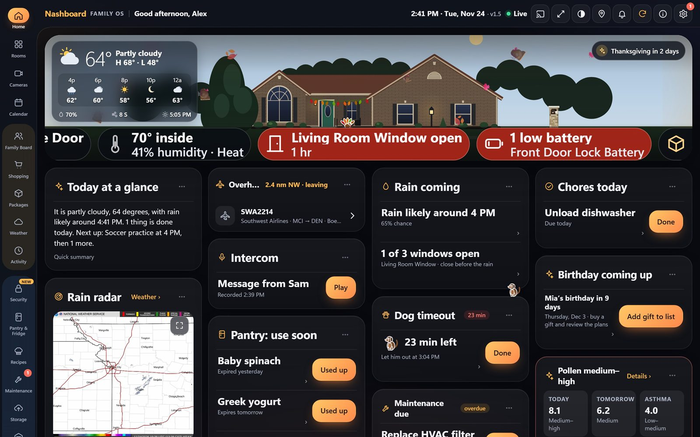
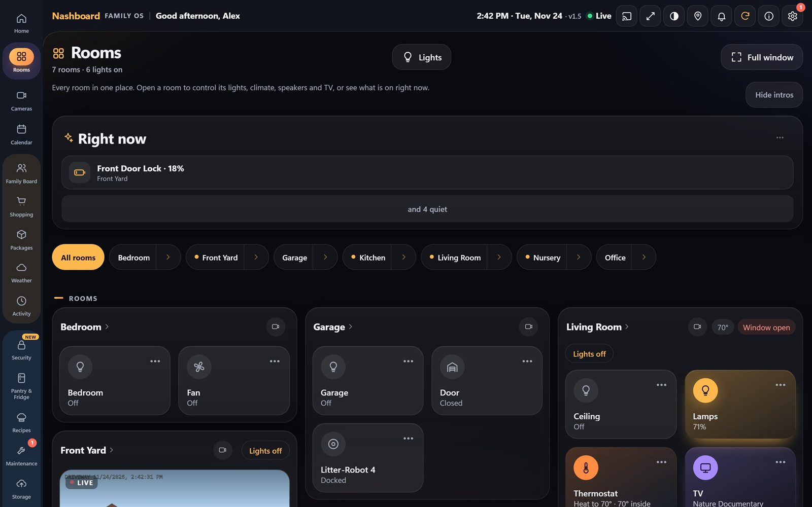
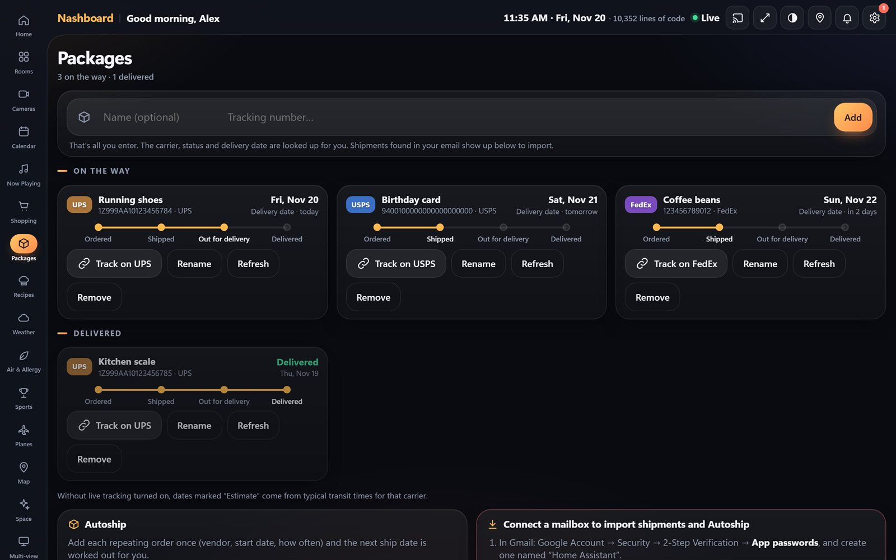
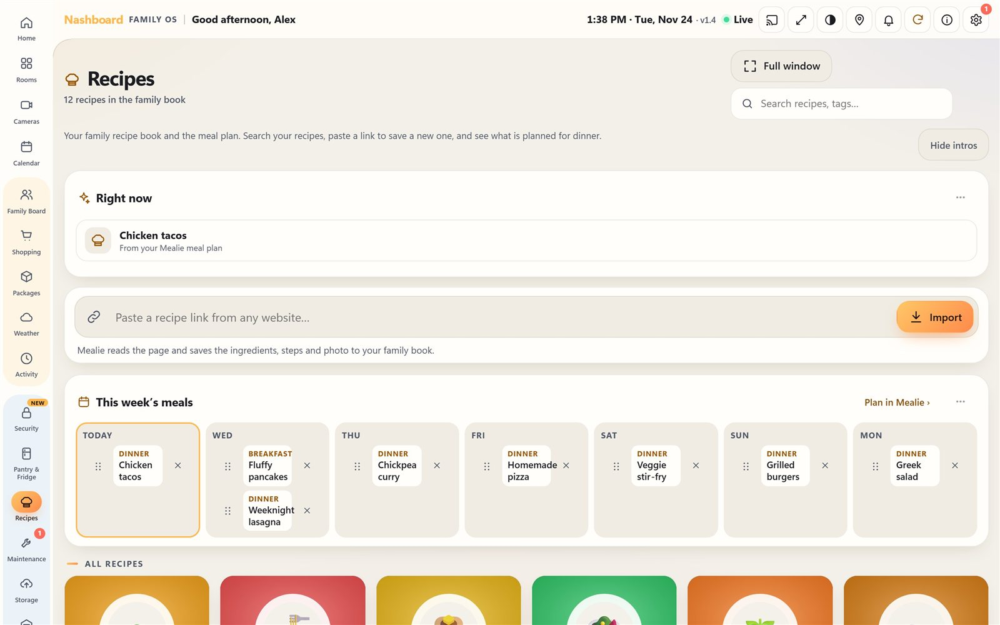
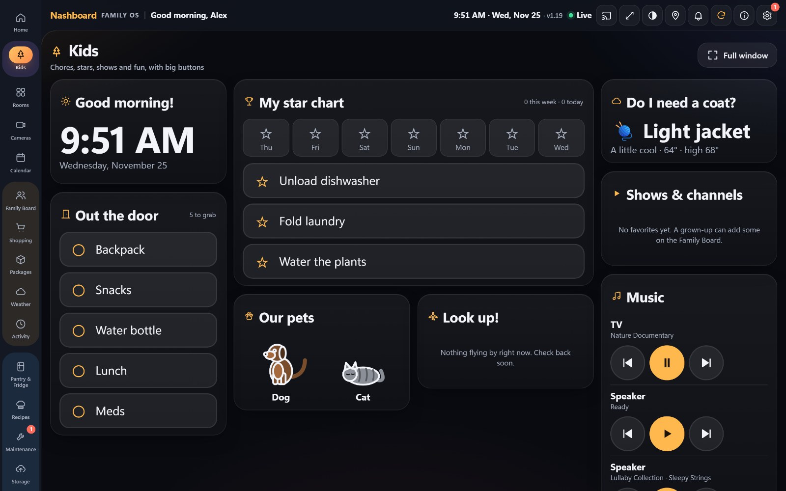
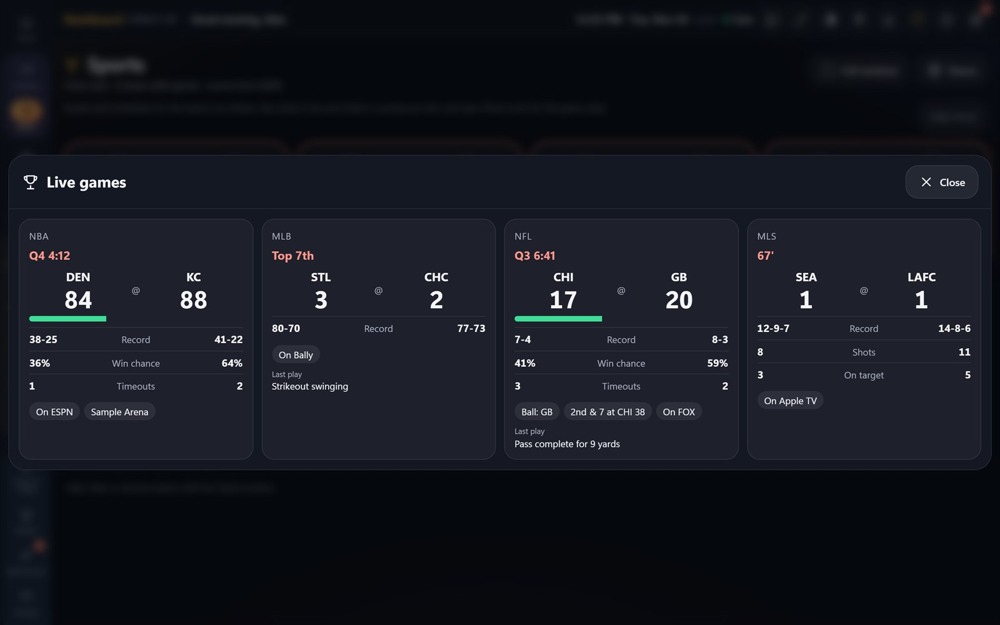
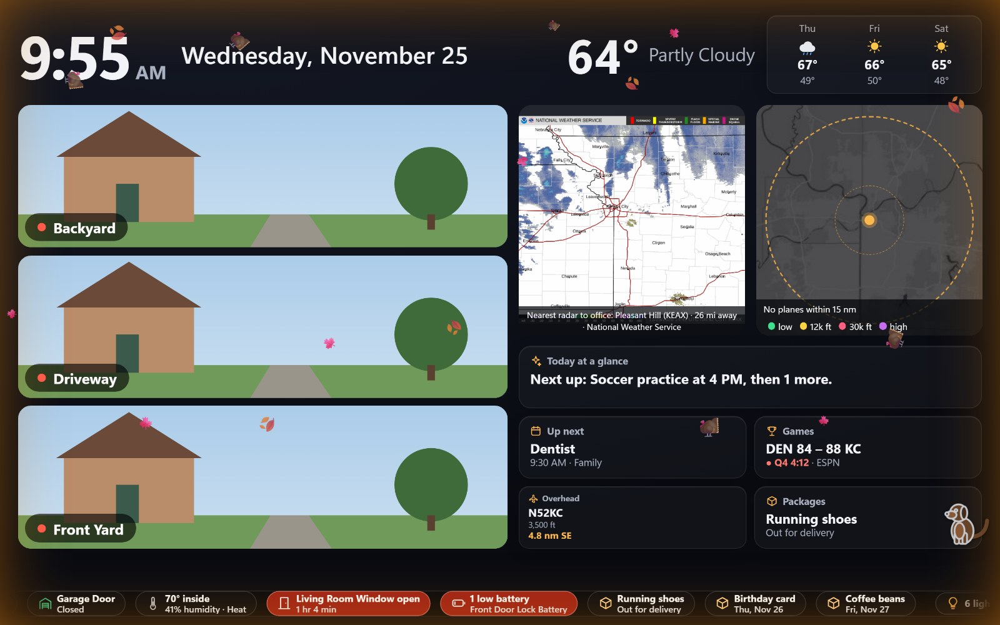
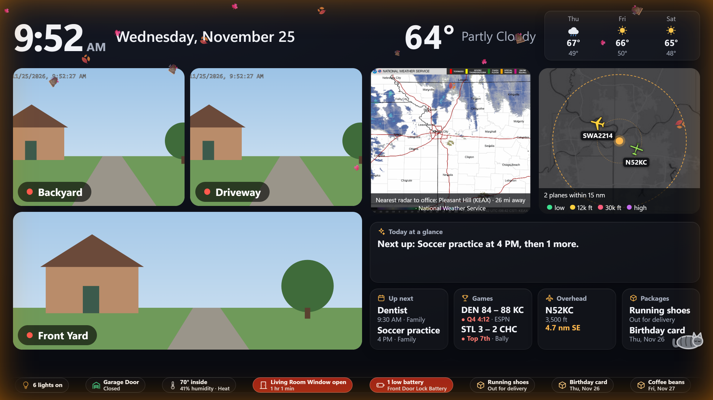
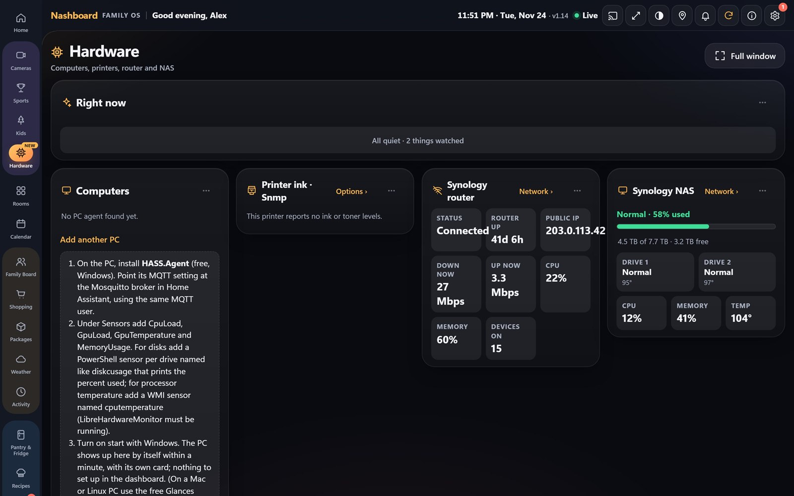

[← Nashboard](index.md)

# All pages

<!-- pagemap:start -->

- **Main tabs** (bottom bar on phones): [Home](#home) · [Rooms](#rooms) · [Cameras](#cameras) · [Calendar](#calendar)
- **Everyday:** [Family Board](#family-board) · [Shopping](#shopping) · [Packages](#packages) · [Weather](#weather) · [Activity](#activity)
- **House:** [Pantry & Fridge](#pantry--fridge) · [Recipes](#recipes) · [Maintenance](#maintenance) · [Storage](#storage) · [Garage](#garage) · [Automations](#automations) · [Utilities](#utilities) · [Pool](#pool)
- **Family:** [Kids](#kids) · [Pets](#pets) · [Guest](#guest) · [Sitter monitor](#sitter-monitor) · [Wellbeing](#wellbeing) · [Workout](#workout) · [Hobbies](#hobbies)
- **Out & about:** [Commute](#commute) · [Map](#map) · [Air & Allergy](#air--allergy) · [Planes](#planes) · [Space](#space)
- **Fun & info:** [Now Playing](#now-playing) · [Sports](#sports) · [Finance](#finance) · [Multi-view](#multi-view)
- **Labs:** [Browser](#labs) · [3D Printer](#labs) · [Energy](#labs-energy-and-bills)
- **System:** [Network](#network--storage) · [Settings](#settings) · [Hardware](#hardware) · [About](#about)

<!-- pagemap:end -->

Pages appear in the side menu (or the bottom bar and "More" sheet on phones). The menu, the More sheet and Menu pages are grouped under short headings: **Everyday**, **House**, **Family**, **Out & about**, **Fun & info**, **Labs** and **System**. Home and the tab-bar pages stay first and About stays last. On a desktop each group is its own softly tinted container (alternating colours, no heading words; screen readers still hear the group name). A **Frequent** group of your most-used pages comes right after Home, and a page shown there is not listed again in its own group. On a phone the **More** sheet is a two-column grid with a search box on top and your last three opened pages first, then the groups. Each Home Assistant user can choose
which pages they see, and in what order; see [Settings](settings.md). Some pages only appear once their data exists:
for example, Cameras needs at least one camera. Pages you set up yourself (Commute, Pets, Pool, Utilities and Energy)
wait under **More to set up** in Menu pages, each with a **Set up** button that opens the page and adds it to your menu.

They're listed here in roughly the same order as the menu, so you can scroll through the whole app or jump to one:

[Home](#home) · [Rooms](#rooms) · [Cameras](#cameras) · [Calendar](#calendar) · [Activity](#activity) · [Now Playing](#now-playing) · [Shopping](#shopping) · [Packages](#packages) · [Recipes](#recipes) · [Pantry & Fridge](#pantry--fridge) · [Storage](#storage) · [Garage](#garage) · [Kids](#kids) · [Weather](#weather) · [Air & Allergy](#air--allergy) · [Sports](#sports) · [Commute](#commute) · [Planes](#planes) · [Map](#map) · [Space](#space) · [Multi-view](#multi-view) · [Display](#display) · [Kitchen tablet](#kitchen-tablet) · [Finance](#finance) · [Room dashboards](#room-dashboards) · [Design Studio](#design-studio) · [Network & Storage](#network--storage) · [Hardware](#hardware) · [Family Board](#family-board) · [Guest](#guest) · [Maintenance](#maintenance) · [Pets](#pets) · [Hobbies](#hobbies) · [Workout](#workout) · [Utilities](#utilities) · [Pool](#pool) · [Wellbeing](#wellbeing) · [Sitter monitor](#sitter-monitor) · [Automations](#automations) · [System](#system) · [About](#about) · [Labs](#labs)

Also: [Settings](#settings) and [Security](#security) (a chip inside Activity, not its own page).

Also: [Things every page has](#things-every-page-has) (the card ⋯ menu, tap-to-collapse, Right now, theme colours,
left- or right-handed phones).

*Screenshots use a made-up demo house; no real data.*

## Things every page has

- **A subtitle** under the page title (also shown in the phone's More menu), and a **Full window** button that fills the
  window, then the whole screen; it zooms the page so all of it fits.
- **A Right now card** on pages that own Home cards. It shows what is live on that page (Rain coming on Weather, the
  dog timer on Pets, Leave soon on Commute). Everything quiet folds into one line, **All quiet · 8 things watched** (or
  **and 6 quiet** under the live rows); tap it to see the whole list; whether that fold is open is remembered for you on every device. A row for something the house does not have (no
  UPS, no pool reading, no car that charges) is left out, and a quiet row says the real state ("Garage door: Closed")
  or what it watches for. Home only shows copies while they matter. When a page has two or more Right now cards they sit together in one softly highlighted container labelled Right now; a single card stays plain.
- **Set-up and settings cards come after the page's own cards**, never above them, so a page opens on its content. Cards that are still waiting to be set up fold into one **More to set up · N** card at the very end of the page; tap it to show them.
- **The card ⋯ menu** on every card's header opens right under its own button, on every screen: Full window, Collapse, Hide for today and Hide just for me (with a confirm;
  admins can also turn a card off for everyone). It also lists the card's **related settings** above How this works (a Settings entry that runs the card's own set-up button, the exact settings of cards that have them such as Bedtime settings or the trash and recycling schedule, and "Shows on the ... page" for a Home card that belongs to another page). New cards get these entries automatically. Hidden cards come back from Customize menu → Hidden cards or the System
  page's Hidden cards section.
- **Remove from this page and Add a card here** are also in the card ⋯ menu. Remove only hides the card on that page: nothing saved in it is touched, and it comes back from the toast's Undo or from **Cards on this page** (opened by Add a card here, with an On this page tab and an Add a card tab). **Hide just for me** hides a card only for you; Remove from this page applies to everyone at home. Add a card here shows a card from another page (for example Medicine & fever on Kids) with the same live data and buttons. Nothing can be removed from Settings, so you can always get back. Settings → Household has the same screen as **Cards on each page**.
- **Move and How this works** are in the same menu. While Move mode is on, a **Cancel move** button sits beside Done so you can leave without changing the order. Move drags a card to a new spot (the order is shared by every
  screen), and How this works opens a short plain explanation of the card.
- **Tap a card's top bar** to collapse or expand it. Buttons and links in the header still work as normal. What you
  collapse is remembered for you (it follows your sign-in to every screen); other people keep their own view. A
  collapsed card shows a **one-line summary** in its header, and cards stay locked in their columns when one collapses or expands (no jumping).
- **A page intro line** under every page title says what the page is for; hide it from the line itself or in Settings.
- **Interface scale** (Settings → Look and size) re-packs cards, columns and text smaller or larger; in Full window a
  small − / + control sets it. Buttons, chips and switches have 44 px touch areas.
- **NEW and UPDATED tags** in the menu: a page added in the last 24 hours shows NEW; a page whose Right now card has
  something new since you last opened it shows an UPDATED dot until you open it.
- **Theme colours**: Interface scale offers seven accent colours (Amber, Coral, Rose, Violet, Blue, Teal, Green), per
  person, readable in light and dark.
- **Left- or right-handed** (Interface scale → Hand, per person): on phones the navigation, room card buttons, page header
  buttons, add and mic buttons, Home card buttons and sheet buttons move to your thumb's side.
- **Voice** on every quick-add list, and no character limits on text boxes.
- **Export history (CSV)** in every card's ⋯ menu: pick a sensor and a range (24 hours, 7 days, 30 days, 12 months or two dates) and download a spreadsheet file. It is not offered on wall screens or in guest mode.
- **Swipe between pages** on phones: a clear sideways swipe on an empty page or a card body goes to the next or previous
  page in menu order, with a page-name hint (maps, charts, chip rows and card swipes keep their own gestures). Turn it
  off in Alerts & notifications.
- **Legends**: any map, chart or dial whose colours, lines or symbols mean something has a legend for each one.
- **A soft chime** the first time a screen loads a new build (once per build, never in quiet hours or on Calm/Off; a
  switch in Settings).

## More on every page

- **Top bar:** buttons sit tight together; the button strip takes at most half the bar and scrolls past that, and top-bar text first tightens its spacing, and every piece of top-bar and banner text then scrolls on its own when it still does not fit, instead of being cut off or overlapping. The version line shows the time, the version and, for admins who maintain the app, the number of open backlog items (for example "10:14 AM · v<!-- ver -->1.30<!-- /ver --> · 11 open"); tap the count to open the Design Studio. A failed load keeps the number already shown.
- **Phone and tablet page bar:** the bottom bar fits as many page buttons as the width allows and slides sideways through every page, Frequent pages first, then the groups in menu order as tinted segments (no heading words), with **More** always pinned at the end. Buttons are at least 48 px.
- **Card text fills the card:** card titles (and marked main values) grow in a few steps, up to one and a half times, to use the room the card already has. No card gets taller, and sizes stay close from card to card.
- **Browser tab icon:** the dashboard shows its own small house icon in the browser tab.
- **New marks:** a new card gets a small "New" tag and a soft glow for up to 3 days. It goes away once you have seen it (on screen for 2 seconds) or tapped it, and the seen list follows your account.
- **Labs switch:** Settings has a "Show Labs pages" switch that hides the whole Labs section from the menu for you. Each Labs page also keeps its own switch in Menu pages.
- **Smooth touch scrolling:** while a finger is scrolling, timers and data loads that would redraw part of the page wait, then run once afterwards. Taps and typing are never held.
- **Quiet when idle:** the Home page does far less work when nothing changes. The banner loop runs only when it has something to draw, and pets, mail and decorations that are off screen pause.
- **Card change notices:** off unless you turn them on in Settings. When on, an **urgent** card (a leak, someone at the door, time to leave) that appears or clears on its own puts a large notice on **wall screens and TVs**, readable from across the room. Phones, tablets and computers stay quiet unless you switch on "On this screen too" on that device. Changes you cause yourself and the first load stay silent, a burst of changes becomes one notice, it closes by itself, and quiet hours swap it for a small message.
- **Demo mode:** open the dashboard address with `?demo=1` and it runs on the same made-up sample house the screenshots use (the demo is generated from that sample house when the app is built, so new sample data reaches it by itself): no sign-in, read-only, nothing real is read or written, and a DEMO strip shows on every page. Tapping something that would save explains why it is off; nothing pops up by itself.
- **Undo button:** next to Refresh in the top bar, a 48 px button that takes back the last layout change you made on this screen: a card hidden by swiping, a card turned off, a card made narrower or wider, a card moved or the order reset, a card folded, or Done on a Right now row. Each tap undoes one more, newest first (up to 20), through the same save the change used, and a small toast says what was undone. A change only goes back on the page where you made it, so someone else's edits on another page are never touched. With nothing to undo the button stays in place, dimmed. The list starts empty again when the page is reloaded.
- **Refresh button:** a chip in the top bar, on every screen. A tap re-fetches the current page's data and redraws the page, unless you are typing in a text box (your text is never thrown away). A long press, or a tap while a new version is waiting, does a full safe reload, which also waits while you are typing, have unsaved text or have a sheet open. A short spin shows while it works, and a failed or empty load keeps the data already on screen.
- **At a glance summaries:** Weather, Commute, Packages, Family Board, Pantry & Fridge and Security each show one optional sentence in an **At a glance** card beside their Right now card. It is built the same way as Home's Today at a glance: a local model first, a cloud model only after "Allow cloud AI" has been switched on there, otherwise a plain sentence made from the page's own facts. Each page refreshes its sentence at most every 15 minutes (a failed try waits 10), and the text is shared by every screen. The **Page summaries** card on the System page turns all six off and stops the AI calls.
  **AI decides here:** it chooses what each sentence says. Without an AI, a plain sentence built from the page's own facts is used.

### Background picture

An optional soft picture behind every page, switched on in Settings under Display size, next to Look. It is **off by default**. **Pictures from** is either public-domain art (pick a theme such as Landscapes, Impressionism, Seascapes, Flowers, Japanese prints or Abstract) or whatever the Picture frame is set to show (an album such as Google Photos, or image entities). It changes slowly (every 5 minutes, 15 minutes, 1 hour, 6 hours or daily) and fades between pictures. **Dimming** (Light, Medium or Strong) lays the page's own background colour over the picture so text stays readable in dark and light and in every Look. A picture that won't load is skipped, and the choice follows you to every device.

## Home

The page most screens sit on: an illustrated house banner with live status (the art reaches every edge of the banner, and a strip of two-line chips sits between the horizon and the banner's bottom edge; the clock is large, with the info chip stacked under it), and cards that appear when they matter
(a plane overhead, rain coming, a game on, a package arriving) and leave when they don't. Every card and pop-up is
described on the [Home page](home.md) guide and in the [Every feature](features.md#home-automatic-cards) table.

### Home: Sticky notes

A small **Sticky notes** button with a count sits on the Home banner and opens the notes. Anyone in the household can post a **note**, a **reminder** (date optional) or a **countdown** (date required); each shows who posted it and the days left or overdue. Mark a reminder **Done** or remove any note (Undo is offered). While one or two notes are open they also show as small yellow **paper** notes pinned to the banner; tap one to open the notes. The paper follows the page's Look: lined cream paper in **Paper**, frosted translucent yellow in **Glass** and strong yellow with a thick edge in **Bold**, with the same size and dark, readable text in every Look so nothing moves when the Look changes. The banner never stretches tall: if its picture or notes would push it past its normal height, it repairs itself back to size. Notes are saved for the whole household in Home Assistant and never replaced by an empty list. A reminder that is due or a countdown in its last day also appears as a Right now card on Home. Tap a note to edit its text or date in place (Undo is offered). Dated reminders that are not done can also reach phones at 8 AM on the due day once the matching Home Assistant automation is switched on. The trash-cans reminder's **Done** button now shows **Done by** and a first name until the pickup passes.

### Home: Right now Done hides a row everywhere

Tap **Done**, **Seen**, **Got it** or **Dismiss** on a Right now row, a Home card or a page's Right now card and the row hides at once on this screen and on every other screen at home, including the Display. The note says who tapped and offers **Undo**. A dismissal ends by itself after 6 hours, or when the situation clears and later comes back (it counts as new then). The record is saved in Home Assistant with who and when, so two screens never undo each other. Sticky-note reminders keep their own Undo.

### Home: Wall screen user

A **wall screen user** is a Home Assistant login that an administrator marks for a shared wall tablet or kitchen screen. Mark it in **Settings, This screen, Wall screen user**: the card lists the logins that are not administrators, each with a switch. An administrator login is never a wall screen, and the setting stores only which logins are marked, not names or passwords. If no such login exists yet, the card says how to create one in Home Assistant (a person who may sign in and is not an administrator).

On a marked login the screen hides what is personal or for grown-ups: cards for valuables, the security log, camera pictures, car value, invites and the saved-data list, and each person's own data (Finance, workout history, My gift ideas, the package email setup). Their pages, Right now rows and sheets are hidden too. Only a short list of shared things can still be changed from the wall: medicine doses, sticky notes, kids stars, the family board, the dishwasher, laundry, leftovers, the intercom, a shopping run and Right now Done. Everything else is read only there, and a refused change says so calmly and never changes saved data. Saving from a wall login uses an optional wall save helper in Home Assistant; without it those changes are refused with a short note.

This is a privacy convenience, not a lock: grown-up household data is still stored where any Home Assistant login could read it, so it is hidden on the wall rather than made secret. Each person's own data is kept in their own Home Assistant account and is returned only to them.

**Calm self-check on wall screens:** on a wall screen (a screen set to the Wall role, a wall screen user login, a kiosk browser, or Wall display on), each page counts the cards that start on the first screen while they are still being placed out of sight. Past the calm limit (more than four Right now cards, or more than two cards per column, at least six) the extras are folded to their title bars before anything shows, and a one-line note says how many, with **Show all**. Folding is for that visit only and never changes anyone's saved collapse settings; tapping a folded card opens it. **Wall user calm page (1.25):** a signed-in wall screen user gets a stricter limit, one Right now card and three cards above the fold; other wall screens keep the normal limit. Done on a Right now row still hides it on every screen.

### Home: Needs attention

*Suggested by Claude.* One calm card on Home, and the first row of the System page's Right now card, for the things that quietly need a person: a camera that went offline, another device that has not answered for 10 minutes or more, a low battery, or an update waiting. Several of one kind fold into one row ("5 devices not responding") naming the first few. **Done** hides an item for a day and **Snooze** for a week; it comes back by itself when the time is up and the problem is still there. The choice is saved for the whole house in Home Assistant and merges across screens, so Done on a phone clears the wall tablet. Grown-ups only: a wall screen user and guest mode never see it. **No AI here:** it reads what the System page already reads.

### Home: Household mode

*Suggested by Claude.* A picker on the Family page sets one mode for the whole house: **Home**, **Away**, **Sleep** or **Guests**. The mode decides which Home cards and Right now rows show: Away tucks away meals, chores and at-home reminders; Sleep shows only urgent cards plus the goodnight and bedtime checks, and counts as quiet time for sounds, notices, announcements and the screen dim; Guests tucks away private health, family, money and shopping cards. Safety and security cards (fire, leaks, severe weather, the doorbell, the garage door) are never hidden by a mode, and nothing is deleted: a hidden card returns when the mode does. While the mode is not Home, one row says so with a **Back to Home** button. It is saved for the house and read by every screen, and it is not the PIN-locked guest mode. An optional Home Assistant helper lets an automation or the Home Assistant app change the mode too. **No AI here:** modes are plain rules.

### Home: Ask AI warm-up

*Suggested by Claude.* When the Ollama card shows the PC is awake but no model is loaded, a phone or tablet sends one tiny local request so the model is ready and the first real answer is quick. The card shows **Warming up** and then **Ready**. It tries at most once every 10 minutes per screen, only while the page is visible, never on a wall or Display screen, and never reaches a cloud AI. Nothing is saved. **AI decides here:** nothing about your data; it only wakes the local AI.

### Home: Smart layout

Cards are sized and sorted by one model: **every card measures what it shows and picks its own size, one packer fills one canvas per page, and the order comes from priority first, then use, with your own moves always winning.** Nothing saved is read differently, and old saved order and sizes are kept. It is on by default and per device: **Settings, This screen, Smart layout** turns it off for that screen (it stays off there until you turn it back on). With it on, Home and every page with a Right now box (Family, System, Commute, Finance, Space, Network, Packages, Recipes, Pantry, Pets, Rooms, Activity) become one canvas: section names turn into small labels and a row of section chips, Right now cards come first, your card order is kept, and a card you move into another section stays there. With it on, only the banner is a pinned full row; the weather card and Now playing no longer split the page into separate areas; a card made wide drops to one column when its content fits there and grows a step when its text would overrun; and no lone card is stretched across a row. Nothing repacks under a finger, a scroll or while you type. Other pages use the standard packer, which widens a card into a free column beside it instead of leaving a hole.

### Home: Raise cards and pages you use

While Smart layout is on (the default), the page remembers which cards you tap, expand or keep collapsed (counts only, no content, fading over about two weeks) and, on Home and every page that is one canvas under Smart layout, moves a card you use up to three places, or one you leave collapsed down to three. **Pages rise by use too:** after about 5 seconds on a page its visit is counted, and in the menu groups and the More sheet a page you open often moves up to three places inside its own group (Home, the bottom-bar pages and About never move, and nothing changes if you chose your own order). The menu order is read once when the app loads, so it never reorders while a page is open. Your own card order, Right now cards and the banner always come first. The order is decided once per visit so nothing shuffles while you read; a raised card gets a small arrow after its title and a line in its ⋯ menu saying why. Turn it off in **Settings → This screen → Raise cards and pages you use**; the counts are saved per person in Home Assistant.

### Home: Today at a glance and card order

- **Today at a glance:** the first card under the banner, with two or three sentences about what already happened today, what is going on now and what is coming. It uses the AI set up in Home Assistant when there is one; otherwise a plain summary built from the same facts (weather, calendar, alerts, packages, commute). A prompt only goes to a local model unless "Allow cloud AI" is switched on. The text is shared by every screen and refreshed at most every 15 minutes.
  **AI decides here:** it chooses what to say about the day. Without an AI, a plain summary is built from the same facts.
- **Card order:** every automatic card has a priority. Urgent cards come first (a leak, a power cut, someone at the door, time to leave), then what needs doing today, then richer cards (more rows, buttons or a photo), then a "Lower priority" section where quiet single-row cards are stacked together in one small card. Nothing is hidden. A small chip appears on a title only when it adds something: the minutes left, or "overdue". On Rooms, customised room cards come first.
  **No AI here:** card order is plain rules (urgent first, then due today, then richer cards), the same every time.

## Rooms

Every Home Assistant area as a card (including new rooms that have no devices yet): lights, switches, fans, media,
climate and sensors, with chips to filter the list. Tap a room's name to open its [room dashboard](#room-dashboards).
Rooms can have a picture as their background and their own icon. Rooms with a routine (such as a bedtime routine) show
a button for it. **Right now** shows low batteries (with each device's room), lights left on late, the garage and the **Leaving the
house** check: when everyone has left (for 45 minutes after), a card lists lights left on, unlocked locks, an open
garage and open doors or windows, with **All off** (locks and the garage take two taps).

### Rooms: floor plan and vacuum map

- **Floor plan (1.28):** *Suggested by Claude.* A panel at the top of the Rooms page. Draw rooms as rectangles on a grid
  (or lay your areas out in one tap), name each one, and place lights, doors, windows and garage doors on it. Lit rooms
  glow, open doors and windows show red, and tapping a light switches it. The plan is saved in Home Assistant for
  everyone; with no plan yet the panel only offers to start one. Ideas from neonplan3d and easy-floorplan ([credits](credits.md)).
- **Vacuum map (1.29):** *Suggested by Claude.* When Home Assistant has a vacuum: your own floor picture with rooms you
  draw on it and a moving dot for the vacuum. Tap one or more rooms and **Clean** to send them (by the vacuum's segment
  number, or by a script of your own), plus Start, Pause and Dock. The picture and rooms are saved for everyone at home.

### Rooms: Laundry

On a laundry or utility room page, a **Laundry** card follows any appliance on a power-monitoring plug: power above a threshold means running, low power for a few minutes means done. A Home card appears when a load finishes and goes away when the door opens (optional door sensor) or someone taps Done; a washer left finished for a while gets a "wet clothes forgotten" reminder. Appliances are picked in the card. The dishwasher keeps its own card.

## Cameras

- **Camera alerts:** the one place for everything your cameras can tell you, below the camera wall. At the top, one row per kind shows how each is doing: people and cars seen, AI picture checks, video states such as a door open or closed, the mail truck, the frost and feeding checks, and camera models. Tap a row or a chip to see only that kind. The settings for each kind are in the card's menu: which cameras watch for what, quiet hours and which phones are told. On Home, recent detections make a single line, such as "Person at the back door, 2 min ago", even when there were several; other pages show only the results. Phone alerts start once the camera alerts automation is set up in Home Assistant.

A camera wall like a security console: layouts (auto, 1, 2×2, 3×3, 4×4, 1+5, 1+7), grouping, ordering, hiding,
labels, snapshot refresh rate or live video. Tap a camera for a large live view. Snapshots are fetched with the
dashboard's own sign-in, never stale camera links.

### Cameras: pan, tilt and zoom

*Suggested by Claude (1.29).* When a camera can pan and tilt, its large live view shows a round joystick (hold toward a
direction to move, let go to stop) and zoom buttons, and you can tap a spot on the picture to aim there. Cameras that
cannot move show nothing extra, and wall screens never get the controls. Idea from ultimate-hikvision-nvr-card ([credits](credits.md)).

### Cameras: control bar and sound

One control bar sits in the page-arrows pill (or the toolbar in Auto layout), so nothing floats over the screen controls.

- **Listen** plays the sound of the camera you picked, and the same button turns into **Stop**. Tap a camera tile to hear it. Only one camera plays at a time, and nothing streams until you tap.
- **Talk** shows only on cameras that have a talk control, such as a doorbell.
- **Open live view** opens the big live view of the picked camera.
- Sound uses **WebRTC** first, which works with many cameras that the older method cannot play. If WebRTC is not available or fails, it falls back to **HLS**. A camera with no audio says so.

### Cameras: alerts and Frigate

- **Camera alerts:** a card with status and recent detections, plus a settings sheet where each camera gets person detection, extra objects (car, animal, package), zones when the source reports them, quiet hours and who is notified. Detection comes from Frigate; other cameras still get quiet hours and a phone list.
- **Vision alerts in one place:** every alert a camera can raise (person and object detections, the vision checks below, weather and feeding alerts) is in one **Vision alerts** screen, each with its own switch. Home shows one grouped **Vision alerts** card.
- **Send to phones for:** in each camera's settings, pick which kinds (person, car, animal, package) are sent to phones. The rest still show on Home.
- **Frigate at the door:** a Talk button and Open camera link on the Doorbell card; a "Person at the door" card for 2 minutes after a Frigate person sensor fires; a "The camera sees a package outside" card on Packages and Home.
- **Video states:** pick any sensor that reports a state seen on video (for example a Frigate state classification such as door open or closed). Each shows its value, how long it has been so, and a snapshot, with an optional "alert when it is this for N minutes" Home card.
- **Mail truck:** vehicle sensors and a front camera; each detection asks "Was that the mail truck?". Once enough answers are logged, a Home card says when the truck is usually due.

### Cameras: vision alarms

A camera snapshot is read by the AI set up in Home Assistant, and a **Vision alerts** card appears on Home only when the answer says something needs doing. Nothing is built in: each check is switched on, given a camera and a schedule (daily, weekly or hourly, with a time and, for outdoor checks, daylight hours only) from its settings sheet on the Cameras page. A check does nothing until it is on, has a camera and an AI is available. It uses a **local AI by default**; a cloud model is used for a check only if you turn on "Allow cloud AI" for that check. The snapshot sent for the AI is removed again afterwards, and a failed or empty check never replaces what is shown. Several screens may be open, but a check runs once, not once per screen.

**AI decides here:** the AI looks at each snapshot and decides whether something needs doing (long grass, a windshield to scrape, snow, cats fed); the card only appears when it says yes.

- **Grass is getting long:** a yard camera is asked weekly; a strip of the last few snapshots shows how it has changed, and **Mowed it** clears the card.
- **Scrape the windshield:** on a cold morning (today's low or the current temperature under a limit you choose, inside a morning window), a driveway or car camera is asked whether the windshield is frosted or iced. The card says to leave a few extra minutes early. The temperature source, limit, window and extra minutes are all picked in the sheet; with no temperature source or forecast the check stays quiet and says what to add.
- **It snowed:** a yard camera is asked for fresh snow after a cold night, with a Commute button on the card.
- **Cats fed:** a camera at the feeding spot is asked at set times, and when a motion sensor you pick fires, whether a pet is eating or the bowl has food. The last time they were fed shows on the Pets page, and a card appears if nothing shows them fed by the time you set.

### Cameras: camera models

A **camera model** teaches Frigate to tell two or more looks of one spot apart, like a garage door open or closed. The **Camera models** card (admins) shows each model with its status: not set up, collecting images, training, ready, and the last result.

- Pick a camera, draw the area, name the states, and capture labelled pictures. The sheet shows the config to copy and guides the Frigate steps.
- **Footage training wizard:** pick frames from past recordings with a time scrubber and step buttons. A saved frame is cropped to your area and labelled with its state and lighting.
- **Snapshot collector:** for a camera with no recording history. The wizard drafts an automation that saves a picture every few minutes for a day or two, then stops. The wizard then browses those pictures.
- **Lighting checklist:** sun, shadows, glare, night and headlights must not flip a state, so each state needs pictures in each lighting. The checklist shows what is still missing.
- **Hold time:** a state only changes after it agrees for this many seconds, so a headlight sweep or a passing shadow does not flip it.
- **Wrong guess?** On a ready model, save the current moment with the right label for the next training round.

## Calendar

Day, week and a rolling 4-week month (this week plus three, up to five events a day that wrap to two lines, past days
dimmed) across all your calendars, in the colours you pick (shared by everyone). Add and edit events, toggle calendars
on and off, and see the meal plan alongside. The wall calendar has big **Add event** and **Add to list** buttons with a
microphone. Zoom to fit sizes rows correctly in Full window and keeps your scroll position.

- **Weather on each day**: month cells and the week and day headers show the forecast icon and the high and low for days inside the forecast range (the same forecast the Weather page uses; nothing extra is fetched). Days beyond the forecast, or a house with no weather source, show nothing. Touch or hover the icon for the words.
- **Private calendars:** in the Show on calendar list, mark a calendar Private. On shared screens (the TV, wall and kiosk screens, and screens in guest mode) its events show as Busy with the time only, no title, place or notes. Your own login still sees everything. The setting is saved in Home Assistant, so every screen agrees; until it has loaded, a shared screen shows every calendar as Busy.
- **Import a document**: a document button on this page (and on the Family Board, the other page that uses it) opens a form for flyers, calendars and schedules. It opens the camera first with **or choose a file** beside it (or paste text), and the AI reads the events and items for you to review before anything is added. The review step has **Location** and **Room** fields, can fill a **lunch menu calendar** (a marker you confirm flags a lunch to skip, with a **pack-a-lunch reminder** that morning), and Take a photo opens the phone camera. The button shows a page icon because it expects a document, and it does not show on pages that have no use for it. A **Tell the AI about this document** box takes your own notes (for example "only add the school days"), which the AI follows for that document. Every import can be undone: an **Undo** right after **Add**, and an **Import history** (only you see yours) with **Undo** for each past import, which removes only what that import added and leaves anything changed since. On an admin screen a missing **Lunch menu** calendar or **Reminders** list can be made for you in Home Assistant; Undo takes it away again while it is empty.
  **AI decides here:** it reads the document and chooses which events and items to propose. You review every one before anything is added.
- **People view (1.28):** a **People** button next to Month, Week and Day shows one column per person, each with that person’s calendars for the day or the week in the calendar colours, with a colour legend. It suits a wall tablet. A grown-up (an admin account) uses **Set up people** to choose which calendars belong to whom; the choice is saved in Home Assistant and shared by every screen. Calendars nobody owns go in a **Shared** column. The button only appears when Home Assistant has people. Inspired by calendar-card-pro and HA-Family-Hub.
- **Month view on Up next (1.29):** *Suggested by Claude.* the Up next calendar card has a **List | Month** switch. Month shows a grid with a dot for each calendar on every busy day; tap a day to see its events below. Arrows move between months and **Today** jumps back. It works on a phone.
- **Tasks** card for Google Tasks: every list with due dates, overdue items in the warning colour, tick to complete and
  an add box per list. Tasks due today also show in Home's Up next card; overdue ones get a Home card.
- **Gift deadlines (private):** *Suggested by Claude.* a gift you plan in My gift ideas with a date, and each Start shopping reminder, appears as a private marker on your own Calendar view only, never on a shared or wall screen.

## Activity

One scrolling timeline of what happened around the house **today and yesterday**, newest first and grouped by hour: the
doorbell and people at the front door, the garage and doors, locks, people arriving and leaving, packages, alarms and
smoke, and intercom messages. **Filter chips** (Everyone, Doors, Cameras, Packages and Security) narrow it to one kind. **Security** is the saved security log joined into the same timeline: its important events stay **unseen** until someone taps them, and that unseen mark is shared with the menu badge. It reads Home Assistant's logbook, refreshes when
you open it and every minute while it's open.

## Now Playing

What every speaker is playing, with artwork, play/pause, seek, volume and per-speaker faders inside speaker groups.
Browse and search Music Assistant to start something new.

### Now Playing: YouTube playlists and launch buttons

A **YouTube playlists** card. Save playlists by name by pasting a YouTube or YouTube Music playlist link (Settings on the card), choose a speaker or TV under **Play on**, and tap a playlist to play it there; Cast players open the YouTube app on that playlist, other players are sent the link. The **YouTube TV** section has one button per TV you pick in the card's Settings, and each opens YouTube TV on that TV. Playlists and the chosen TVs are saved in Home Assistant, so every screen shows the same ones. With nothing saved the card explains what to add.

While a TV is showing the dashboard by casting, the **Cast dashboard** pop-up also gets **YouTube** and **YouTube TV** buttons for that TV. They try the TV's own YouTube source first, then its remote or the cast app, then the link, and say if the app couldn't be opened.

### Now Playing: listening recap

A **Listening recap** card shows the minutes of music played in the past 7 days (and how much of it was today), the top artist, and a streak of days in a row with music. It is built from Home Assistant's history of the Music Assistant speakers, counts the whole household (speakers playing together count once) and saves nothing. It hides itself when there are no Music Assistant speakers or no history yet. On Sunday evening a copy shows on Home, then goes quiet. Idea from the crow-media-player project.

## Shopping

The Home Assistant shopping list (and Mealie's, if connected). Only shopping lists show here; chores, maintenance, the
pantry and ideas stay on their own pages. Add several items at once (or say them), tick items into the cart, clear the
cart, and "Buy again" from recent items. Changes show on every screen instantly. **Start shopping** regroups the to-buy items by store section in a walking order (Produce, Bakery, Meat and fish, Dairy and eggs, Frozen, Drinks, Household, Pantry, Other) and offers to add tonight's missing dinner ingredients, asking first. Only the view changes; the list itself is untouched, and the switch is remembered per person.

### Shopping: Kroger-family store

A store card for any Kroger-family banner, picked in the card (the choice is saved for everyone). **Open store** opens the store's site; **Copy list + open store** copies the open items on the current shopping list and opens the store; **Send to the store's to-do list** appears only when Home Assistant has a to-do list named after the banner or Kroger; and a short row of store-search links covers the first open items. Any Home Assistant entity named after the banner or Kroger is listed. This is link-out only (no store account or sync). With no store picked, the card shows what to set up.

## Packages

Add a tracking number from any carrier. Shipments are also found in email (USPS, store order emails) and through
17TRACK; email finds wait for you to **Import** or **Ignore** them. Each package shows its stage and latest event, and
delivered ones leave two days later. Duplicate rows for one tracking number are merged, and a USPS email fallback finds USPS shipments when 17TRACK cannot. A separate section handles recurring **autoship** orders with their next ship
date.

**Package left outside**: when a delivery sits outside with nobody home, or is still out after dark, a card shows here
and on Home, and every phone gets one notification.

**Mail pictures and "Mail came, not collected" (1.28):** *Suggested by Claude.* With the Mail and Packages integration, a
mailbox sensor or a mail-truck sensor, a card shows today's mail pictures and whether the mail has been collected. It
stays "not collected" until someone taps **I got it** or the mailbox opens after the mail came. With none of those
sources the card stays hidden. Ideas from Mail and Packages and the Mailbox Card ([credits](credits.md)).

### Packages: Frigate

A package left outside is shown with a live snapshot and an Open camera button when Frigate package sensors see one, and a calm note appears when a delivery was logged outside but Frigate no longer sees it. See Cameras for the rest of the Frigate cards.

### Packages: Shop import

A **Shop import** card with a paste box. Paste a Shop app order email, a carrier tracking link or a tracking number, and every tracking number found is added to the Packages list in the same shape as one typed by hand, never twice. Shop has no public connection to read automatically; to import without pasting, forward Shop order emails to the Family inbox, which files the tracking number as a package.

## Recipes

The family recipe book from Mealie: search, photos, ingredients scaled to servings, importing recipes from a link, and
the week's meal plan. **Cook mode** shows one step at a time with the amounts inline ("whisk the **2 cups** flour") and a
row of that step's ingredients with a little picture for each; long steps shrink to fit the screen. Sending a recipe to
the shopping list first asks **"Use what's in the pantry?"** and leaves the ticked items off the list. **Dinner tonight**
(Right now and Home) says when to start cooking.

**Repeat dinner, with a swap:** *Suggested by Claude.* on Thursdays, if the same dinner is planned three or more times across the last two weeks and the coming week, a card offers two other recipes, picked by how many of their ingredients the Pantry already has. **Use this** plans it (and removes the repeat when Mealie access is saved, otherwise it says to remove it in Mealie) and **Keep it** hides the card for that repeat. **No AI here:** plain rules.

## Pantry & Fridge

What's on hand and when it expires, in a shared Home Assistant to-do list. Each item is **pantry, fridge or freezer**.
The add form has a **barcode scan button** (camera, a photo, or typed); the name comes from Open Food Facts. The shopping
and Storage add forms have the same button. Add the
expiration date and amount. **Use soon** lists anything expiring within 3 days; **Used up** removes it, and the cart
button also adds it to the shopping list. Home and the Kitchen room show a card for food to use soon.

- **Leftovers tracker**: log leftovers with the date; Home shows an **Eat this first** card, oldest first.
- **Fridge and freezer watch**: if a fridge or freezer door stays open, opens more than on a usual night, or the temperature climbs 3 degrees in an hour, a card says so with the likely cause and the last steady reading, and Home shows a copy while it matters. It finds door and temperature sensors with fridge or freezer in the name, or a grown-up can pick them; with no such sensors it stays hidden.
- **Storage places** you add and remove (shared for everyone; a Medicine place is included). Tap a place to set its
  container type (add and remove your own types) and what it sits inside; **Where** shows the nesting. On hand is
  grouped by place.
- **Medicine expiring**: medicines in the Medicine place show a card (Family Board, Pantry, Home copy) when they expire
  within a month, and the Medicine & fever card warns before you log a dose of an expired one.
- **Suggested use-by dates**: items with no date get a suggestion from standard food storage times (USDA FoodKeeper,
  about 200 foods, by pantry, fridge or freezer), marked as suggested, with one-tap **Accept**.

## Storage

"Where's it stored": a house inventory, shared for everyone.

- **Places nest** (Garage › Red toolbox › Drawer 3). **Items** live in a place with a name, count, note and photo;
  appliances also get a serial number, purchase date, warranty end and a manual link.
- **One big search box** finds things by words ("aaa batteries", "where are the christmas lights") and shows the full
  place path.
- **Printable QR labels** for every place: stick one on a bin, scan it with a phone and that place opens on the
  dashboard.
- **Low counts**: set a low number on an item; when it's at or below, **Running low** shows (with Add to shopping list).
- **Warranty ending**: a card when an appliance's warranty ends within 30 days, with its serial, place and manual.
- **Room and spot**: items and places can say which room they are kept in and where ("hall closet"). Each room page then has a **Lives here** card listing what is kept there; tap a row to open it here. The card only shows when the room has something.
- **Insurance list (Valuables)**: a card for things worth insuring: name, room and spot, serial number, purchase date, price, receipt link, a photo and a value that says whether it is an AI estimate or your own, with a total. **Export insurance list** downloads a CSV and **Printable view** opens a page for your insurer; Estimate uses the AI set up in Home Assistant. Once a year a Home **Insurance list** card asks for a review (items with no serial number, values older than 12 months, or no review in a year), with Review and Remind me in a month.
  **AI decides here:** the value is an AI estimate only when you press Estimate, and it is labelled as one; a value you type is never replaced.

## Garage

Tool storage, built on the Storage page's places and items (so the Storage search finds tools too).

- **Toolboxes and tool chests**, each with its **drawers**, and the **tools** in each drawer.
- **One search box** for tools ("10 mm socket", "torque wrench") that shows the toolbox and drawer.
- A small **photo per drawer**, and printable **QR labels** like the Storage page's.
- A **Tool storage** card on the Garage room page.
- **Car cards** (registration, inspection, oil change, recalls) also show here.
- **Tools from a photo**: take or pick a photo of a toolbox or drawer and the AI set up in Home Assistant lists the drawers and tools; you review the list before anything is saved.
  **AI decides here:** it chooses the drawers and tools it sees. You review the list before anything is saved.

### Garage: new cards

- **Car colour and look:** **Colour & look** on each car sets a factory-colour swatch, a custom colour, or a colour picked by tapping the car in a photo (the nearest factory colour name is kept). The car is then drawn as a stock model tinted to that colour, which is the default.
- **Car pictures:** instead of the drawing, each car can show **Stock photo** (an automatic matching photo of the same year, make and model from Wikimedia Commons, free, shown with a caption and a link to its licence page since colours can differ) or **My own photo** (a picture you saved on the car, link or upload). No images are scraped from commercial sites.
- **Car value:** type in a value and the date you looked it up (from any source); the card shows an estimate of today's value that depreciates at a yearly rate (default 15%, changeable per car). No price is scraped.
- **EV charging:** battery, range, plugged and charging for any car integration. A "Plug in the car" card appears from 6 PM when the battery is below your chosen level and the car is not plugged in. A button looks up the nearest public chargers (Open Charge Map, free), with distance, plug types, power and Navigate.
- **Garage door:** works with any cover. Open and Close are always offered, and the state is labelled "reported" because some openers report stale state. **Garage open too long:** a Home card (and a phone alert) shows when the door has been open longer than a time you choose (10 minutes by default), or sooner once it is past a bedtime hour you pick (10 PM by default, or off); Close appears only when a real opener exists and asks you to confirm. The settings are on this page.
- **Toolbox brand badges:** each toolbox gets a nameplate on its card and a brand accent on its drawers: a small badge cropped from your own photo of the box (the photo import finds the brand plate), or the brand name in brand-style colours with a brushed-metal look for 18 common tool brands, or Other with your own text. No brand logo files are used.
- **Smart plugs:** pick any switch as a plug; each gets an on/off button, plus power and energy today when a sensor exists. An unavailable plug says where to fix it.
- **Toolbox photo import:** take or pick a photo of a toolbox or drawer; the AI lists drawers and tools for review (rename, untick, change counts). Only Save writes to the Storage inventory, with drawers as places and tools as items.
  **AI decides here:** it chooses the drawers, tools and counts it sees in the photo. Nothing is saved until you review the list and press Save.
- **Toolbox picture:** every toolbox card shows a drawn picture of the box, built from the saved inventory. Drawers sit top to bottom in name order, hutch sections (Hutch, Top tray, Lid and similar) are drawn on top as a shelf of compartments, and drawers that differ only by Left or Right sit side by side in one row. Tap a drawer to see its tools under the picture, and a search on the Garage page lights up the drawers that hold a match. It follows dark and light and saves nothing new.
- **NFC tags:** every toolbox and drawer has an **Attach a tag** button. The sheet shows the tag id to write with the Home Assistant companion app and can listen for the next scan to pair the tag in one tap (or paste an id). Scanning a paired tag opens the Garage page at that drawer with its contents highlighted for a few seconds. Listening for scans needs a screen signed in as an admin; other screens use a notification automation sketched in the project's drafts.

## Kids

One big-button page for a kid's tablet, made only from things that already exist. A child sees no settings, no
editing and no set-up text: a card that is not set up yet is simply not there, and adding or importing sits behind the
**Grown-ups** button at the bottom, which asks for the kid-lock PIN and closes again by itself after five minutes.

- **Hello**: the time and a countdown to bedtime.
- **Coat check**: what to wear, from the weather.
- **Star chart**: each Family Board chore done earns a star.
- **Reward store**: a grown-up adds rewards with a star cost (the Grown-up button, which asks for the grown-up PIN when one is set). A child taps a reward to ask for it; the stars only come off when a grown-up approves (a Right now row on Home, or the Grown-up panel). Declining just closes the request. Saved in Home Assistant. Idea from ChoreOps and HA-Family-Hub.
- **Out the door**: the shared morning checklist.
- **Shows & channels** from Family favorites (anything on the "blocked for kids" list never shows).
- **Pets**, a **plane overhead** and the **Space Station** flyover, and big **music** buttons.
- **Tell me a story**: a gentle bedtime story made from the day, read aloud if you like (needs an AI set up in Home
  **AI decides here:** it writes the story from the day's facts; nothing is saved or changed in your home.
  Assistant).
- **Kid lock**: with Kids as a screen's start page, a 4-digit grown-up PIN keeps the tablet on this page.
- **Baby monitor**: turns any camera in Home Assistant into a baby monitor: a live picture, an optional **night view** (brighter, green-tinted), an optional sound or motion sensor that puts an alert line on the card, an optional room temperature, and a list of baby monitors that already work with Home Assistant. Choose the camera and sensors with **Set up** on the card (saved for the household). It stays hidden until a camera is chosen, and hidden from children until a grown-up opens Grown-ups. The sensor is an ordinary Home Assistant entity, so any phone alert automation can use it.
- **Screen time**: one card per child with time used today against a daily limit, a bar and plain words ("45 min left", "Over the limit by 10 min"), and for grown-ups +15 / -15 minute buttons and a Lock button. It works with whatever Home Assistant has, such as the Google Family Link integration or a console or TV switch. Grown-ups pick each child's entities once (saved in Home Assistant); children see only the bar. Until suitable entities exist, only grown-ups see a short set-up card. Credit: juju35 Family Link and Console Card.

### Kids: streaks and badges

The **My star chart** card shows how many days in a row stars were earned (today not being done yet does not break the streak) and a row of badges: first star, 3, 7, 14 and 30 day streaks, a perfect week, 5 stars in a day, and 50, 100 and 250 stars. Unearned badges show locked. Everything is worked out from the saved star history, and a small saved history keeps old days so streaks and totals are never lost. Existing stars are never reset. Idea from the ChoreOps project.
- **Sleep-friendly night** (Family Board): when the baby monitor's sound sensor was heard on two nights in a row, a card suggests ONE gentler change, either a dimmer night light preset or a cooler thermostat target, with **Apply** and **Not now** (saved for the household). Apply changes only the setting it names. A local AI may help choose between the two (never a cloud AI); without one a plain rule picks the night light first. It stays hidden without a monitor sound sensor, and only grown-ups see it.

### Kids: the Kids list

One **Kids** list in **Settings → Household** holds each child with a room, a birthday and the cards that follow them (Medicine, Bedtime, Pickup, Sitter). Cards ask this list, so a child is set up once. Admins add or remove a child. Children already set up on those cards are added to the list for you, and choices saved on a card still win.

### Kids: new cards

- **Bedtime library:** an "Our books" shelf. Add a book by scanning its barcode, photographing the cover or typing a title or ISBN (looked up in Open Library, no key). "Read tonight" picks the least recently read book, one a day; "We read it" logs the day.
- **Bookshelf:** one family library under the bedtime shelf. It shows the read-aloud bedtime books together with paper books, e-books and audiobooks. Add a book by title, author, ISBN or barcode; details and cover art come from Open Library, or Google Books when Open Library has no match. Each person has their own shelf, private by default, and can share a book to the family shelf. **Connect e-books** brings in reading history from Libby / OverDrive, Hoopla, Kindle, Apple Books, Google Play Books, Kobo, Audible, Goodreads and The StoryGraph through each service's own export file or a pasted list of titles; nothing signs in and no password is asked for or kept. With the optional Home Assistant voice sentence ("we're reading <title>" said to a smart speaker), a book read aloud in a child's room is matched or looked up and added to the shelf with its cover.
- **Picture mode:** for children who cannot read yet. Behind the Grown-ups PIN a **Picture mode** switch turns the page into big icons and star chore buttons with no words, and a speaker button on each card reads it aloud with the device's own voice. Cards that need reading (story, kid monitor, bookshelf) are hidden. It is remembered per person on that device.
- **Favourite colour:** in Room settings, a child can have a favourite colour that themes that child's room page, the medicine chip and the Kids page when only one child has a colour. No colour means no change.

## Weather

Current conditions, hourly and daily forecasts, rain chances, the National Weather Service forecast text, sun
and moon times, and a live radar with warnings outlined (full-screen capable). Phones can show weather for where
the phone is. The **What to watch** card (Right now) always shows severe weather, rain coming, freeze tonight and UV.

**Rain in the next 60 minutes (1.28):** *Suggested by Claude.* a thin 60-cell ribbon shows dry, light, moderate or heavy rain minute by minute for the next hour, with a line like "Dry for 42 min, then light rain" and a colour legend. Home shows a small copy only while rain is expected within the hour. It uses free 15-minute rain data from Open-Meteo; if that is not reachable the card says so. Idea from juju35's Rain Card ([credits](credits.md)).

**Radar layers:** *Suggested by Claude.* chips on every radar (Weather, Home rain radar, Full window) switch on Lightning (live strikes, last 15 minutes), Warnings (National Weather Service warning areas, coloured by type) and Wildfires (active incidents). Each layer has a legend with a count, and each person's choice is remembered with their account. If you pan or zoom the radar the layers hide until you tap Re-align. Free sources only, no keys. Idea from jpettitt/weather-radar-card.

**Storm prep list:** *Suggested by Claude.* while a National Weather Service warning for wind, thunderstorm, tornado, hurricane, hail, blizzard or ice is active at your location, a Right now card (on Weather and Home) lists up to six short tasks: close any open window, door or garage, bring in or tie down outdoor items, charge phones, and for wind or power-cut warnings find flashlights and fill water jugs. A task that is fixed goes away by itself and the whole card ends with the warning. **No AI here:** the tasks are plain rules and nothing is sent anywhere.

## Air & Allergy

- **"Open the windows?"**: a plain-English verdict from air quality, pollen, rain coming, temperature, humidity,
  wind, and whether opening up would cool the house.
- **Air quality**: US AQI with the next 24 hours as coloured bars, plus PM2.5, PM10, ozone and NO₂.
- **UV index**: now, today's peak and the hours sun protection is needed.
- **Pollen**: from Home Assistant's IQVIA integration (Pollen.com), when set up.
- **Inside vs outside**: temperature, humidity and wind side by side.

## Sports

Your teams' schedules and scores from ESPN (via the Team Tracker integration), with live game cards, TV network
links and recaps.

- **Final scores · last 2 days** for every followed team; **tap a final** for the box score (score by period, team
  stats, leaders, player tables).
- **Watch** opens the game's YouTube TV channel when an admin has saved that network's share link; otherwise the live
  guide. At most one Highlights and one Condensed game link per game, official channels first.
- **Teams**: pick a league, then the team; remove any team, or hide one just for you (also on Home). Minor-league
  baseball comes from MLB's own stats feed.

## Commute

Each trip (for example drop-off then work, or school runs) with live drive time per leg from Waze, delay versus
usual, "leave by" times, a route map and recent days' history. Trips, stops and times are set up in the page's
settings, which create the Waze routes in Home Assistant automatically. Each trip belongs to a person and has its own
**Navigate** button.

**Right now** on Commute: Leave soon, On the way home, **Pick up dinner?** (heading home 4 to 8 PM: saved carry-out places
with tap-to-call and Copy the order), **Gas price drop**, **Car due soon** and **New car recall**. Cars added by VIN
(details and recalls from NHTSA, plate, insurance, tire size, registration, inspection and oil change dates) show here
and on the Garage room.

## Planes

A live map of aircraft around home or around the phone (5 to 500 nm), coloured by altitude, with flight paths,
military aircraft ringed, and emergencies (squawk 7700) highlighted worldwide.

- Glass cards on the map's edge (on a phone they become a plain list under the map, so nothing is hidden or cut off): the plane you picked (all details and a small photo, or a labelled stock photo of its
  type), the one **Closest** card, **military** planes in range, and the **highest** and **fastest plane in the world**
  right now (tap to fly the map there).
- Arrivals and departures boards for nearby airports (airport tabs scroll on phones).
- **Flight restrictions:** active temporary flight restriction zones are drawn on the map as shaded areas that name their type and state on hover or tap. The plane popup and plane card also say in one line when a plane is inside, or within 3 nm of, an active restriction.
- On a phone the plane popup has a **compass arrow** that turns with the phone to point at the plane (a fixed bearing in words if there is no compass; iPhone asks for motion permission with a button).
- Satellite map, full window or full screen, the phone **compass** (the map turns as you turn), map buttons that
  scroll when they don't fit, and an **INFO** button that hides or shows the legend and info cards.
- Optional phone alerts when a plane passes overhead (one per pass).

### Planes: air traffic tiles

Four tiles inside the Planes page grid, all from free sources without a key: **US air traffic status** (ground stops, delay programs, closures), **Restricted airspace** (restricted, prohibited, warning and alert areas near the map centre, with altitudes, times and a small sketch with a legend), **Flight restrictions** (temporary restrictions, optional state filter) and **Listen and world** (live air traffic audio links for chosen airports and links to other countries' air navigation services). Worldwide status feeds and official NOTAM search need a key or account, so those are links only.

### Planes: photo card, airspace layer and Home card

- **Plane photo card:** when an overhead alert fires while the Planes page is open, a glass card sits over the top-left of the map with the plane's picture (the same photo sources as the Home aircraft card) plus flight, type, altitude and route. The map controls stay clear on the right edge. Close it with the x; a dismissed plane stays dismissed, and the card closes by itself when the plane leaves the area.
- **AIR map layer:** an **AIR** button next to PATH and INFO draws the nearby special-use airspace and the currently active temporary flight restrictions under the planes, with its own legend rows. On or off is remembered on each device.
- **Air restrictions near home (Home card):** shown on Home only while it matters: a ground stop, ground delay or closure at a nearby airport, or an active temporary flight restriction that covers home or reaches within the Planes radius. On the Planes page it always shows, with a calm line when there is nothing ("No flight restrictions or ground stops near home").

## Map

People and tracked devices on a map with their recent path for the day, commute places and a You marker.

- **Markers never hide each other:** when two markers would land on the same spot, they are nudged apart so each one can still be tapped, and they settle back as you zoom in.
- **Garage pill:** if the garage camera's model has not been trained yet, the pill says **Camera model not trained yet** in a neutral colour (not a green Unavailable) and opens Cameras so you can train it.

## Space

The Space Station: where it is, the next visible pass, every pass for three days, and whether each is visible.
Upcoming rocket launches. Bright satellites overhead now, and a **sky dial** that can turn with the phone's
compass.

Space keeps working when a source is slow: the Station's orbit and the rocket launch list each have a backup source, the last good data stays on screen if a refresh fails (with a calm note saying how old it is), and a failed or old load retries by itself at most every 5 minutes.

## Multi-view

Show up to four pages at once on a large screen, each in its own tile.

## Display

A full-screen mode for TVs and wall displays: clock, weather, cameras, and automatic cards (up next, commute,
games, overhead aircraft, Space Station, packages, now playing, breaking news). Google Tasks due today or overdue
show as a **Tasks** card. It can rotate between views or
stay on one. **A new TV starts on one still "everything" screen built around the live camera wall**: every camera live in the middle, with the clock, compact weather, radar, up to six cards and a two-line chip strip around it. Urgent cards (doorbell, leak, fire, security, power) land big on top for 40 seconds, nothing meant only for whoever maintains the app shows, the layout scales up to 4K, and rotating screens fade softly. A TV that already has a saved choice keeps it; **Rotate** and **Everything** switch it. TV cards are denser, so more rows fit on each (up to five games, trips, tasks and events, four packages).
Casting to a TV opens the same Display, and **each TV can have its own setup** (rotating or still, seconds
per screen, which screens, night dimming). Casting creates or refreshes a view for that TV in Home Assistant's TV
dashboard, so the TV still knows which one it is after a reload. Home's cards show as a strip on the radar and camera screens; a pet peeks in
from a corner now and then.

- **Plane map beside the radar:** the TV view shows the live plane map next to the weather radar, each fitted to its half (stacked in tall rectangles on tall screens).
- **Live games window:** while games are live, tapping the games card opens a large window with team stats for every live game, up to four side by side (score, period and clock, records, ranking, win chance, timeouts and shots where the sports sensors report them). It shows only while games are live and saves nothing.
- **Casting to a bedroom TV is more forgiving:** any cast screen that is not a speaker shows in the Cast list, a sleeping TV is woken first (through its remote entity if it has one, otherwise the cast device itself) and given up to 25 seconds, the cast retries once, and a TV that stays offline gets a plain message instead of a silent failure.
- **Cast strip:** the strip along the bottom of the cast screen uses the same scrolling chips and info as the Home banner.
- **Fits any screen:** the full-screen What's new and the big TV-mode change log scale to fit the screen, and the TV view at phone width wraps titles at word breaks and keeps the corner pet clear of the chips.

### Display: picture frame

A display can be a **picture frame**: when nobody is in the room it shows a full-screen slideshow, and when someone is there it shows the normal Display screens. Another Display screen can add the slideshow to its rotation. Sources are public-domain art (Art Institute of Chicago open data, by theme or search, with favourites), any Home Assistant image entity, or photo albums from the media library (including Google Photos once that integration is added). Someone is in the room while a chosen presence sensor is on, or the screen was touched recently; with no sensor it works from touch alone. Whether a screen is a picture frame is per device.

### Display: wall display and TV big-type cards

- **Wake on approach:** per screen, in Settings under This screen, pick presence, motion or camera person sensors. When one sees someone, the screen wakes: the page undims, and the screen is switched on and brightened through the Fully Kiosk integration in Home Assistant, or woken with the companion app's screen-on command. After the room has been empty and untouched for a while it dims again; an optional setting limits this to night. A fully dark screen can only be woken from Home Assistant itself, so the same idea is also provided as an automation sketch. Settings are saved in Home Assistant under a random screen label, not a name.
- **Nest Hub kitchen view:** a cast target can show a compact kitchen screen instead of the rotation: clock, timers, the out-the-door list, dishwasher, leftovers and today's events. Choose it in the Cast sheet under Setup for one TV.
- **Wall display setup checklist:** a card on the Kitchen room page with live checks, and a Wall display group in Device setup.
- **TV big-type cards:** on the Display view, chosen Home and Right now cards (Today at a glance, reading tonight, gaming and achievements, laundry, leak, UPS and printer alerts, bills due, the mail truck, the doorbell and person at the door) use a large-type look readable from across the room. Buttons and links are dropped because nothing can be tapped on a TV, long text is trimmed, and only the first few rows show (two for the doorbell and person at the door).

## Kitchen tablet

For a wall display in the kitchen, turned on per device: **Settings → This screen → Kitchen tablet** (or add
`?display=kitchen` to the address; `?display=off` turns it off).

- The display shows the normal Home page. After 2 minutes without a touch it goes back to Home and closes anything left
  open, and it keeps the screen awake (one screen wake lock, reused and released when you leave the display).
- 9 PM to 6:30 AM it dims after a minute without a touch (a tap wakes it), with no animations or chimes.
- The kitchen at-a-glance cards are on the Kitchen room page: Today, Who's home, Trash & recycling and Chores from the
  Family Board, plus the Living Room controls. Room settings can hide them.
- The Kitchen room page also has **Timers** (three named timers; 5, 10, 15, 30 and 60 minute buttons, a name and minutes
  form, pause, resume and cancel; a countdown card on Home while one runs, and a chime and message on open screens when
  one finishes, quiet at night on the kitchen tablet) and **Out the door**, an editable checklist (Backpack, Snacks, Water
  bottle, Lunch, Meds) shared between screens and reset each morning, with a copy on Home on weekday mornings until
  everything is ticked or everyone has left.

## Finance

A watchlist from a published spreadsheet: prices, day and week moves, charts, and a Bitcoin long-term "power
law" chart that zooms and remembers the zoom. The **Markets** card (Right now and Home) shows around the open and close
and after a big move.

**Finance plan (1.29):** *Suggested by Claude.* Three private cards, saved only in your own Home Assistant account and
never shown on a wall screen or the Display. **Left before next paycheck** shows the next payday, the bills due before it
and what is left of the money you chose to count. **Budgets** are a set amount or a percent of your income, with what you
spent this month. **Debt payoff** shows the month you would be debt free and the interest at the minimums or with an extra
amount. It is arithmetic on numbers you type, not advice; until you add a paycheck each card shows one calm line.
Inspired by ledger-home-finance ([credits](credits.md)).

## Room dashboards

Every room has its own dashboard, opened by tapping the room's name on Home or the Rooms page (they are not in the
side menu). A room added in Home Assistant gets its page right away. The general version groups the room's devices into
lights, media, climate, doors, switches and scenes, cameras and sensors. Rooms can have a custom design:

- **Nursery**: a calm, dark screen for night-time. Big clock and status, toddler-lock switch, the night light
  (on/off orb, brightness, eight colours, with a note that red and amber are gentlest for sleep), the sound
  machine (play/stop, volume, favourites, and every built-in sound grouped into sleep, bedtime and wake-up),
  the bedtime routine, the nursery speaker, **presets** (save the sound, volume and light under a name; one tap to
  recall) and a 7-night **sleep log** worked out from the sound machine.

**Room settings** (button in every room page's header), saved per room for everyone:

- **Layout by room type**: kitchen, bedroom, garage, living room, office, outdoors or other (guessed from the room's
  name), which sets the order of the sections.
- **Show or hide sections**: lights, climate, media, cameras, sensors, blinds and doors, and so on.
- **Add a card to this room**: any Home card (dog timeout, trash night, the doorbell…) or a main card (weather, calendar,
  packages, medicine, pantry).
- **Room icon**: a searchable grid of icons in the room's options, shared for everyone.

While something in a room is playing, a **Now playing** card (turntable icon; channel and artwork for video players)
shows on that room's page. A **Sleep timer** card sits beside it, and also on the Music (Now playing) page: pick 15, 30, 45 or 60 minutes, or the end of the track. The volume fades out over the last minute, then the speaker pauses and its volume returns to what it was. The end time is saved in Home Assistant, so a page reload or another screen keeps it running; Cancel stops it. Idea from crow-media-player.
A bedroom with a child set in Room settings also gets that child's cards (a child's room).
Every room page also shows the cards that relate to it: the **Doorbell**, its maintenance jobs, low batteries, pet
device problems, tonight's dinner and expiring food (Kitchen), packages (front of the house), cars (Garage), and
**Storage here**: the containers from the Storage page whose place name contains the room's name.

## Design Studio

Opened from System or the More menu (not in the side menu). A status line at the top comes from one live model of the work in progress, so every card agrees. Its cards are wide (at least a third of the page):

- **Jot it down**: type or say an idea, attach a photo or screenshot, swipe left to remove one; it keeps a draft while
  you type and stays put after you submit. **Import now** asks for new ideas to be filed at the next check-in. Claude's
  **suggestions** appear here marked and dated, with Accept and Ignore. Ignored ones are archived in a collapsed **Ignored suggestions** list with **Bring back**.
- **Backlog**: the whole plan, searchable, every section collapsed until you search, with an open count. **Show done**
  opens the Done list and scrolls to it.
- **Every feature**: the running feature list, searchable.
- **Change log**: a heading per day and an expandable box per build.
- **Shipped per day**: a chart of the last 14 days with a 7-day average.
- **Hardware wishlist**: add a product link, × to remove, **Bought** moves it to Purchased; refreshes every minute.
- **Agents**: one card for every agent used lately. It shows how many are running, then small terminal-style tiles for the main chat, the team leads, helpers and free AI, with their latest lines. It also shows jobs done today with a bar for every job.
- **AI usage**: refreshes by itself and lists every model in use.
- **Agent org chart**: who works for whom (the 12 standard team leads, shown even when idle): the main chat, team leads, paid and free helpers, the quality checks and the last few builds.
- **Agent activity keeps refreshing**: the Agents card and the live status refresh when the screen wakes, regains focus or comes back online, and a watchdog refetches when the data goes stale, so a throttled or low-memory device does not freeze on old lines.
- **Visits** (admins only, never in the demo): demo-page visits today, over the last 7 and 30 days, a 14-day bar chart and a split by device type, with a docs-site visits row that stays "not set up" until an address is added. Agents hide from the Agents card after 5 idle minutes. A visit counts at most once every 10 minutes and only the day and device type are saved.
- **Autopilot** (admins): opens the private control panel for the assistant that maintains the dashboard.

See [Settings](settings.md#design-studio-backlog-and-ideas).

## Network & Storage

- **Status strip**: internet, NAS, Home Assistant and offline devices, each green, amber or red.
- **Internet**: connection status, router uptime, live download and upload speed, data used today and this month,
  router CPU and memory, and hourly speed tests with a 7-day chart.
- **Internet services**: the status of the remote-access service, Cloudflare, GitHub and Discord.
- **Internet provider**: a connectivity sensor (modem or router, ping or uptime) and optional speed-test sensors (download, upload, ping). If the connection is down for 2 minutes, Home and this page show an outage card with a link to the provider's outage page, which you type in the card's settings. It works from Home Assistant entities, since most providers have no public status feed.
- **NAS** (Synology DSM): volume space and status (with an explanation when it needs attention), each drive's
  health and temperature, CPU, memory, temperature, traffic, update and security status.
- **Home Assistant**: CPU, memory, disk and uptime.
- **Devices on the network**: everything connected to the router, busiest first, with Wi-Fi band, signal strength
  (weak signals in red) and live traffic.
- **New on Wi-Fi**: Known dismisses it; **Unknown** logs it to a shared **Follow up later** list here (Done clears it).
- **Offline devices**: anything unavailable, grouped by integration. The guest Wi-Fi details show here too.
- **Slow internet, explained:** *Suggested by Claude.* after three speed tests in a row well below the usual speed for that time of day, a card names the busiest devices on the router right now and gives one fix (pause the device using most of the connection, move a camera to the guest band, or restart the router and modem). It hides itself after a good test. Grown-ups only.
  **AI decides here:** an AI at home, never a cloud AI, may reword the line; without one the plain rule line is shown as it is.

## Hardware

The machines behind the house in one place, in the System group. Every card here also stays on its own page, and a card only shows for hardware that is set up. Nothing is saved; it only reads Home Assistant.

- **Home Assistant host** (a Raspberry Pi or similar): CPU, memory, temperature, storage, network and power status, the same card as System; its text wraps instead of running off the card.
- **One card per PC**: every computer running a PC agent in Home Assistant (HASS.Agent on Windows, or Glances) is found by itself and gets its own card with live CPU, GPU, memory, temperature and disk gauges, plus when it last started. A PC that is off or asleep says **Not reporting** and comes back when it wakes. Each PC card sits on the page grid like any other card, so it can be moved.
- **Add another PC** (a short how-to inside every PC card; open by default until a first PC exists):
  1. On the PC, install HASS.Agent (free, Windows) and point its MQTT setting at the Mosquitto broker in Home Assistant, using the same MQTT user.
  2. Under Sensors add CPU load, GPU load, GPU temperature and memory usage. For each disk add a PowerShell sensor that prints the percent used; for processor temperature add a WMI sensor (LibreHardwareMonitor must be running).
  3. Turn on start with Windows. The PC appears here within a minute; nothing to set up in the dashboard. On a Mac or Linux PC use the free Glances integration instead.
- **Connected, but no sensors yet**: a PC that HASS.Agent has registered but that sends nothing shows a **No sensors** card with the steps to finish (open Configuration, then Sensors, add the sensors above, choose Store and Activate).
- **Printers**: toner, ink, drum and page levels for every printer you added on Utilities, the same card and the same Add a printer sheet.
- **3D printer**: state, percent done, time left, layer, nozzle and bed temperature, only when a 3D printer is found.
- **Router** and **NAS** (Synology): internet status, uptime, speed, load and devices for the router; volume status and fullness, drives, load and temperature for the NAS. Tap Network for the full details.
- Home shows a card while the PC is running hot (above 85 degrees), a disk is over 90 percent full or memory is nearly used up.

## Family Board

Made for a kitchen screen with bigger text: the time and weather, **who's home**, today's events and tonight's
dinner, **trash and recycling** days (with "take the bins out tonight"), the live **shopping list**, a shared
**chores** list anyone can tick off, **birthdays** coming up (from calendars, plus people added by hand), the
**intercom** (record a message that plays on every screen and notifies phones), **holiday traditions**, **carry-out
orders**, **kids' activity ideas**, **family favorites**, **for sale**, the Sunday **week ahead**, the **doorbell**, and
the **Medicine & fever** card: one-tap buttons for each medicine with its own rules (once a day, every few hours,
alternating Tylenol and ibuprofen), a profile per child, a temperature log, symptom buttons, a 7-day history with a
fever chart and a copy-for-the-doctor summary, FDA drug-label facts with citations, and a heads-up when two medicines are
the same kind.

**Right now** on the Family Board covers Good morning, Goodnight check, chores, trash night, lights left on, the nursery,
fever and medicine, medicine expiring, birthdays, holiday traditions, the week ahead, kids' ideas, movie night, for sale
and the intercom.

**Fever and medicine night summary (1.28):** *Suggested by Claude.* When a temperature or a dose was logged overnight
(8 PM to 7 AM), one Right now line from 6 to 11 AM sums up the night for each child from the Medicine & fever log, with
**Copy for the doctor** and **Done**. It states the logged values only and never gives advice; an AI at home may reword
it only if every number and time stays the same.

### Family: My gift ideas (private)

A card for gifts you plan to give someone: who it is for, the idea, a link, a price, the occasion, a date and a status (idea, bought, wrapped), with private notes per person (sizes, favourite brands) that feed the AI. It is **private to the person signed in**: saved only in your own Home Assistant account, never in the shared household data, so another account on the same home sees an empty list. It never appears on the Display or TV page, on a wall or kiosk screen, or where nobody is signed in. Ideas from an AI come only from an AI in your home, show before anything is saved, and are kept only when you tap Add; with no home AI the rest works the same.

### Family: Everyone home and Last one out

*Suggested by Claude.* A Family card with one row per household member showing the last time they arrived or left, and a one-line summary (**Everyone is home**, **2 of 3 home**, **Everyone is out**). It follows the same privacy as Where is everyone: a person's row shows only if that person switched location sharing on, and only the words home or away with a time, never a place. **When the last person leaves** and something is still on or unlocked (lights, a lock, the garage, a TV), a Home reminder lists it with one-tap fixes. Switches for what the house should do by itself when the last person leaves, or the first one gets home, are recorded here and carried out by optional Home Assistant automations that you review and switch on; the dashboard itself never runs them. The card is never drawn on a wall or guest screen.

### Family: Announce

*Suggested by Claude.* Type a message (or speak it where the browser can listen), pick speakers and TVs, and tap **Send**; Home Assistant speaks it on those devices. The card has its own quiet hours and can follow the household quiet hours, and during quiet time **Send** asks for a second tap. A short log shows who sent what and where. Grown-ups only: never drawn on a wall or guest screen, so a guest cannot speak through the house.

### Family: Deadlines from email

*Suggested by Claude.* Items the Family inbox found with a date and a deadline-like title (due, closes, sign up, permission slip, RSVP, last day) are listed soonest first. **Add to calendar** files just that item (with Undo) and **Hide** removes it on every screen. A Home reminder appears the day before and the day of each deadline that is not hidden. Nothing new is read from the mailbox. With no Family inbox the card is absent.
  **AI decides here:** the Family inbox's AI chose the date and kind of each message; this card only lists what it already found, and without an AI the inbox's plain rules are used.

### Family: private cards (My to-dos, Private reminders, My wish list, Gift dates and sizes)

*Suggested by Claude.* Four cards for one signed-in person, kept in that person's own Home Assistant account and never in shared household data: **My to-dos** (errands and things not for the shared Chores list), **Private reminders** (an appointment, a gift to order by a date), **My wish list** (things you want, with a link and a price) and **Gift dates and sizes** (sizes, favourite brands, allergies and what someone already has, with a birthday). Two kinds of reminder are worked out for you rather than saved: **Start shopping** three weeks before each birthday you entered, and **Order by** a week before the date of a gift still marked as an idea in My gift ideas. They show in Private reminders, as a private Home reminder and as a private marker on that person's own Calendar view (see [Calendar](#calendar)). None of it is built on the Display or TV page, on a wall or kiosk screen, for a wall screen user or guest, or where nobody is signed in. Another account on the same home sees only its own lists. A removed row has Undo, and a failed load never replaces what is shown.

### Family: Chore turns and first-come chores

Each chore on the Family Board has a small chip. Tap it to make the chore **take turns** between chosen people (the row then shows whose turn it is, the turn moves on when the chore is ticked off, and the chore returns to the list) or **first come** (whoever ticks it gets the credit). Credits are counted per person and shown in the same sheet. Chores that are not set up behave exactly as before.

### Family Board: new cards

- **Where is everyone:** one tile per person. Each person decides whether their place shows (off until they switch it on). Only Home, Work or Away, battery and last update show, never coordinates. **Ring my phone** uses a Find My Device sound button when there is one, otherwise the companion app notification command.
- **Family inbox:** a dedicated email address read through Home Assistant's IMAP integration. The AI works out what each message is and files it as a calendar event, package, note or shopping item. Mail is untrusted: only allowed senders are filed by themselves, everything else waits for a tap, and every filed item has Undo. Without IMAP or AI the card says what to add.
  **AI decides here:** it reads each message and chooses what kind of thing it is (event, package, note or shopping item). Only allowed senders are filed by themselves, and every filed item has Undo.
- **Closings:** places to watch (daycare, school), feeds, sensors and a manual "Closed today" toggle; a Home card shows while something is closed or delayed.
- **How we're doing:** an opt-in card fed by the private Wellbeing page (see [Wellbeing](#wellbeing)). It shows a mood dot per person who chose to share and rotates the shared gratitude notes as one quiet line. It stays empty until someone opts in.
- **Page title:** the Family Board now shows its **Family Board** heading like every other page; before, the page started straight into its cards with no title. The same build also stops the chore and trash schedule from being saved before it has finished loading, which could have overwritten it.

## Guest

Everything a guest or house sitter needs on the screens already around the house: a welcome note, **Wi-Fi with a
QR code** (drawn on the device; the password is never sent anywhere) and copy buttons, room light switches and an
"all lights off" button, the thermostat, tap-to-call contacts, how-tos and pet notes. Admins edit it; everyone sees
the same information. Also: **weather now and the next 6 hours**, the live radar, and a **Watching TV** card with the
TV remote steps and YouTube TV buttons for each TV (no passwords on the page).

### Guest: jukebox

*Suggested by Claude (idea from DJS91/HAMusicAssistantJukebox).* A **Guest jukebox** card on the Guest page lets guests request songs. It shows a QR code that opens the Guest page on a phone (guests need a login to this Home Assistant), a search box, and a **Request** button on each song. Requests are added to the queue of one Music Assistant speaker; if nothing is playing, the song starts and an optional party playlist follows it. A grown-up switches the jukebox on or off and picks the speaker, the wait between one guest's requests (none, 2, 5, 10 or 15 minutes) and the playlist. Settings are saved in Home Assistant; the wait is kept on each guest's own device, so it is a courtesy rather than a lock. The card is hidden for guests while it is off, and for everyone when Music Assistant has no speakers. **No AI here.**

### Guest: guest mode

An admin can turn on **guest mode** from a phone: every house screen switches to a simple guest view (the Guest page first, a short menu, no System, settings or editing). A grown-up PIN lifts it on one screen for 5 minutes of use, and an optional end date turns it off by itself. The screen you switch it from, and any screen set to opt out, keeps working normally. A small card on this page also turns on the Sitter monitor and opens it.

## Maintenance

Recurring house jobs (filters, smoke detector tests, gutters, oil changes, and more) kept in a shared Home
Assistant to-do list. Each job shows how often it repeats, when it was last done and a countdown bar. **Done**
reschedules it from today. A starter list of 15 common jobs, a low-battery panel, a menu badge when something is
overdue, and a "Maintenance due" pop-up on Home. Car due dates show here too.

**QR and NFC labels:** every job has a QR button that shows a scannable label, a link to copy, a printable page of labels (or Print labels for all jobs) and, on Android Chrome, Write NFC tag. Scanning the label or tapping the tag opens that job with a Mark done button, so you can complete it standing at the appliance.

## Pets

**Pet characters** (cat or dog, coat and pattern, and a name) that live on the cards rather than in the house picture:
they sit on card headers (the dog on Dog timeout, a cat on the medicine and litter cards), walk card edges, nap, peek
and chase. Also here: the dog timeout (30 min,
1 h, 2 h) and feeder times, and pet devices such as a self-cleaning litter box: status, drawer level, litter level,
faults and history.

- **Pet medicine**: how often it's given, when it was last given, **Log now**, and logging by tapping an NFC tag on the
  bottle. A Home copy shows when a dose is due; a phone reminder if it's two hours late.
- The cat medicine card shows the medicine bottle from Pantry & Fridge with its expiration date.
- **Pet notes** (shared with the Guest page) show and edit here.
- **Litter box pattern note:** *Suggested by Claude.* when a litter box's daily cycle count has been at least half above or half below its usual for each of the last three days, a card says so in plain words and suggests a vet call if it lasts. It describes a trend and never names a cause or a condition, and it is absent when nothing is unusual. Grown-ups only. **No AI here:** the wording is fixed so it can never drift into a diagnosis.
- **Pet care due**: one card (here and on Home) lists each pet task due now, the cat's medicine and the dog's feeder, with a **Done** button. It stays until done and says overdue after an hour.
- The pets follow the interface scale (same size at the normal scale), measure the real gap before a jump and land just inside the next card, and turn around when there is no safe landing. They stay off the TV page.
- This is the pets' favourite page: they play here often (chases, naps on cards), and only rarely elsewhere.

## Hobbies

Each person picks their own hobbies (saved with their login); each hobby's cards are **shared**, so anyone who picks the
same hobby sees the same content. Built-in hobbies: band and set lists, audio mixing and video editing, Ableton Live,
book club, gardening (plants with watering reminders), running and cycling, reading list, board game night, cooking
experiments and 3D printing, or add your own. A **Hobbies** Home card shows only your hobbies, only when something is
soon (book club tonight, plants to water, game night, a show this week). The band hobby is **Gigs**: start, setup
(2 hours before), show length, breakdown (1 hour after), a timeline, and import from an event link; Home shows a Gig
card with the be-there-by time.

**Plants are thirsty:** after 3 hot (85° or more), dry days in a row with no rain measured today, a Right now line (Hobbies page and Home) names the plants that need water first, from your saved plant list and the weather at your location. It clears when rain is measured or when you tap Done (saved for that day).

### Hobbies: owners and spending

Each hobby card has an **Owners and spending** row. Pick which household people the hobby belongs to, pick the spending account that pays for it, and log spending. A total shows for the month. People come from Home Assistant. Nothing is removed from older settings.

### Hobbies: gaming and smoker

- **Gaming:** one card fed by the Steam, Xbox and PlayStation integrations (or any similar entities, detected by name and tickable in settings). It shows what is being played on which device, account chips (Playing, Online, Away, Offline) and turns achievement counters going up into house events (toast, optional chime and confetti, a 3-hour Home card, a "Gamer of the week" tidbit). Rare ones are marked. Home shows a card only while a game is running.
- **Smoker:** pit temperature, pit target, meat probe, probe goal and pellet level from any entities you pick. A Home card shows while a cook is running with an estimated time to the goal, and a Done card when the probe reaches it.

## Workout

Made for a TV in the garage (big numbers you can read across the room), and it works on a phone too.

- **Interval timer**: work, rest and rounds, with a progress ring and optional beeps (started with a tap).
- **Routines** you save (name, timings, exercises).
- **Workout log** shared by the family, with a weekly total per person.
- Health stats (steps, heart rate, sleep, weight) from your own phone app's sensors, and treadmill sessions: see the health card below. A value is only picked automatically when it comes from the phone app; anything else asks first.

### Workout: health card

A card in the Workout grid reads the Home Assistant companion app's health sensors (steps, heart rate, activity, distance, calories, weight, sleep, including those a watch syncs through Health Connect) and treadmill entities (running state, speed, distance). Each person picks their own sensors. When the treadmill starts, a session starts by itself, and when it stops the card offers Log it (or logs automatically when Auto-log is on). Only sensor choices are saved, never health values; nothing leaves the house.

### Workout: extras

- **14-day trends** of the sleep and weight sensors picked in the Health card, read from Home Assistant's history. The values are held in memory on that screen and never saved.
- **After a workout:** for 2 hours after a workout ends (a treadmill session, a finished interval timer or a logged workout) a card shows on Home and in the Workout page's Right now with a short summary. The numbers stay in memory only.
- **Cast Workout page:** sends the Workout page to a TV you choose, using the normal cast code, and the TV opens the page once it loads. Only which TV was chosen is remembered, never any health value.

## Utilities

Three cards, all auto-detected with a picker and a setup message when nothing is found. The page joins the menu by itself once Home Assistant has a leak sensor, a UPS or a printer; before that it waits under More to set up in Menu pages.

- **Leak sensors:** every moisture sensor, with a red "Water leak" Home card and one chime when a new leak appears.
- **UPS:** battery charge, runtime left, load and status, with a "Running on battery" card.
- **Printer:** a status line, a bar for every toner, ink or drum with its percent (a mono laser has one black bar plus the drum) and the page count, with a "Printer ink low" card under a limit you choose. **Add a printer** (in the card's 3-dot menu and in the setup checklist) lists the printers Home Assistant has found (Brother, IPP, SNMP, HP, Epson, Canon and more; 3D printers have their own card), matches the sensors to roles for you, lets you correct any role and name the printer, and saves it for every screen. Add as many printers as you have: each gets its own block on the card, with Edit and Remove in the card's options, and Remove has an Undo that works on every screen. Until one is added, a printer found by itself is shown. When any printer's level falls under your limit, a "Printer ink low" line appears in Right now on Home naming the printer and the colour.

- **Water running at night:** *Suggested by Claude.* the page finds a water meter or flow sensor by itself and checks Home Assistant's history after midnight. If water use shows in every 15-minute slice for a full hour between 1 and 5 AM, the card says water has been running steadily and one phone alert goes out (once per night, from one screen only). A running dishwasher, washer or sprinkler explains it and no alert is sent. **No AI here:** plain rules; the card is absent without a water sensor.

- **Print buttons:** quick Print entries for things that are handy on paper. The Medicine & fever card's menu has **Print the log** (the last 7 days, for a doctor visit), the Shopping page has **Print the list** (a tick box beside every item still to buy), and the Right now card's menu has **Print this list** (a one-page summary of what needs a look today, made for the fridge). Each opens a plain black-and-white page in a new tab with a Print button, prints only what has already loaded, and says "Still loading" if you tap too soon.

## Pool

Readings from sensors you pick (pH, chlorine, temperature, alkalinity, hardness, stabilizer), or from a manual test log until sensors exist. Each reading is shown against its range with plain guidance, plus a trend. Home shows a card only when something needs doing (out of range or a test is overdue). The page waits under More to set up in Menu pages until there is a first reading.

## Wellbeing

A gentle, optional, private page: mood check-ins with a 14-day trend, a breathing exercise, a wind-down reminder, gratitude notes and a daily affirmation. It is saved per signed-in person and is private by default, with no scores, no diagnosis and no cloud AI.

**Family sharing (opt-in):** each person can choose, only for themselves, to share two things with the family: a simple **mood dot** (just the latest check-in, never any notes) and the **gratitude notes they mark as shared**. Both switches are off by default. What is shared is kept separately from the private data and holds only what was explicitly shared. Turning a switch off, removing a note or erasing wellbeing data removes it from what the family sees. Shared items appear in the **How we're doing** card on the Family Board.

## Sitter monitor

A calm, phone-first page for whoever is watching a sick child at home: cameras for the chosen rooms, the child's room temperature and humidity, next medicine doses, the Medicine & fever card, quick-call contacts and emergency info (doctor, allergies, notes). It stays out of the menu until an admin turns on Show in the menu; setup is on the page, and a copy-link button shares its address with anyone signed in to Home Assistant on that device.

## Automations

What the house does on its own: every Home Assistant automation as a friendly card (grouped, with when it last ran and a
description), on/off and **Run now** for admins, and **Make your own** with five fill-in templates. The full list of
what ships with Nashboard is on [Automations](automations.md).

### Automations: suggestions

A **Suggested for your home** card proposes new automations, app rules and badges, each with Accept, Dismiss and Later. Rule-based suggestions always work (from the devices and existing automations); **Ask the AI** uses the AI set up in Home Assistant only when pressed. Nothing is ever applied to Home Assistant: accepting an automation saves a sketch to read or copy.

**AI decides here:** only when you press **Ask the AI**, which picks which suggestions to offer. You choose what to accept.

## System

Home Assistant health at a glance: updates, backups, recent errors, devices that need attention, low batteries,
and settings such as Menu pages, alerts and appearance.

- **Who's on**: the live screens and people seen in the last minute.
- **Scroll health** (in the Design Studio card): one calm line saying whether scrolling has been smooth on this screen, or which pages paused while scrolling (long pauses counted per page, on this device only, fading over about two weeks), so a slow card is spotted before a release. Browsers that cannot time this show no line.
- **Earbuds battery**: left, right and case battery levels (up to three sensors, usually from the phone's companion app) plus an optional Bluetooth connected sensor, with a low-battery card on Home and System at a level you choose (default 20%). Every sensor is picked in the card's settings or auto-detected by name and device class, so any earbuds work.
- **Home settings**: the household basics in one place (house name and Wi-Fi from Guest, pickup days from the Family
  Board, this device's zip, Home Assistant's location, time zone, units and people), each linking to where it's edited.
- **Banner windows**: say which window, porch light or lamp in the house picture is which room or light (Highlight shows
  it).
- **Low batteries** with each device's room, **Hidden cards** with Show again, the **Device setup** checklist (ticks per
  device), the **User manual** link (kept for every user), and Interface scale on phones.
- **Saved data**: every saved app setting with its size, entries, last save, who saved it and its version, with
  **Undo** (the last 20 versions are kept, and a dated copy is exported every night). See
  [How it all connects](how-it-connects.md).

### System: TV helpers

A settings and status card for TVs. **Cast timeout:** while a TV shows the dashboard by casting, a card counts down to when it will drop out, and the keep-alive time can be set. **Volume leveler:** per TV, on or off, how far to step down, and an optional sound-level sensor; the room page shows when the leveler last stepped in. The automations that act on these are sketches for review.

### System: Setup checklist

One card with two parts. **Getting started** is the basics every house wants first: rooms, weather, a calendar, a
shopping list, cameras, speakers, the phone app and a commute. Only these are counted in the bar at the top, so a
finished house reads as finished. **Optional extras** (camera detection, the family inbox, game accounts, a UPS and
printer, leak sensors, a pool monitor, laundry plugs, Health Connect, Google Photos, wall displays, AI Task, EV
charging, the garage door, a smoker and more) are folded under one button and never counted. Every row is detected live
from Home Assistant, so nothing is typed in or saved: a done row says it was found, a to-do row says in one line what
to add, and each row opens the page its card is on.

## Security

Security is no longer its own page. It lives in [Activity](#activity), under the **Security** chip.

- **Mode**: switch the alarm between Away, Home, Night and Off. **Alert choices** sets which kinds of events raise an alert in each mode, which phones are told, and quiet hours. Smoke, CO and water leaks always get through quiet hours.
- **Security log**: a saved log of people at cameras, packages, doors, the garage, locks, alarm changes, smoke, CO or gas, water leaks and cameras going offline. It keeps up to 500 events over 30 days and is the same on every screen. Entries stay **unseen** until you tap them or use Mark all seen, and the menu badge counts the unseen important ones.

Devices are found by what they are (doors, locks, smoke detectors, cameras), never by name, so it works in any house.

## Settings

Your own settings in one place, in the menu and from a button on the System page. Settings has five sections behind a chip row (You, This screen, Household, Alerts, House and app), and the top bar's scale and bell buttons open This screen and Alerts. Its cards:

- **Look and size** (this device): the theme (dark, light or follow the device) and the Interface scale sheet, which
  also holds the Look, accent colour, the optional background picture, handedness and holiday decorations.
- **Alerts and notifications**: opens the alerts sheet (chimes, plane and Space Station alerts, phone alerts), with
  switches for Swipe between pages, the New build sound, the Connection lost alert and the location pin.
- **Household quiet hours** (Alerts section): one schedule, off until you turn it on, that chimes, notices, announcements, the intercom, screen dimming and security phone alerts all follow. Each follower has its own switch, a room or a camera can opt out, and existing per-feature quiet times keep working. Wall screens and TVs show a line while it is active.
- **Card change notices**: the full-screen notice for urgent cards on wall screens and TVs (off by default), with
  "On this screen too" and quiet hours.
- **Menu pages**: choose and order the pages in your menu, switch Labs pages on or off, bring hidden cards back, and
  set up the pages that are waiting under More to set up.
- **Location use**: what used this device's location, or set a zip code instead.
- **Lite mode** (This screen): for old tablets, phones and Kindles. It turns off animations, blur, shadows and the holiday and weather effects, refreshes less often, and keeps every card working. It is saved on that screen only, and a screen that looks slow is offered it once.
- **The house and the app**: a link to System (updates, backups, hidden cards, saved data, device setup).

Everything is described on [Settings and personalisation](settings.md).

## About

Version and build (with the pieces count; facts such as card counts, checks and models are generated when the app is built, so they never go stale), **What's new**, the full feature list, a scrolling **Credits** card (a plain
list with reduced motion), data-source credits, the user manual, and **Run the tour
again**. It also has five simple pictures (how the app works, how your data is kept, where cards show up, who can see what, and for admins how the AI builds it); see [About page diagrams](diagrams.md#about-page-diagrams). It is always the last page, and an **i** button in the top bar opens it. Top-bar buttons that don't fit on a
phone scroll with a soft fade.

## Labs

Experiments: a **Browser** for quick look-ups (just the bar: back and reload, a bookmarks dropdown and the address with
voice; tools behind a ⋯ menu; reopens your last page on each device; in Full window it works like a real browser) and a
3D printer monitor.

### Labs: Energy and bills

An **Energy** page in Labs. It finds power, energy and cost sensors by type, shows what is using power now and usage today and this month (from long-term statistics, read only) with the biggest users, and estimates cost from a price per kWh you type in. **Bills** are entered by hand (name, amount, due date, repeat); Paid moves a repeating bill to its next date. Home shows bills due soon or overdue and an "unusually high day" note. Without energy monitoring the page explains what to add.

**This year versus last year:** a card with paired monthly bars (last year grey, this year coloured) and a sentence on how much more or less power you used over the same months. It reads long-term statistics and stays hidden until last year's readings exist. The Weather page has the same card for outdoor temperature and rain.

**Solar, generator and grid cards:** three more cards on the Energy page. Nothing is hardcoded to a house; each finds its sensors by name (or from the sensors in Home Assistant's Energy settings, read only) and has a **Set up / Change** button with pickers. With nothing found, a card says what to add.

**Live power flow:** an animated diagram at the top of the Energy page. Grid and Home always show; Solar, Battery and EV appear only when Home Assistant has a power sensor for them (read from the Energy settings, or found by name). Each circle shows live watts, dots move along the line in the direction power is flowing, and a dim line means nothing is flowing. With no grid or solar power sensor the card is hidden. Motion stops if your device asks for reduced motion. Idea from power-flow-card-plus.

- **Solar:** power now and energy today, from solar, PV or inverter sensors. Today's figure comes from long-term statistics unless the sensor already reports a daily total.
- **Generator:** status, fuel level and when it was last exercised.
- **Energy outlook (1.26):** the cheapest or cleanest hours for the next 24 hours, with the best start for the dishwasher, laundry and car, when a price or grid-cleanliness forecast sensor exists (otherwise it says what to add). Beside it, one plain sentence on why power use went up or down over the last 7 days. Grown-ups only.
- **Run it now or wait (1.29):** *Suggested by Claude.* a short card that says, for hot water and car charging, whether to run now or wait for the cheapest or cleanest window of the next day (or run now while solar is making power). It only appears when a price, grid or solar sensor exists, and is for grown-ups only.
- **Running cost today:** each device with an energy sensor (the devices in Home Assistant's Energy settings, or plain energy sensors) with kWh used today and what it cost, biggest cost first, top 5 with Show more. The price is the Energy page's price, or the one in Home Assistant's Energy settings, or a flat price you type once (saved in Home Assistant). The card hides when no device energy sensors exist.
- **Grid:** a status sensor for mains power. When it reports an outage, Home shows a **Power outage** card.
