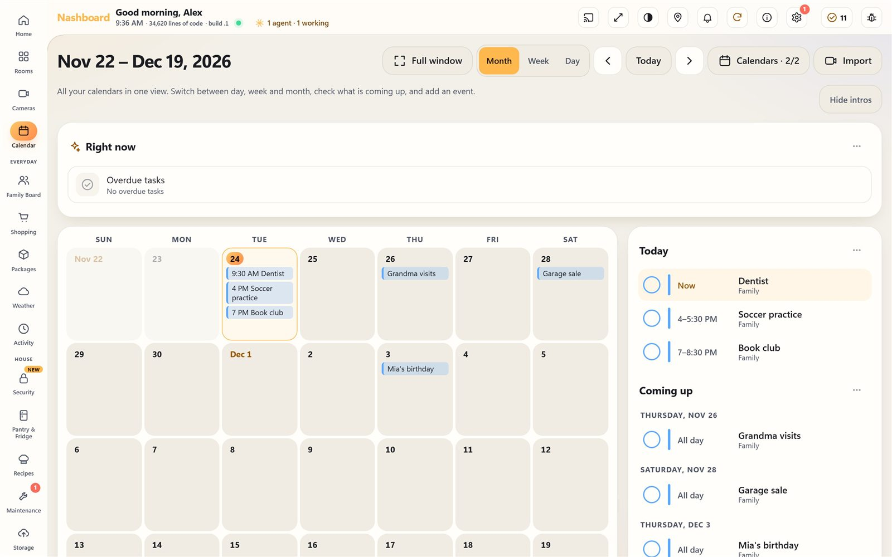
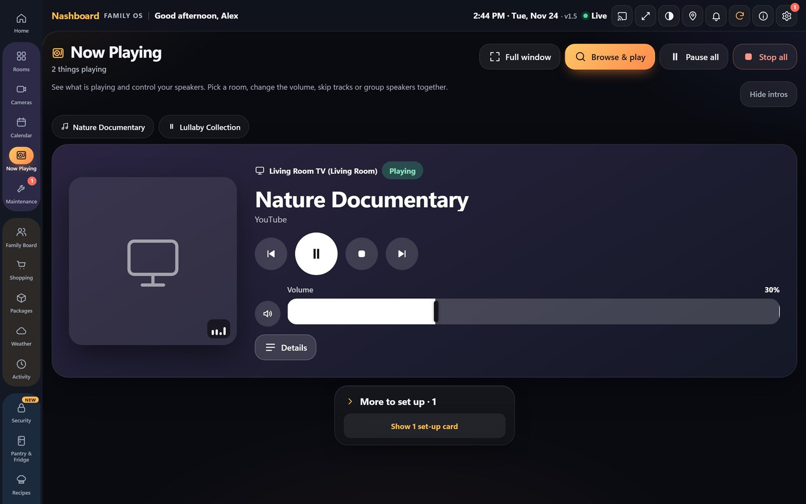
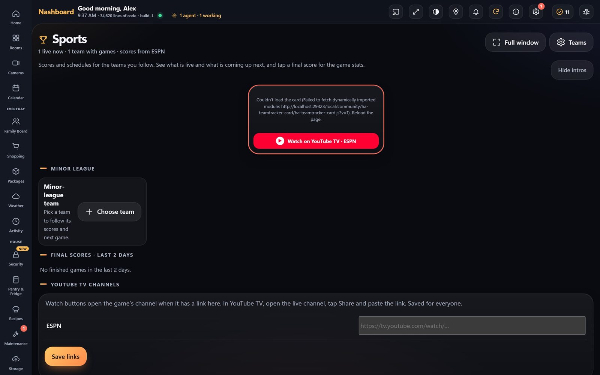
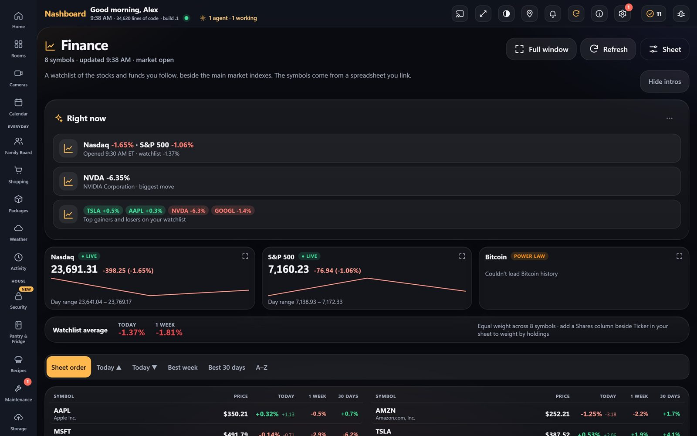
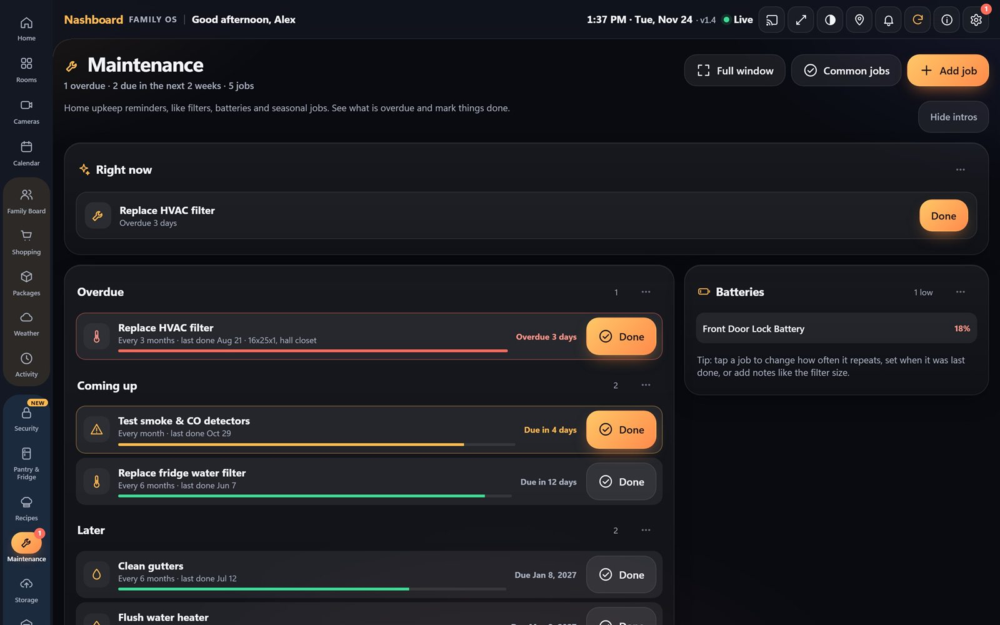
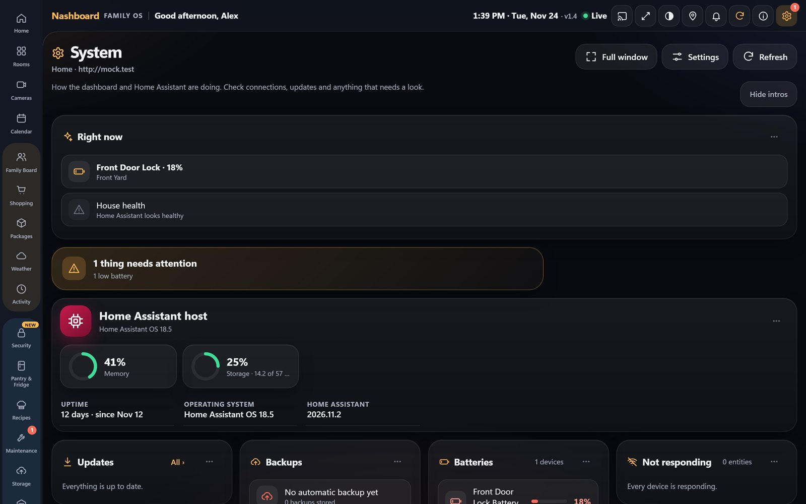
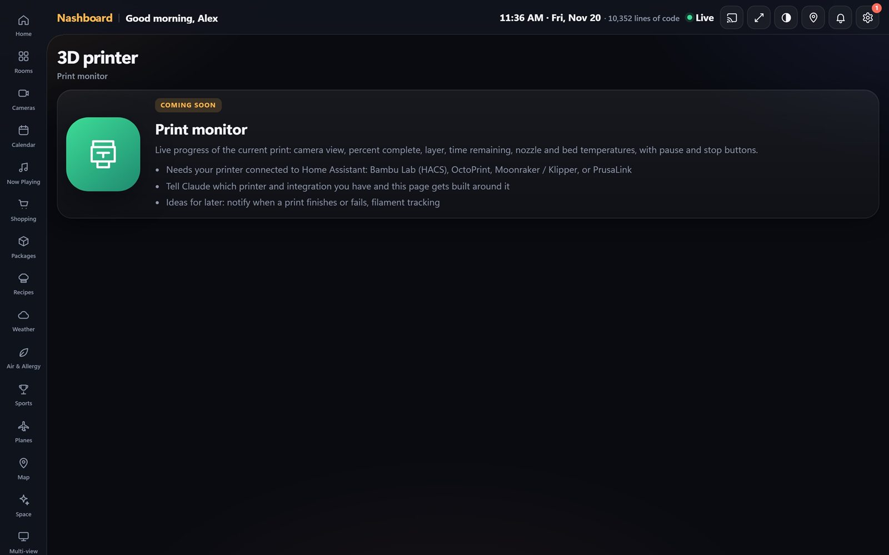

[← Nashboard](index.md)

# All pages

Pages appear in the side menu (or the bottom bar and "More" sheet on phones). Each Home Assistant user can choose
which pages they see, and in what order; see [Settings](settings.md). Pages only appear once their data exists, for
example Cameras needs at least one camera.

They're listed here in roughly the same order as the menu, so you can scroll through the whole app or jump to one:

[Home](#home) · [Rooms](#rooms) · [Cameras](#cameras) · [Calendar](#calendar) · [Activity](#activity) · [Now Playing](#now-playing) · [Shopping](#shopping) · [Packages](#packages) · [Recipes](#recipes) · [Pantry & Fridge](#pantry--fridge) · [Storage](#storage) · [Weather](#weather) · [Air & Allergy](#air--allergy) · [Sports](#sports) · [Commute](#commute) · [Planes](#planes) · [Map](#map) · [Space](#space) · [Multi-view](#multi-view) · [Display](#display) · [Kitchen display](#kitchen-display-preset) · [Finance](#finance) · [Room dashboards](#room-dashboards) · [Design Studio](#design-studio) · [Network & Storage](#network--storage) · [Family Board](#family-board) · [Guest](#guest) · [Maintenance](#maintenance) · [Pets](#pets) · [Hobbies](#hobbies) · [Workout](#workout) · [Automations](#automations) · [System](#system) · [About](#about) · [Labs](#labs)

Also: [Things every page has](#things-every-page-has) (the card ⋯ menu, tap-to-collapse, Right now, theme colours,
left- or right-handed phones).

*Screenshots use a made-up demo house; no real data.*

## Things every page has

- **A subtitle** under the page title (also shown in the phone's More menu), and a **Full window** button that fills the
  window, then the whole screen; it zooms the page so all of it fits.
- **A Right now card** on pages that own Home cards: it always shows that page's cards (Rain coming on Weather, the dog
  on Pets, Leave soon on Commute) with a calm line when nothing is happening. Home only shows copies while they matter.
- **The card ⋯ menu** on every card's header: Full window, Collapse, Hide for today and Hide this card (with a confirm;
  admins can also turn a card off for everyone). Hidden cards come back from Customize menu → Hidden cards or the System
  page's Hidden cards section.
- **Tap a card's top bar** to collapse or expand it. Buttons and links in the header still work as normal. Collapsing is
  only for the moment: a refresh brings every card back expanded.
- **NEW and UPDATED tags** in the menu: a page added in the last 24 hours shows NEW; a page whose Right now card has
  something new since you last opened it shows an UPDATED dot until you open it.
- **Theme colours**: Display size offers seven accent colours (Amber, Coral, Rose, Violet, Blue, Teal, Green), per
  person, readable in light and dark.
- **Left- or right-handed** (Display size → Hand, per person): on phones the navigation, room card buttons, page header
  buttons, add and mic buttons, Home card buttons and sheet buttons move to your thumb's side.
- **Voice** on every quick-add list, and no character limits on text boxes.

## Home

The page most screens sit on: an illustrated house banner with live status, and cards that appear when they matter
(a plane overhead, rain coming, a game on, a package arriving) and leave when they don't. Every card and pop-up is
described on the [Home page](home.md) guide and in the [Every feature](features.md#home-automatic-cards) table.

## Rooms

Every Home Assistant area as a card (including new rooms that have no devices yet): lights, switches, fans, media,
climate and sensors, with chips to filter the list. Tap a room's name to open its [room dashboard](#room-dashboards).
Rooms can have a picture as their background and their own icon. Rooms with a routine (such as a bedtime routine) show
a button for it. **Right now** shows low batteries (with each device's room), lights left on late and the garage.

## Cameras

A camera wall like a security console: layouts (auto, 1, 2×2, 3×3, 4×4, 1+5, 1+7), grouping, ordering, hiding,
labels, snapshot refresh rate or live video. Tap a camera for a large live view. Snapshots are fetched with the
dashboard's own sign-in, never stale camera links.

## Calendar

Day, week and a rolling 4-week month (this week plus three, up to five events a day that wrap to two lines, past days
dimmed) across all your calendars, in the colours you pick (shared by everyone). Add and edit events, toggle calendars
on and off, and see the meal plan alongside.

- **Tasks** card for Google Tasks: every list with due dates, overdue items in the warning colour, tick to complete and
  an add box per list. Tasks due today also show in Home's Up next card; overdue ones get a Home card.

## Activity

One scrolling timeline of what happened around the house **today and yesterday**, newest first and grouped by hour: the
doorbell and people at the front door, the garage and doors, locks, people arriving and leaving, packages, alarms and
smoke, and intercom messages. **Filter chips** narrow it to one kind. It reads Home Assistant's logbook, refreshes when
you open it and every minute while it's open.

## Now Playing

What every speaker is playing, with artwork, play/pause, seek, volume and per-speaker faders inside speaker groups.
Browse and search Music Assistant to start something new.

## Shopping

The Home Assistant shopping list (and Mealie's, if connected). Only shopping lists show here; chores, maintenance, the
pantry and ideas stay on their own pages. Add several items at once (or say them), tick items into the cart, clear the
cart, and "Buy again" from recent items. Changes show on every screen instantly.

## Packages

Add a tracking number from any carrier. Shipments are also found in email (USPS, store order emails) and through
17TRACK; email finds wait for you to **Import** or **Ignore** them. Each package shows its stage and latest event, and
delivered ones leave two days later. A separate section handles recurring **autoship** orders with their next ship
date.

**Package left outside**: when a delivery sits outside with nobody home, or is still out after dark, a card shows here
and on Home, and every phone gets one notification.

## Recipes

The family recipe book from Mealie: search, photos, ingredients scaled to servings, importing recipes from a link, and
the week's meal plan. **Cook mode** shows one step at a time with the amounts inline ("whisk the **2 cups** flour") and a
row of that step's ingredients with a little picture for each; long steps shrink to fit the screen. Sending a recipe to
the shopping list first asks **"Use what's in the pantry?"** and leaves the ticked items off the list. **Dinner tonight**
(Right now and Home) says when to start cooking.

## Pantry & Fridge

What's on hand and when it expires, in a shared Home Assistant to-do list. Each item is **pantry, fridge or freezer**.
Scan a barcode with the phone camera (Chrome on Android) or type it; the name comes from Open Food Facts. Add the
expiration date and amount. **Use soon** lists anything expiring within 3 days; **Used up** removes it, and the cart
button also adds it to the shopping list. Home and the Kitchen room show a card for food to use soon.

- **Storage places** you add and remove (shared for everyone; a Medicine place is included). Tap a place to set its
  container type (add and remove your own types) and what it sits inside; **Where** shows the nesting. On hand is
  grouped by place.
- **Medicine expiring**: medicines in the Medicine place show a card (Family Board, Pantry, Home copy) when they expire
  within a month, and the Medicine & fever card warns before you log a dose of an expired one.

## Storage

"Where's it stored": a house inventory, shared for everyone.

- **Places nest** (Garage › Red toolbox › Drawer 3). **Items** live in a place with a name, count, note and photo;
  appliances also get a serial number, purchase date, warranty end and a manual link.
- **One big search box** finds things by words ("aaa batteries", "where are the christmas lights") and shows the full
  place path.
- **Printable QR labels** for every place: stick one on a bin, scan it with a phone and that place opens on the
  dashboard.
- **Low counts**: set a low number on an item; when it's at or below, **Running low** shows (with Add to shopping list).
- **Warranty ending**: a card when an appliance's warranty ends within 30 days, with its serial, place and manual.

## Weather

Current conditions, hourly and daily forecasts, rain chances, the National Weather Service forecast text, sun
and moon times, and a live radar with warnings outlined (full-screen capable). Phones can show weather for where
the phone is. The **What to watch** card (Right now) always shows severe weather, rain coming, freeze tonight and UV.

## Air & Allergy

- **"Open the windows?"**: a plain-English verdict from air quality, pollen, rain coming, temperature, humidity,
  wind, and whether opening up would cool the house.
- **Air quality**: US AQI with the next 24 hours as coloured bars, plus PM2.5, PM10, ozone and NO₂.
- **UV index**: now, today's peak and the hours sun protection is needed.
- **Pollen**: from Home Assistant's IQVIA integration (Pollen.com), when set up.
- **Inside vs outside**: temperature, humidity and wind side by side.

## Sports

Your teams' schedules and scores from ESPN (via the Team Tracker integration), with live game cards, TV network
links and recaps.

- **Final scores · last 2 days** for every followed team; **tap a final** for the box score (score by period, team
  stats, leaders, player tables).
- **Watch** opens the game's YouTube TV channel when an admin has saved that network's share link; otherwise the live
  guide. At most one Highlights and one Condensed game link per game, official channels first.
- **Teams**: pick a league, then the team; remove any team, or hide one just for you (also on Home). Minor-league
  baseball comes from MLB's own stats feed.

## Commute

Each trip (for example drop-off then work, or school runs) with live drive time per leg from Waze, delay versus
usual, "leave by" times, a route map and recent days' history. Trips, stops and times are set up in the page's
settings, which create the Waze routes in Home Assistant automatically. Each trip belongs to a person and has its own
**Navigate** button.

**Right now** on Commute: Leave soon, On the way home, **Pick up dinner?** (heading home 4 to 8 PM: saved carry-out places
with tap-to-call and Copy the order), **Gas price drop**, **Car due soon** and **New car recall**. Cars added by VIN
(details and recalls from NHTSA, plate, insurance, tire size, registration, inspection and oil change dates) show here
and on the Garage room.

## Planes

A live map of aircraft around home or around the phone (5 to 500 nm), coloured by altitude, with flight paths,
military aircraft ringed, and emergencies (squawk 7700) highlighted worldwide.

- Glass cards on the map's edge: the plane you picked (all details and a small photo, or a labelled stock photo of its
  type), the **closest** plane, **military** planes in range, and the **highest** and **fastest plane in the world**
  right now (tap to fly the map there).
- Arrivals and departures boards for nearby airports (airport tabs scroll on phones).
- Satellite map, full window or full screen, the phone **compass** (the map turns as you turn), map buttons that
  scroll when they don't fit, and an **INFO** button that hides or shows the legend and info cards.
- Optional phone alerts when a plane passes overhead (one per pass).

## Map

People and tracked devices on a map with their recent path for the day, commute places and a You marker.

## Space

The Space Station: where it is, the next visible pass, every pass for three days, and whether each is visible.
Upcoming rocket launches. Bright satellites overhead now, and a **sky dial** that can turn with the phone's
compass.

## Multi-view

Show up to four pages at once on a large screen, each in its own tile.

## Display

A full-screen mode for TVs and wall displays: clock, weather, cameras, and automatic cards (up next, commute,
games, overhead aircraft, Space Station, packages, now playing, breaking news). It can rotate between views or
stay on one. Casting to a TV opens the same Display, and **each TV can have its own setup** (rotating or still, seconds
per screen, which screens, night dimming). Home's cards show as a strip on the radar and camera screens; a pet peeks in
from a corner now and then.

## Kitchen display preset

A calm, always-on layout for a landscape wall display in the kitchen, turned on per device: **Cast → This device →
Kitchen display** (or add `?display=kitchen` to the address; `?display=off` turns it off).

- Clock and weather, today's calendar and dinner, who's home, chores, trash night, the Home cards while they matter, and
  the Kitchen (or Living Room) light and device controls.
- Tap anywhere that isn't a control to use the full dashboard; after 2 minutes without a touch it returns to the kitchen
  view.
- 9 PM to 6:30 AM it goes very dim, with no animations or chimes.

## Finance

A watchlist from a published spreadsheet: prices, day and week moves, charts, and a Bitcoin long-term "power
law" chart that zooms and remembers the zoom. The **Markets** card (Right now and Home) shows around the open and close
and after a big move.

## Room dashboards

Every room has its own dashboard, opened by tapping the room's name on Home or the Rooms page (they are not in the
side menu). A room added in Home Assistant gets its page right away. The general version groups the room's devices into
lights, media, climate, doors, switches and scenes, cameras and sensors. Rooms can have a custom design:

- **Nursery**: a calm, dark screen for night-time. Big clock and status, toddler-lock switch, the night light
  (on/off orb, brightness, eight colours, with a note that red and amber are gentlest for sleep), the sound
  machine (play/stop, volume, favourites, and every built-in sound grouped into sleep, bedtime and wake-up),
  the bedtime routine, the nursery speaker, **presets** (save the sound, volume and light under a name; one tap to
  recall) and a 7-night **sleep log** worked out from the sound machine.

**Room settings** (button in every room page's header), saved per room for everyone:

- **Layout by room type**: kitchen, bedroom, garage, living room, office, outdoors or other (guessed from the room's
  name), which sets the order of the sections.
- **Show or hide sections**: lights, climate, media, cameras, sensors, blinds and doors, and so on.
- **Add a card to this room**: any Home card (dog timeout, trash night, the doorbell…) or a main card (weather, calendar,
  packages, medicine, pantry).
- **Room icon**: a searchable grid of icons in the room's options, shared for everyone.

Every room page also shows the cards that relate to it: the **Doorbell**, its maintenance jobs, low batteries, pet
device problems, tonight's dinner and expiring food (Kitchen), packages (front of the house), cars (Garage).

## Design Studio

Opened from System or the More menu (not in the side menu). Its cards are wide (at least a third of the page):

- **Jot it down**: type or say an idea, attach a photo or screenshot, swipe left to remove one; it keeps a draft while
  you type and stays put after you submit. **Import now** asks for new ideas to be filed at the next check-in. Claude's
  **suggestions** appear here marked and dated, with Accept and Ignore.
- **Backlog**: the whole plan, searchable, every section collapsed until you search, with an open count.
- **Every feature**: the running feature list, searchable.
- **Change log**: a heading per day and an expandable box per build.
- **Shipped per day**: a chart of the last 14 days with a 7-day average.
- **Hardware wishlist**: add a product link, × to remove, **Bought** moves it to Purchased; refreshes every minute.
- **Autopilot** (admins): opens the private control panel for the assistant that maintains the dashboard.

See [Settings](settings.md#design-studio-backlog-and-ideas).

## Network & Storage

- **Status strip**: internet, NAS, Home Assistant and offline devices, each green, amber or red.
- **Internet**: connection status, router uptime, live download and upload speed, data used today and this month,
  router CPU and memory, and hourly speed tests with a 7-day chart.
- **Internet services**: the status of the remote-access service, Cloudflare, GitHub and Discord.
- **NAS** (Synology DSM): volume space and status (with an explanation when it needs attention), each drive's
  health and temperature, CPU, memory, temperature, traffic, update and security status.
- **Home Assistant**: CPU, memory, disk and uptime.
- **Devices on the network**: everything connected to the router, busiest first, with Wi-Fi band, signal strength
  (weak signals in red) and live traffic.
- **New on Wi-Fi**: Known dismisses it; **Unknown** logs it to a shared **Follow up later** list here (Done clears it).
- **Offline devices**: anything unavailable, grouped by integration. The guest Wi-Fi details show here too.

## Family Board

Made for a kitchen screen with bigger text: the time and weather, **who's home**, today's events and tonight's
dinner, **trash and recycling** days (with "take the bins out tonight"), the live **shopping list**, a shared
**chores** list anyone can tick off, **birthdays** coming up (from calendars, plus people added by hand), the
**intercom** (record a message that plays on every screen and notifies phones), **holiday traditions**, **carry-out
orders**, **kids' activity ideas**, **family favorites**, **for sale**, the Sunday **week ahead**, the **doorbell**, and
the **Medicine & fever** card: one-tap buttons for each medicine with its own rules (once a day, every few hours,
alternating Tylenol and ibuprofen), a profile per child, a temperature log, symptom buttons, a 7-day history with a
fever chart and a copy-for-the-doctor summary, FDA drug-label facts with citations, and a heads-up when two medicines are
the same kind.

**Right now** on the Family Board covers Good morning, Goodnight check, chores, trash night, lights left on, the nursery,
fever and medicine, medicine expiring, birthdays, holiday traditions, the week ahead, kids' ideas, movie night, for sale
and the intercom.

## Guest

Everything a guest or house sitter needs on the screens already around the house: a welcome note, **Wi-Fi with a
QR code** (drawn on the device; the password is never sent anywhere) and copy buttons, room light switches and an
"all lights off" button, the thermostat, tap-to-call contacts, how-tos and pet notes. Admins edit it; everyone sees
the same information. Also: **weather now and the next 6 hours**, the live radar, and a **Watching TV** card with the
TV remote steps and YouTube TV buttons for each TV (no passwords on the page).

## Maintenance

Recurring house jobs (filters, smoke detector tests, gutters, oil changes, and more) kept in a shared Home
Assistant to-do list. Each job shows how often it repeats, when it was last done and a countdown bar. **Done**
reschedules it from today. A starter list of 15 common jobs, a low-battery panel, a menu badge when something is
overdue, and a "Maintenance due" pop-up on Home. Car due dates show here too.

## Pets

**Pet characters** (cat or dog, coat and pattern, and a name) that live on the Home banner, the dog timeout (30 min,
1 h, 2 h) and feeder times, and pet devices such as a self-cleaning litter box: status, drawer level, litter level,
faults and history.

- **Pet medicine**: how often it's given, when it was last given, **Log now**, and logging by tapping an NFC tag on the
  bottle. A Home copy shows when a dose is due; a phone reminder if it's two hours late.
- **Pet notes** (shared with the Guest page) show and edit here.
- This is the pets' favourite page: they play here often (chases, naps on cards), and only rarely elsewhere.

## Hobbies

Each person picks their own hobbies (saved with their login); each hobby's cards are **shared**, so anyone who picks the
same hobby sees the same content. Built-in hobbies: band and set lists, audio mixing and video editing, Ableton Live,
book club, gardening (plants with watering reminders), running and cycling, reading list, board game night, cooking
experiments and 3D printing, or add your own. A **Hobbies** Home card shows only your hobbies, only when something is
soon (book club tonight, plants to water, game night, a show this week).

## Workout

Made for a TV in the garage (big numbers you can read across the room), and it works on a phone too.

- **Interval timer**: work, rest and rounds, with a progress ring and optional beeps (started with a tap).
- **Routines** you save (name, timings, exercises).
- **Workout log** shared by the family, with a weekly total per person.
- Live heart rate, calories and treadmill data **(planned)**.

## Automations

What the house does on its own: every Home Assistant automation as a friendly card (grouped, with when it last ran and a
description), on/off and **Run now** for admins, and **Make your own** with five fill-in templates. The full list of
what ships with Nashboard is on [Automations](automations.md).

## System

Home Assistant health at a glance: updates, backups, recent errors, devices that need attention, low batteries,
and settings such as Menu pages, alerts and appearance.

- **Home settings**: the household basics in one place (house name and Wi-Fi from Guest, pickup days from the Family
  Board, this device's zip, Home Assistant's location, time zone, units and people), each linking to where it's edited.
- **Banner windows**: say which window, porch light or lamp in the house picture is which room or light (Highlight shows
  it).
- **Low batteries** with each device's room, **Hidden cards** with Show again, the **Device setup** checklist (ticks per
  device), the **User manual** link, and Display size on phones.

## About

Version and build, **What's new**, the full feature list, data-source credits, the user manual, and **Run the tour
again**.

## Labs

Experiments: a **Browser** for quick look-ups (just the bar: back and reload, a bookmarks dropdown and the address with
voice; tools behind a ⋯ menu; reopens your last page on each device; in Full window it works like a real browser) and a
3D printer monitor.
