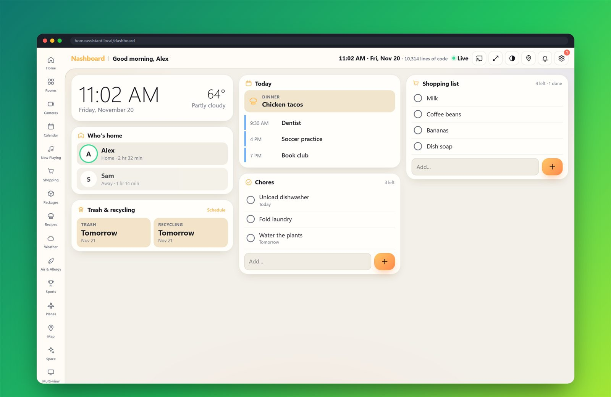

[← Nashboard](index.md)

# All pages

Pages appear in the side menu (or the bottom bar and "More" sheet on phones). Each Home Assistant user can choose
which pages they see; see [Settings](settings.md). Pages only appear once their data exists, for example Cameras
needs at least one camera.

## Rooms

Every Home Assistant area as a card: lights, switches, fans, media, climate and sensors, with chips to filter the
list. Tap a room's name to open its [room dashboard](#room-dashboards). Rooms can have a picture as their
background. Rooms with a routine (such as a bedtime routine) show a button for it.

## Cameras

A camera wall like a security console: layouts (auto, 1, 2×2, 3×3, 4×4, 1+5, 1+7), grouping, ordering, hiding,
labels, snapshot refresh rate or live video. Tap a camera for a large live view. Snapshots are fetched with the
dashboard's own sign-in, never stale camera links.

## Calendar

Day, week and month views across all your calendars, in the colours you pick (shared by everyone). Add and edit
events, toggle calendars on and off, and see the meal plan alongside.

## Now Playing

What every speaker is playing, with artwork, play/pause, seek, volume and per-speaker faders inside speaker groups.
Browse and search Music Assistant to start something new.

## Shopping

The Home Assistant shopping list (and Mealie's, if connected). Add several items at once, tick items into the
cart, clear the cart, and "Buy again" from recent items. Changes show on every screen instantly.

## Packages

Add a tracking number from any carrier. Shipments are also found in email (USPS, store order emails) and through
17TRACK. Each package shows its stage and latest event. A separate section handles recurring **autoship** orders
with their next ship date.

## Recipes

The family recipe book from Mealie: search, photos, ingredients scaled to servings, a step-by-step cooking view,
importing recipes from a link, and the week's meal plan.

## Weather

Current conditions, hourly and daily forecasts, rain chances, the National Weather Service forecast text, sun
and moon times, and a live radar with warnings outlined (full-screen capable). Phones can show weather for where
the phone is.

## Air & Allergy

- **"Open the windows?"**: a plain-English verdict from air quality, pollen, rain coming, temperature, humidity,
  wind, and whether opening up would cool the house.
- **Air quality**: US AQI with the next 24 hours as coloured bars, plus PM2.5, PM10, ozone and NO₂.
- **UV index**: now, today's peak and the hours sun protection is needed.
- **Pollen**: from Home Assistant's IQVIA integration (Pollen.com), when set up.
- **Inside vs outside**: temperature, humidity and wind side by side.

## Sports

Your teams' schedules and scores from ESPN (via the TeamTracker integration), with live game cards, TV network
links and recaps.

## Commute

Each trip (for example drop-off then work, or school runs) with live drive time per leg from Waze, delay versus
usual, "leave by" times, a route map and recent days' history. Trips, stops and times are set up in the page's
settings, which create the Waze routes in Home Assistant automatically.

## Planes

A live map of aircraft around home or around the phone (5 to 500 nm), coloured by altitude, with flight paths,
military aircraft ringed, and emergencies (squawk 7700) highlighted worldwide.

- Glass cards on the map's edge: the plane you picked (all details and a small photo), the **closest** plane,
  **military** planes in range, and the **highest plane in the world** right now (tap to fly the map there).
- Arrivals and departures boards for nearby airports.
- Satellite map, full window or full screen, and the phone **compass** (the map turns as you turn).
- Optional alerts when a plane passes overhead.

## Map

People and tracked devices on a map with their recent path for the day.

## Space

The Space Station: where it is, the next visible pass, every pass for three days, and whether each is visible.
Upcoming rocket launches. Bright satellites overhead now, and a **sky dial** that can turn with the phone's
compass.

## Multi-view

Show up to four pages at once on a large screen, each in its own tile.

## Display

A full-screen mode for TVs and wall displays: clock, weather, cameras, and automatic cards (up next, commute,
games, overhead aircraft, Space Station, packages, now playing, breaking news). It can rotate between views or
stay on one. Casting to a TV opens the same Display.

## Finance

A watchlist from a published spreadsheet: prices, day and week moves, charts, and a Bitcoin long-term "power
law" chart.

## Room dashboards

Every room has its own dashboard, opened by tapping the room's name on Home or the Rooms page (they are not in the
side menu). The general version groups the room's devices into lights, media, climate, doors, switches and
scenes, cameras and sensors. Rooms can have a custom design:

- **Nursery**: a calm, dark screen for night-time. Big clock and status, toddler-lock switch, the night light
  (on/off orb, brightness, eight colours, with a note that red and amber are gentlest for sleep), the sound
  machine (play/stop, volume, favourites, and every built-in sound grouped into sleep, bedtime and wake-up),
  the bedtime routine, and the nursery speaker.

## Network & Storage

- **Status strip**: internet, NAS, Home Assistant and offline devices, each green, amber or red.
- **Internet**: connection status, router uptime, live download and upload speed, data used today and this month,
  router CPU and memory, and hourly speed tests with a 7-day chart.
- **NAS** (Synology DSM): volume space and status (with an explanation when it needs attention), each drive's
  health and temperature, CPU, memory, temperature, traffic, update and security status.
- **Home Assistant**: CPU, memory, disk and uptime.
- **Devices on the network**: everything connected to the router, busiest first, with Wi-Fi band, signal strength
  (weak signals in red) and live traffic.
- **Offline devices**: anything unavailable, grouped by integration.

## Family Board

Made for a kitchen screen with bigger text: the time and weather, **who's home**, today's events and tonight's
dinner, **trash and recycling** days (with "take the bins out tonight"), the live **shopping list** and a shared
**chores** list anyone can tick off.

## Guest

Everything a guest or house sitter needs on the screens already around the house: a welcome note, **Wi-Fi with a
QR code** (drawn on the device; the password is never sent anywhere) and copy buttons, room light switches and an
"all lights off" button, the thermostat, tap-to-call contacts, how-tos and pet notes. Admins edit it; everyone sees
the same information.

## Maintenance

Recurring house jobs (filters, smoke detector tests, gutters, oil changes, and more) kept in a shared Home
Assistant to-do list. Each job shows how often it repeats, when it was last done and a countdown bar. **Done**
reschedules it from today. A starter list of 15 common jobs, a low-battery panel, a menu badge when something is
overdue, and a "Maintenance due" pop-up on Home.

## Pets

Pet devices such as a self-cleaning litter box: status, drawer level, litter level, faults and history.

## System

Home Assistant health at a glance: updates, backups, recent errors, devices that need attention, low batteries,
and settings such as Menu pages, alerts and appearance.

## Backlog

Opened from System or the More menu (not in the side menu): jot down ideas and browse the project backlog. See
[Settings](settings.md#backlog-and-ideas).

## Labs

Experiments that aren't finished yet, such as a 3D printer monitor.
