# Themes and looks

Nashboard can be changed in three independent ways. Mix them freely; each is remembered per person and follows that
person to every device they sign in on.

1. **Look**: the overall style (Classic, Paper, Glass or Bold, or Auto, which changes with the season).
2. **Mode**: Auto, Dark or Light.
3. **Accent colour**: seven colours that tint buttons, highlights and the active menu item.

Layout never changes with any of these. Card widths, the grid, the single font and the text size scale stay the same;
only colours, borders, shadows and surfaces change.

## Looks

Pick a look in **Settings, Interface scale**, in the Look row. Tap one of the five buttons; it applies at once.

### Classic (default)
- **Feel**: the original Nashboard. Warm charcoal in dark mode, a warm off-white in light mode, soft rounded cards with a
  gentle lift.
- **Suits**: everything. A good all-round choice on phones, tablets and desktops.

### Paper
- **Feel**: flat and airy. Cards have thin, slightly stronger outlines, almost no shadow, a touch more room inside and
  slightly tighter corners. Light mode is a clean near-white; dark mode is a calm slate with see-through card
  surfaces.
- **Suits**: reading-heavy pages (lists, calendar, news), daytime use, anyone who finds the default a little busy.

### Glass
- **Feel**: frosted, translucent cards over a soft blurred colour wash (blue, pink and teal glows) that stays put as you
  scroll. Cards blur whatever is behind them and have a faint highlight along the top edge.
- **Suits**: phones and tablets in the evening, and displays that are looked at more than touched. The blur is a little
  heavier to draw, so on a very old wall tablet Classic or Bold may feel smoother.

### Bold
- **Feel**: high contrast. Pure black (dark) or pure white (light) backgrounds, thick 2 px borders, no soft shadows,
  brighter secondary text, larger and heavier card titles, and a clear outline on the selected option in button groups.
- **Suits**: wall screens and TVs viewed from across the room, bright rooms, and anyone who wants maximum legibility.

### Auto (seasonal)
- **Feel**: the look follows the calendar: Glass from December to February, Paper from March to May, Classic from June to August and Bold from September to November. Only screens set to Auto change.
- **Suits**: a screen you want to feel fresh through the year without touching it.

## Modes: Auto, Dark, Light

Tap the theme button in the top bar to cycle **Auto, Dark, Light**. Its icon shows the current choice (contrast circle for
Auto, moon for Dark, sun for Light), and a short message confirms it.

- **Auto** follows the device: light when the phone or computer is set to light, dark when it is set to dark, switching on its
  own at sunset if the device does that. This is the default.
- **Dark** and **Light** stay fixed whatever the device does.
- The browser bar colour on phones and the map and chart colours follow the active mode.

Every look has both a dark and a light version, so any look can be used in any mode (for example Glass in light mode is a
pale frosted blue-white, Bold in dark mode is black with bright outlines).

## Display modes for screens

Dedicated screens such as a wall tablet or TV use the same looks and modes, set once on that device. Pairing **Bold** with
**Dark** (or **Light** in a bright room) gives the most readable result at a distance; the interface scale setting beside the
Look row makes everything larger on top of that. Full window on any page zooms the page to fit the screen and uses the
current look.

## Accent colours

Seven accents: Amber (default), Coral, Rose, Violet, Blue, Teal and Green. Pick one in the same Settings sheet. Each is used
for buttons, the active menu item and highlights, and works with every look and both modes.

## Readability rule

Text must be readable in every combination of look, mode and accent:

- Meaningful coloured text (accent, warning, error, success, info) uses darker text shades in light mode, so it keeps at
  least the contrast needed to read comfortably on white. Bright accent colours are never placed straight onto text.
- Text that sits on a coloured background (selected chips, primary buttons) always uses a dark ink so it stays readable on
  every accent.
- An automated check opens every page in dark and light and fails any text with too little contrast before a new version
  is released.

## Holiday looks

On holidays the Home banner dresses the house, and a few things drift past (falling leaves, snow, hearts, confetti). Anything that moves passes behind the house, never over it; things fixed to the house, like a wreath on the door or lights along the roof, stay on it. Turn it all off, or keep it still, with Holiday decorations in the Interface scale sheet (On, Calm, Off). These pictures come from the demo house with the date set to each holiday.

<figure style="margin:0">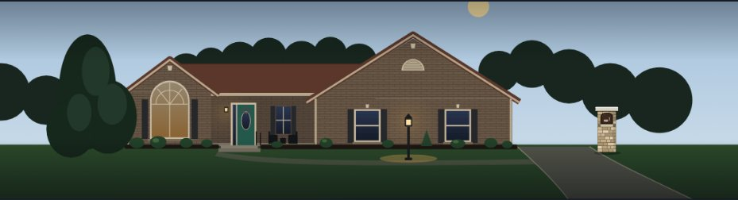<figcaption style="font-size:.9em;margin-top:6px">No holiday: the plain house</figcaption></figure>
<figure style="margin:0">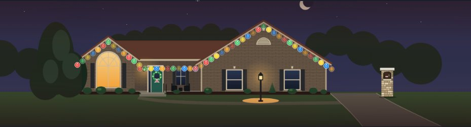<figcaption style="font-size:.9em;margin-top:6px">Christmas: string lights along the roofs, with the wreath (Dec 1-25)</figcaption></figure>
<figure style="margin:0"><figcaption style="font-size:.9em;margin-top:6px">December: a wreath on the front door (the rest of the month)</figcaption></figure>
<figure style="margin:0">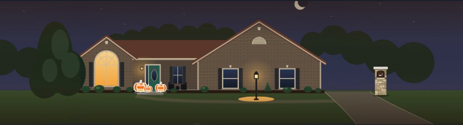<figcaption style="font-size:.9em;margin-top:6px">Halloween: pumpkins on the porch (the week before)</figcaption></figure>
<figure style="margin:0">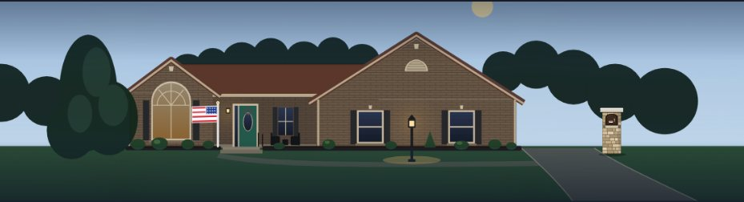<figcaption style="font-size:.9em;margin-top:6px">Fourth of July: a flag on the porch</figcaption></figure>
<figure style="margin:0">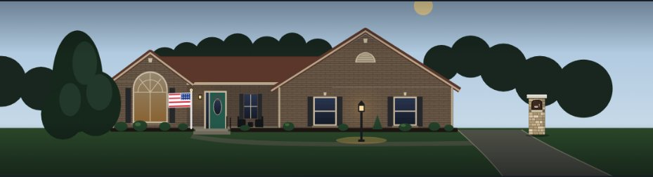<figcaption style="font-size:.9em;margin-top:6px">Memorial Day: a flag on the porch</figcaption></figure>
<figure style="margin:0">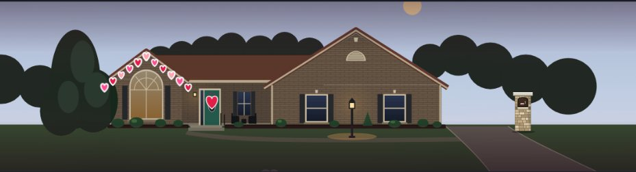<figcaption style="font-size:.9em;margin-top:6px">Valentine’s Day: heart garland and a heart on the door</figcaption></figure>
<figure style="margin:0">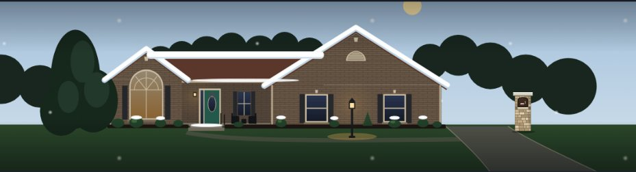<figcaption style="font-size:.9em;margin-top:6px">First snow: snow on the roofs when the weather says snow</figcaption></figure>
<figure style="margin:0">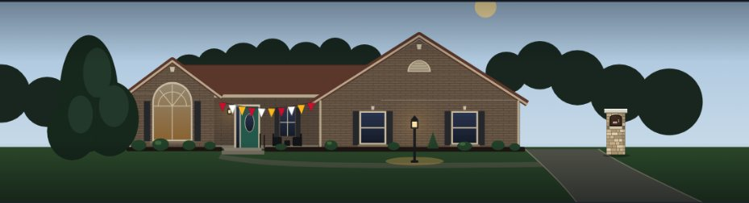<figcaption style="font-size:.9em;margin-top:6px">Game day: bunting in the team colours</figcaption></figure>
<figure style="margin:0">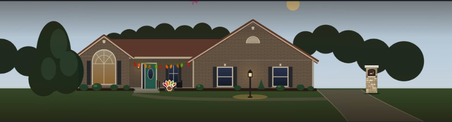<figcaption style="font-size:.9em;margin-top:6px">Thanksgiving: leaf garland and a turkey</figcaption></figure>
<figure style="margin:0"><figcaption style="font-size:.9em;margin-top:6px">St. Patrick’s Day: shamrock garland</figcaption></figure>
<figure style="margin:0">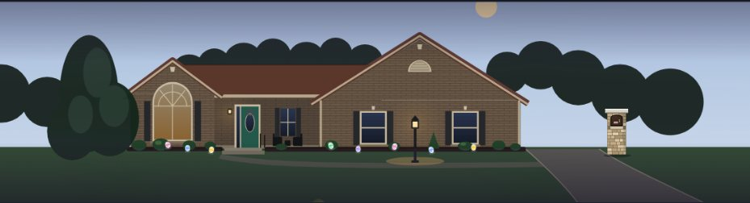<figcaption style="font-size:.9em;margin-top:6px">Easter: eggs on the lawn (the week before)</figcaption></figure>
<figure style="margin:0">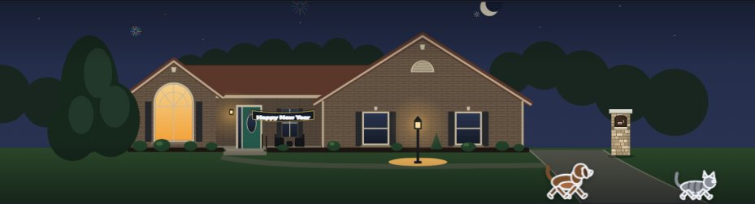<figcaption style="font-size:.9em;margin-top:6px">New Year: banner and fireworks (Dec 31 and Jan 1)</figcaption></figure>
<figure style="margin:0">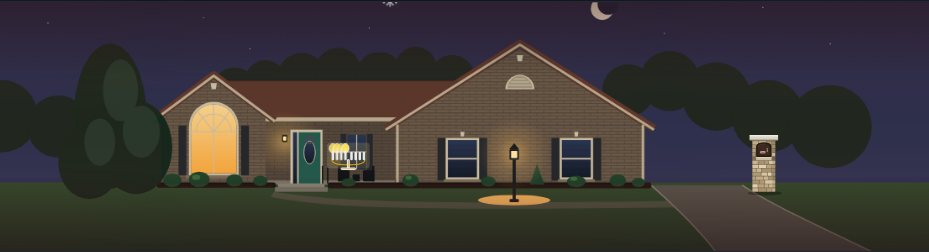<figcaption style="font-size:.9em;margin-top:6px">Hanukkah: a menorah in the window, one more candle each night</figcaption></figure>
<figure style="margin:0">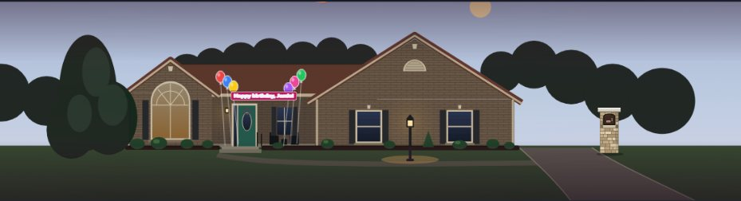<figcaption style="font-size:.9em;margin-top:6px">A family birthday: balloons and a banner (shown with a demo name)</figcaption></figure>

## Quick guide

- Phone, everyday: Classic or Paper, Auto.
- Evening on the sofa: Glass, Dark.
- Wall screen or TV: Bold, Dark (or Light in a sunny room).
- Bright daytime reading: Paper, Light.
