# Guided tour

A step-by-step look at every page of Nashboard, in the order you would meet them. Tap **Next** to move along, or jump straight to a page from the strip below. All screenshots use a made-up demo house, with no real data.

<ol class="tour-strip" id="top">
<li><a href="#s-home" title="Home">1</a></li>
<li><a href="#s-menu" title="The grouped menu">2</a></li>
<li><a href="#s-more" title="The phone More sheet">3</a></li>
<li><a href="#s-rooms" title="Rooms">4</a></li>
<li><a href="#s-cameras" title="Cameras">5</a></li>
<li><a href="#s-moresetup" title="More to set up">6</a></li>
<li><a href="#s-calendar" title="Calendar">7</a></li>
<li><a href="#s-family" title="Family Board">8</a></li>
<li><a href="#s-kids" title="Kids">9</a></li>
<li><a href="#s-pets" title="Pets">10</a></li>
<li><a href="#s-pantry" title="Pantry and Fridge">11</a></li>
<li><a href="#s-storage" title="Storage">12</a></li>
<li><a href="#s-garage" title="Garage">13</a></li>
<li><a href="#s-weather" title="Weather">14</a></li>
<li><a href="#s-air" title="Air and Allergy">15</a></li>
<li><a href="#s-planes" title="Planes">16</a></li>
<li><a href="#s-map" title="Map">17</a></li>
<li><a href="#s-space" title="Space">18</a></li>
<li><a href="#s-commute" title="Commute">19</a></li>
<li><a href="#s-sports" title="Sports">20</a></li>
<li><a href="#s-packages" title="Packages">21</a></li>
<li><a href="#s-shopping" title="Shopping">22</a></li>
<li><a href="#s-recipes" title="Recipes">23</a></li>
<li><a href="#s-music" title="Music">24</a></li>
<li><a href="#s-finance" title="Finance">25</a></li>
<li><a href="#s-network" title="Network">26</a></li>
<li><a href="#s-maint" title="Maintenance">27</a></li>
<li><a href="#s-security" title="Security log">28</a></li>
<li><a href="#s-guest" title="Guest">29</a></li>
<li><a href="#s-hobbies" title="Hobbies">30</a></li>
<li><a href="#s-wellbeing" title="Wellbeing">31</a></li>
<li><a href="#s-workout" title="Workout">32</a></li>
<li><a href="#s-activity" title="Activity">33</a></li>
<li><a href="#s-automations" title="Automations">34</a></li>
<li><a href="#s-printer" title="3D Printer">35</a></li>
<li><a href="#s-multi" title="Multi-view">36</a></li>
<li><a href="#s-display" title="Display and TV">37</a></li>
<li><a href="#s-backlog" title="Design Studio">38</a></li>
<li><a href="#s-system" title="System">39</a></li>
<li><a href="#s-settings" title="Settings">40</a></li>
<li><a href="#s-about" title="About">41</a></li>
</ol>

<section class="tour-step" id="s-home">

Step 1 of 41

<h2>Home</h2>
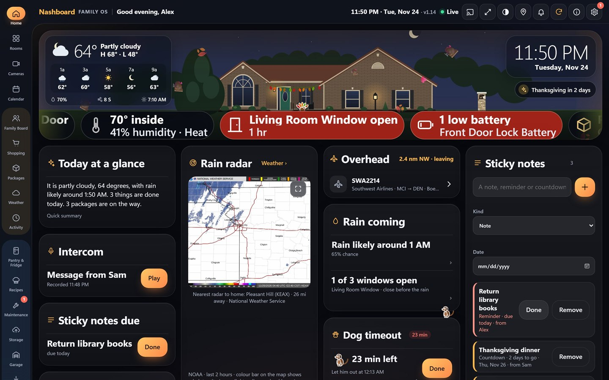

The banner shows the illustrated house with live lights, weather and status chips. Below it, cards appear on their own when something matters (a plane overhead, rain coming, trash night) and leave again when it passes.

<a class="nx" href="#s-menu">The grouped menu &rarr;</a>

</section>

<section class="tour-step" id="s-menu">

Step 2 of 41

<h2>The grouped menu</h2>
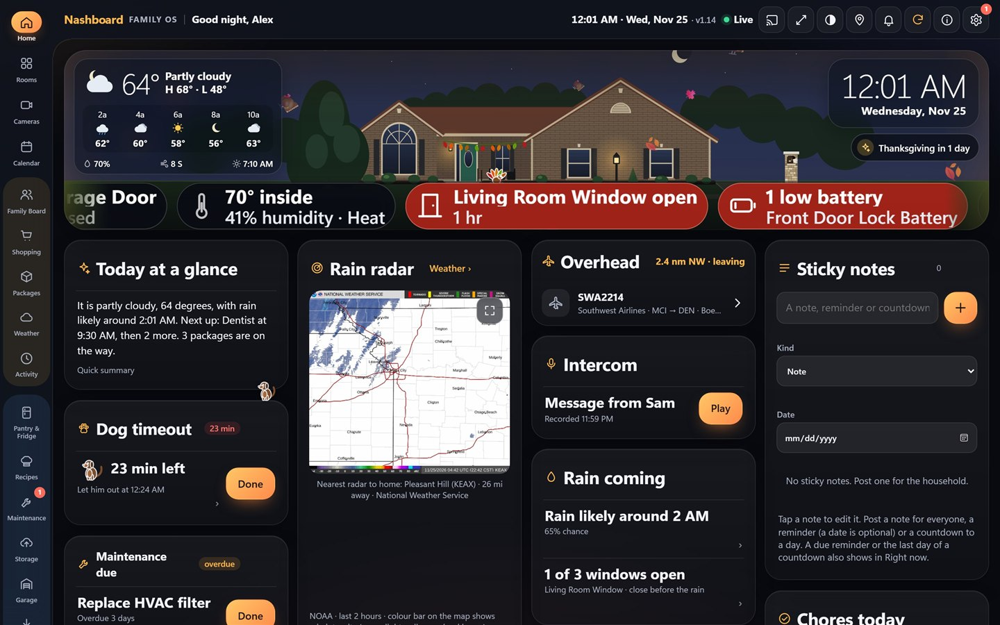

The menu is split into short groups so a long list of pages stays easy to scan: Everyday, House, Family, Out and about, Fun and info, Labs and System. On a computer each group is a colour-tinted block with no heading; the phone More sheet shows the group names. Home and the tab-bar pages stay first and About stays last. Your hidden pages and your order choice still work inside each section.

<a href="#s-home">&larr; Home</a><a class="nx" href="#s-more">The phone More sheet &rarr;</a>

</section>

<section class="tour-step" id="s-more">

Step 3 of 41

<h2>The phone More sheet</h2>
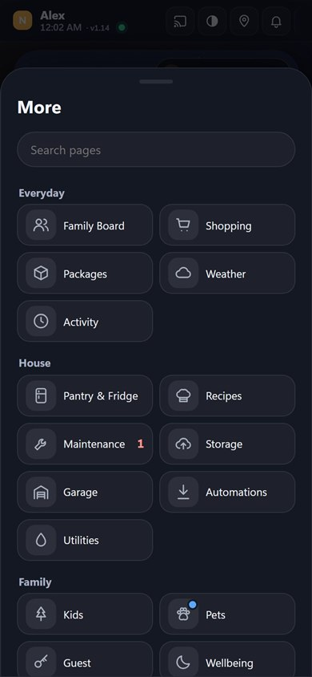

On a phone the tab bar holds the main pages and More opens the rest as a two-column grid with a search box and your last three pages on top, then the same headings, each page with a one-line description. Menu pages in Settings list the same groups.

<a href="#s-menu">&larr; The grouped menu</a><a class="nx" href="#s-rooms">Rooms &rarr;</a>

</section>

<section class="tour-step" id="s-rooms">

Step 4 of 41

<h2>Rooms</h2>
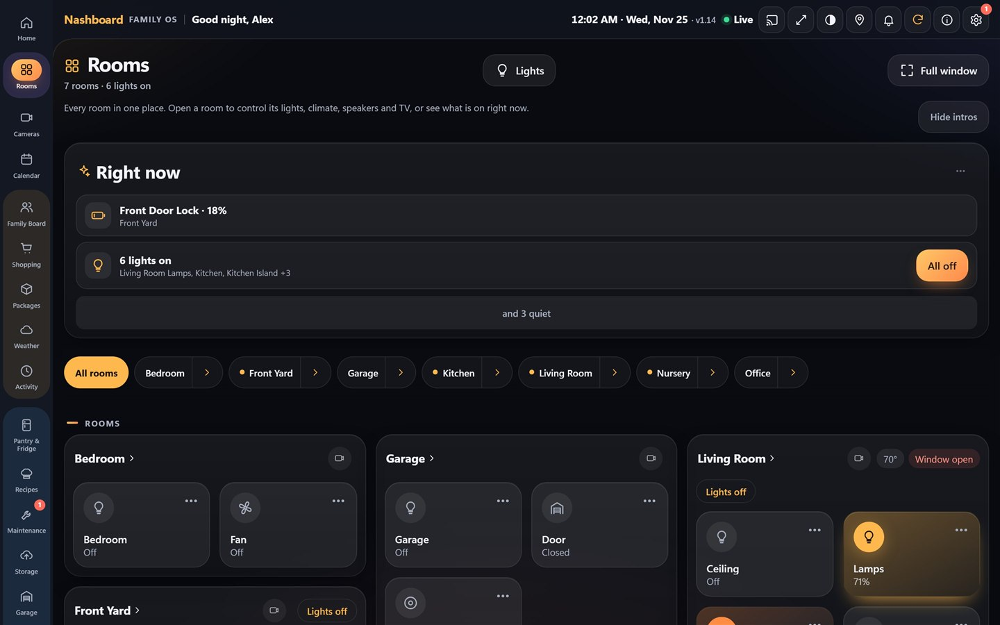

Every area in Home Assistant gets its own room tile and room page, made automatically. Tap a room for its lights, devices and settings.

<a href="#s-more">&larr; The phone More sheet</a><a class="nx" href="#s-cameras">Cameras &rarr;</a>

</section>

<section class="tour-step" id="s-cameras">

Step 5 of 41

<h2>Cameras</h2>
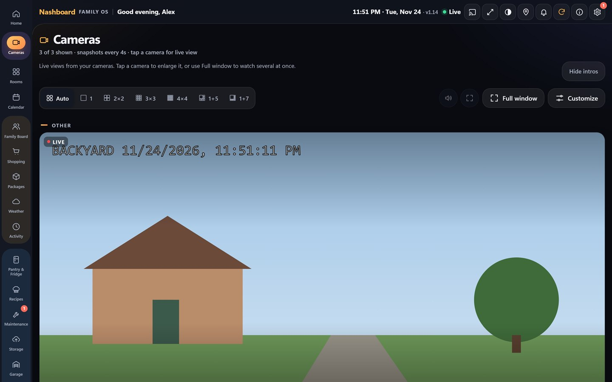

Live camera views in one place, with the same cameras available as a quick tile group on Home.

<a href="#s-rooms">&larr; Rooms</a><a class="nx" href="#s-moresetup">More to set up &rarr;</a>

</section>

<section class="tour-step" id="s-moresetup">

Step 6 of 41

<h2>More to set up</h2>
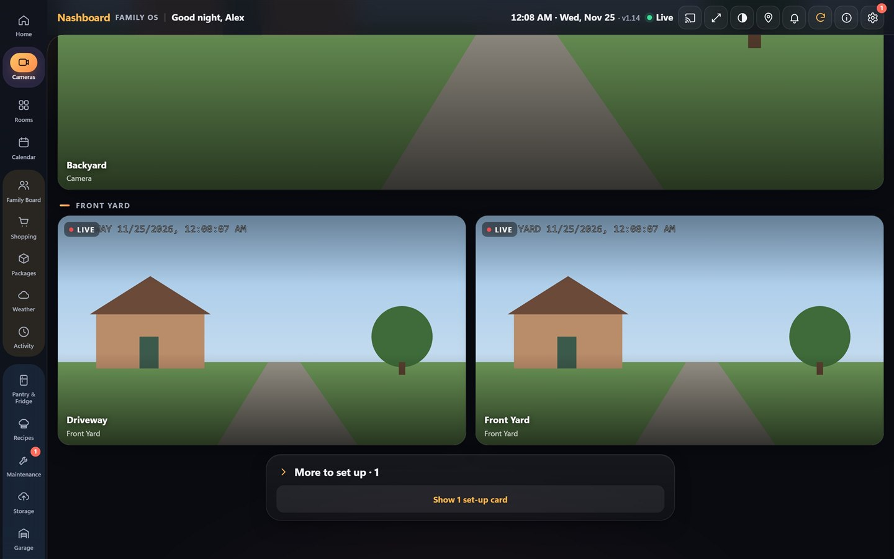

Cards that are still waiting to be set up no longer crowd the top of a page. They fold into one More to set up card at the very end, with a count. Tap it to show them; every page opens on its main thing first.

<a href="#s-cameras">&larr; Cameras</a><a class="nx" href="#s-calendar">Calendar &rarr;</a>

</section>

<section class="tour-step" id="s-calendar">

Step 7 of 41

<h2>Calendar</h2>
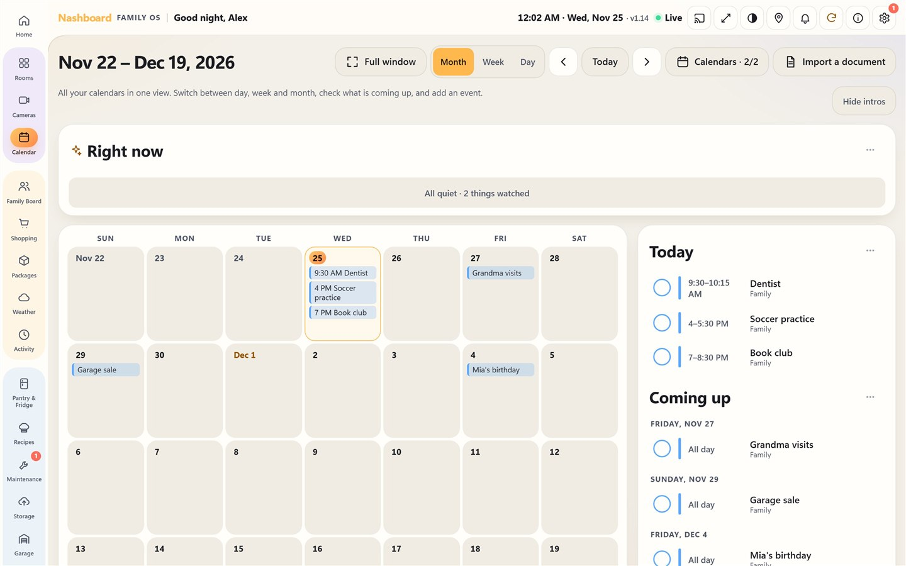

One agenda for the whole family, merged from every calendar you connect. Events, birthdays and school days sit side by side.

<a href="#s-moresetup">&larr; More to set up</a><a class="nx" href="#s-family">Family Board &rarr;</a>

</section>

<section class="tour-step" id="s-family">

Step 8 of 41

<h2>Family Board</h2>
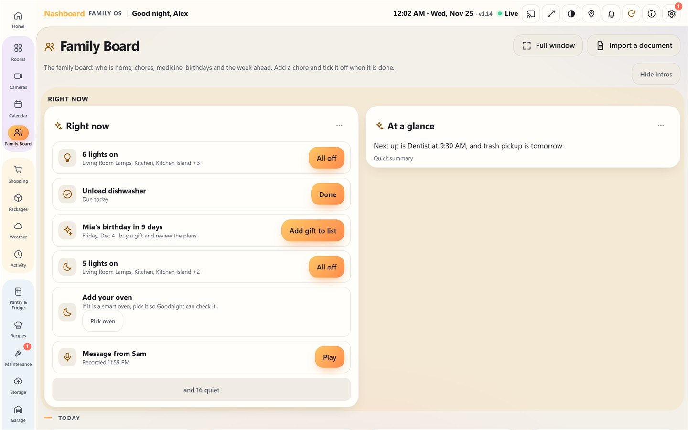

Who is home, chores, medicine reminders, birthdays and trash night. A shared board everyone can glance at.

<a href="#s-calendar">&larr; Calendar</a><a class="nx" href="#s-kids">Kids &rarr;</a>

</section>

<section class="tour-step" id="s-kids">

Step 9 of 41

<h2>Kids</h2>
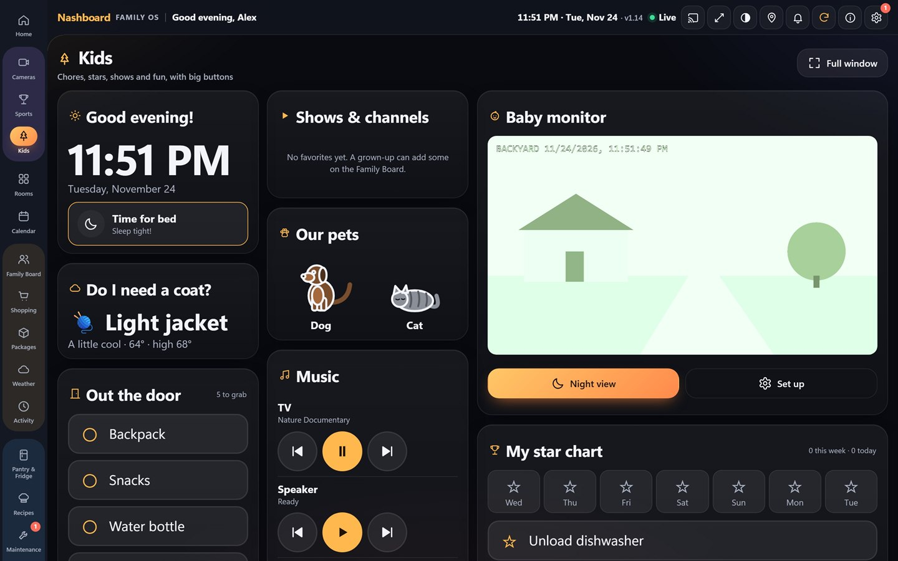

A page just for the children: schedules, routines and the things each child needs for the day. A grown-up can also set up a baby monitor card from any camera.

<a href="#s-family">&larr; Family Board</a><a class="nx" href="#s-pets">Pets &rarr;</a>

</section>

<section class="tour-step" id="s-pets">

Step 10 of 41

<h2>Pets</h2>
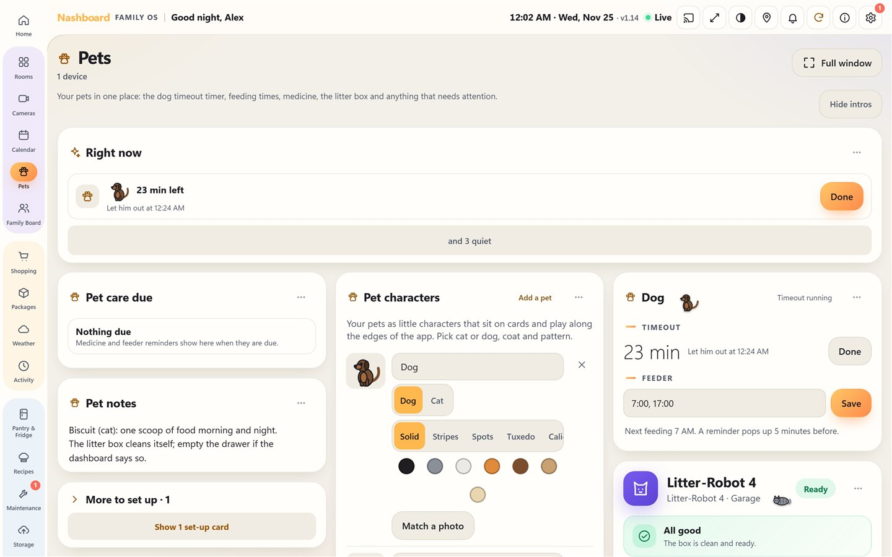

Playful pet characters, timeout, the feeder and pet devices. The animated pets mostly live here.

<a href="#s-kids">&larr; Kids</a><a class="nx" href="#s-pantry">Pantry and Fridge &rarr;</a>

</section>

<section class="tour-step" id="s-pantry">

Step 11 of 41

<h2>Pantry and Fridge</h2>
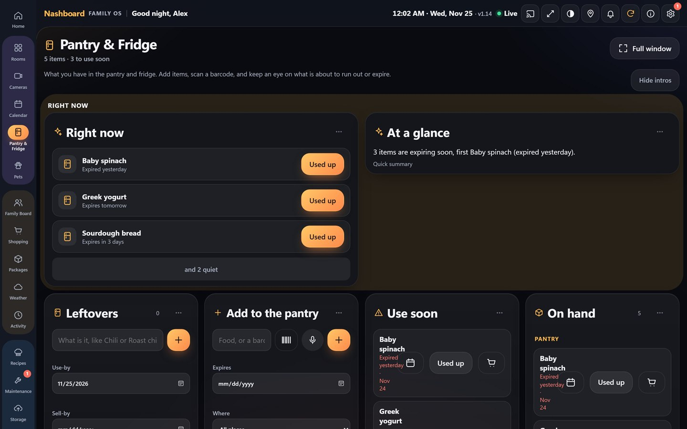

What is in the pantry, fridge and freezer and what expires soon, so food gets used in time.

<a href="#s-pets">&larr; Pets</a><a class="nx" href="#s-storage">Storage &rarr;</a>

</section>

<section class="tour-step" id="s-storage">

Step 12 of 41

<h2>Storage</h2>
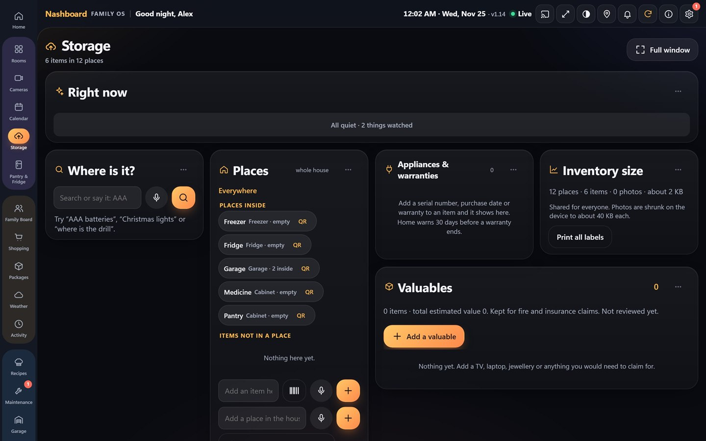

Boxes and shelves with labels and counts, so you can find things and spot what is running low.

<a href="#s-pantry">&larr; Pantry and Fridge</a><a class="nx" href="#s-garage">Garage &rarr;</a>

</section>

<section class="tour-step" id="s-garage">

Step 13 of 41

<h2>Garage</h2>
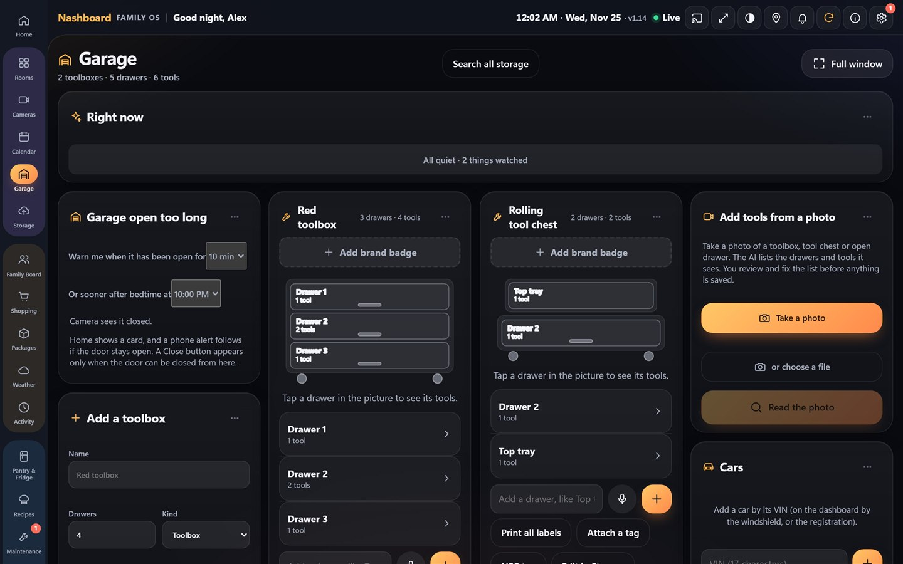

Doors, tools and what lives in the garage. Anything physical asks for confirmation first.

<a href="#s-storage">&larr; Storage</a><a class="nx" href="#s-weather">Weather &rarr;</a>

</section>

<section class="tour-step" id="s-weather">

Step 14 of 41

<h2>Weather</h2>
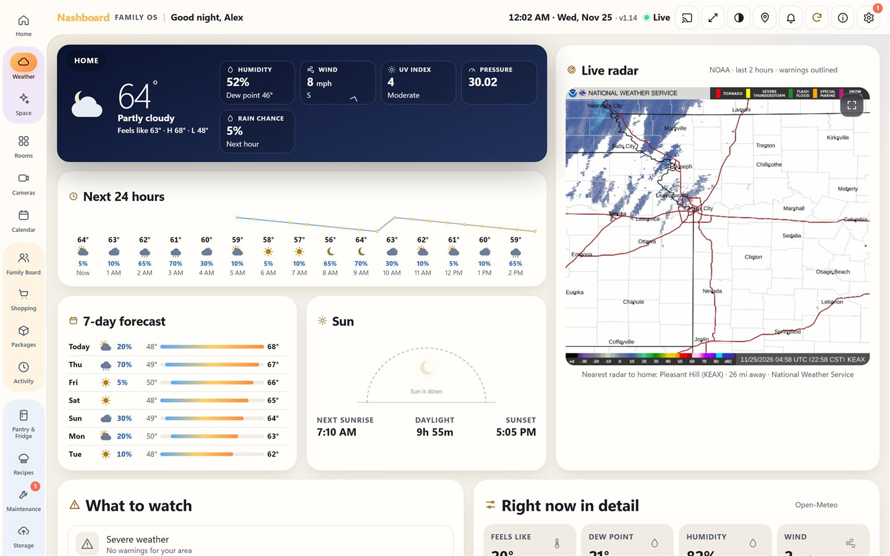

Forecast, live radar and alerts. Rain coming and freeze tonight show here first and on Home only when they matter.

<a href="#s-garage">&larr; Garage</a><a class="nx" href="#s-air">Air and Allergy &rarr;</a>

</section>

<section class="tour-step" id="s-air">

Step 15 of 41

<h2>Air and Allergy</h2>
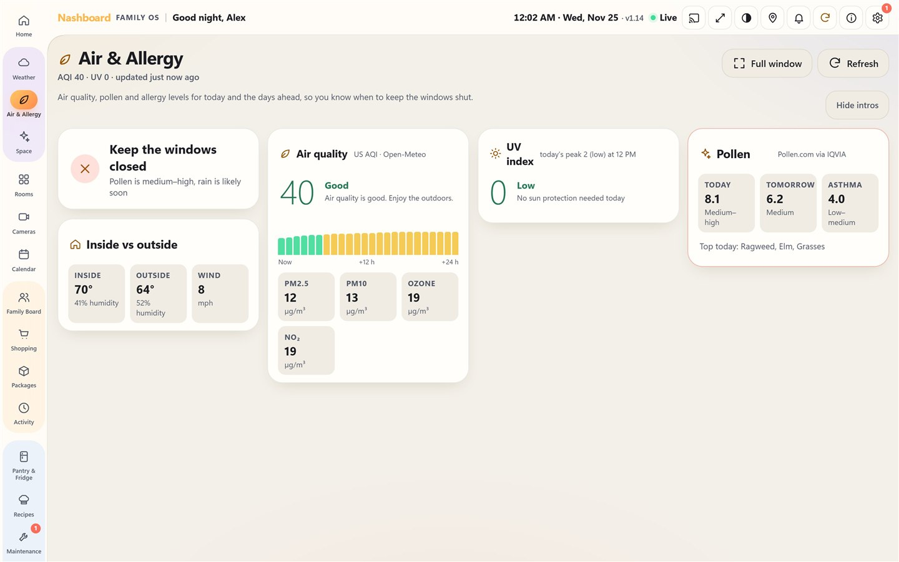

Air quality and pollen at a glance, with a plain-language note on what it means today.

<a href="#s-weather">&larr; Weather</a><a class="nx" href="#s-planes">Planes &rarr;</a>

</section>

<section class="tour-step" id="s-planes">

Step 16 of 41

<h2>Planes</h2>
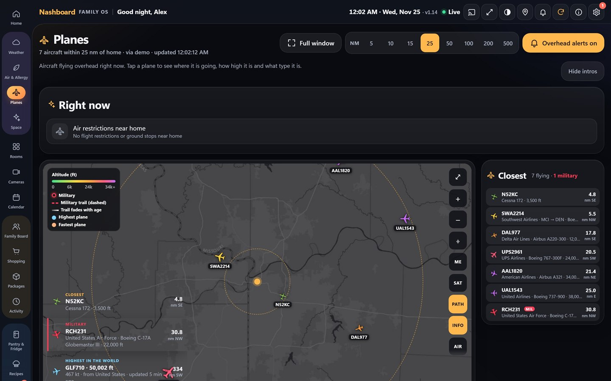

Aircraft overhead on a live map, with airline, model and route for each one. Home shows a card when one is close.

<a href="#s-air">&larr; Air and Allergy</a><a class="nx" href="#s-map">Map &rarr;</a>

</section>

<section class="tour-step" id="s-map">

Step 17 of 41

<h2>Map</h2>
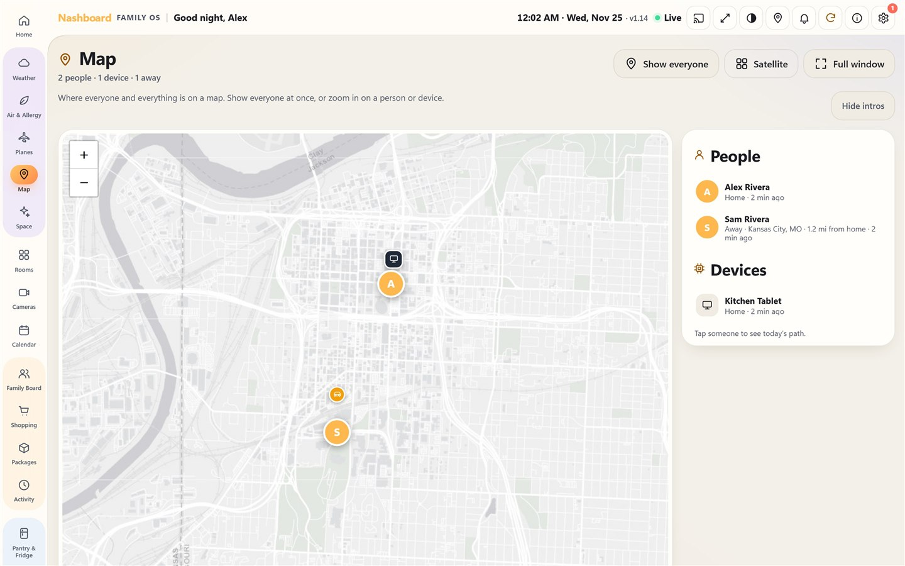

People and devices on one map, using this device's own location first.

<a href="#s-planes">&larr; Planes</a><a class="nx" href="#s-space">Space &rarr;</a>

</section>

<section class="tour-step" id="s-space">

Step 18 of 41

<h2>Space</h2>
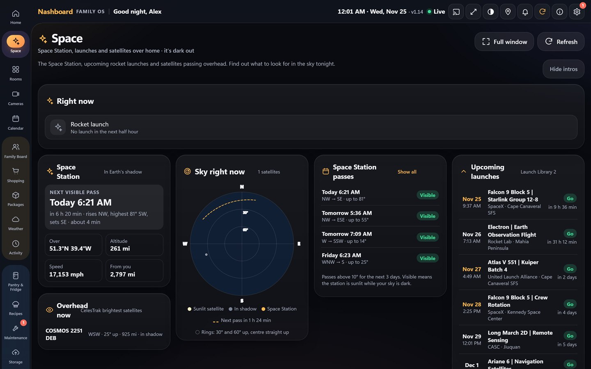

The Space Station, upcoming launches and visible satellite passes for your location.

<a href="#s-map">&larr; Map</a><a class="nx" href="#s-commute">Commute &rarr;</a>

</section>

<section class="tour-step" id="s-commute">

Step 19 of 41

<h2>Commute</h2>
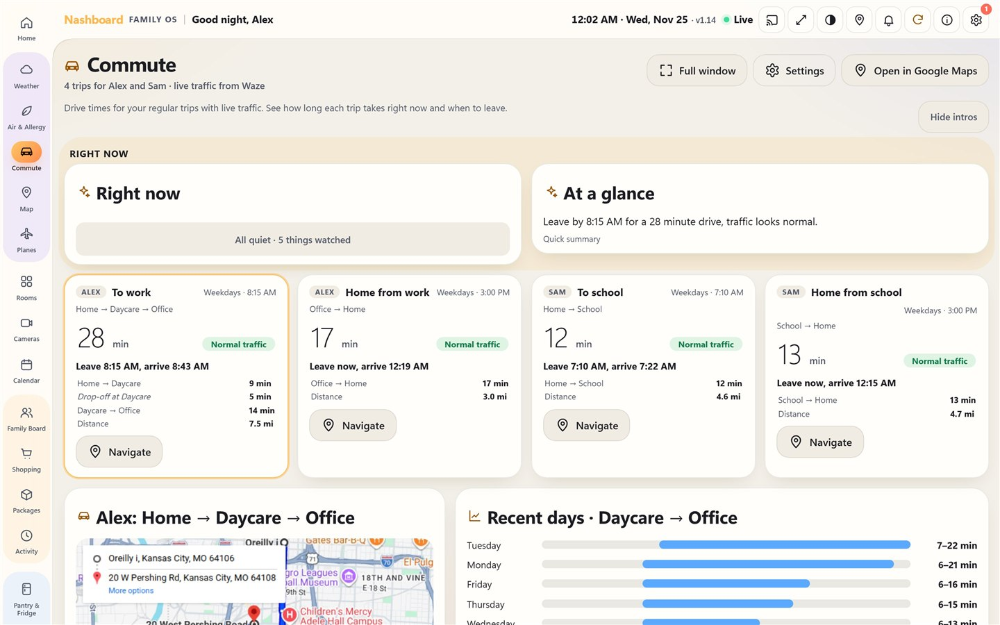

Trips, live drive times and a leave-soon prompt that tells you when to head out.

<a href="#s-space">&larr; Space</a><a class="nx" href="#s-sports">Sports &rarr;</a>

</section>

<section class="tour-step" id="s-sports">

Step 20 of 41

<h2>Sports</h2>
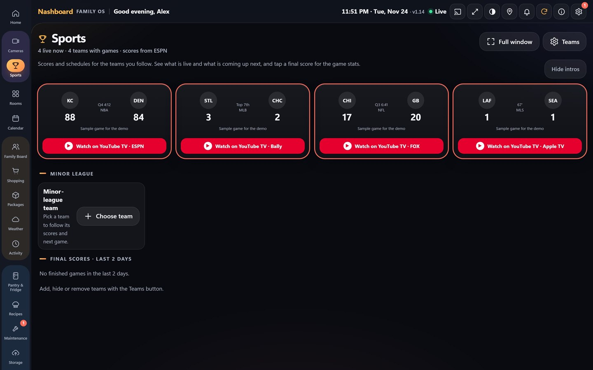

Scores, schedules and replays for your teams, with live games promoted to Home.

<a href="#s-commute">&larr; Commute</a><a class="nx" href="#s-packages">Packages &rarr;</a>

</section>

<section class="tour-step" id="s-packages">

Step 21 of 41

<h2>Packages</h2>
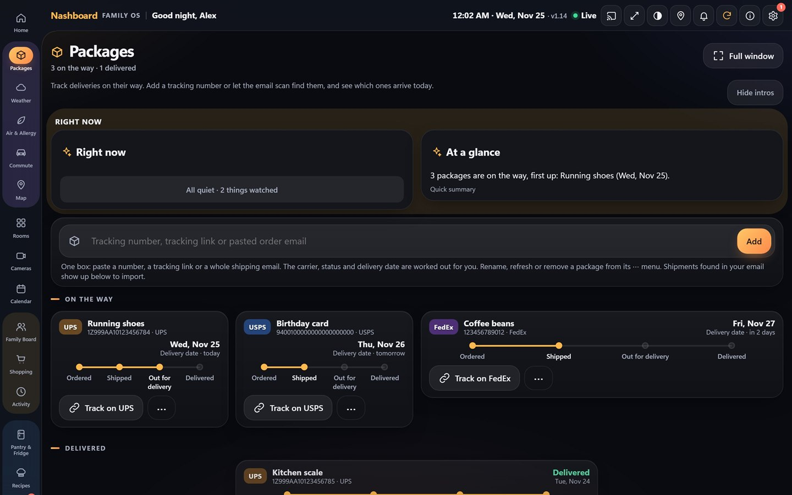

Tracking and autoships in one list, with an alert if a package is left outside.

<a href="#s-sports">&larr; Sports</a><a class="nx" href="#s-shopping">Shopping &rarr;</a>

</section>

<section class="tour-step" id="s-shopping">

Step 22 of 41

<h2>Shopping</h2>
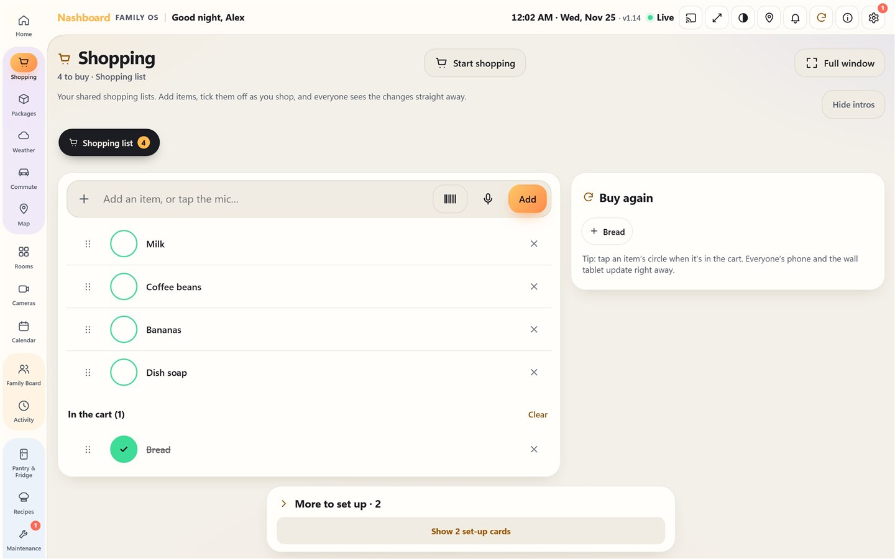

A shared shopping list you can fill by voice. Everyone sees additions at once.

<a href="#s-packages">&larr; Packages</a><a class="nx" href="#s-recipes">Recipes &rarr;</a>

</section>

<section class="tour-step" id="s-recipes">

Step 23 of 41

<h2>Recipes</h2>
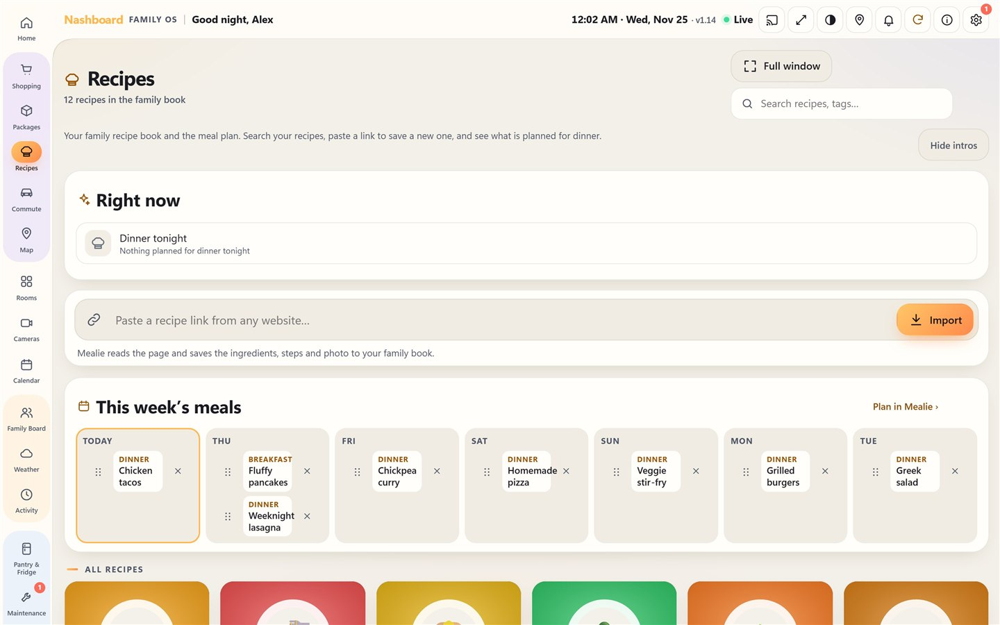

The meal plan and a recipe box with a hands-free cook mode.

<a href="#s-shopping">&larr; Shopping</a><a class="nx" href="#s-music">Music &rarr;</a>

</section>

<section class="tour-step" id="s-music">

Step 24 of 41

<h2>Music</h2>
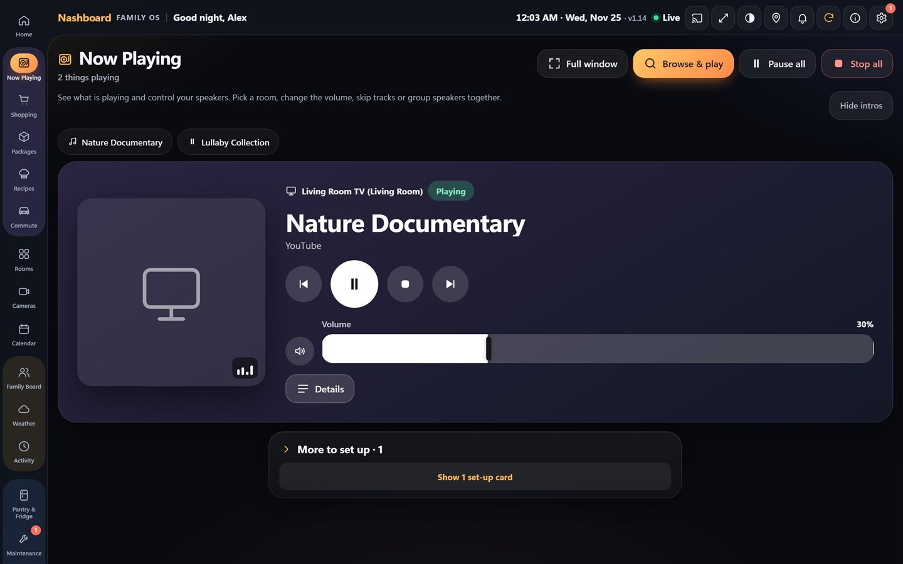

What is playing in each room, with browse and play controls.

<a href="#s-recipes">&larr; Recipes</a><a class="nx" href="#s-finance">Finance &rarr;</a>

</section>

<section class="tour-step" id="s-finance">

Step 25 of 41

<h2>Finance</h2>
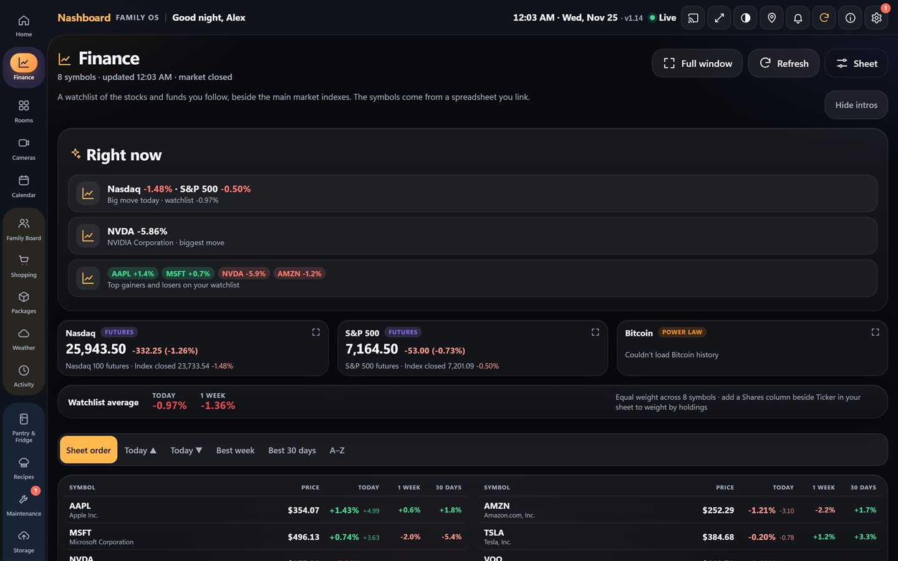

Markets and a watchlist with live quotes.

<a href="#s-music">&larr; Music</a><a class="nx" href="#s-network">Network &rarr;</a>

</section>

<section class="tour-step" id="s-network">

Step 26 of 41

<h2>Network</h2>
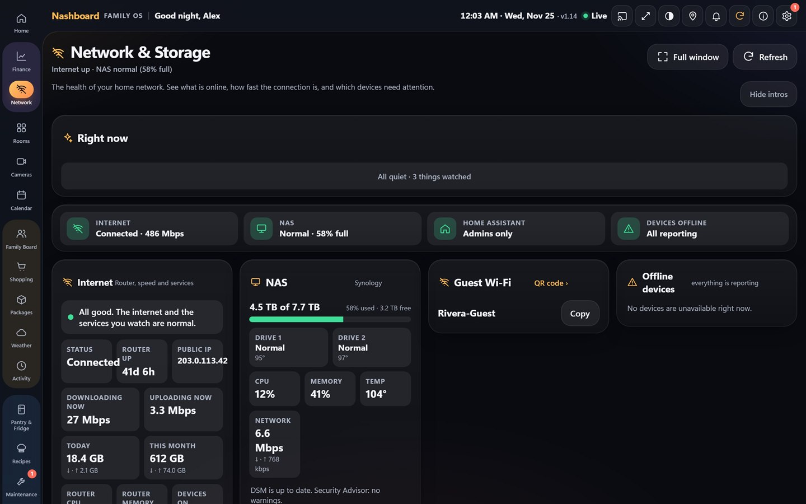

Wi-Fi devices, internet speed and the services that keep the house online.

<a href="#s-finance">&larr; Finance</a><a class="nx" href="#s-maint">Maintenance &rarr;</a>

</section>

<section class="tour-step" id="s-maint">

Step 27 of 41

<h2>Maintenance</h2>
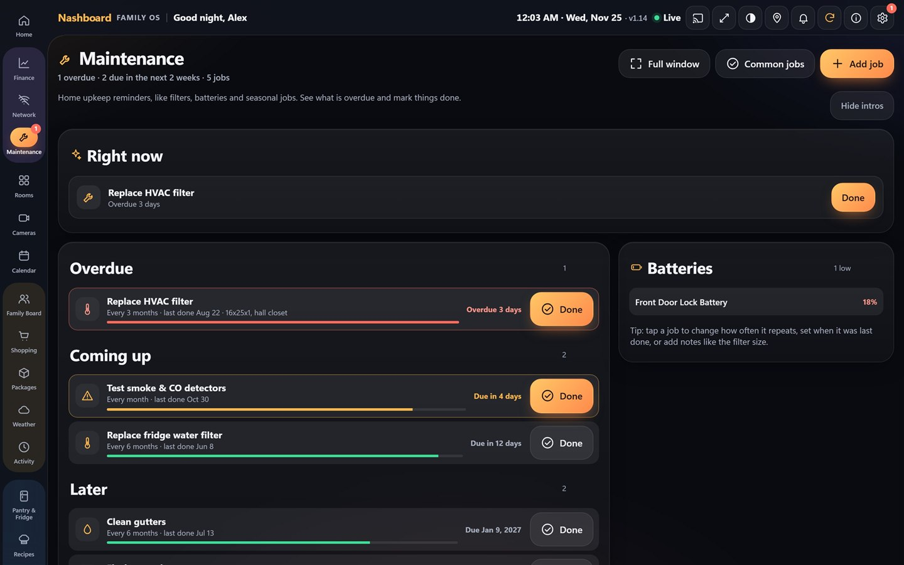

A schedule of home upkeep, from filters to smoke alarms, with reminders when something is due.

<a href="#s-network">&larr; Network</a><a class="nx" href="#s-security">Security log &rarr;</a>

</section>

<section class="tour-step" id="s-security">

Step 28 of 41

<h2>Security log</h2>
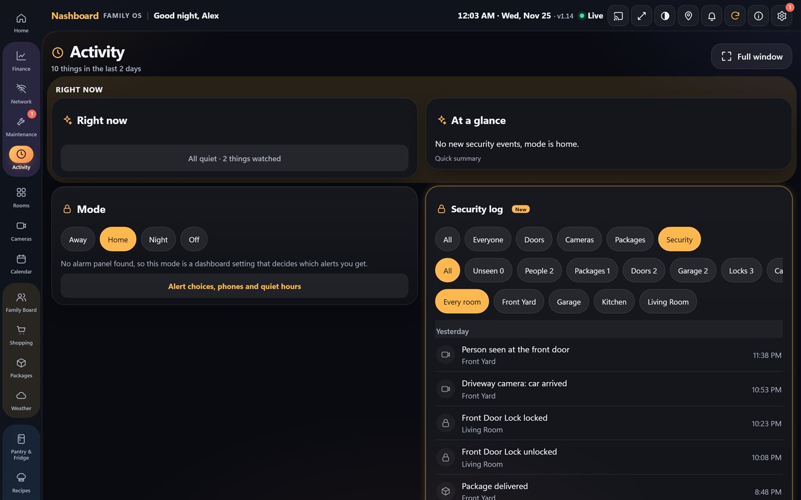

Security now lives on the Activity page: pick its Security chip. Alerts for doors, locks, garage, alarms, smoke, leaks, packages and cameras, kept in a log until someone has seen them. Pick a mode (Away, Home, Night, Off) that decides which alerts matter, and keep the fire-safety escape plan close by.

<a href="#s-maint">&larr; Maintenance</a><a class="nx" href="#s-guest">Guest &rarr;</a>

</section>

<section class="tour-step" id="s-guest">

Step 29 of 41

<h2>Guest</h2>
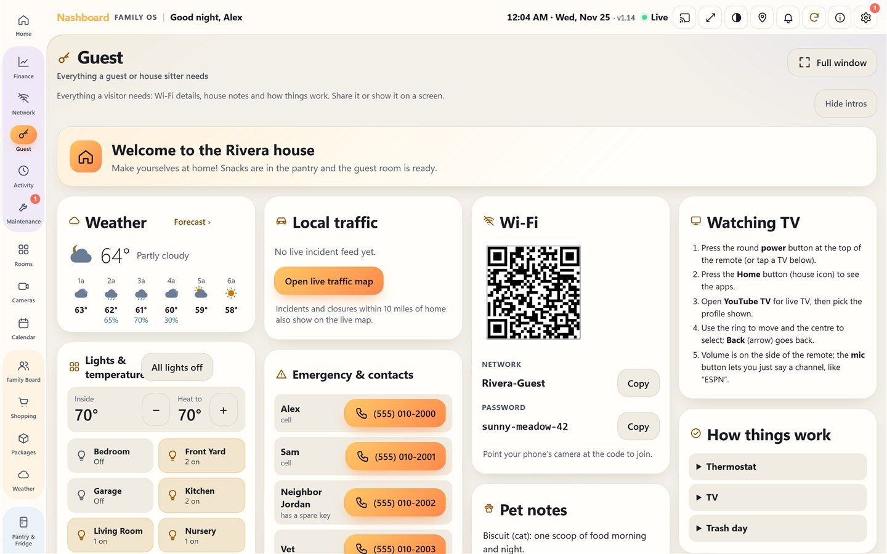

Wi-Fi details, contacts and how-tos for visitors, ready to show or print.

<a href="#s-security">&larr; Security log</a><a class="nx" href="#s-hobbies">Hobbies &rarr;</a>

</section>

<section class="tour-step" id="s-hobbies">

Step 30 of 41

<h2>Hobbies</h2>
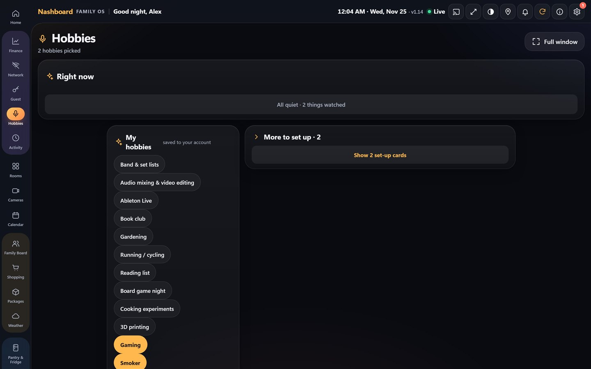

Pick your hobbies and get shared preset cards, with a Home card when something is due.

<a href="#s-guest">&larr; Guest</a><a class="nx" href="#s-wellbeing">Wellbeing &rarr;</a>

</section>

<section class="tour-step" id="s-wellbeing">

Step 31 of 41

<h2>Wellbeing</h2>
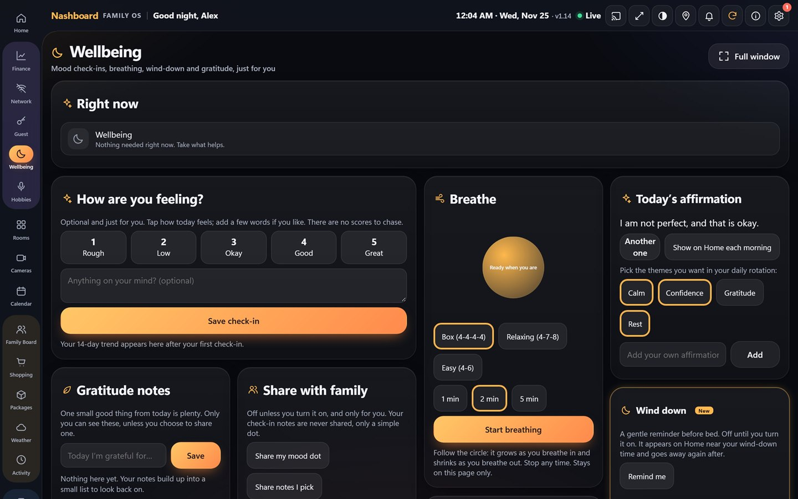

A private page for mood check-ins, guided breathing, a daily affirmation, gratitude notes and a gentle wind-down reminder. Nothing is shared unless you choose to share it.

<a href="#s-hobbies">&larr; Hobbies</a><a class="nx" href="#s-workout">Workout &rarr;</a>

</section>

<section class="tour-step" id="s-workout">

Step 32 of 41

<h2>Workout</h2>
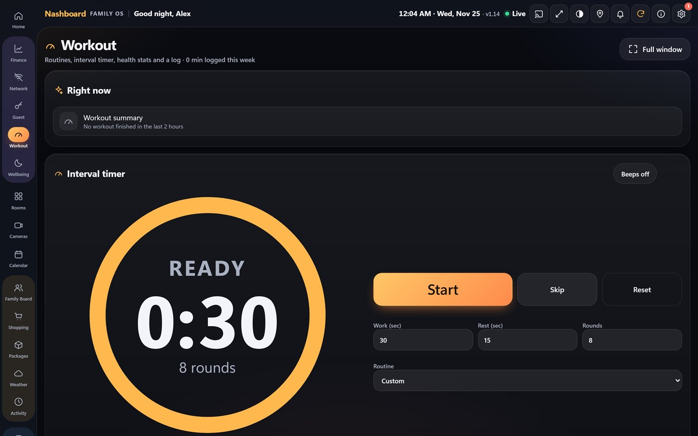

Workout plans and progress for the household.

<a href="#s-wellbeing">&larr; Wellbeing</a><a class="nx" href="#s-activity">Activity &rarr;</a>

</section>

<section class="tour-step" id="s-activity">

Step 33 of 41

<h2>Activity</h2>
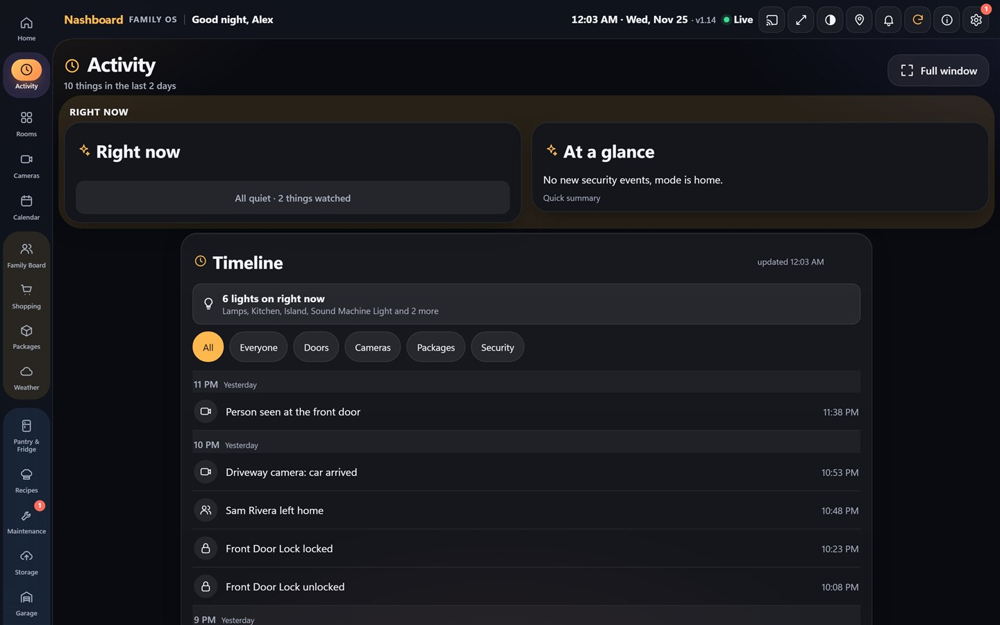

A timeline of what happened around the house today.

<a href="#s-workout">&larr; Workout</a><a class="nx" href="#s-automations">Automations &rarr;</a>

</section>

<section class="tour-step" id="s-automations">

Step 34 of 41

<h2>Automations</h2>
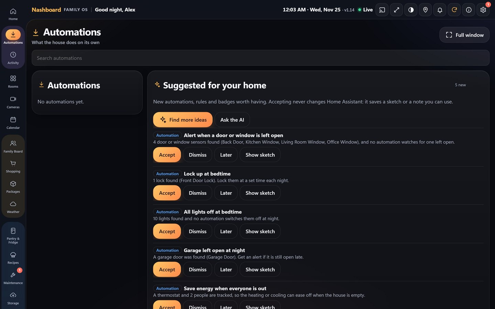

Everything the house does on its own, what triggers each one and how to turn it off.

<a href="#s-activity">&larr; Activity</a><a class="nx" href="#s-printer">3D Printer &rarr;</a>

</section>

<section class="tour-step" id="s-printer">

Step 35 of 41

<h2>3D Printer</h2>
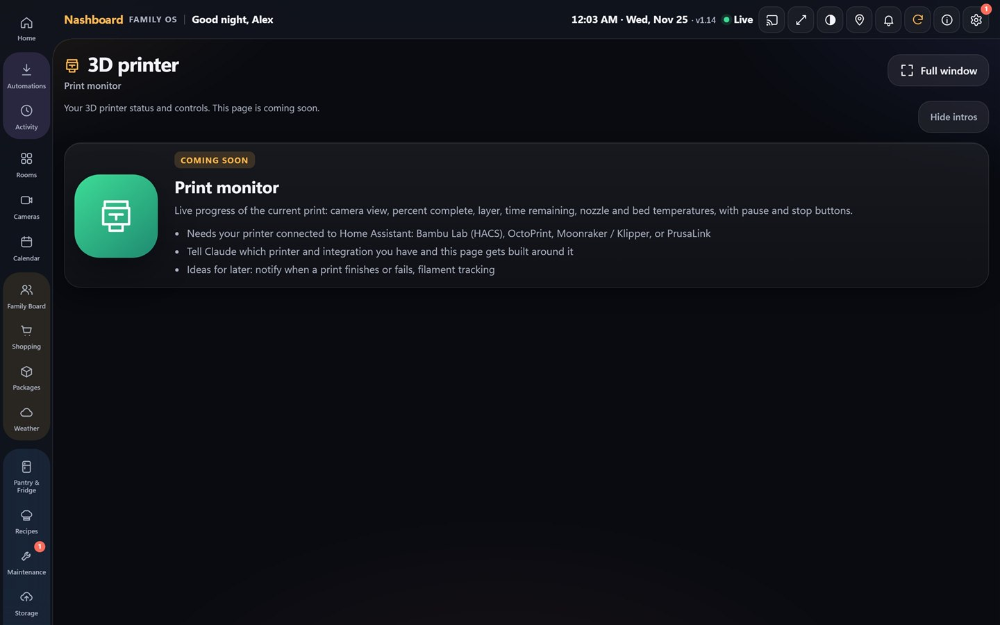

Live status for the 3D printer: progress, temperatures and time left.

<a href="#s-automations">&larr; Automations</a><a class="nx" href="#s-multi">Multi-view &rarr;</a>

</section>

<section class="tour-step" id="s-multi">

Step 36 of 41

<h2>Multi-view</h2>
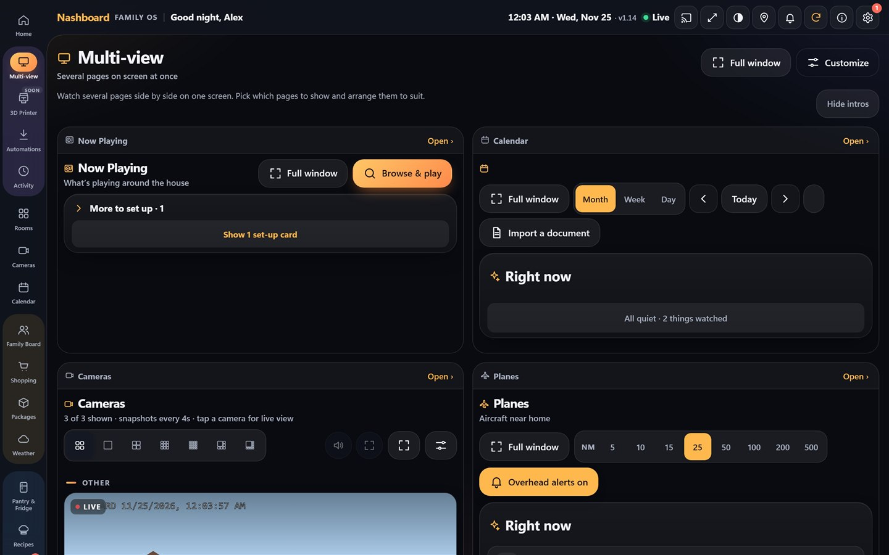

Several pages side by side in one window, made for a big screen.

<a href="#s-printer">&larr; 3D Printer</a><a class="nx" href="#s-display">Display and TV &rarr;</a>

</section>

<section class="tour-step" id="s-display">

Step 37 of 41

<h2>Display and TV</h2>
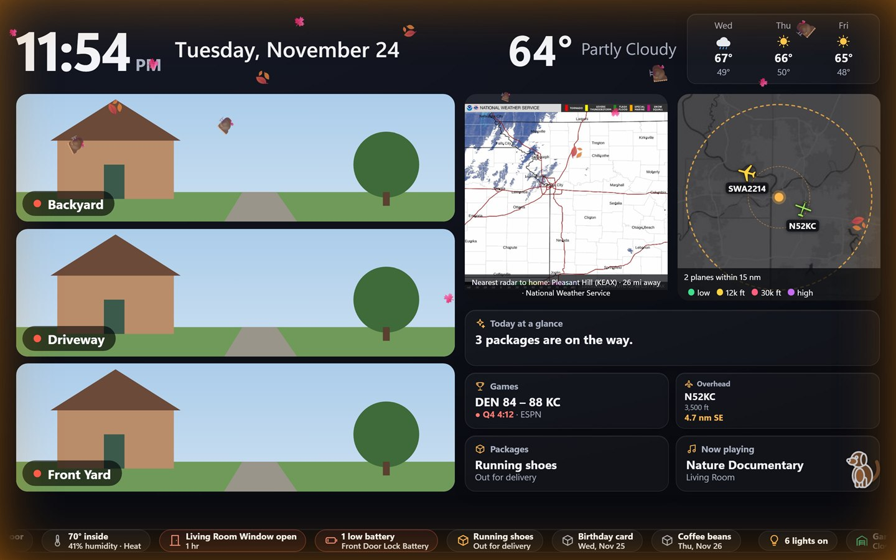

Kiosk and TV settings: what rotates on the screen and how big it is. The TV view shows the plane map beside the radar, and tapping the games card opens a live stats window.

<a href="#s-multi">&larr; Multi-view</a><a class="nx" href="#s-backlog">Design Studio &rarr;</a>

</section>

<section class="tour-step" id="s-backlog">

Step 38 of 41

<h2>Design Studio</h2>
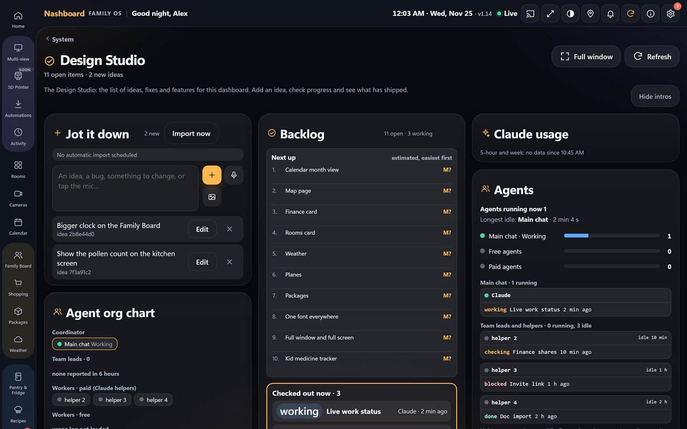

Where ideas, bugs and the build plan live. Jot something down and it is filed into the plan.

<a href="#s-display">&larr; Display and TV</a><a class="nx" href="#s-system">System &rarr;</a>

</section>

<section class="tour-step" id="s-system">

Step 39 of 41

<h2>System</h2>
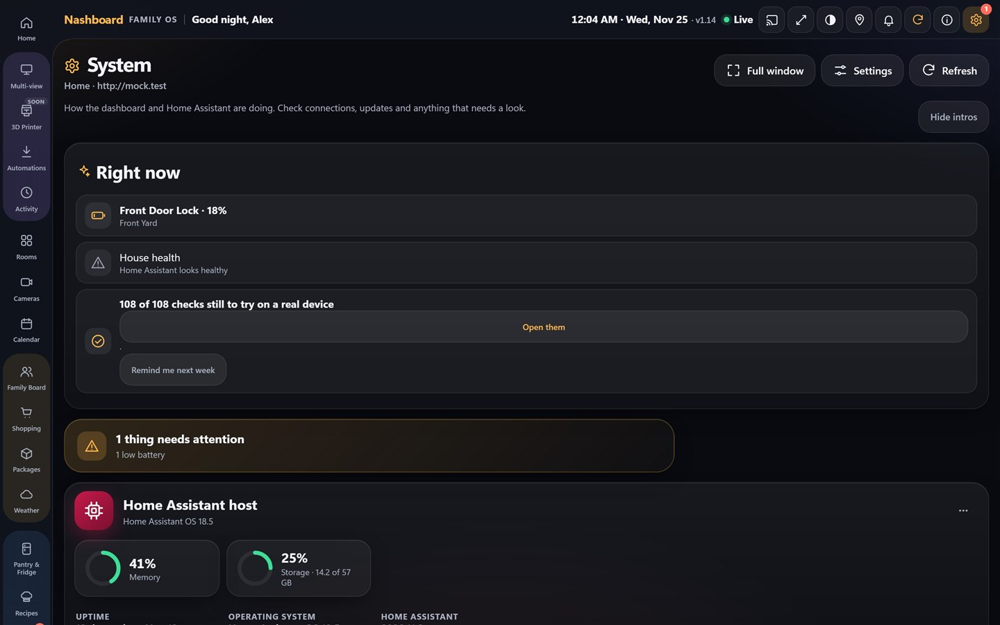

Updates, batteries and settings, plus every hidden card with a button to show it again.

<a href="#s-backlog">&larr; Design Studio</a><a class="nx" href="#s-settings">Settings &rarr;</a>

</section>

<section class="tour-step" id="s-settings">

Step 40 of 41

<h2>Settings</h2>
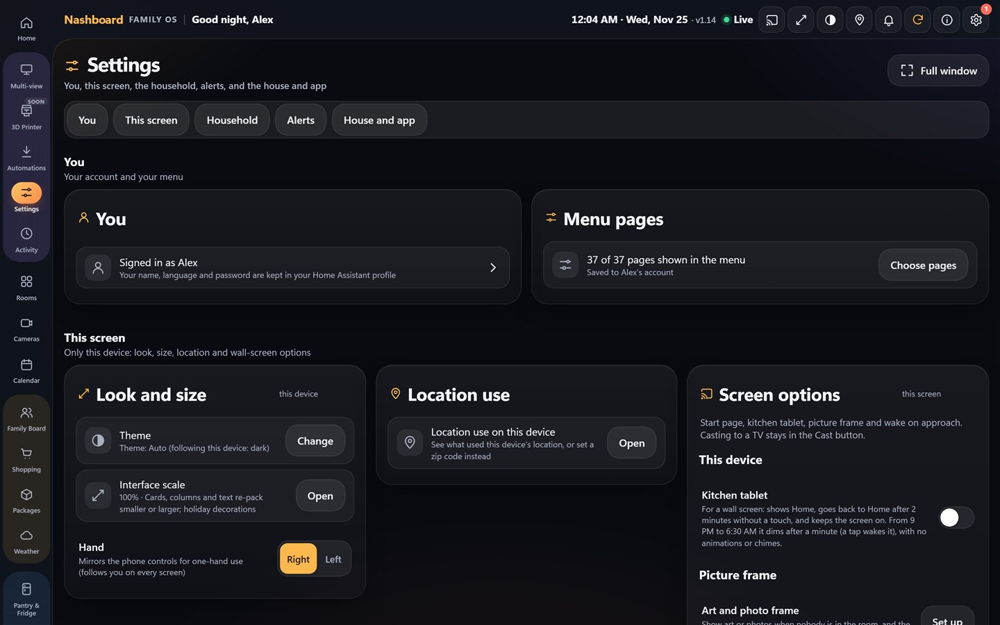

Your own settings in one place: theme and size, alerts and notifications, which pages appear in the menu, location use, and a way into System for the house and the app.

<a href="#s-system">&larr; System</a><a class="nx" href="#s-about">About &rarr;</a>

</section>

<section class="tour-step" id="s-about">

Step 41 of 41

<h2>About</h2>
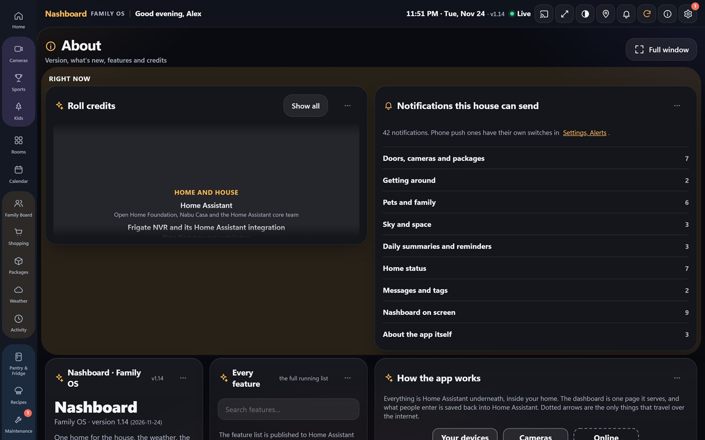

What Nashboard is, the version, and a short tour of what is new.

<a href="#s-settings">&larr; Settings</a><a class="nx" href="#top">Back to the top</a>

</section>

That is the whole app. For the full list of what each page can do, see [Every feature](features.md), and for everyday habits see [Living with Nashboard](living-with-nashboard.md).
